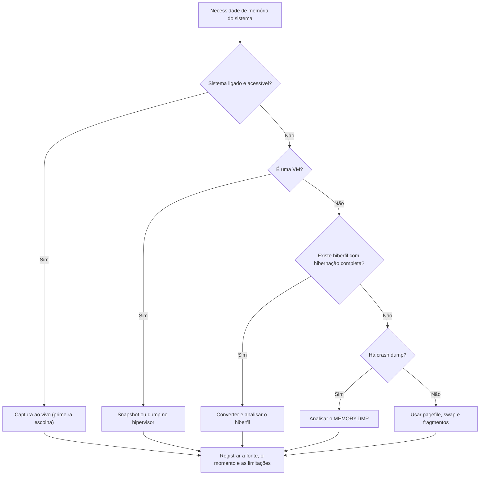

# Memória de VMs, Hibernação e Crash Dumps

> **Objetivo pedagógico:** aproveitar fontes de memória que não vêm de uma captura ao vivo (hibernação, arquivos de paginação, crash dumps, memória de máquinas virtuais e dumps de processos), conhecendo o conteúdo, os formatos, as conversões e as limitações de cada uma.

## 1. Visão geral das fontes

| Fonte | Conteúdo | Ferramentas | Limitações |
|---|---|---|---|
| `hiberfil.sys` | Memória no momento da hibernação | Conversores (por exemplo, `hibr2bin` do Comae Toolkit) e análise com Volatility | Com Fast Startup, guarda apenas parte do sistema (sessão do kernel) |
| `pagefile.sys` e `swapfile.sys` | Páginas de memória trocadas para o disco | Strings, YARA, carving | Fragmentos, sem estrutura completa |
| Crash dump (`MEMORY.DMP`) | Memória no momento de uma falha do sistema | WinDbg, Volatility 3 | Depende do tipo (completo, kernel ou pequeno) |
| Memória de VM (`.vmem`, `.vmss`, `.vmsn`, Hyper-V, VirtualBox, KVM) | Memória do convidado | Volatility 3 e ferramentas do hipervisor | Requer arquivos auxiliares e consistência do snapshot |
| Dump de processo | Memória de um único processo | `procdump`, `gcore`, Process Hacker, WinDbg | Contexto limitado |
| Memória em nuvem | Instâncias e contêineres | Agente de captura, snapshots de disco | Disponibilidade limitada |

## 2. Hibernação e Fast Startup

| Aspecto | Observação |
|---|---|
| Hibernação completa | O arquivo contém a memória do sistema e das sessões de usuário, incluindo processos e dados abertos |
| Fast Startup (inicialização rápida, padrão em muitas instalações) | Hiberna apenas a sessão do kernel; o conteúdo do usuário não é preservado |
| Localização | `C:\hiberfil.sys` (arquivo oculto de sistema) |
| Formato | Comprimido; exige conversão antes da análise |
| Valor | Estado do sistema no momento da hibernação, o que pode revelar processos e conexões que já não existem na memória atual |

```powershell
# Verificar se a hibernação está habilitada e como o sistema desliga
powercfg /a
reg query "HKLM\SYSTEM\CurrentControlSet\Control\Session Manager\Power" /v HiberbootEnabled
```

A análise de `hiberfil.sys` exige a coleta de imagem de disco ou a cópia por ferramenta de baixo nível, pois o arquivo está bloqueado no sistema ao vivo.

## 3. Arquivos de paginação

```bash
# Strings do pagefile (ASCII e UTF-16)
strings -a -td pagefile.sys > pf_ascii.txt
strings -a -el -td pagefile.sys > pf_unicode.txt
grep -i -E "https?://|password|BEGIN (RSA|OPENSSH)" pf_ascii.txt pf_unicode.txt | head -200

# Varredura YARA
yara -r regras.yar pagefile.sys
```

Os arquivos de paginação podem conter fragmentos de documentos, URLs, comandos e credenciais. Ao relatar, indique que se trata de fragmentos sem contexto garantido de processo e de horário.

## 4. Crash dumps do Windows

| Tipo | Conteúdo |
|---|---|
| Completo | Toda a memória física |
| Kernel | Memória do kernel e dos drivers |
| Pequeno (minidump) | Pilha, módulos e informações limitadas |
| Automático e ativo | Variantes configuradas pelo sistema |

Localização padrão: `C:\Windows\MEMORY.DMP` e `C:\Windows\Minidump\`. Verifique a configuração em `HKLM\SYSTEM\CurrentControlSet\Control\CrashControl`.

| Uso | Ferramenta |
|---|---|
| Causa da falha | WinDbg (`!analyze -v`), útil para investigar exploração de vulnerabilidades e drivers |
| Análise forense completa | Volatility 3, que reconhece o formato de dump completo |
| Identificação de módulos e drivers | Lista de módulos carregados no momento da falha |

Falhas inexplicáveis de sistema ou de drivers podem ser sinal de exploração ou de rootkits; preserve os dumps.

## 5. Máquinas virtuais

| Plataforma | Arquivos | Como obter a memória |
|---|---|---|
| VMware | `.vmem` (memória), `.vmss` e `.vmsn` (estado e snapshot) | Suspender a VM ou criar snapshot com memória; copiar `.vmem` e o arquivo de estado correspondente |
| Hyper-V | `.VMRS` e `.bin` | Snapshot (checkpoint) com memória; ferramentas de conversão |
| VirtualBox | Núcleo da VM | `VBoxManage debugvm <vm> dumpvmcore --filename vm.elf` |
| KVM e QEMU | Dump da memória do convidado | `virsh dump <domínio> arquivo --memory-only --format elf` |
| Nuvem | Sem acesso direto à memória do hipervisor | Captura dentro da instância ou snapshot de disco |

Vantagens: a captura pelo hipervisor não executa código dentro do convidado e reduz o risco de interferência. Registre o hipervisor, a versão e o horário, e calcule o hash dos arquivos.

```bash
# Exemplo KVM
virsh dump meudominio /mnt/evidencias/DFL-2026-001-E004-MEM01.elf --memory-only --format elf
sha256sum /mnt/evidencias/DFL-2026-001-E004-MEM01.elf

# Análise com Volatility 3
vol -f /mnt/evidencias/DFL-2026-001-E004-MEM01.elf windows.info.Info
```

## 6. Dumps de processos

| Ferramenta | Uso |
|---|---|
| `procdump -ma <pid>` (Sysinternals) | Dump completo de um processo no Windows |
| Process Hacker e Process Explorer | Dumps e inspeção de memória |
| WinDbg | Análise de dumps de processos |
| `gcore <pid>` (Linux) | Core dump do processo |
| `/proc/<pid>/mem` e `/proc/<pid>/maps` | Leitura direta da memória do processo ao vivo |

Os dumps de processos são úteis quando a captura de toda a RAM não é possível ou quando se quer isolar o conteúdo de um programa. Registre o horário, o PID, o usuário e o hash.

## 7. Escolha da fonte de memória



## 8. Exemplo prático: VM encerrada com snapshot

| Etapa | Ação |
|---|---|
| 1 | Servidor virtual VMware com suspeita de comprometimento é suspenso pela equipe de TI |
| 2 | A equipe forense copia `.vmem` e `.vmss` com o disco virtual, calcula o hash e registra a custódia |
| 3 | O Volatility 3 identifica o sistema (`windows.info.Info`) |
| 4 | `pstree`, `netscan` e `malfind` identificam o processo injetado e a conexão |
| 5 | A memória do snapshot é comparada com um estado anterior (outro snapshot) para delimitar o momento do comprometimento |
| Conclusão | O snapshot preservou a memória do momento da suspensão; a comparação entre snapshots delimitou a janela do incidente; confiança alta |

## 9. Casos de uso corporativos

- Investigação de VMs desligadas ou migradas antes da coleta.
- Análise de crash dumps em sistemas com falhas suspeitas.
- Aproveitamento de arquivos de hibernação de notebooks apreendidos.

## 10. Normas e frameworks relevantes

- RFC 3227; ISO/IEC 27037:2012; NIST SP 800-86
- NIST IR 8387 (preservação de evidência digital)
- MITRE ATT&CK: T1055, T1003, T1014
- ISO/IEC 27002:2022, controle 5.28

## 11. Referências

- Ligh, M. et al. The Art of Memory Forensics. Wiley, 2014.
- Russinovich, M. et al. Windows Internals. 7. ed. 2017.
- Microsoft Learn. Documentação de arquivos de despejo e de WinDbg.
- VMware. Documentação de arquivos de VM; libvirt (virsh dump); Oracle VirtualBox (debugvm).
- Documentação do Volatility 3 e do Comae Toolkit.
- Sysinternals. ProcDump.
