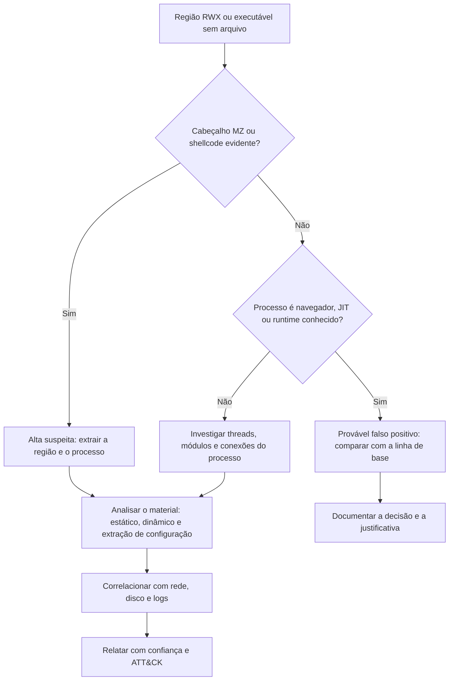

# Malware, Injeção e Rootkits em Memória

> **Objetivo pedagógico:** detectar e analisar injeção de código, malware sem arquivo, interceptações (hooks) e rootkits por meio da memória, interpretando corretamente os indícios, tratando falsos positivos e extraindo material para a análise de malware.

## 1. Técnicas de injeção e execução em memória

| Técnica | ATT&CK | Descrição |
|---|---|---|
| Injeção de DLL | T1055.001 | Força um processo a carregar uma DLL controlada pelo atacante |
| Injeção de PE | T1055.002 | Grava um executável inteiro na memória de outro processo |
| Sequestro de thread | T1055.003 | Altera o contexto de uma thread existente para executar código |
| APC (fila de chamadas assíncronas) | T1055.004 | Enfileira código para execução em uma thread |
| Process hollowing | T1055.012 | Cria um processo legítimo suspenso, esvazia sua imagem e a substitui por código malicioso |
| Process doppelgänging e variantes | T1055.013 | Usa transações do sistema de arquivos para executar código sem arquivo legítimo correspondente |
| Ptrace em Linux | T1055.008 | Injeta código em processos por `ptrace` |
| Carregamento reflexivo | T1620 | Carrega código diretamente na memória, sem usar o carregador do sistema |
| Execução sem arquivo (PowerShell, .NET em memória) | T1059.001 | Scripts e assemblies executados somente em memória |

## 2. Indícios de injeção e de execução sem arquivo

| Indício | Onde observar | Interpretação |
|---|---|---|
| Região de memória privada com permissão de execução e escrita (RWX) | `malfind`, `vadinfo` | Código dinâmico; típico de injeção |
| Cabeçalho `MZ` (executável) em região sem arquivo mapeado | `malfind` | PE injetado ou carregamento reflexivo |
| Processo sem a imagem mapeada correspondente (VAD do módulo principal ausente ou divergente) | `vadinfo`, `dlllist` | Process hollowing |
| Imagem base do processo diferente da do arquivo em disco | Comparação com o executável | Hollowing |
| Threads iniciadas fora de módulos conhecidos | Análise de threads | Código injetado |
| Processos legítimos fazendo conexões de rede incomuns | `netscan` | Uso de processo hospedeiro |
| Strings de configuração (domínios, chaves, comandos) em regiões anônimas | Strings e YARA | Configuração de beacon ou de implante |
| `memfd` ou binário `(deleted)` em Linux | `/proc`, `linux.proc.Maps` | Execução sem arquivo |

### 2.1 Falsos positivos do malfind

Programas legítimos com compilação sob demanda (JIT) criam regiões RWX ou RX com código gerado: navegadores, máquinas virtuais Java e .NET, runtimes de JavaScript e ferramentas de segurança. Reduza o risco:

- Verifique o processo hospedeiro e a existência de módulos esperados.
- Procure por cabeçalho `MZ` e por padrões de shellcode, e não somente por permissões.
- Compare com a linha de base de processos semelhantes.
- Corrobore com rede, disco e logs.

## 3. Fluxo de decisão para suspeita de injeção



## 4. Procedimento de extração e análise

```bash
# Regiões suspeitas por processo e seus arquivos
vol -f mem.raw -o ./saida windows.malfind.Malfind --pid 1840 --dump
vol -f mem.raw windows.vadinfo.VadInfo --pid 1840
vol -f mem.raw -o ./saida windows.pslist.PsList --pid 1840 --dump

# Hash e triagem do material extraído
sha256sum ./saida/*

# Strings com UTF-16
strings -a ./saida/pid.1840.*.dmp | head -100
strings -a -el ./saida/pid.1840.*.dmp | head -100

# Varredura YARA nas regiões do processo
vol -f mem.raw windows.vadyarascan.VadYaraScan --pid 1840 --yara-file regras.yar
```

Em seguida: análise estática e dinâmica em laboratório isolado (ver pasta de malware), obtenção de indicadores (domínios, IPs, mutexes, chaves) e produção de regras de detecção.

### 4.1 Exemplo de regra YARA genérica para strings em memória

```
rule Memoria_PowerShell_Comando_Codificado
{
    meta:
        descricao = "Indicadores textuais de PowerShell com comando codificado"
        autor     = "Digital Forensics Lab"
    strings:
        $a = "powershell" nocase ascii wide
        $b = "-enc"       nocase ascii wide
        $c = "FromBase64String" nocase ascii wide
    condition:
        $a and ($b or $c)
}
```

Adapte e valide as regras para reduzir falsos positivos.

## 5. Implantes de comando e controle (C2) na memória

| Aspecto | Observação |
|---|---|
| Beacons (por exemplo, de frameworks de pós-exploração) | Normalmente executam em processos hospedeiros, com região RWX e configuração criptografada ou ofuscada na memória |
| Extração de configuração | Há ferramentas e scripts da comunidade que extraem configurações de beacons conhecidos a partir de dumps (por exemplo, o parser CobaltStrikeParser e os scripts de Didier Stevens); use-os em laboratório e valide o resultado |
| Sleep masking | Alguns implantes criptografam a si mesmos em repouso, reduzindo a visibilidade; capturas em momentos diferentes podem ajudar |
| Indicadores úteis | Domínios, URLs, intervalos de comunicação (beaconing), User-Agent, nomes de pipes e mutexes |
| Corroboração | Proxy, DNS, firewall e EDR para confirmar o canal |

## 6. Rootkits e manipulação do sistema

| Técnica | Descrição | Detecção |
|---|---|---|
| DKOM (manipulação direta de objetos do kernel) | Remoção de processos da lista encadeada | Divergência entre `pslist` e `psscan` |
| Drivers ocultos ou maliciosos | Driver não listado ou com assinatura incomum | `modules` versus `modscan` e `driverscan` |
| Hooks de SSDT, IDT e IRP | Redirecionamento de funções do kernel | `ssdt`, `callbacks` e verificação de rotinas fora dos módulos conhecidos |
| Hooks inline em bibliotecas (por exemplo, `ntdll.dll`) | Alteração de código de APIs | Comparação do código em memória com o do arquivo em disco |
| Patch de AMSI e de ETW | Desativação de telemetria e de análise de scripts | Bytes alterados em funções como `AmsiScanBuffer` e `EtwEventWrite` (T1562.001) |
| Linux: hooks em syscalls e módulos ocultos | Interceptação de chamadas e ocultação | `linux.check_syscall`, `linux.lsmod` e comparação de listas |
| Linux: `LD_PRELOAD` e `ld.so.preload` | Interceptação por bibliotecas | Ambiente dos processos e arquivo `ld.so.preload` |

```bash
vol -f mem.raw windows.psscan.PsScan > psscan.txt
vol -f mem.raw windows.pslist.PsList > pslist.txt
vol -f mem.raw windows.modules.Modules > modules.txt
vol -f mem.raw windows.modscan.ModScan > modscan.txt
vol -f mem.raw windows.driverscan.DriverScan > drivers.txt
vol -f mem.raw windows.callbacks.Callbacks
```

Para comparar as visões, compare os PIDs de `pslist` e `psscan` e os módulos de `modules` e `modscan`:

```bash
diff <(awk 'NR>3{print $1}' pslist.txt | sort -n) <(awk 'NR>3{print $1}' psscan.txt | sort -n)
```

Ajuste as colunas ao formato de saída da sua versão.

## 7. Evidências complementares ao disco e à rede

| Fonte | Valor |
|---|---|
| Prefetch, Amcache e `$MFT` | Confirmar a presença do binário original |
| Logs de eventos e Sysmon | Acesso a processos (evento 10), criação de threads remotas (evento 8) e imagens carregadas (evento 7) |
| Proxy, DNS e fluxos de rede | Confirmar a comunicação do implante |
| EDR | Telemetria e alertas |

## 8. Exemplo prático: process hollowing em `svchost.exe`

| Evidência | Resultado |
|---|---|
| `pslist` e `cmdline` | `svchost.exe` (PID 3120), pai `explorer.exe`, sem argumento `-k` |
| `dlllist` e `vadinfo` | Região da imagem principal com permissão RWX e sem arquivo mapeado correspondente ao `svchost.exe` legítimo |
| `malfind` | Cabeçalho MZ na região principal |
| `netscan` | Conexão a IP externo na porta 443 |
| Extração | Executável extraído com `--dump`; hash registrado |
| Análise estática | Binário diferente do `svchost.exe` legítimo (strings de C2 e de comandos) |
| Conclusão | Process hollowing (T1055.012) em processo que imita `svchost.exe`; confiança alta |

## 9. Casos de uso corporativos

- Investigação de comprometimento em que o EDR não detectou o implante.
- Identificação de rootkits em servidores críticos.
- Fornecimento de indicadores à equipe de detecção a partir de amostras em memória.

## 10. Normas e frameworks relevantes

- MITRE ATT&CK: T1055 (e subtécnicas), T1620, T1014, T1562.001, T1562.006, T1059.001, T1574.006
- MITRE D3FEND (técnicas de análise de processos e de memória)
- NIST SP 800-83 Rev. 1 (tratamento de malware); NIST SP 800-86
- ISO/IEC 27002:2022, controle 8.7 (proteção contra malware)

## 11. Referências

- Ligh, M. et al. The Art of Memory Forensics. Wiley, 2014.
- Sikorski, M.; Honig, A. Practical Malware Analysis. No Starch Press, 2012.
- MITRE ATT&CK. T1055: Process Injection. https://attack.mitre.org
- Volatility Foundation. Documentação do Volatility 3 (malfind, vadinfo).
- SANS Institute. FOR526 e FOR610.
- Stevens, D. Scripts de análise de beacons (didierstevens.com).
- SentinelOne. CobaltStrikeParser (repositório público).
