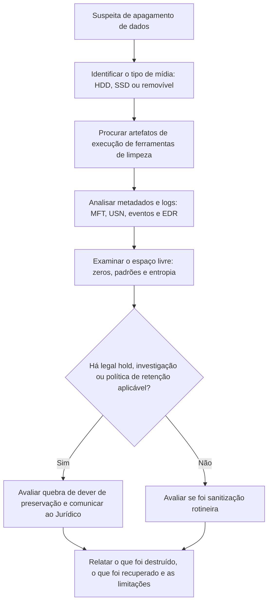

# Anti-forense, SSD, TRIM e Limpeza Segura

> **Objetivo pedagógico:** reconhecer indícios de apagamento, de limpeza segura e de ocultação em discos, compreender como SSD e TRIM alteram a expectativa de recuperação, distinguir sanitização legítima de destruição de evidências e relatar com precisão o que foi, e o que não foi, destruído.

## 1. Técnicas e seus efeitos

| Técnica | ATT&CK | Descrição | Efeito sobre a recuperação |
|---|---|---|---|
| Exclusão simples | T1070.004 | Remove a referência do sistema de arquivos | Dados permanecem em HDD até sobrescrita |
| Sobrescrita de arquivos (wiping) | T1070.004 | Ferramentas que escrevem padrões sobre o conteúdo antes de excluir | Conteúdo irrecuperável; metadados podem restar |
| Limpeza do espaço livre | T1070.004 | Escrita sobre todo o espaço não alocado | Elimina resíduos de arquivos excluídos |
| Formatação rápida e completa | T1561.002 | Recria estruturas; a formatação completa pode zerar (conforme o sistema) | Metadados perdidos; dados podem restar na rápida |
| Apagamento de tabela de partições ou do MBR | T1561.002 | Remove a estrutura de boot e de partições | Reconstruível por assinaturas e backup do GPT |
| Apagamento do disco inteiro (wipers) | T1561.001 | Sobrescreve os dados do disco | Irrecuperável após a sobrescrita |
| Apagamento seguro pelo firmware (ATA Secure Erase, NVMe Format e Sanitize) | T1561 | Comando do dispositivo para apagar o conteúdo | Irrecuperável por imagem lógica |
| Destruição criptográfica (crypto erase) | T1485 | Destruição da chave de um disco ou volume criptografado | Dados ilegíveis, ainda que presentes |
| Destruição física | T1485 | Trituração e desmagnetização | Irrecuperável |
| Ocultação (partições ocultas, ADS, contêineres) | T1564 | Esconde dados sem apagá-los | Recuperável se localizado |

Importante: a sanitização é uma prática legítima na gestão de ativos (descarte e reutilização); a análise deve distinguir a limpeza rotineira da corporação da destruição deliberada de evidências, considerando contexto, horário, autoria e existência de legal hold.

## 2. SSD, TRIM e a expectativa de recuperação

| Mecanismo | Efeito |
|---|---|
| TRIM | O sistema informa ao SSD quais blocos foram liberados; o controlador pode apagá-los em segundo plano |
| Coleta de lixo (garbage collection) | Reorganiza e apaga blocos internamente, sem comando do host |
| Wear leveling e FTL | Dados lógicos mudam de local físico; blocos antigos podem existir temporariamente |
| Sobre-provisionamento | Área reservada não acessível ao host |
| Leitura após TRIM (DRAT e RZAT) | O SSD pode retornar zeros para blocos liberados |
| Bloqueador de escrita | Não impede operações internas do SSD |

Consequências práticas:

- Dados excluídos em SSD com TRIM ativo têm baixa probabilidade de recuperação, e essa probabilidade diminui com o tempo e a energização.
- Mesmo sem TRIM (por exemplo, em USB), o comportamento depende do controlador.
- Declare no relatório que a ausência de dados recuperados em um SSD não prova que não existiram.
- A técnica de chip-off pode acessar dados remanescentes em alguns casos, mas é especializada e exige criptografia interna e FTL tratados; consulte laboratórios qualificados.

## 3. Detecção de apagamento seguro e de limpeza

### 3.1 Artefatos de ferramentas

| Fonte | Indício |
|---|---|
| Prefetch, Amcache, BAM e UserAssist | Execução de ferramentas de apagamento (por exemplo, SDelete, BleachBit, CCleaner, Eraser e utilitários equivalentes) |
| `$UsnJrnl` e `$MFT` | Rajada de renomeações de arquivos para nomes padronizados e exclusões em massa |
| Windows `cipher /w` | Criação e remoção de pasta temporária na raiz do volume (por exemplo, `EFSTMPWP`) e escrita extensa em disco |
| Logs de eventos e de EDR | Linhas de comando de ferramentas de limpeza; `format`, `diskpart clean all` e `dd` |
| Histórico do shell em Linux | `shred`, `wipe`, `dd if=/dev/zero`, `blkdiscard`, `hdparm --security-erase` e `nvme format` |
| Navegadores | Limpeza de dados de navegação e ferramentas de limpeza de sistema |
| Logs de firmware e de dispositivo | Eventos de Secure Erase e de Sanitize registrados em logs do dispositivo, quando existem |

### 3.2 Indícios no próprio disco

| Indício | Interpretação |
|---|---|
| Grandes regiões preenchidas por zeros, por um padrão repetido ou por dados aleatórios, no espaço livre | Limpeza de espaço livre |
| Ausência de resíduos de arquivos excluídos em HDD onde normalmente se esperam | Possível limpeza |
| Metadados (MFT, USN e logs) preservados, mas conteúdo zerado | Apagamento de conteúdo sem destruir metadados |
| Disco inteiro sem tabela de partições e sem estruturas de sistema de arquivos | Apagamento da tabela ou do disco |
| Datas de criação do sistema de arquivos recentes em disco antigo | Formatação ou reinstalação recente |
| Superbloco ou volume com data de criação recente e logs antigos de sistema em outro local | Reinstalação |

Exemplo de verificação de regiões de zeros e de entropia:

```python
#!/usr/bin/env python3
# Identifica sequências longas de blocos de 4 KiB totalmente zerados em uma imagem
import sys
BLOCO = 4096
MINIMO_BLOCOS = 256  # 1 MiB
arq = sys.argv[1]
zero = bytes(BLOCO)
corrida = inicio = 0
with open(arq, "rb") as f:
    n = 0
    while True:
        dados = f.read(BLOCO)
        if not dados:
            break
        if dados == zero[:len(dados)]:
            if corrida == 0:
                inicio = n
            corrida += 1
        else:
            if corrida >= MINIMO_BLOCOS:
                print(f"Zeros: bloco {inicio} a {n-1} ({corrida*BLOCO/1048576:.1f} MiB)")
            corrida = 0
        n += 1
    if corrida >= MINIMO_BLOCOS:
        print(f"Zeros: bloco {inicio} a {n-1} ({corrida*BLOCO/1048576:.1f} MiB)")
```

```bash
python3 zeros.py /mnt/analise/E001-IMG01-W1.dd
binwalk -E /mnt/analise/E001-IMG01-W1.dd
```

Interprete os resultados com cautela: zeros também são resultado normal de áreas nunca usadas, de TRIM e de formatação de fábrica.

## 4. Fluxo de análise de suspeita de apagamento



## 5. Sanitização legítima de mídias

A sanitização deve seguir as categorias do NIST SP 800-88 (Rev. 1, e a revisão vigente quando aplicável):

| Categoria | Descrição | Exemplos |
|---|---|---|
| Clear | Sobrescrita lógica por interfaces normais | Sobrescrita completa em HDD |
| Purge | Técnicas que tornam a recuperação inviável, mesmo com recursos de laboratório | ATA Secure Erase, NVMe Sanitize e crypto erase |
| Destroy | Destruição física | Trituração e incineração |

Em investigações:

- Não sanitize mídias que são evidência ou que estão sob legal hold.
- O descarte de evidências só ocorre após o encerramento e a autorização, com termo de descarte e certificado (ver pasta 02).
- Documente o método, a data, o responsável e a verificação.

## 6. Relato

| Elemento | Conteúdo |
|---|---|
| Indício | O que foi observado (artefato, horário e fonte) |
| Interpretação | Possíveis explicações, inclusive a limpeza rotineira |
| Impacto | O que ficou irrecuperável e o que foi recuperado por outras fontes |
| Corroboração | Logs, EDR, backups e outras cópias dos dados |
| Limitações | Efeitos de SSD e TRIM, criptografia e ausência de logs |
| Confiança | Alta, média ou baixa, com critérios |

Evite concluir "dolo" ou "intenção"; descreva fatos e o grau de confiança, deixando a valoração à autoridade competente.

## 7. Exemplo prático: limpeza antes da devolução de notebook

| Fonte | Achado |
|---|---|
| Amcache e Prefetch | Execução de ferramenta de apagamento de espaço livre às 17:55Z |
| `$UsnJrnl` | Criação e exclusão de milhares de arquivos temporários entre 17:56Z e 19:10Z |
| Análise do espaço livre | 38 GiB de blocos preenchidos por um padrão repetido |
| `fls -d` e carving | Muito poucos arquivos excluídos recuperáveis, apesar do uso intenso do equipamento |
| Logs de EDR e de proxy | Registro da atividade do usuário antes da limpeza |
| Backups e nuvem | Cópias de arquivos de projeto preservadas |
| Conclusão | Limpeza de espaço livre às vésperas da devolução, comprovada por três fontes; conteúdo excluído anterior irrecuperável no notebook; a recuperação foi feita por backups e logs; confiança alta quanto à limpeza |

## 8. Casos de uso corporativos

- Avaliação de devolução de equipamentos com limpeza suspeita.
- Verificação de legal hold quando há destruição de dados.
- Processos de sanitização e descarte de ativos de TI com comprovação.

## 9. Normas e frameworks relevantes

- NIST SP 800-88 Rev. 1: Guidelines for Media Sanitization (verifique a revisão vigente)
- MITRE ATT&CK: T1070.004, T1485, T1561.001, T1561.002, T1564
- ISO/IEC 27002:2022, controles 7.14 (descarte seguro de equipamentos) e 8.10 (exclusão de informações)
- LGPD, arts. 15 e 16 (término do tratamento e eliminação)

## 10. Referências

- Kissel, R. et al. NIST SP 800-88 Rev. 1: Guidelines for Media Sanitization. 2014.
- Wei, M. et al. Reliably Erasing Data from Flash-Based Solid State Drives. USENIX FAST, 2011.
- Bednar, P.; Katos, V. SSD: New challenges for digital forensics. 2011.
- King, C.; Vidas, T. Empirical analysis of solid state disk data retention when used with contemporary operating systems. Digital Investigation, v. 8, 2011.
- Documentação do ATA (comandos de segurança) e do NVMe (Format e Sanitize).
- MITRE ATT&CK. T1561: Disk Wipe. https://attack.mitre.org
