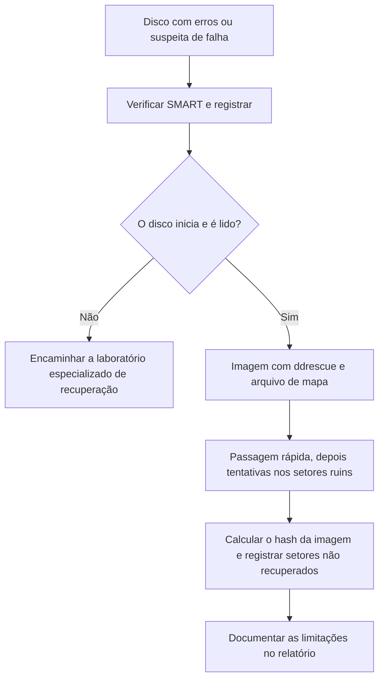

# Aquisição, Validação e Casos Especiais de Discos

> **Objetivo pedagógico:** adquirir imagens íntegras mesmo em situações difíceis (discos com falhas de leitura, SSD e NVMe, RAID, discos virtuais, áreas ocultas e discos bloqueados), validando o resultado e documentando as limitações. Complementa o procedimento geral da pasta 03.

## 1. Escolha do método de aquisição

| Método | Vantagens | Limitações |
|---|---|---|
| Duplicador de hardware | Alta velocidade, bloqueio de escrita integrado, hashes e registro automáticos | Custo; formatos específicos |
| Bloqueador de hardware com software de imagem | Flexível e amplamente aceito | Exige estação configurada |
| Boot em mídia forense (Linux) com bloqueio por software | Útil quando não é possível remover o disco | Exige validação do bloqueio de escrita e controle do boot |
| Aquisição lógica | Volumes criptografados desbloqueados, escopo restrito | Não preserva espaço não alocado |
| Aquisição remota | Quando o acesso físico não é possível | Depende de rede e agente; integridade a documentar |

Sempre confira o modelo, a série e o tamanho do disco de origem antes de iniciar e registre o equipamento de aquisição (modelo, série e firmware do bloqueador).

## 2. Verificação de saúde e áreas ocultas

```bash
# Dados SMART (saúde, setores realocados, pendentes e horas de uso)
sudo smartctl -a /dev/sdb

# Capacidade informada versus capacidade real (HPA)
sudo hdparm -N /dev/sdb

# Configuração do disco (DCO) e recursos de segurança ATA
sudo hdparm --dco-identify /dev/sdb
sudo hdparm -I /dev/sdb | grep -i -A8 "Security"

# NVMe
sudo nvme list
sudo nvme id-ctrl /dev/nvme0
```

| Indicador | Interpretação | Ação |
|---|---|---|
| Setores realocados ou pendentes crescentes | Disco em degradação | Priorizar a imagem, usar ddrescue e minimizar tentativas de leitura |
| HPA ativado | Áreas ocultas na capacidade informada | Registrar e adquirir a área completa conforme procedimento validado |
| DCO ativo | Capacidade reduzida por configuração | Registrar e avaliar a aquisição da capacidade original |
| Segurança ATA habilitada ("locked") | Disco protegido por senha | Obter a senha por via legal; não tente força bruta sem autorização |
| SED (OPAL) | Disco com criptografia em hardware | Procurar a chave e a política de gestão |

A modificação de HPA e DCO só deve ser feita com procedimento validado e documentado, quando necessária à aquisição, pois altera a configuração do disco.

## 3. Discos com erros de leitura



```bash
# GNU ddrescue: primeira passagem sem raspagem, depois novas tentativas, com arquivo de mapa
sudo ddrescue -d -n /dev/sdb /mnt/evidencias/E001-IMG01.img /mnt/evidencias/E001-IMG01.map
sudo ddrescue -d -r3 /dev/sdb /mnt/evidencias/E001-IMG01.img /mnt/evidencias/E001-IMG01.map

# Hash e arquivo do mapa preservados
sha256sum /mnt/evidencias/E001-IMG01.img /mnt/evidencias/E001-IMG01.map > /mnt/evidencias/E001-IMG01.sha256
```

O ddrescue não calcula hash; calcule-o depois. Se houver setores não lidos, a imagem não é uma cópia completa: registre o mapa e declare no relatório que o hash da imagem não corresponde ao da fonte.

## 4. SSD e NVMe

| Aspecto | Observação |
|---|---|
| TRIM e coleta de lixo | Blocos liberados podem ser apagados pelo controlador a qualquer momento, inclusive com bloqueio de escrita |
| Wear leveling e FTL | O mapeamento lógico-físico impede a recuperação por imagem lógica de áreas já remapeadas |
| Dados após TRIM | Muitos SSDs retornam zeros (DRAT e RZAT) para áreas liberadas |
| Energização | Minimize o tempo de energização e documente |
| Bloqueio de escrita | O bloqueador impede escritas do host, mas não as operações internas do SSD |
| NVMe | Use adaptadores e bloqueadores compatíveis; registre o modelo do controlador e o firmware |
| Chip-off e técnicas avançadas | Especializadas e fora do escopo rotineiro; indicadas em casos excepcionais, com laboratório qualificado |

Declare no relatório que a recuperação de dados excluídos em SSD tem expectativa reduzida e que o resultado depende do firmware.

## 5. RAID e volumes lógicos

| Cenário | Procedimento |
|---|---|
| RAID por hardware | Registrar a controladora, o nível, o tamanho de stripe e a ordem dos discos; adquirir o volume lógico apresentado e, se possível, cada disco membro |
| RAID por software (`mdadm`) | Imagens de todos os membros e remontagem em somente leitura |
| LVM | Imagens dos discos físicos e ativação dos volumes na estação de análise |
| Windows (discos dinâmicos e Storage Spaces) | Imagem de todos os discos e uso de ferramentas que reconheçam os metadados |

```bash
# Examinar membros RAID (sobre dispositivos de loop das imagens, somente leitura)
for i in 1 2 3; do sudo losetup -r -f --show /mnt/evidencias/raid_disco$i.img; done
sudo mdadm --examine /dev/loop1 /dev/loop2 /dev/loop3

# Montar o arranjo em modo somente leitura
sudo mdadm --assemble --readonly /dev/md127 /dev/loop1 /dev/loop2 /dev/loop3
sudo mount -o ro,noload,noexec,nodev /dev/md127 /mnt/evid
```

Registre os parâmetros do arranjo; o resultado depende da reconstrução correta da ordem e do tamanho de stripe.

## 6. Discos virtuais

| Formato | Origem | Ferramentas |
|---|---|---|
| VMDK | VMware | `qemu-img`, `vmdkmount` (libvmdk) |
| VHD e VHDX | Hyper-V e Windows | `vhdimount` (libvhdi), `qemu-img` |
| QCOW2 | KVM e QEMU | `qemu-img`, `qcowmount` (libqcow) |
| VDI | VirtualBox | `qemu-img` |

```bash
# Informações e conversão para RAW (a origem é somente leitura; confira espaço e hash)
qemu-img info /mnt/evidencias/servidor.vmdk
qemu-img convert -f vmdk -O raw /mnt/evidencias/servidor.vmdk /mnt/analise/servidor.raw
sha256sum /mnt/evidencias/servidor.vmdk /mnt/analise/servidor.raw

# Montagem direta sem converter (libvmdk)
vmdkmount /mnt/evidencias/servidor.vmdk /mnt/vmdk
```

Preserve também os arquivos de configuração e os snapshots da máquina virtual, pois estados anteriores podem conter dados que já não existem no disco atual.

## 7. Mídias removíveis e dispositivos especiais

| Mídia | Cuidados |
|---|---|
| Pendrive e cartão SD | Bloqueador de escrita ou interruptor de proteção, imagem completa e registro de fabricante, capacidade e série; controladores podem ocultar áreas |
| Discos externos USB | A ponte USB pode alterar a geometria e ocultar recursos; registre o adaptador |
| Mídia óptica | Imagem de todas as sessões e registro de sessões múltiplas |
| Discos de Mac (T2 e Apple Silicon) | Armazenamento criptografado e vinculado ao hardware; exige procedimentos específicos e possivelmente ferramentas comerciais |
| Dispositivos móveis | Ver pasta de forense mobile |

## 8. Validação da aquisição

| Verificação | Procedimento |
|---|---|
| Hash da fonte e da imagem | SHA-256 calculado e comparado; ou verificação interna do formato (E01) |
| Segunda leitura | Em casos críticos, repetir a aquisição e comparar os hashes |
| Tamanho e setores | Conferir o tamanho em bytes e o número de setores |
| Tabela de partições | Verificar que a imagem apresenta a mesma estrutura da fonte |
| Teste de montagem | Montar em somente leitura e verificar a abertura de arquivos |
| Registro | Formulário C (Registro de Aquisição) e relatório de verificação da ferramenta |

## 9. Exemplo prático: aquisição de HDD com setores defeituosos

| Etapa | Resultado |
|---|---|
| `smartctl` | 1.240 setores realocados e 36 pendentes |
| ddrescue (passagem rápida) | 99,97% lido em 4 horas |
| ddrescue (novas tentativas, 3 passes) | 99,998% lido; 84 setores (42 KiB) não recuperados |
| Hash | SHA-256 da imagem calculado; fonte não pôde ser verificada integralmente |
| Mapa de setores | Arquivo de mapa preservado; setores não lidos listados no relatório |
| Conclusão | Imagem parcial documentada; análise dos arquivos afetados pelos setores ilegíveis com marcação de limitação |

## 10. Casos de uso corporativos

- Aquisição de servidores com RAID por hardware sem remover discos de produção.
- Imagens de discos antigos de arquivo com falhas progressivas.
- Preservação de discos virtuais e seus snapshots em ambientes virtualizados.

## 11. Normas e frameworks relevantes

- ISO/IEC 27037:2012; NIST SP 800-86; NIST CFTT
- SWGDE Best Practices for Computer Forensic Acquisitions
- ENFSI Best Practice Manual for the Forensic Examination of Digital Technology
- ISO/IEC 27002:2022, controle 5.28

## 12. Referências

- Carrier, B. File System Forensic Analysis. Addison-Wesley, 2005.
- SWGDE. Best Practices for Computer Forensic Acquisitions.
- Documentação do GNU ddrescue, do smartmontools, do hdparm, do nvme-cli, do mdadm, do QEMU (qemu-img) e do libyal.
- NIST. Computer Forensic Tool Testing (CFTT): relatórios de bloqueadores de escrita e de ferramentas de imagem.
- SANS Institute. FOR498: Digital Acquisition and Rapid Triage.
