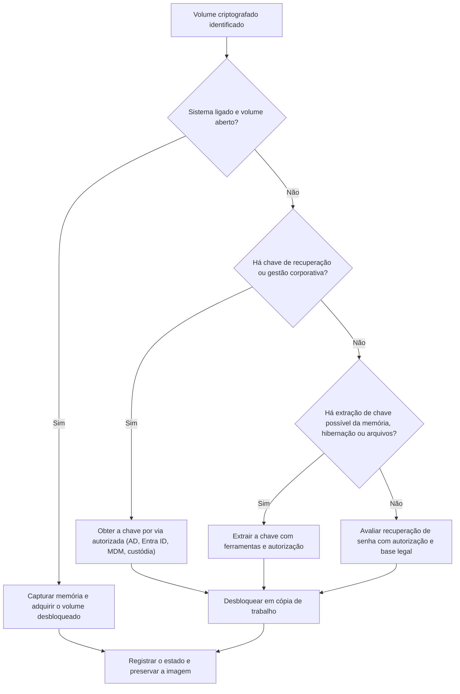

# Criptografia de Disco e Volumes Protegidos

> **Objetivo pedagógico:** identificar e tratar volumes criptografados (BitLocker, FileVault, LUKS, VeraCrypt, EFS e discos autocriptografados), obter acesso por vias lícitas e documentadas (chaves de recuperação, memória e gestão corporativa) e conhecer os limites técnicos e jurídicos.

## 1. Panorama

| Tecnologia | Plataforma | Onde estão as chaves |
|---|---|---|
| BitLocker | Windows | TPM, senha de recuperação de 48 dígitos, arquivo `.BEK`, Active Directory, Entra ID, conta Microsoft |
| FileVault 2 | macOS | Senha do usuário, chave de recuperação, custódia no iCloud ou chave institucional; hardware (T2 e Apple Silicon) |
| LUKS (LUKS1 e LUKS2) | Linux | Senha ou arquivo-chave em slots; cabeçalho no início da partição |
| VeraCrypt e TrueCrypt | Multiplataforma | Senha e arquivos-chave; sem assinatura reconhecível |
| EFS | Windows (NTFS) | Certificados e chaves do usuário; agente de recuperação |
| fscrypt e eCryptfs | Linux | Chaves do usuário |
| SED e OPAL | Discos | Chave no firmware; senha ATA |

## 2. Identificação de volumes criptografados

| Indício | Interpretação |
|---|---|
| Assinatura `-FVE-FS-` no início do volume | BitLocker |
| Cabeçalho `LUKS` e identificação de versão (`cryptsetup luksDump`) | LUKS |
| Volume APFS com indicação de criptografia ou CoreStorage criptografado | FileVault |
| Região com alta entropia, sem assinatura de sistema de arquivos | Possível VeraCrypt ou dado aleatório |
| Arquivo de tamanho grande com conteúdo de alta entropia | Contêiner criptografado |
| Atributo de arquivo criptografado (NTFS) | EFS |

```bash
# BitLocker: assinatura no início do volume
dd if=/dev/loop0p3 bs=512 count=1 2>/dev/null | xxd | head -n 3

# LUKS
cryptsetup isLuks /dev/loop0p3 && cryptsetup luksDump /dev/loop0p3

# Entropia (alta próximo de 8 bits por byte indica compressão ou criptografia)
ent /mnt/analise/arquivo_suspeito.bin
binwalk -E /mnt/analise/arquivo_suspeito.bin
```

```powershell
# Windows: estado de criptografia e protetores
manage-bde -status
manage-bde -protectors -get C:
Get-BitLockerVolume | Format-List MountPoint,VolumeStatus,ProtectionStatus,EncryptionMethod,KeyProtector
```

## 3. Abordagem geral



Princípio: a imagem do volume criptografado deve ser sempre preservada como está, e o desbloqueio deve ser feito sobre cópias de trabalho.

## 4. BitLocker

### 4.1 Protetores e fontes de recuperação

| Fonte | Observação |
|---|---|
| Senha de recuperação (48 dígitos, em 8 grupos de 6) | Pode estar no Active Directory (objeto `msFVE-RecoveryInformation`), no Entra ID, na conta Microsoft do usuário, impressa ou em arquivo |
| Arquivo `.BEK` (chave de inicialização) | Em mídia removível |
| TPM e TPM+PIN | A chave só é liberada no hardware original com a configuração de inicialização esperada |
| Chave em memória ou em hibernação | A chave de criptografia do volume (FVEK) pode estar na RAM de um sistema ligado e em arquivos de hibernação |

### 4.2 Desbloqueio em análise

```bash
# Linux: libbde (bdemount) com senha de recuperação
sudo mkdir -p /mnt/bde /mnt/evid
sudo bdemount -r 123456-123456-123456-123456-123456-123456-123456-123456 /dev/loop0p3 /mnt/bde
sudo mount -o ro,loop /mnt/bde/bde1 /mnt/evid

# Alternativa: dislocker
sudo dislocker -V /dev/loop0p3 -p123456-123456-123456-123456-123456-123456-123456-123456 -- /mnt/bde
sudo mount -o ro,loop /mnt/bde/dislocker-file /mnt/evid
```

```powershell
# Windows: desbloquear volume anexado em modo somente leitura (estação de análise)
manage-bde -unlock D: -RecoveryPassword 123456-123456-123456-123456-123456-123456-123456-123456
```

Os valores acima são ilustrativos; as chaves reais são segredos e devem ser tratadas com acesso restrito, sem aparecer em relatórios.

## 5. FileVault 2 (macOS)

| Aspecto | Observação |
|---|---|
| Volumes | APFS (criptografia nativa) ou CoreStorage em sistemas mais antigos |
| Chaves | Senha do usuário, chave de recuperação, chave institucional ou custódia no iCloud |
| Mac com T2 ou Apple Silicon | O armazenamento está vinculado ao hardware; sem a chave, o volume interno não pode ser lido em outro equipamento |
| Procedimento | Obter a chave por via autorizada; avaliar a coleta ao vivo com o usuário autenticado; usar ferramentas comerciais quando necessário |

```bash
# Em um Mac (com autorização): estado do FileVault
fdesetup status
diskutil apfs list
```

## 6. LUKS

| Passo | Procedimento |
|---|---|
| Preservar | Backup do cabeçalho e hash |
| Identificar | `cryptsetup luksDump` (versão, cifra e slots) |
| Desbloquear | `cryptsetup open --readonly` sobre a cópia de trabalho |
| Montar | `mount -o ro,noload,noexec,nodev` |

```bash
sudo cryptsetup luksHeaderBackup /dev/loop0p3 --header-backup-file /mnt/evidencias/E001-luks-header.img
sha256sum /mnt/evidencias/E001-luks-header.img
sudo cryptsetup open --readonly /dev/loop0p3 evid_luks
sudo mount -o ro,noload,noexec,nodev /dev/mapper/evid_luks /mnt/evid
```

A senha pode vir do gerenciamento corporativo, do usuário (por via autorizada) ou ser recuperada, quando houver autorização, por ataque de dicionário.

## 7. VeraCrypt e contêineres sem assinatura

| Aspecto | Observação |
|---|---|
| Identificação | Arquivos ou partições com alta entropia e sem assinatura reconhecível; tamanho compatível com contêiner |
| Volumes ocultos | Um volume oculto pode existir dentro do espaço livre aparente de outro; sua existência não é detectável por design |
| Indícios de uso | Artefatos do programa (Prefetch, Amcache, registro, LNK e MRU de arquivos `.hc`) |
| Senha e keyfiles | Procurar em gerenciadores de senhas, arquivos-chave e na memória (se montado) |
| Limitação | Sem a senha, a análise do conteúdo é inviável |

Registre os indícios de uso e a impossibilidade de acesso, sem afirmar a existência de dados ocultos sem base.

## 8. EFS (Encrypting File System)

| Aspecto | Observação |
|---|---|
| Funcionamento | Arquivos NTFS criptografados com chaves ligadas ao certificado do usuário (e protegidas por DPAPI) |
| Recuperação | Requer o certificado e a chave privada do usuário ou do agente de recuperação, ou a senha do usuário (conforme o caso) |
| Artefatos | Atributo `$EFS` na MFT; certificados no armazenamento do usuário |
| Boa prática | Coletar também os perfis, o diretório `Protect` do DPAPI e as hives do usuário |

## 9. Discos autocriptografados e senha ATA

| Cenário | Conduta |
|---|---|
| Disco com senha ATA ativa | Obter a senha por via legal (usuário, administrador ou fabricante); não tente força bruta |
| SED com OPAL gerenciado | Consultar o sistema de gestão (por exemplo, console corporativo) |
| Perda da chave | Os dados podem ser irrecuperáveis por projeto; registrar e comunicar |

## 10. Recuperação de senhas: limites técnicos e legais

| Tema | Orientação |
|---|---|
| Autorização | Qualquer tentativa de quebra de senha deve estar prevista no escopo e ter base legal definida pelo Jurídico |
| Direitos do investigado | O direito de não produzir prova contra si mesmo (Constituição Federal, art. 5º, LXIII) e as regras sobre fornecimento de senhas variam conforme o procedimento; consulte o Jurídico |
| Ferramentas | John the Ripper e hashcat possuem módulos para BitLocker, LUKS e VeraCrypt; utilitários extraem os dados necessários dos volumes |
| Viabilidade | Depende da força da senha e do tempo de processamento; senhas fortes tornam o ataque inviável |
| Registro | Documentar dicionários, regras e resultados |

Evite ataques sem autorização e sem necessidade comprovada.

## 11. Exemplo prático: notebook corporativo com BitLocker

| Etapa | Ação |
|---|---|
| 1 | Notebook desligado; BitLocker identificado (`-FVE-FS-`) na imagem E01 |
| 2 | O DPO e o Jurídico autorizam o uso da chave de recuperação corporativa |
| 3 | A TI localiza a senha de recuperação no Active Directory pelo identificador de 8 caracteres exibido na tela de recuperação |
| 4 | O desbloqueio é feito em cópia de trabalho com `bdemount`, e o sistema de arquivos montado em somente leitura |
| 5 | O acesso à chave é registrado (quem, quando e por quê) e a senha de recuperação é rotacionada ao final do caso |
| Conclusão | Análise concluída sem alterar a imagem original; trilha de auditoria do uso da chave |

## 12. Casos de uso corporativos

- Investigação de dispositivos corporativos com BitLocker e chaves em diretório.
- Tratamento de dispositivos pessoais com FileVault em investigações autorizadas.
- Identificação de uso de contêineres criptografados por colaboradores.

## 13. Normas e frameworks relevantes

- ISO/IEC 27037:2012; NIST SP 800-86; NIST SP 800-111 (proteção de informação em dispositivos de armazenamento)
- ISO/IEC 27002:2022, controles 8.24 (uso de criptografia) e 5.28
- MITRE ATT&CK: T1486 (Data Encrypted for Impact), T1027, T1553
- LGPD, arts. 6º, 7º e 46; Constituição Federal, art. 5º, LXIII

## 14. Referências

- Metz, J. Documentação do libbde e do libluksde (libyal).
- Microsoft Learn. Documentação do BitLocker e da recuperação de chaves.
- Apple. Apple Platform Security Guide (FileVault, APFS e T2).
- Cryptsetup. Documentação do LUKS (LUKS1 e LUKS2).
- VeraCrypt. Documentação oficial.
- Scarfone, K.; Souppaya, M.; Sexton, M. NIST SP 800-111. 2007.
- Documentação do dislocker, do John the Ripper e do hashcat.
