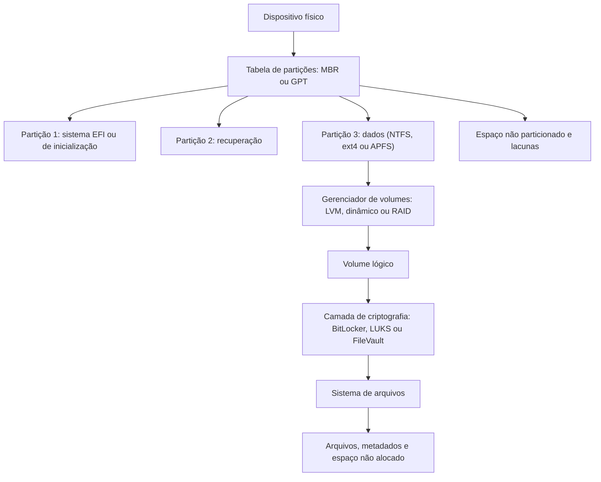

# Fundamentos de Armazenamento e Esquemas de Partição

> **Objetivo pedagógico:** compreender as tecnologias de armazenamento (HDD, SSD, NVMe, mídias removíveis), a organização física e lógica de um disco (setores, partições, volumes e gerenciadores de volume) e saber analisar tabelas de partição, lacunas e estruturas ocultas em imagens forenses.

## 1. Tecnologias de armazenamento

| Tecnologia | Características | Implicações forenses |
|---|---|---|
| HDD (disco magnético) | Pratos e cabeças; setores regravados no mesmo local | Dados excluídos permanecem até serem sobrescritos; falhas mecânicas exigem tratamento especializado |
| SSD (SATA) | Memória flash com controlador, mapeamento lógico-físico (FTL), TRIM e coleta de lixo | O controlador altera dados internamente; menor recuperação de dados excluídos |
| NVMe | Flash sobre PCIe com comandos próprios | Exige adaptadores e bloqueadores compatíveis; comandos de sanitização integrados |
| eMMC, cartões SD e pendrives | Flash com controlador simples | Comportamento variável; wear leveling; baixa previsibilidade de recuperação |
| Discos autocriptografados (SED, OPAL) | Criptografia em hardware | Podem estar bloqueados; a chave pode estar vinculada ao hardware |
| Mídias ópticas e fitas | Formatos específicos (ISO 9660, UDF e outros) | Ferramentas e procedimentos próprios |

### 1.1 Interfaces

| Interface | Observação |
|---|---|
| SATA e SAS | Bloqueadores de escrita de hardware amplamente disponíveis |
| NVMe (M.2 e U.2) | Exige adaptador e bloqueador compatíveis com NVMe |
| USB e Thunderbolt | Bridges podem mascarar informações do dispositivo; registrar o adaptador |
| Controladoras RAID | Podem apresentar volumes lógicos e ocultar os discos físicos |

## 2. Setores e endereçamento

| Conceito | Descrição |
|---|---|
| Setor lógico | Unidade mínima de endereçamento (LBA, Logical Block Addressing) |
| Tamanho do setor | 512 bytes (tradicional), 4096 bytes (Advanced Format 4Kn) ou 512e (4K físico emulando 512) |
| Cluster ou bloco | Unidade de alocação do sistema de arquivos (múltiplos de setores) |
| Alinhamento | Partições modernas começam em múltiplos de 1 MiB (por exemplo, setor 2048) |
| Capacidade informada | Registrar o tamanho em bytes e em setores e o tamanho do setor |

Em análises, informe o tamanho do setor corretamente às ferramentas (por exemplo, `mmls -b 4096`), pois um valor errado produz deslocamentos incorretos.

## 3. Esquemas de partição

### 3.1 MBR (Master Boot Record)

| Elemento | Posição | Descrição |
|---|---|---|
| Código de inicialização | Bytes 0 a 445 | Código do carregador inicial |
| Tabela de partições | Bytes 446 a 509 | Quatro entradas de 16 bytes |
| Assinatura | Bytes 510 e 511 | `0x55AA` |
| Limitação | Setores de 32 bits | Cerca de 2 TiB com setores de 512 bytes |

Campos de cada entrada: indicador de boot, CHS inicial, tipo, CHS final, LBA inicial e número de setores.

| Tipo (hex) | Significado comum |
|---|---|
| `07` | NTFS, exFAT ou HPFS |
| `0B` e `0C` | FAT32 |
| `83` | Linux |
| `82` | Linux swap |
| `8E` | Linux LVM |
| `FD` | Linux RAID |
| `05` e `0F` | Partição estendida |
| `EE` | MBR protetor de um disco GPT |

Partições estendidas encadeiam partições lógicas por EBRs (Extended Boot Records), que devem ser percorridos.

### 3.2 GPT (GUID Partition Table)

| Elemento | Posição | Descrição |
|---|---|---|
| MBR protetor | LBA 0 | Tipo `EE`, impede que ferramentas antigas tratem o disco como vazio |
| Cabeçalho primário | LBA 1 | Assinatura `EFI PART`, GUID do disco, localização e CRC32 das entradas |
| Entradas de partição | A partir do LBA 2 | Normalmente 128 entradas de 128 bytes |
| Cabeçalho e entradas de backup | Final do disco | Cópia para recuperação |
| Limite | Endereçamento de 64 bits | Capacidades muito superiores a 2 TiB |

| Tipo de partição (GUID) | Significado |
|---|---|
| `C12A7328-F81F-11D2-BA4B-00A0C93EC93B` | EFI System Partition |
| `EBD0A0A2-B9E5-4433-87C0-68B6B72699C7` | Microsoft Basic Data (NTFS, exFAT e FAT) |
| `E3C9E316-0B5C-4DB8-817D-F92DF00215AE` | Microsoft Reserved |
| `DE94BBA4-06D1-4D40-A16A-BFD50179D6AC` | Windows Recovery |
| `0FC63DAF-8483-4772-8E79-3D69D8478445` | Linux filesystem |
| `E6D6D379-F507-44C2-A23C-238F2A3DF928` | Linux LVM |
| `0657FD6D-A4AB-43C4-84E5-0933C84B4F4F` | Linux swap |
| `7C3457EF-0000-11AA-AA11-00306543ECAC` | Apple APFS |

### 3.3 Outros

| Esquema | Observação |
|---|---|
| Apple Partition Map | Sistemas Mac antigos (PowerPC) |
| BSD disklabel | Sistemas BSD |
| Discos dinâmicos do Windows | Volumes distribuídos, espelhados e agregados; metadados em LDM |
| Windows Storage Spaces | Pools de armazenamento com metadados próprios |
| LVM (Linux), `mdadm` | Volumes lógicos e RAID por software |
| Apple CoreStorage e contêineres APFS | Volumes lógicos no macOS |

## 4. Mapa de organização do disco



## 5. Análise de tabelas de partição

```bash
# Sleuth Kit: partições e espaço não alocado (informe o tamanho do setor se for 4Kn)
mmls /mnt/analise/E001-IMG01-W1.dd
mmls -b 4096 /mnt/analise/E001-IMG01-W1.dd

# fdisk e sgdisk em modo de leitura
fdisk -l /mnt/analise/E001-IMG01-W1.dd
sgdisk -p /mnt/analise/E001-IMG01-W1.dd

# Primeiro setor (MBR) em hexadecimal
xxd -l 512 /mnt/analise/E001-IMG01-W1.dd

# Cabeçalho GPT (LBA 1)
dd if=/mnt/analise/E001-IMG01-W1.dd bs=512 skip=1 count=1 2>/dev/null | xxd | head -n 6

# Pesquisa de tabelas de partição apagadas (modo de listagem, sem alterações)
testdisk /list /mnt/analise/E001-IMG01-W1.dd
```

Sempre use cópias de trabalho. Ferramentas interativas como o TestDisk podem gravar alterações se o usuário confirmar a escrita; em evidência, use apenas as opções de análise e listagem.

## 6. Lacunas, espaço oculto e partições apagadas

| Fenômeno | Como identificar | Interpretação |
|---|---|---|
| Espaço não alocado entre partições | `mmls` mostra linhas "Unallocated" | Pode conter partições apagadas, dados antigos ou apenas alinhamento |
| Espaço antes da primeira partição | Setores 1 a 2047 | Normalmente alinhamento, mas pode abrigar código de boot ou dados ocultos |
| Partição apagada | Assinatura de sistema de arquivos em área não alocada (por exemplo, `NTFS` ou `EXT` em setores de início) | Possível restauração da tabela; registrar a descoberta |
| Partição oculta | Tipo de partição incomum, sem letra de unidade | Recuperação, EFI e fabricantes; verificar o conteúdo |
| Final do disco não particionado | Espaço após a última partição | Pode conter o cabeçalho de backup do GPT, mas também dados |
| HPA e DCO | `hdparm -N` e `hdparm --dco-identify` | Áreas ocultas na capacidade informada pelo disco |
| Slack de volume | Setores entre o fim do sistema de arquivos e o da partição | Pode conter dados de formatações anteriores |

```bash
# Procurar assinaturas de sistemas de arquivos em áreas não alocadas (exemplo para NTFS)
# Extraia o espaço não alocado e busque a string "NTFS    " no setor inicial de volumes
blkls -o 2048 /mnt/analise/E001-IMG01-W1.dd > /mnt/saida/unalloc.raw
grep -c -a "NTFS    " /mnt/saida/unalloc.raw
```

## 7. Exemplo prático: análise de um disco de executivo

| Observação | Interpretação |
|---|---|
| `mmls` mostra 4 partições GPT (EFI, MSR, Windows, Recovery) e 120 GiB não alocados no final | Espaço não alocado significativo |
| `testdisk /list` encontra assinatura de uma partição ext4 de 120 GiB na área não alocada | Partição Linux apagada (dual boot removido) |
| Registro de datas no superbloco ext4 | Criação em 2026-03-14 e última montagem em 2026-09-02 |
| Relatório | O disco já abrigou um sistema Linux; a tabela de partições foi alterada depois; a recuperação do sistema de arquivos exige análise em cópia de trabalho |
| Limitação | Conteúdo parcialmente sobrescrito pela partição Windows nova |

## 8. Casos de uso corporativos

- Análise de discos de notebooks devolvidos por executivos, com partições apagadas ou ocultas.
- Verificação de partições de recuperação e de fabricantes em investigações de vazamento.
- Identificação de sistemas operacionais alternativos usados para contornar controles corporativos.

## 9. Normas e frameworks relevantes

- ISO/IEC 27037:2012 (aquisição e preservação de mídias)
- NIST SP 800-86; NIST CFTT (testes de bloqueadores e de ferramentas)
- UEFI Specification (formato GPT)
- MITRE ATT&CK: T1564 (Hide Artifacts), T1561 (Disk Wipe)

## 10. Referências

- Carrier, B. File System Forensic Analysis. Addison-Wesley, 2005.
- UEFI Forum. UEFI Specification: GUID Partition Table (GPT) Disk Layout.
- Microsoft. Documentação de MBR, GPT e discos dinâmicos.
- Documentação do The Sleuth Kit (mmls), do TestDisk e do gdisk (sgdisk).
- SANS Institute. FOR500 e FOR498.
