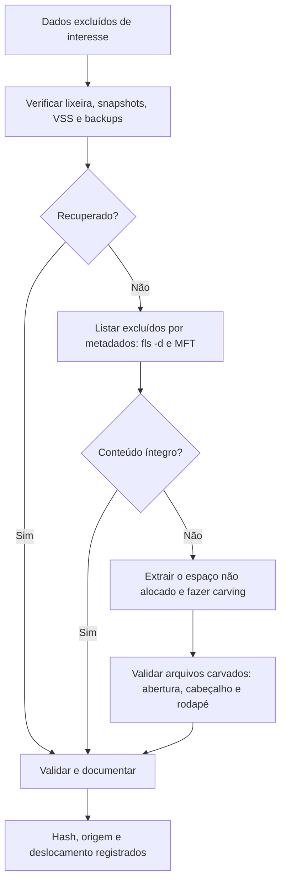

# Recuperação, Carving e Espaço Não Alocado

> **Objetivo pedagógico:** recuperar dados excluídos por metadados e por carving de assinaturas, analisar espaço não alocado e slack, compreender os limites (fragmentação, TRIM e sobrescrita) e validar e documentar os arquivos recuperados.

## 1. Estratégias de recuperação

| Estratégia | Descrição | Preserva nome e carimbos? | Quando usar |
|---|---|---|---|
| Por metadados | Usa as estruturas do sistema de arquivos (MFT, inodes e diretórios) | Sim | Primeira escolha |
| Por journal e snapshots | Usa cópias de metadados e estados anteriores | Sim | Quando os metadados atuais foram perdidos |
| Carving | Busca assinaturas de arquivos nos dados brutos | Não | Metadados ausentes ou sistema de arquivos danificado |
| Reconstrução de volume | Restaura tabelas de partições ou o sistema de arquivos | Sim | Partição apagada ou formatada |
| Recuperação em backups e VSS | Procura cópias anteriores | Sim | Sempre que existir |

## 2. Fluxo de recuperação



## 3. Recuperação por metadados

```bash
# Arquivos excluídos com metadados ainda disponíveis
fls -r -p -d -o 2048 /mnt/analise/E001-IMG01-W1.dd > fls_excluidos.txt

# Recuperar um arquivo específico
icat -o 2048 /mnt/analise/E001-IMG01-W1.dd <inode> > /mnt/saida/arquivo_recuperado.bin

# Recuperar todos os arquivos excluídos recuperáveis
tsk_recover -e -o 2048 /mnt/analise/E001-IMG01-W1.dd /mnt/saida/recuperados
```

Preserve o nome, o caminho original, o inode e os carimbos no registro da recuperação.

## 4. Extração do espaço não alocado e do slack

```bash
# Espaço não alocado (blocos livres) do sistema de arquivos
blkls -o 2048 /mnt/analise/E001-IMG01-W1.dd > /mnt/saida/unalloc.raw

# Slack (espaço entre o fim do arquivo e o fim do cluster)
blkls -s -o 2048 /mnt/analise/E001-IMG01-W1.dd > /mnt/saida/slack.raw

sha256sum /mnt/saida/unalloc.raw /mnt/saida/slack.raw > /mnt/saida/hashes_unalloc.sha256
```

| Tipo de espaço | Conteúdo possível |
|---|---|
| Não alocado | Arquivos excluídos, versões antigas, resíduos de formatações |
| Slack de arquivo | Fragmentos do arquivo anterior que ocupava o cluster |
| Slack de volume | Dados de usos anteriores da partição |
| Espaço entre partições | Dados de particionamentos anteriores |

Ao carvar a partir de `unalloc.raw`, o deslocamento do arquivo carvado refere-se ao arquivo extraído; para obter o endereço na imagem, use o mapeamento do `blkls` ou carvar diretamente a imagem completa.

## 5. Assinaturas de arquivos (magic numbers)

| Tipo | Cabeçalho (hex ou texto) | Observações |
|---|---|---|
| JPEG | `FF D8 FF` | Rodapé `FF D9` |
| PNG | `89 50 4E 47 0D 0A 1A 0A` | Rodapé `IEND` |
| GIF | `47 49 46 38` ("GIF8") | |
| PDF | `25 50 44 46` ("%PDF") | Rodapé `%%EOF` |
| ZIP, DOCX, XLSX e PPTX | `50 4B 03 04` ("PK") | Contêineres ZIP |
| Office legado (DOC, XLS) | `D0 CF 11 E0 A1 B1 1A E1` | OLE2 |
| RAR | `52 61 72 21` ("Rar!") | |
| 7-Zip | `37 7A BC AF 27 1C` | |
| GZIP | `1F 8B` | |
| Executável PE | `4D 5A` ("MZ") | |
| ELF | `7F 45 4C 46` | |
| SQLite | `SQLite format 3\0` | Bancos de aplicativos e navegadores |
| Registro do Windows | `regf` | Hives |
| EVTX | `ElfFile\0` | Logs de eventos |
| MP4 e MOV | `ftyp` a partir do deslocamento 4 | |
| PST | `!BDN` | Caixas de e-mail do Outlook |

## 6. Carving

```bash
# PhotoRec (interativo): selecione a imagem, o tipo de partição e a pasta de saída
photorec /d /mnt/saida/carving_photorec /mnt/analise/E001-IMG01-W1.dd

# foremost: tipos específicos
foremost -t jpg,pdf,zip,doc -i /mnt/saida/unalloc.raw -o /mnt/saida/carving_foremost

# scalpel (com arquivo de configuração de assinaturas)
scalpel -c /etc/scalpel/scalpel.conf -o /mnt/saida/carving_scalpel /mnt/saida/unalloc.raw

# bulk_extractor: e-mails, URLs, números e outros "features" sem depender do sistema de arquivos
bulk_extractor -o /mnt/saida/bulk /mnt/saida/unalloc.raw
```

| Ferramenta | Característica |
|---|---|
| PhotoRec | Amplo suporte a formatos, bom com sistemas de arquivos danificados |
| foremost e scalpel | Configuráveis por assinaturas, úteis para tipos específicos |
| bulk_extractor | Extrai e-mails, URLs, números de telefone e outros artefatos, e gera histogramas |
| Autopsy (módulo PhotoRec Carver) | Integra o carving ao caso |
| Ferramentas comerciais | X-Ways, EnCase e FTK possuem carving integrado |

### 6.1 Limitações do carving

| Limitação | Efeito |
|---|---|
| Fragmentação | Arquivos fragmentados são recuperados incompletos ou corrompidos |
| Ausência de rodapé | O tamanho pode ser estimado e conter lixo ao final |
| Perda de metadados | Sem nome, caminho nem carimbos |
| Falsos positivos | Assinaturas casuais em dados aleatórios |
| TRIM em SSD | Dados já apagados pelo controlador retornam zeros |
| Compressão e criptografia | Conteúdo sem assinatura reconhecível |

## 8. Validação dos arquivos recuperados

| Verificação | Procedimento |
|---|---|
| Tipo de arquivo | `file` e verificação do cabeçalho e do rodapé |
| Abertura | Tentar abrir em visualizador seguro (em ambiente isolado) |
| Metadados | `exiftool` para imagens, documentos e vídeos |
| Hash | SHA-256 de cada arquivo e registro do deslocamento de origem |
| Duplicatas | Hash para identificar duplicatas e comparar com o conteúdo atual |
| Contexto | Corroborar o achado com outras fontes (logs, histórico e artefatos de usuário) |
| Segurança | Arquivos recuperados podem conter malware; manuseie em laboratório isolado |

```bash
file /mnt/saida/carving_photorec/*/* | head
exiftool -a -G1 -s /mnt/saida/carving_photorec/recup_dir.1/f0001234.jpg
find /mnt/saida/carving_foremost -type f -exec sha256sum {} \; > /mnt/saida/hashes_carving.sha256
```

## 9. Busca por conteúdo no espaço não alocado

```bash
# Strings ASCII e UTF-16 com deslocamentos
strings -a -td /mnt/saida/unalloc.raw > unalloc_ascii.txt
strings -a -el -td /mnt/saida/unalloc.raw > unalloc_unicode.txt

# Busca de termos e padrões
grep -i -E "confidencial|proposta|contrato" unalloc_ascii.txt unalloc_unicode.txt | head -50
```

Entropia e regiões especiais:

```bash
binwalk -E /mnt/saida/unalloc.raw      # picos de entropia indicam dados criptografados ou compactados
```

## 10. Exemplo prático: planilha confidencial excluída e sobrescrita parcialmente

| Etapa | Resultado |
|---|---|
| 1 | `fls -d` mostra `precos_2026.xlsx` excluído (inode livre, blocos zerados parcialmente) |
| 2 | `icat` recupera apenas parte do conteúdo; o arquivo está corrompido |
| 3 | O carving em `unalloc.raw` encontra três fragmentos ZIP (PK) com estrutura OOXML |
| 4 | Dois fragmentos contêm partes da planilha, reconstituídas e validadas no visualizador isolado |
| 5 | O hash e o deslocamento de cada fragmento são registrados |
| Conclusão | Existência e parte do conteúdo comprovados; conteúdo completo não recuperável; confiança média quanto ao conteúdo e alta quanto à existência |

## 11. Casos de uso corporativos

- Recuperação de documentos excluídos antes do desligamento de colaboradores.
- Busca de indícios de dados sensíveis (cartões, CPFs e credenciais) em mídias devolvidas.
- Análise de discos formatados antes da devolução de equipamentos.

## 12. Normas e frameworks relevantes

- ISO/IEC 27037:2012; ISO/IEC 27042:2015; NIST SP 800-86
- NIST CFTT (validação de ferramentas de recuperação e carving)
- MITRE ATT&CK: T1070.004, T1485, T1561
- LGPD, arts. 6º (necessidade) e 46, no tratamento dos dados recuperados

## 13. Referências

- Carrier, B. File System Forensic Analysis. Addison-Wesley, 2005.
- Garfinkel, S. Carving contiguous and fragmented files with fast object validation. Digital Investigation, v. 4S, 2007.
- Pal, A.; Memon, N. The evolution of file carving. IEEE Signal Processing Magazine, 2009.
- Documentação do PhotoRec, foremost, scalpel, bulk_extractor e The Sleuth Kit (blkls e tsk_recover).
- Kessler, G. File Signatures Table (referência pública de assinaturas).
- SANS Institute. FOR500 e FOR498.
