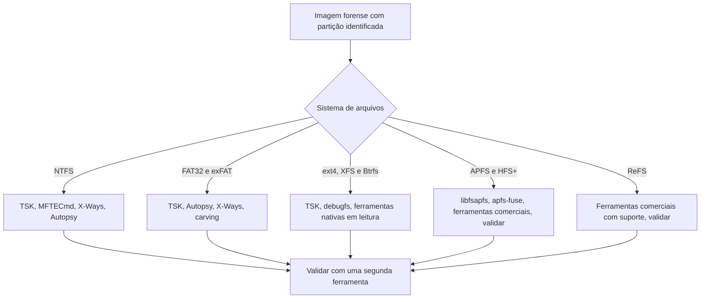

# Sistemas de Arquivos Comparados e Artefatos

> **Objetivo pedagógico:** comparar os principais sistemas de arquivos (FAT32, exFAT, NTFS, ext4, APFS, HFS+, ReFS e outros) quanto à estrutura, aos carimbos de data e hora, ao comportamento na exclusão e aos artefatos forenses, para escolher as ferramentas e antecipar o que pode ser recuperado.

## 1. Quadro comparativo

| Sistema | Estrutura principal | Carimbos | Resolução | Journal | Comportamento na exclusão |
|---|---|---|---|---|---|
| FAT32 | Setor de boot, tabelas FAT, diretórios de entradas de 32 bytes | Criação, modificação, acesso (somente data) | 2 s (modificação), hora local | Não | Primeiro byte do nome vira `0xE5`; a cadeia na FAT é zerada |
| exFAT | Bitmap de alocação, conjuntos de entradas de diretório | Criação, modificação e acesso, com deslocamento de fuso | 10 ms | Não | Bit "em uso" da entrada é limpo; bitmap liberado |
| NTFS | MFT, atributos, `$UsnJrnl`, `$LogFile` | 4 em `$SI` e 4 em `$FN` | 100 ns, UTC | Metadados | Registro MFT marcado como livre; dados mantidos até sobrescrita |
| ext4 | Superbloco, grupos, inodes, extents, journal | mtime, atime, ctime e crtime | ns | Sim | Inode liberado; extents do inode geralmente zerados |
| APFS | Contêiner, volumes, árvores B, snapshots, CoW | Criação, modificação, alteração de atributos e acesso | ns | Não (CoW) | Blocos liberados; snapshots podem preservar estados anteriores |
| HFS+ | Cabeçalho do volume, catálogo, journal | Criação, modificação, atributos e acesso | 1 s, UTC | Sim | Entradas do catálogo removidas; journal pode ter cópias |
| XFS e Btrfs | Ver pasta 08 | | | | |
| ReFS | Estruturas em árvore, integridade por checksum | Semelhantes ao NTFS | 100 ns | Não | Suporte limitado de ferramentas |
| ISO 9660 e UDF | Mídias ópticas | Datas de criação e modificação | 1 s | Não | Geralmente de gravação única |

## 2. FAT32

| Elemento | Descrição | Valor forense |
|---|---|---|
| Setor de boot (BPB) | Tamanho de setor, cluster, número de FATs, rótulo e número de série do volume | Identificação e vínculo com LNK (número de série do volume) |
| FAT | Tabela de encadeamento de clusters | A cadeia é perdida na exclusão; a recuperação supõe arquivos contíguos |
| Diretórios | Entradas de 32 bytes com nome curto 8.3, atributos, datas, primeiro cluster e tamanho | Entradas excluídas mantêm nome (exceto o primeiro caractere), tamanho e primeiro cluster |
| Nomes longos (LFN) | Entradas adicionais com o nome completo em UTF-16 | Podem sobreviver à exclusão e revelar o nome original |
| Tempo | Hora local sem fuso | Interpretar com o fuso do sistema que gravou |

## 3. exFAT

| Elemento | Descrição | Valor forense |
|---|---|---|
| Bitmap de alocação | Marca clusters usados | Clusters liberados na exclusão |
| Conjuntos de entradas de diretório | Entradas de arquivo, fluxo e nome | A exclusão limpa o bit "em uso" mas preserva o restante |
| Flag de arquivo contíguo | Dispensa o uso da FAT | Recuperação frequentemente simples se o arquivo era contíguo |
| Carimbos | Com deslocamento de fuso | Identificam o fuso do dispositivo que gravou |
| Uso comum | Cartões SD e pendrives de grande capacidade | Fonte comum de evidências em mídias removíveis |

## 4. NTFS, ext4, XFS e Btrfs

Veja os detalhes nas pastas 07 (NTFS, MFT, USN Journal, Lixeira e VSS) e 08 (ext4, XFS, Btrfs, ZFS e LVM).

## 5. APFS

| Elemento | Descrição | Valor forense |
|---|---|---|
| Contêiner e volumes | Um contêiner agrega volumes que compartilham espaço | Identificar todos os volumes (Dados, Sistema, VM, Preboot) |
| Snapshots | Estados pontuais do volume | Comparar estados antes e depois de um incidente |
| Cópia na escrita | Blocos antigos não são sobrescritos de imediato | Possível recuperar estados anteriores |
| Clones de arquivos | Arquivos compartilham blocos | Cuidado ao atribuir tamanho e conteúdo |
| Criptografia | Por volume e por arquivo, com chaves em hierarquia | Exige a senha ou a chave de recuperação |
| Carimbos | Nanossegundos | Alta resolução |

O suporte do The Sleuth Kit a APFS é limitado; use bibliotecas e ferramentas específicas (por exemplo, libfsapfs e apfs-fuse) e ferramentas comerciais, validando os resultados com mais de uma abordagem.

```bash
# Exemplos com a biblioteca libfsapfs (se instalada)
fsapfsinfo imagem_apfs.dd
mkdir -p /mnt/apfs && fsapfsmount imagem_apfs.dd /mnt/apfs
```

## 6. HFS+

| Elemento | Descrição | Valor forense |
|---|---|---|
| Arquivo de catálogo | Árvore B com metadados de todos os arquivos | Entradas removidas na exclusão; podem restar em nós não sobrescritos |
| Journal | Registro de transações | Cópias de metadados antigos |
| Carimbos | UTC, resolução de 1 segundo | Menor resolução que APFS |
| Fork de recursos | Dados adicionais associados ao arquivo | Pode ocultar conteúdo |

## 7. ReFS e outros

| Sistema | Observação |
|---|---|
| ReFS | Usado em servidores e em unidades Dev Drive; ferramentas forenses ainda limitadas; verificar suporte antes de depender do resultado |
| exFAT, FAT e NTFS em cartões e pendrives | Frequentes; confirmar qual sistema o dispositivo usa |
| ISO 9660 e UDF | Para mídias ópticas, verificar sessões múltiplas e dados em sessões anteriores |
| Sistemas de arquivos de rede (SMB e NFS) | Os dados estão no servidor; use as fontes do servidor e os logs |

## 8. Escolha de ferramentas por sistema de arquivos



## 9. Comandos úteis do The Sleuth Kit

```bash
# Informações do sistema de arquivos
fsstat -o 2048 /mnt/analise/E001-IMG01-W1.dd

# Listagem recursiva com caminhos; -d para excluídos
fls -r -p -o 2048 /mnt/analise/E001-IMG01-W1.dd > fls_todos.txt
fls -r -p -d -o 2048 /mnt/analise/E001-IMG01-W1.dd > fls_excluidos.txt

# Metadados e conteúdo
istat -o 2048 /mnt/analise/E001-IMG01-W1.dd <inode>
icat  -o 2048 /mnt/analise/E001-IMG01-W1.dd <inode> > arquivo.bin

# Encontrar o inode ou o nome correspondente
ifind -o 2048 -n "pasta/arquivo.docx" /mnt/analise/E001-IMG01-W1.dd
ffind -o 2048 /mnt/analise/E001-IMG01-W1.dd <inode>

# Montagem somente leitura para FAT e exFAT
sudo losetup -r -P -f --show /mnt/analise/E001-IMG01-W1.dd
sudo mount -o ro,noexec,nodev /dev/loop0p1 /mnt/evid
```

Registre sempre o deslocamento, o tamanho do setor e as versões das ferramentas.

## 10. Exemplo prático: arquivo excluído em cartão exFAT

| Etapa | Resultado |
|---|---|
| 1 | O `fls -d` lista a entrada excluída `relatorio_clientes.xlsx` com tamanho e primeiro cluster |
| 2 | O arquivo era contíguo (flag sem cadeia FAT) |
| 3 | `icat` ou o Autopsy extraem o conteúdo, com hash registrado |
| 4 | Os carimbos mostram deslocamento de fuso UTC−3 e datas compatíveis com a atividade do usuário |
| 5 | Conclusão | Arquivo recuperado integralmente, pois os clusters não foram reutilizados |

## 11. Casos de uso corporativos

- Análise de cartões SD e pendrives apreendidos em investigações de vazamento.
- Verificação de estados anteriores em volumes APFS com snapshots.
- Escolha das ferramentas adequadas ao formato de cada mídia recebida pelo laboratório.

## 12. Normas e frameworks relevantes

- ISO/IEC 27037:2012; NIST SP 800-86; NIST CFTT
- MITRE ATT&CK: T1070.004 (File Deletion), T1564 (Hide Artifacts)
- Especificações de exFAT, NTFS, APFS e ext4 publicadas pelos mantenedores

## 13. Referências

- Carrier, B. File System Forensic Analysis. Addison-Wesley, 2005.
- Microsoft. Especificação do exFAT e documentação do FAT e do NTFS.
- Apple. Apple File System Reference (2020).
- Documentação do The Sleuth Kit, do libyal (libfsapfs, libfsntfs) e do apfs-fuse.
- Hansen, K.; Toolan, F. Decoding the APFS file system. Digital Investigation, v. 22, 2017.
- SANS Institute. FOR500 e FOR518 (Mac forensics).
