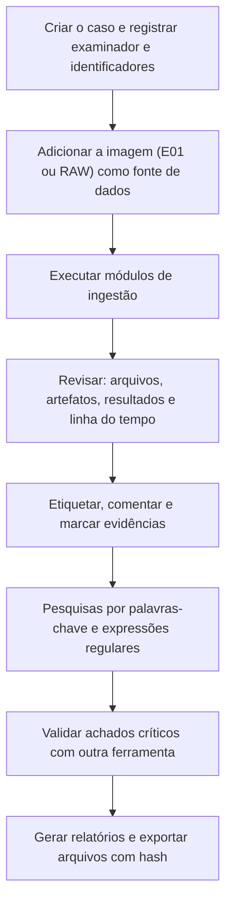

# Suítes Forenses, Ferramentas, Modelos e Checklist de Disco

> **Objetivo pedagógico:** conduzir uma análise de disco com suítes forenses (Autopsy, X-Ways, EnCase e FTK) e ferramentas de linha de comando, definir buscas, filtros e validação cruzada, e registrar o trabalho com modelos e checklist reproduzíveis.

## 1. Ferramentas por finalidade

| Finalidade | Ferramentas |
|---|---|
| Aquisição | FTK Imager, ewfacquire, dc3dd, ddrescue, duplicadores de hardware |
| Suítes de análise | Autopsy (código aberto), X-Ways Forensics, EnCase, FTK e Magnet AXIOM (comerciais) |
| Sistema de arquivos | The Sleuth Kit, MFTECmd, debugfs, libyal |
| Carving e extração | PhotoRec, foremost, scalpel, bulk_extractor |
| Linha do tempo | Plaso, Timesketch, mactime |
| Hash e listas | hashdeep, NSRL, Autopsy Hash Lookup |
| Criptografia | libbde, dislocker, cryptsetup |
| Análise de arquivos | `file`, `exiftool`, `strings`, YARA |
| Verificação | Segunda suíte ou ferramenta de linha de comando |

Registre nome, versão, licença e hash das ferramentas; valide-as em ambiente de testes (NIST CFTT) e mantenha as versões estáveis durante o caso.

## 2. Autopsy: fluxo de trabalho

| Módulo de ingestão | Função |
|---|---|
| Data Source Integrity | Verifica os hashes internos da imagem (por exemplo, E01) |
| Recent Activity | Navegadores, documentos recentes, dispositivos e outros artefatos de usuário |
| Hash Lookup | Comparação com bases de hashes conhecidos (NSRL) e notáveis |
| File Type Identification e Extension Mismatch Detector | Tipo real do arquivo e extensões enganosas |
| Embedded File Extractor | Extrai arquivos contidos em outros (ZIP, Office) |
| Keyword Search | Indexação e busca de texto |
| Email Parser | Mensagens e anexos |
| Picture Analyzer | Metadados EXIF de imagens |
| Encryption Detection | Arquivos e volumes possivelmente criptografados |
| Interesting Files Identifier | Regras para tipos e locais de interesse |
| PhotoRec Carver | Carving integrado |
| Virtual Machine Extractor | Discos de máquinas virtuais contidos na imagem |

Boas práticas: execute somente os módulos necessários ao escopo, documente a configuração e preserve o banco de dados do caso e a lista de módulos executados.

## 3. Buscas e filtros

### 3.1 Palavras-chave e expressões regulares

| Alvo | Expressão regular de referência |
|---|---|
| CPF | `\b\d{3}\.?\d{3}\.?\d{3}-?\d{2}\b` |
| CNPJ | `\b\d{2}\.?\d{3}\.?\d{3}/?\d{4}-?\d{2}\b` |
| E-mail | `[A-Za-z0-9._%+-]+@[A-Za-z0-9.-]+\.[A-Za-z]{2,}` |
| URL | `https?://[^\s"'<>]+` |
| Endereço IPv4 | `\b(?:\d{1,3}\.){3}\d{1,3}\b` |

Reduza falsos positivos: valide os dígitos verificadores de CPF e de CNPJ e o algoritmo de Luhn para números de cartão. Em casos com dados pessoais, aplique minimização: limite as buscas ao escopo e restrinja o acesso aos resultados (LGPD, art. 6º, III).

### 3.2 Filtragem

| Filtro | Uso |
|---|---|
| Hashes conhecidos (NSRL) | Excluir arquivos de software conhecido |
| Hashes notáveis do caso | Localizar arquivos específicos |
| Tipo e extensão | Arquivos de dados, executáveis e documentos |
| Datas (MAC) e horários | Janela de interesse (em UTC) |
| Caminhos | Perfis de usuários, pastas temporárias, lixeira |
| Tamanho e entropia | Contêineres e arquivos criptografados |

## 4. Validação cruzada

| Prática | Descrição |
|---|---|
| Segunda ferramenta | Confirmar achados críticos com outra suíte ou com o TSK |
| Verificação manual | Visualizar estruturas em hexadecimal (por exemplo, o registro MFT) |
| Verificação de hash | Conferir o hash de arquivos exportados com os registrados |
| Revisão por pares | Segundo analista revisa as conclusões e os registros |
| Reprodutibilidade | Registrar o caso, os módulos e os parâmetros |

## 5. Dez perguntas e como respondê-las

| Pergunta | Onde responder |
|---|---|
| 1. A imagem é íntegra e qual a estrutura de partições? | Relatório de verificação e `mmls` |
| 2. Qual o sistema operacional, as contas e o fuso? | Artefatos do sistema (pastas 07 e 08) |
| 3. Quais arquivos existem e quais foram excluídos? | Suíte e `fls`, MFT e inodes |
| 4. O conteúdo foi apagado e há recuperação possível? | Carving, journal, VSS e snapshots |
| 5. Há volumes criptografados ou ocultos? | Detecção de criptografia e entropia |
| 6. Que arquivos foram abertos ou copiados? | LNK, Jump Lists, USN, mídias removíveis |
| 7. Há dados sensíveis ou específicos do caso? | Buscas por palavras-chave e hashes |
| 8. Houve tentativa de apagamento? | Artefatos de ferramentas, espaço livre e logs |
| 9. Quais artefatos de usuário são relevantes? | Navegadores, e-mail, documentos recentes |
| 10. O que outras fontes (logs, memória e rede) confirmam? | Corroboração externa |

## 6. Modelo A: Inventário de mídia e imagens

| ID | Mídia (fabricante, modelo e série) | Capacidade (bytes e setores) | Tipo (HDD, SSD, NVMe, USB) | Imagem (ID e formato) | Hash SHA-256 | Estado e observações |
|---|---|---|---|---|---|---|
| E001 | | | | | | |
| E002 | | | | | | |

## 7. Modelo B: Inventário de partições e volumes

| Imagem | Partição | Início e tamanho (setores) | Tipo (MBR ou GUID) | Sistema de arquivos | Criptografia | Observações (lacunas, HPA e DCO) |
|---|---|---|---|---|---|---|
| E001-IMG01 | 1 | | | | | |
| E001-IMG01 | 2 | | | | | |

## 8. Modelo C: Registro de recuperação

| ID | Origem (partição e inode, ou deslocamento) | Método (metadados, journal, carving) | Arquivo recuperado e hash | Integridade (íntegro, parcial e corrompido) | Observações |
|---|---|---|---|---|---|
| R-001 | | | | | |
| R-002 | | | | | |

## 9. Modelo D: Registro de buscas

| ID | Data e hora (UTC) | Ferramenta e versão | Termo ou expressão | Escopo (partições e pastas) | Resultados | Falsos positivos | Responsável |
|---|---|---|---|---|---|---|---|
| B-001 | | | | | | | |

## 10. Checklist operacional de disco

**Caso:** DFL-AAAA-NNN
**Imagem:** ____________________
**Analista:** ____________________
**Data e hora (UTC):** ____________________

### 10.1 Preparação

- [ ] Autorização, escopo e perguntas investigativas definidos
- [ ] Imagem verificada por hash e trabalho em cópia
- [ ] Ferramentas validadas e versões registradas
- [ ] Tamanho do setor e deslocamentos das partições registrados

### 10.2 Estrutura

- [ ] Tabela de partições (MBR ou GPT) analisada
- [ ] Lacunas, partições ocultas e apagadas investigadas
- [ ] HPA e DCO verificados na fonte, quando aplicável
- [ ] Volumes lógicos, RAID e criptografia identificados

### 10.3 Sistema de arquivos

- [ ] Sistema de arquivos identificado e ferramenta adequada selecionada
- [ ] Arquivos excluídos listados e recuperação por metadados tentada
- [ ] Journal, snapshots, VSS e backups avaliados
- [ ] Carving no espaço não alocado, com validação dos resultados
- [ ] Slack e fluxos alternativos de dados examinados

### 10.4 Análise de conteúdo

- [ ] Hash Lookup (NSRL e notáveis) aplicado e versão registrada
- [ ] Buscas por palavras-chave e padrões, com minimização de dados pessoais
- [ ] Artefatos de usuário e de aplicativos revisados
- [ ] Arquivos de interesse exportados com hash e origem

### 10.5 Anti-forense

- [ ] Artefatos de ferramentas de apagamento procurados
- [ ] Espaço livre examinado (zeros, padrões e entropia)
- [ ] Efeito de SSD e TRIM considerado e declarado
- [ ] Hipóteses alternativas (limpeza rotineira) consideradas

### 10.6 Qualidade e relato

- [ ] Achados críticos validados por uma segunda ferramenta
- [ ] Horários normalizados para UTC
- [ ] Limitações e grau de confiança declarados
- [ ] Mapeamento para MITRE ATT&CK, quando aplicável
- [ ] Revisão por pares realizada

## 11. Resultado da verificação

| Resultado | Condição |
|---|---|
| Conforme | Todos os itens aplicáveis marcados |
| Conforme com ressalvas | Pendências sem impacto nas conclusões, com plano de ação |
| Não conforme | Análise sobre a imagem original, achados sem validação ou ferramentas sem registro; comunicar o líder e o Jurídico |

**Assinatura do analista:** ____________________
**Assinatura do revisor:** ____________________

## 12. Casos de uso corporativos

- Padronização das análises de disco do laboratório.
- Treinamento de analistas com os modelos e o checklist.
- Auditoria da qualidade técnica por amostragem de casos.

## 13. Normas e frameworks relevantes

- ISO/IEC 27037:2012; ISO/IEC 27041:2015; ISO/IEC 27042:2015; NIST SP 800-86
- NIST CFTT; SWGDE; ENFSI Best Practice Manual (ENFSI-BPM-FIT-01)
- LGPD, arts. 6º e 46

## 14. Referências

- Carrier, B. File System Forensic Analysis. Addison-Wesley, 2005.
- Documentação do Autopsy e do The Sleuth Kit (Basis Technology e comunidade).
- Documentação do X-Ways Forensics, do EnCase e do FTK.
- Documentação do bulk_extractor, do PhotoRec e do hashdeep.
- Casey, E. Digital Evidence and Computer Crime. 3. ed. 2011.
- SANS Institute. FOR500 e FOR498.
