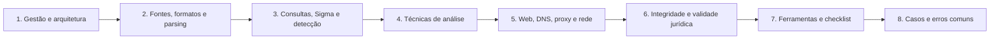

# 11 Análise de Logs

## Objetivo

Estruturar a gestão, a coleta, o parsing, a análise e a validação de logs de sistemas, redes, identidade, aplicações e nuvem, de modo a detectar atividades maliciosas, reconstruir incidentes e sustentar conclusões com integridade, reprodutibilidade e atenção aos requisitos legais e de privacidade.

## Trilha de estudo recomendada

## Conteúdo da pasta

| Ordem | Arquivo | Objetivo |
|---|---|---|
| 1 | [fundamentos-gestao-e-arquitetura-de-logs.md](fundamentos-gestao-e-arquitetura-de-logs.md) | Ciclo de vida, política, arquitetura, retenção e lacunas de logging |
| 2 | [fontes-de-log-formatos-e-parsing.md](fontes-de-log-formatos-e-parsing.md) | Catálogo de fontes, formatos, esquemas e técnicas de parsing |
| 3 | [linguagens-de-consulta-sigma-e-engenharia-de-deteccao.md](linguagens-de-consulta-sigma-e-engenharia-de-deteccao.md) | KQL, SPL, Sigma e ciclo de engenharia de detecção |
| 4 | [tecnicas-de-analise-e-deteccao-de-anomalias.md](tecnicas-de-analise-e-deteccao-de-anomalias.md) | Frequência, baseline, beaconing, DNS, geovelocidade e calibração |
| 5 | [analise-de-logs-web-dns-proxy-e-rede.md](analise-de-logs-web-dns-proxy-e-rede.md) | Logs web, DNS, proxy, firewall, VPN, e-mail e Zeek |
| 6 | [integridade-retencao-e-validade-juridica-dos-logs.md](integridade-retencao-e-validade-juridica-dos-logs.md) | Integridade, retenção, privacidade e apresentação como prova |
| 7 | [ferramentas-pipelines-modelos-e-checklist-de-logs.md](ferramentas-pipelines-modelos-e-checklist-de-logs.md) | Ferramentas, pipeline, playbook de 60 minutos, modelos e checklist |
| 8 | [casos-de-uso-e-erros-comuns-em-logs.md](casos-de-uso-e-erros-comuns-em-logs.md) | Sete cenários, erros comuns e exercícios |

## Princípios

- Preservar o log bruto e produzir as camadas derivadas separadamente
- Normalizar os horários para UTC e documentar fusos, desvios e margens de erro
- Centralizar os logs, com transporte seguro, imutabilidade e acesso restrito
- Declarar lacunas e verificar o que a política de auditoria efetivamente registra
- Tratar os resultados das técnicas como candidatos e corroborá-los com fontes independentes
- Registrar consultas, ferramentas e versões para reprodutibilidade
- Minimizar dados pessoais e restringir o acesso aos logs
- Distinguir tentativa de comprometimento e comprometimento confirmado

## Relação com outras pastas

- 04-hash-e-integridade e 02-cadeia-de-custodia: hash, manifestos e custódia de logs exportados
- 05-timeline-analysis: normalização de tempo e correlação multifonte
- 06-evidencias-digitais: validade e apresentação de evidências, inclusive logs
- 07-windows-forensics e 08-linux-forensics: logs de sistemas operacionais em detalhe
- Pastas de rede, e-mail, nuvem, Azure, M365 e threat hunting: aprofundamentos por fonte e por técnica

## Referências

- Kent, K.; Souppaya, M. NIST SP 800-92: Guide to Computer Security Log Management (2006)
- NIST SP 800-53 Rev. 5 (família AU); NIST SP 800-61 Rev. 3 (2025)
- CIS Controls v8.1 (controle 8); ISO/IEC 27002:2022 (controles 8.15, 8.16 e 8.17)
- RFC 3164, RFC 5424, RFC 5425, RFC 6587 e RFC 3339
- MITRE ATT&CK; Sigma (SigmaHQ); Atomic Red Team
- OWASP. Top 10 (2021) e Logging Cheat Sheet
- Chuvakin, A.; Schmidt, K.; Phillips, C. Logging and Log Management (2013)
- Davidoff, S.; Ham, J. Network Forensics (2012)
- Brasil. Lei nº 12.965/2014 (Marco Civil da Internet); Lei nº 13.709/2018 (LGPD)
- Documentação do Zeek, Elastic, Splunk, Microsoft Sentinel (KQL), Hayabusa e Chainsaw
- SANS Institute. FOR508, FOR572 e SEC555
