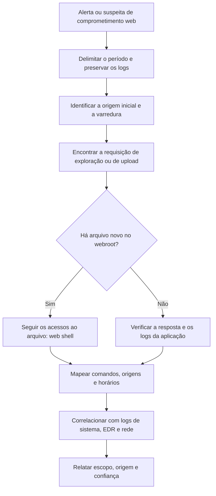

# Análise de Logs Web, DNS, Proxy e Rede

> **Objetivo pedagógico:** analisar logs de servidores web, WAF, DNS, proxy, firewall, VPN, e-mail e Zeek para identificar exploração de aplicações, varreduras, comunicação com infraestrutura maliciosa e exfiltração, reconstruindo o ataque a partir da perspectiva da rede e das aplicações.

## 1. Logs de servidores web (Apache, Nginx e IIS)

### 1.1 Campos úteis

| Campo | Uso |
|---|---|
| IP de origem | Atribuição e correlação; atenção a proxies, CDNs e cabeçalhos `X-Forwarded-For` |
| Horário | Linha do tempo; verificar o fuso |
| Método e URL (com parâmetros) | Tipo de requisição e alvo |
| Código de status | 200, 3xx, 401, 403, 404 e 5xx |
| Bytes enviados | Tamanho da resposta (útil para exfiltração e para detectar execução bem-sucedida) |
| Referer e user-agent | Ferramenta ou navegador |
| Tempo de resposta | Lentidão pode indicar exploração (por exemplo, injeção cega com atraso) |
| Usuário autenticado | Quando disponível |

### 1.2 Padrões de ataque

| Padrão | Indício em logs | Observação |
|---|---|---|
| Varredura de diretórios e de arquivos | Muitos 404 em sequência, a partir de uma origem | Ferramentas de varredura e de enumeração |
| Injeção de SQL | Parâmetros com `union select`, `' or 1=1`, `sleep(`, `benchmark(` | Resposta com tamanho incomum ou atraso |
| Travessia de diretórios | `../`, `..%2f`, `%2e%2e/` e acesso a `/etc/passwd` | |
| Execução remota de comandos | Parâmetros como `cmd=`, `exec=`, `system(`, `wget`, `curl`, `base64` | Possível web shell |
| Exploração de Log4j | `${jndi:ldap://` e variações ofuscadas no URL, nos cabeçalhos e no user-agent | CVE-2021-44228 |
| Inclusão de arquivos | `php://`, `file://`, `data://` e URLs externas em parâmetros | |
| Força bruta de login | Muitos POST a `/login` ou `/wp-login.php` com 401 ou 200 diferentes | Verificar o tamanho da resposta |
| Upload e web shell | POST de upload seguido de GET ao arquivo enviado e de POSTs com parâmetros de comando | Arquivos recém-criados no webroot |
| Ferramentas conhecidas | User-agents de ferramentas de varredura (por exemplo, sqlmap, Nikto e Nmap Scripting Engine) | O user-agent pode ser alterado |

```bash
# Principais origens por volume
awk '{print $1}' access.log | sort | uniq -c | sort -nr | head -20

# Códigos 404 e 403 por origem (varredura)
awk '$9==404 || $9==403 {print $1}' access.log | sort | uniq -c | sort -nr | head

# Parâmetros suspeitos
grep -E -i "union(\s|%20|\+)+select|sleep\(|\.\./|%2e%2e|/etc/passwd|\$\{jndi:|cmd=|exec=|base64" access.log | head -100

# Requisições POST seguidas de acesso ao mesmo arquivo (possível web shell)
awk '$6=="\"POST" {print $7}' access.log | sort | uniq -c | sort -nr | head
```

Atenção: o servidor registra o que foi solicitado, e não o que foi executado com sucesso; confirme com o código de status, o tamanho da resposta, os logs de aplicação, os logs do sistema e os arquivos no disco.

### 1.3 Reconstrução de um ataque web



## 2. WAF e CDN

| Fonte | Valor |
|---|---|
| WAF | Regras acionadas, ações (bloqueio ou permissão) e carga; o que foi bloqueado informa a tentativa, o que passou informa o risco |
| CDN e balanceadores | O IP real do cliente em cabeçalhos; registre a cadeia (`X-Forwarded-For`) |
| Limitação | Atacantes distribuídos usam muitos IPs; correlacione por padrão de requisição |

## 3. DNS

| Análise | Descrição |
|---|---|
| Domínios consultados por host | Identificar comunicação com infraestrutura suspeita |
| Domínios recém-registrados ou de baixa reputação | Consulta a inteligência de ameaças (por domínio, sem enviar dados internos) |
| NXDOMAIN em volume | DGA ou varredura |
| Túneis (subdomínios longos e TXT) | Exfiltração ou C2 |
| Resolvedores externos usados diretamente | Evasão |
| Consultas anormais de servidores | Servidores raramente consultam domínios variados |

```bash
# Principais domínios consultados
zeek-cut query < dns.log | sort | uniq -c | sort -nr | head -30

# Consultas com NXDOMAIN
zeek-cut query rcode_name < dns.log | awk '$2=="NXDOMAIN" {print $1}' | sort | uniq -c | sort -nr | head
```

## 4. Proxy e filtro web

| Campo ou análise | Uso |
|---|---|
| Usuário, IP e dispositivo | Atribuir a atividade |
| URL, domínio e categoria | Identificar destinos de risco |
| Método e tamanho de requisição (POST) | Envio de dados |
| Volume por usuário | Exfiltração |
| Método CONNECT e SNI | Visibilidade parcial de tráfego TLS |
| Downloads de executáveis e arquivos compactados | Vetores de entrada |
| Beaconing | Ver técnicas de análise |

```bash
# Maiores volumes enviados por usuário (CSV com colunas usuario, bytes_enviados)
mlr --icsv --opprint stats1 -a sum -f bytes_enviados -g usuario then sort -nr bytes_enviados_sum proxy.csv | head -20
```

## 5. Firewall, NetFlow e VPN

| Fonte | Análises |
|---|---|
| Firewall | Conexões negadas e permitidas; varredura de portas (uma origem e muitas portas de destino); conexões de saída para portas incomuns |
| NetFlow e IPFIX | Volume por par origem e destino; conexões de longa duração; transferência de grandes volumes |
| VPN | Logons, origens e geolocalização, dispositivos, sessões simultâneas e horário |
| IDS e IPS | Alertas e assinaturas, com contexto e verificação de falsos positivos |

```bash
# Detecção simples de varredura de portas: origens com muitos destinos e portas distintas (Zeek conn.log)
zeek-cut id.orig_h id.resp_h id.resp_p < conn.log | sort -u | awk '{c[$1]++} END{for(i in c) print c[i], i}' | sort -nr | head
```

## 6. Logs do Zeek

| Log | Conteúdo |
|---|---|
| `conn.log` | Todas as conexões: tempo, endereços, portas, protocolo, serviço, duração e bytes |
| `dns.log` | Consultas e respostas |
| `http.log` | Requisições HTTP com host, URI, user-agent e status |
| `ssl.log` | Handshakes TLS: SNI, versão, certificado e impressões JA3 e JA4 |
| `files.log` | Arquivos transferidos, com hashes |
| `notice.log` | Alertas e anomalias |
| `weird.log` | Comportamentos de protocolo anormais |

```bash
# Conexões longas (possível canal persistente)
zeek-cut id.orig_h id.resp_h id.resp_p duration < conn.log | awk '$4 > 3600' | sort -k4 -nr | head

# SNI mais raros
zeek-cut server_name < ssl.log | sort | uniq -c | sort -n | head -30
```

## 7. E-mail

| Fonte | Análises |
|---|---|
| Gateway de e-mail | Remetentes, assuntos, anexos, resultados de SPF, DKIM e DMARC e ações |
| Rastreamento de mensagens (message trace) | Fluxo de uma mensagem entre servidores e destinatários |
| Alertas de antiphishing | Campanhas e destinatários afetados |
| Cabeçalhos | Rota e autenticação (ver pasta de e-mail) |

## 8. Visibilidade em tráfego criptografado

| Limitação | Alternativas |
|---|---|
| Conteúdo não visível em TLS | Metadados: SNI, certificado, JA3 e JA4, tamanho, tempo e frequência |
| Proxy sem inspeção TLS | Logs de endpoint (EDR), DNS e fluxos |
| DNS sobre HTTPS (DoH) | Bloqueio ou controle por política; logs de resolvedores corporativos |
| Aplicações em nuvem | Logs do próprio provedor (audit logs) |

## 9. Exemplo prático: web shell e exfiltração

| Hora (UTC) | Fonte | Achado |
|---|---|---|
| 20:55 a 21:01 | Nginx | 340 requisições com 404 de 203.0.113.50 (varredura de diretórios) |
| 21:02:14 | Nginx | POST a `/upload.php` com 200 e resposta de 62 bytes |
| 21:02:40 | Sistema de arquivos | Novo arquivo `uploads/img.php`, não presente no repositório de código |
| 21:03:05 a 21:20 | Nginx | POSTs a `/uploads/img.php` com parâmetros codificados; respostas de tamanhos variados |
| 21:05:30 | auditd | `www-data` executando `/bin/sh`, `id` e `tar` |
| 21:18:10 | Firewall | 4,2 GB de saída do servidor web para IP externo na porta 443 |
| Conclusão | Exploração de upload (T1190), web shell (T1505.003) e exfiltração (T1041); confiança alta, corroborada por logs web, disco, auditd e firewall |

## 10. Casos de uso corporativos

- Investigação de comprometimento de aplicações web e de APIs.
- Caça a C2 e a exfiltração com DNS, proxy e fluxos.
- Revisão de acessos VPN suspeitos e de uso de credenciais comprometidas.

## 11. Normas e frameworks relevantes

- MITRE ATT&CK: T1190, T1505.003, T1595 (Active Scanning), T1071, T1568, T1041, T1048, T1078
- OWASP Top 10 (A01 a A10); OWASP Logging Cheat Sheet
- CIS Controls v8.1, controles 8, 12 e 13
- ISO/IEC 27002:2022, controles 8.15, 8.16 e 8.20 (segurança de redes)

## 12. Referências

- OWASP. Top 10 Web Application Security Risks (2021).
- Davidoff, S.; Ham, J. Network Forensics: Tracking Hackers through Cyberspace. Prentice Hall, 2012.
- Zeek Project. Documentação dos logs e do zeek-cut.
- Apache HTTP Server e Nginx. Documentação de formatos de log.
- Microsoft. Documentação de logs do IIS (formato W3C).
- MITRE ATT&CK. https://attack.mitre.org
- SANS Institute. FOR572: Advanced Network Forensics.
