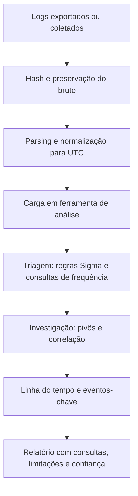

# Ferramentas, Pipelines, Modelos e Checklist de Logs

> **Objetivo pedagógico:** estruturar as ferramentas, os pipelines e os registros necessários para analisar logs de forma reproduzível, e verificar a qualidade do trabalho com modelos e uma lista de verificação.

## 1. Ferramentas por finalidade

| Finalidade | Ferramentas |
|---|---|
| Triagem em linha de comando | grep, awk, sed, sort, uniq, jq, Miller (mlr), csvkit, DuckDB |
| Logs do Windows | Get-WinEvent, EvtxECmd, Chainsaw, Hayabusa, Timeline Explorer |
| Regras e detecções | Sigma, sigma-cli, Chainsaw, Hayabusa |
| SIEM e plataformas | Microsoft Sentinel, Splunk, Elastic e OpenSearch, Graylog, Wazuh, Security Onion |
| Coleta e encaminhamento | rsyslog, syslog-ng, Elastic Agent, Fluent Bit, Vector, NXLog, Windows Event Forwarding |
| Rede | Zeek (e zeek-cut), Suricata, Wireshark e tshark, Arkime |
| Linhas do tempo | Plaso, Timesketch, Timeline Explorer |
| Visualização | Kibana, Grafana, Power BI, Jupyter |
| Análise programática | Python (pandas), Jupyter Notebook, R |
| Testes de detecção | Atomic Red Team, conjuntos de dados públicos |

Registre nome, versão e origem de cada ferramenta e preserve consultas e scripts em repositório com versionamento.

## 2. Triagem de logs do Windows (EVTX)

```powershell
# Resumo de eventos por ID (Hayabusa)
hayabusa eid-metrics -d E:\coleta\logs

# Resumo de logons
hayabusa logon-summary -d E:\coleta\logs

# Linha do tempo com regras Sigma
hayabusa csv-timeline -d E:\coleta\logs -o E:\saida\hayabusa.csv

# Chainsaw: caça com regras Sigma e mapeamento de campos
chainsaw hunt E:\coleta\logs -s sigma\rules --mapping mappings\sigma-event-logs-all.yml --csv --output E:\saida\chainsaw

# Conversão para CSV com EvtxECmd
EvtxECmd.exe -d E:\coleta\logs --csv E:\saida --csvf evtx.csv
```

Confirme os parâmetros e os caminhos de mapeamento nas versões instaladas.

## 3. Pipeline mínimo de análise de logs



## 4. Playbook de triagem de logs em 60 minutos

| Minuto | Atividade |
|---|---|
| 0 a 10 | Definir a pergunta e a janela de interesse; listar as fontes disponíveis; preservar e fazer hash |
| 10 a 20 | Normalizar horários e carregar os dados; verificar completude e lacunas |
| 20 a 35 | Executar regras Sigma e consultas de baseline: autenticações, processos, destinos de rede raros e volumes |
| 35 a 50 | Pivotear a partir dos candidatos: usuário, host, IP e domínio; corroborar com uma segunda fonte |
| 50 a 60 | Registrar achados e consultas; definir os próximos passos (coleta adicional ou contenção) |

## 5. Laboratório de logs

| Componente | Opções |
|---|---|
| Plataforma de análise | Elastic (Docker), OpenSearch, Graylog, Wazuh ou Security Onion |
| Agentes e encaminhadores | Elastic Agent, Fluent Bit e Wazuh agent |
| Fontes de teste | Máquinas virtuais Windows e Linux, servidor web e Zeek |
| Dados de exercício | Conjuntos públicos (ver abaixo) |
| Documentação | Versões, configuração e esquema de campos |

Conjuntos de dados públicos para prática: OTRF Security-Datasets (Mordor), EVTX-ATTACK-SAMPLES, Splunk Attack Data, Loghub e os conjuntos Boss of the SOC (BOTS).

## 6. Modelo A: Inventário de fontes de log

| ID | Fonte | Sistema ou ativo | Formato | Fuso | Retenção | Centralizada? | Cobertura temporal | Lacunas conhecidas |
|---|---|---|---|---|---|---|---|---|
| S1 | | | | | | | | |
| S2 | | | | | | | | |

## 7. Modelo B: Registro de consultas

| ID | Data e hora (UTC) | Analista | Plataforma e versão | Fonte e período | Consulta (texto completo) | Objetivo | Resultado resumido | Hash do arquivo de resultado |
|---|---|---|---|---|---|---|---|---|
| Q-001 | | | | | | | | |
| Q-002 | | | | | | | | |

## 8. Modelo C: Registro de lacunas de log

| ID | Fonte | Período da lacuna | Causa provável | Impacto na investigação | Fonte alternativa | Ação corretiva |
|---|---|---|---|---|---|---|
| G-001 | | | | | | |

## 9. Modelo D: Registro de achados em logs

| ID | Fonte e evento | Hora (UTC) | Entidades (usuário, host, IP) | Descrição | Corroboração | Confiança | Técnica ATT&CK |
|---|---|---|---|---|---|---|---|
| L-001 | | | | | | | |
| L-002 | | | | | | | |

## 10. Checklist operacional de análise de logs

**Caso:** DFL-AAAA-NNN
**Analista:** ____________________
**Data e hora (UTC):** ____________________

### 10.1 Preparação

- [ ] Perguntas investigativas e janela de interesse definidas
- [ ] Autorização, base legal e minimização consideradas
- [ ] Inventário de fontes preenchido e lacunas identificadas
- [ ] Logs de retenção curta preservados e retenção ampliada, quando necessário

### 10.2 Coleta e preservação

- [ ] Exportação por meio oficial, com conta nominal
- [ ] Consultas e filtros de exportação registrados
- [ ] Hash e manifesto gerados; custódia registrada
- [ ] Armazenamento com controle de acesso e imutabilidade

### 10.3 Processamento

- [ ] Log bruto preservado separadamente
- [ ] Formato, fuso e codificação identificados
- [ ] Horários normalizados para UTC e desvio estimado
- [ ] Parsing validado por amostragem e contagem
- [ ] Enriquecimentos documentados (geolocalização, ativos e inteligência de ameaças)

### 10.4 Análise

- [ ] Regras Sigma e consultas de baseline executadas
- [ ] Análise de frequência, primeira ocorrência e janelas
- [ ] Beaconing, DNS e volume de saída verificados, quando pertinente
- [ ] Pivôs realizados e corroboração por duas fontes independentes
- [ ] Falsos positivos avaliados e registrados
- [ ] Lacunas e sinais de adulteração analisados

### 10.4.1 Segurança da análise

- [ ] Consultas externas limitadas a indicadores (hashes e domínios), sem enviar dados internos
- [ ] Acesso aos resultados restrito conforme a sensibilidade

### 10.5 Relato

- [ ] Eventos-chave com fonte, hora (UTC) e confiança
- [ ] Consultas e scripts anexados
- [ ] Limitações, premissas e margens de erro declaradas
- [ ] Mapeamento para MITRE ATT&CK
- [ ] Recomendações de logging (lacunas) e de detecção
- [ ] Revisão por pares realizada

## 11. Resultado da verificação

| Resultado | Condição |
|---|---|
| Conforme | Todos os itens aplicáveis marcados |
| Conforme com ressalvas | Pendências sem impacto nas conclusões, com plano de ação |
| Não conforme | Horários sem normalização, consultas não registradas, conclusões sem corroboração ou exportação sem hash; comunicar o líder |

**Assinatura do analista:** ____________________
**Assinatura do revisor:** ____________________

## 12. Casos de uso corporativos

- Padronização da triagem de logs do SOC e do time de DFIR.
- Treinamento de analistas com laboratório, conjuntos de dados e checklist.
- Auditoria da qualidade técnica de investigações que dependem de logs.

## 13. Normas e frameworks relevantes

- NIST SP 800-92; NIST SP 800-61 Rev. 3; ISO/IEC 27042:2015
- MITRE ATT&CK; Sigma
- CIS Controls v8.1, controles 8 e 17
- ISO/IEC 27002:2022, controles 8.15 e 8.16

## 14. Referências

- Documentação do Hayabusa (Yamato Security), do Chainsaw (WithSecure), do Sigma e do Zeek.
- Documentação do Elastic, do OpenSearch, do Graylog, do Wazuh e do Security Onion.
- Documentação do jq, do Miller e do DuckDB.
- OTRF. Security-Datasets (Mordor); sbousseaden. EVTX-ATTACK-SAMPLES; Splunk. Attack Data; Loghub (logpai).
- Chuvakin, A. et al. Logging and Log Management. Syngress, 2013.
- SANS Institute. FOR508 e SEC555 (SIEM com análise de logs).
