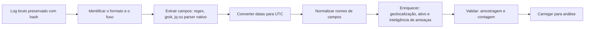

# Fontes de Log, Formatos e Parsing

> **Objetivo pedagógico:** conhecer as principais fontes de log por domínio (identidade, endpoint, rede, aplicações, nuvem e dados), reconhecer os formatos mais comuns e seus campos essenciais, e extrair e normalizar os dados com ferramentas de linha de comando e esquemas padronizados.

## 1. Catálogo de fontes por domínio

| Domínio | Fontes | Campos essenciais | Perguntas respondidas |
|---|---|---|---|
| Identidade e acesso | Active Directory, Entra ID, SSO, IdP, MFA | Usuário, resultado, IP de origem, dispositivo, aplicação, horário | Quem autenticou, de onde e com qual método |
| Endpoint | EVTX, Sysmon, EDR, auditd, journald | Processo, linha de comando, usuário, hash, pai, conexões | O que foi executado |
| Rede | Firewall, proxy, DNS, VPN, NetFlow, Zeek, IDS e IPS | Origem, destino, portas, bytes, URL, domínio, ação | Quem se comunicou com quem |
| Servidores web e aplicações | Apache, Nginx, IIS, WAF, logs de aplicação | IP, método, URL, status, user-agent, usuário, bytes | Como o serviço foi acessado ou explorado |
| Bancos de dados | Auditoria nativa | Usuário, consulta, objeto, resultado, origem | Quem acessou ou alterou dados |
| Nuvem e SaaS | CloudTrail, Azure Activity, GCP Audit Logs, Microsoft 365, Google Workspace | Identidade, API, recurso, IP, resultado, região | O que mudou e quem alterou na nuvem |
| E-mail | Gateway, rastreamento de mensagens | Remetente, destinatário, assunto, resultado, IP | Fluxo de mensagens e phishing |
| Contêineres e orquestração | Logs de contêiner, auditoria do Kubernetes | Pod, usuário, verbo, recurso, resultado | Operações no cluster |
| Segurança | Antivírus, DLP, CASB, vulnerabilidades | Alerta, arquivo, política, ação | Eventos de proteção |

## 2. Formatos comuns

| Formato | Estrutura | Observações |
|---|---|---|
| Syslog (RFC 3164) | `<PRI>Mmm dd hh:mm:ss host app[pid]: mensagem` | Sem ano e sem fuso |
| Syslog (RFC 5424) | `<PRI>VERSÃO TIMESTAMP HOST APP PROCID MSGID [DADOS ESTRUTURADOS] MENSAGEM` | Timestamp no formato RFC 3339 |
| CEF (Common Event Format) | `CEF:Versão\|Fabricante\|Produto\|Versão\|ID do evento\|Nome\|Severidade\|Extensão` | Campos chave=valor na extensão |
| LEEF | `LEEF:Versão\|Fabricante\|Produto\|Versão\|ID\|` e atributos separados por tabulação | Usado em soluções de SIEM |
| JSON e NDJSON | Um objeto por linha | Estruturado; preferível em novas integrações |
| EVTX e XML | Registros do Windows | Converter com ferramentas |
| W3C Extended Log (IIS) | Cabeçalhos `#Fields:` com campos separados por espaço | O IIS registra o formato W3C em UTC por padrão |
| Common e Combined Log Format (Apache e Nginx) | `%h %l %u %t "%r" %>s %b "%{Referer}i" "%{User-agent}i"` | O horário é local, com deslocamento de fuso |
| Zeek | TSV com cabeçalho ou JSON | `conn.log`, `dns.log`, `http.log`, `ssl.log`, entre outros |
| NetFlow e IPFIX | Registros de fluxo binários | Resumo de conexões, sem conteúdo |
| Logs de nuvem | JSON | CloudTrail, Azure Activity, GCP Audit |

Exemplos:

```
# Syslog RFC 3164
Oct 28 13:22:10 srv01 sshd[2231]: Accepted publickey for deploy from 203.0.113.50 port 51322 ssh2

# CEF
CEF:0|Fornecedor|Firewall|1.0|100|Conexao bloqueada|5|src=10.1.2.3 dst=198.51.100.9 dpt=443 act=deny

# Apache Combined
203.0.113.50 - - [28/Oct/2026:13:22:10 -0300] "GET /admin HTTP/1.1" 403 512 "-" "Mozilla/5.0"
```

## 3. Esquemas e modelos de dados comuns

| Esquema | Característica |
|---|---|
| ECS (Elastic Common Schema) | Campos padronizados do Elastic (por exemplo, `source.ip` e `user.name`) |
| OCSF (Open Cybersecurity Schema Framework) | Esquema aberto para eventos de segurança |
| Splunk CIM | Modelos de dados comuns do Splunk |
| Microsoft ASIM | Modelo de informações de segurança do Microsoft Sentinel |
| Campos mínimos próprios | Quando não há plataforma, defina um esquema mínimo (ver abaixo) |

### 3.1 Esquema mínimo de eventos de investigação

| Campo | Descrição |
|---|---|
| `ts_utc` | Horário em UTC (ISO 8601) |
| `fonte` | Origem do log |
| `host` | Sistema gerador |
| `usuario` | Conta envolvida |
| `ip_origem` e `ip_destino` | Endereços |
| `acao` | Ação ou tipo do evento |
| `objeto` | Recurso afetado (arquivo, URL, recurso de nuvem) |
| `resultado` | Sucesso, falha ou bloqueio |
| `bruto` | Linha original, preservada |

## 4. Pipeline de parsing



Princípio: preserve sempre o log bruto e produza os campos extraídos como uma camada separada, para que a análise seja reproduzível e auditável.

## 5. Exemplos práticos de parsing

### 5.1 Apache e Nginx (Combined)

```bash
# IPs de origem mais frequentes
awk '{print $1}' access.log | sort | uniq -c | sort -nr | head

# Códigos de status por contagem
awk '{print $9}' access.log | sort | uniq -c | sort -nr

# Extração com regex para CSV (IP, horário, método, URL, status, bytes)
perl -ne 'print "$1,$2,$3,$4,$5,$6\n" if /^(\S+) \S+ \S+ \[([^\]]+)\] "(\S+) (\S+) [^"]*" (\d{3}) (\S+)/' access.log > access.csv
```

### 5.2 JSON (CloudTrail)

```bash
jq -r '.Records[] | [.eventTime, .eventName, .eventSource, .userIdentity.arn, .sourceIPAddress] | @tsv' cloudtrail.json > cloudtrail.tsv
```

### 5.3 Logs delimitados e CSV

```bash
# Miller: contagem por usuário
mlr --icsv --opprint count-distinct -f usuario then sort -nr count proxy.csv

# DuckDB: consulta SQL direta sobre CSV
duckdb -c "SELECT ip_origem, count(*) AS n FROM read_csv_auto('proxy.csv') GROUP BY 1 ORDER BY n DESC LIMIT 20"
```

### 5.4 Zeek

```bash
# Conexões por destino com volume (zeek-cut seleciona colunas)
cat conn.log | zeek-cut id.orig_h id.resp_h id.resp_p orig_bytes resp_bytes | sort | head
```

### 5.5 Conversão de horário para UTC (Python)

```python
import pandas as pd
df = pd.read_csv("proxy.csv")
df["ts_utc"] = (pd.to_datetime(df["ts_local"])
                .dt.tz_localize("America/Sao_Paulo", ambiguous="NaT", nonexistent="NaT")
                .dt.tz_convert("UTC"))
```

## 6. Armadilhas comuns de parsing

| Armadilha | Efeito | Prevenção |
|---|---|---|
| Fuso ou ano ausente (syslog tradicional) | Horários errados | Informar o fuso do host e determinar o ano pelo contexto |
| Eventos multilinha (stack traces e XML) | Eventos quebrados | Parsers com suporte a multilinha |
| Campos com espaços e aspas | Colunas deslocadas | Parsers adequados, e não `awk` simples |
| Codificação de caracteres | Texto corrompido | Identificar a codificação (UTF-8 ou UTF-16) |
| Valores truncados | Dados incompletos | Verificar o limite do campo na fonte |
| Injeção de log (quebras de linha em campos controlados pelo usuário) | Linhas forjadas | Sanitização na geração e validação no parsing |
| Mudança de formato após atualização | Parsing falho | Monitorar a taxa de sucesso do parser |
| Duplicidade (reenvio) | Contagens infladas | Identificadores e deduplicação sem apagar o original |

## 7. Exemplo prático: normalização de três fontes em um incidente

| Fonte | Formato original | Fuso | Tratamento |
|---|---|---|---|
| Proxy | CSV com `ts_local` | America/Sao_Paulo | Converter para UTC e acrescentar a coluna `fonte=proxy` |
| Entra ID | JSON com `createdDateTime` | UTC | Extrair com `jq` e padronizar nomes |
| Firewall | CEF | UTC (conforme configuração do equipamento) | Extrair `src`, `dst`, `dpt` e `act` |
| Resultado | Tabela unificada pelo esquema mínimo, com o log bruto preservado | | |

## 8. Casos de uso corporativos

- Integração de novas fontes de log ao SIEM com validação de parsing.
- Preparação de dados para investigação quando não há SIEM.
- Auditoria da qualidade de logs de aplicações críticas.

## 9. Normas e frameworks relevantes

- RFC 3164 e RFC 5424 (Syslog); RFC 3339 e ISO 8601 (data e hora)
- NIST SP 800-92; ISO/IEC 27002:2022, controles 8.15 e 8.17
- ECS, OCSF, Splunk CIM e Microsoft ASIM (esquemas)
- CIS Controls v8.1, safeguards 8.2, 8.5 e 8.9

## 10. Referências

- Lonvick, C. RFC 3164. 2001; Gerhards, R. RFC 5424. 2009.
- Micro Focus (ArcSight). Common Event Format Implementation Standard.
- Elastic. Documentação do Elastic Common Schema.
- OCSF. Open Cybersecurity Schema Framework (documentação).
- Zeek Project. Documentação dos logs.
- Documentação do jq, do Miller, do DuckDB e do Logstash (grok).
- Chuvakin, A. et al. Logging and Log Management. Syngress, 2013.
