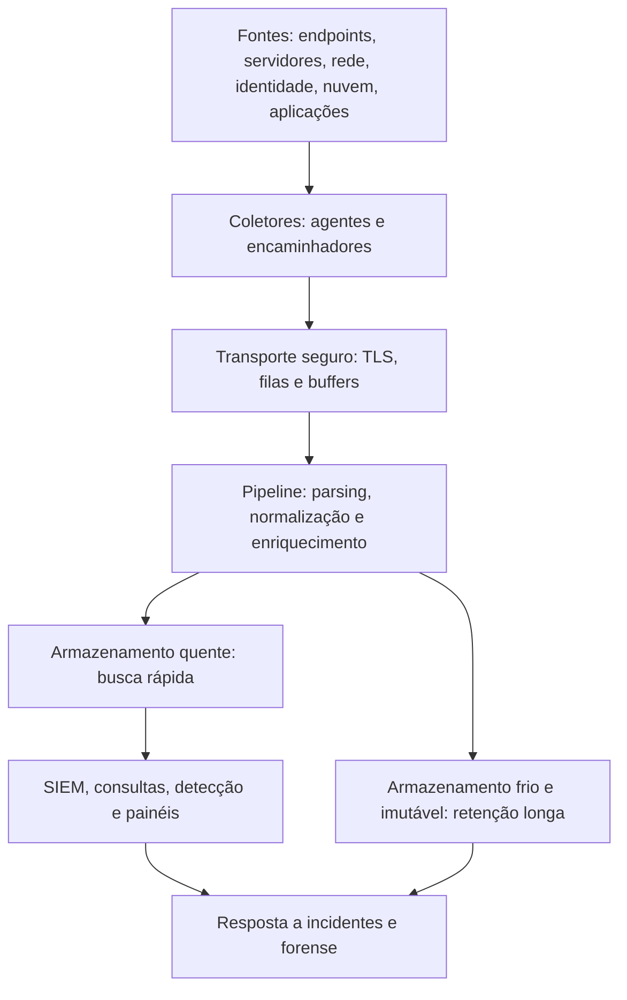

# Fundamentos, Gestão e Arquitetura de Logs

> **Objetivo pedagógico:** compreender o ciclo de vida dos logs (geração, transmissão, armazenamento, análise e descarte), a arquitetura de coleta e centralização e os requisitos de gestão (política, retenção, tempo, proteção e privacidade) que determinam o que será possível investigar quando um incidente ocorrer.

## 1. Por que os logs decidem uma investigação

Em muitos incidentes, a qualidade das respostas depende da qualidade dos registros disponíveis antes do evento. Logs completos, centralizados, com tempo sincronizado e retidos pelo período adequado permitem reconstruir quem fez o quê, quando e de onde. A falta de logs não prova ausência de atividade; ela limita a capacidade de afirmar ou negar fatos.

| Pergunta da investigação | Tipo de log necessário |
|---|---|
| Quem acessou? | Autenticação (identidade, VPN, endpoint, aplicações) |
| O que foi executado? | Criação de processos, auditoria de comandos, EDR |
| O que foi acessado ou alterado? | Auditoria de arquivos, bancos de dados, aplicações, nuvem |
| De onde veio o acesso? | Rede (proxy, firewall, DNS, NetFlow), VPN, web |
| O que saiu da organização? | Proxy, DLP, e-mail, nuvem, fluxos de rede |
| O que o atacante tentou ocultar? | Logs centralizados e metadados do próprio sistema de logs |

## 2. Ciclo de vida do log

| Etapa | Pontos de atenção |
|---|---|
| Geração | Configurar o que é registrado (política de auditoria), o nível de detalhe e o formato |
| Coleta | Agentes, encaminhamento nativo ou coleta por API; confiabilidade e criptografia |
| Normalização | Formatos, campos padronizados e fusos horários (UTC) |
| Armazenamento | Capacidade, desempenho, imutabilidade e controle de acesso |
| Análise | Consultas, detecções, correlação e revisão periódica |
| Retenção | Prazos por tipo de log, requisitos legais e legal hold |
| Descarte | Eliminação segura e registro, observada a LGPD |

## 3. Política e planejamento de gestão de logs

O NIST SP 800-92 orienta que a gestão de logs seja planejada, com política, papéis e infraestrutura definidos. Elementos mínimos:

| Elemento | Conteúdo |
|---|---|
| Escopo e objetivos | Sistemas e finalidades (segurança, operação, conformidade, forense) |
| Fontes obrigatórias | Lista de logs por categoria de ativo |
| Eventos a registrar | Autenticação, privilégios, alterações de configuração, acesso a dados sensíveis, falhas e erros |
| Campos mínimos | Data e hora com fuso, origem, usuário, ação, objeto, resultado e identificadores de sessão |
| Retenção | Prazos por tipo de log, camadas de armazenamento e requisitos legais |
| Proteção | Controle de acesso, integridade, criptografia e segregação de funções |
| Sincronização de tempo | Fonte NTP corporativa e monitoramento de desvios |
| Revisão | Frequência de revisão e responsáveis |
| Privacidade | Minimização de dados pessoais, base legal e acesso restrito |
| Tratamento de incidentes | Preservação e exportação de logs para investigação |

## 4. Arquitetura de referência

| Camada | Exemplos de tecnologias |
|---|---|
| Coleta nativa | rsyslog, syslog-ng, journald, Windows Event Forwarding, API de nuvem |
| Agentes e encaminhadores | Elastic Agent e Beats, Fluent Bit, Fluentd, Vector, NXLog, Wazuh agent |
| Transporte | Syslog sobre TLS (RFC 5425), RELP, filas e brokers (por exemplo, Kafka) |
| Pipeline | Logstash, Cribl, Vector, funções de ingestão do SIEM |
| Armazenamento e busca | Elasticsearch e OpenSearch, Splunk, Microsoft Sentinel (Log Analytics), Graylog, Loki, ClickHouse |
| Arquivamento | Armazenamento de objetos com imutabilidade (WORM) |
| Visualização e detecção | Kibana, Grafana, regras Sigma, consultas salvas |

### 4.1 Confiabilidade do transporte

| Protocolo | Observações |
|---|---|
| Syslog sobre UDP | Sem garantia de entrega; perda silenciosa de mensagens; evite para logs críticos |
| Syslog sobre TCP | Entrega confiável, com enquadramento (RFC 6587) |
| Syslog sobre TLS | Confidencialidade e autenticação do servidor (RFC 5425) |
| RELP | Entrega confiável com confirmação (rsyslog) |
| Filas e buffers locais | Preservam logs durante indisponibilidade da rede |
| Windows Event Forwarding | Coleta nativa de eventos para coletores centrais |

Monitore a saúde da coleta: fontes que pararam de enviar logs são um indício operacional (e, às vezes, de adulteração).

## 5. Estratificação de armazenamento e retenção

| Camada | Uso | Característica |
|---|---|---|
| Quente | Consulta frequente e detecção | Indexado, mais caro, retenção curta (dias a poucos meses) |
| Morna | Investigações recentes | Compactada, consulta mais lenta |
| Fria e imutável | Retenção longa e legal | Baixo custo; recuperação sob demanda; imutabilidade |

Referências de retenção:

| Referência | Orientação |
|---|---|
| CIS Controls v8.1, safeguard 8.10 | Reter logs de auditoria por no mínimo 90 dias |
| PCI DSS v4.0, requisito 10.5.1 | Reter o histórico de logs por no mínimo 12 meses, com pelo menos os 3 meses mais recentes imediatamente disponíveis |
| Marco Civil da Internet, arts. 13 e 15 | Guarda de registros de conexão (1 ano) e de acesso a aplicações (6 meses) pelos provedores obrigados |
| Necessidade investigativa | Muitos incidentes são descobertos meses depois; reter por períodos maiores para fontes críticas |
| LGPD | Reter pelo menor prazo necessário à finalidade e às obrigações legais |

## 6. Controles de qualidade da coleta

| Controle | Como verificar |
|---|---|
| Cobertura | Inventário de fontes versus ativos; fontes sem logs |
| Completude | Comparar o volume esperado com o recebido; alertar para fontes silenciosas |
| Tempo | Monitorar o desvio de relógio das fontes e o atraso de ingestão |
| Integridade | Hash, assinatura, imutabilidade e acesso restrito |
| Qualidade do parsing | Percentual de eventos com campos extraídos corretamente |
| Disponibilidade | Monitoramento do pipeline e das filas |
| Eficácia | Testes periódicos de detecção e de consultas de investigação |

## 7. Exemplo prático: análise de lacunas de logging de um ambiente

| Ativo | Logs desejados | Situação | Lacuna | Prioridade |
|---|---|---|---|---|
| Controladores de domínio | Eventos de autenticação e de alteração de AD | Parcial; 4768 e 4769 desabilitados | Kerberos sem auditoria | Alta |
| Servidor de arquivos | Auditoria de acesso a pastas sensíveis | Não habilitada | Sem rastreio de acesso a dados | Alta |
| Servidores Linux | `auth.log`, auditd e journald | `auth.log` local, sem centralização | Logs apenas locais | Alta |
| Proxy | URLs e volume por usuário | Centralizado, retenção de 30 dias | Retenção curta | Média |
| Microsoft 365 | Audit log unificado | Habilitado, retenção limitada | Retenção a ampliar | Média |
| Aplicação web | Logs de acesso e de aplicação | Local, sem usuário autenticado | Sem identificação do usuário | Alta |

## 8. Esqueleto de política de logs (resumo)

| Seção | Exemplo de conteúdo |
|---|---|
| Objetivo | Garantir registros suficientes para segurança, conformidade e investigação |
| Escopo | Todos os sistemas críticos e os que processam dados pessoais ou financeiros |
| Requisitos | Registrar autenticação, privilégios, alterações e acesso a dados sensíveis; UTC; NTP |
| Centralização | Todos os logs críticos enviados a repositório central com TLS |
| Retenção | 12 meses para logs críticos (3 meses quentes); 90 dias para demais |
| Proteção | Acesso restrito, imutabilidade e verificação periódica de integridade |
| Privacidade | Minimização e controle de acesso a dados pessoais nos logs |
| Revisão | Revisão semanal de alertas e trimestral da cobertura |
| Exceções | Aprovação formal e registro |

## 9. Casos de uso corporativos

- Avaliação de maturidade de logging antes de uma auditoria ou certificação.
- Definição de requisitos de logs para novos sistemas e para a contratação de fornecedores.
- Planejamento de retenção por tipo de fonte, considerando investigações e exigências legais.

## 10. Normas e frameworks relevantes

- NIST SP 800-92: Guide to Computer Security Log Management (2006); NIST SP 800-92 Rev. 1 (rascunho): Cybersecurity Log Management Planning Guide
- NIST SP 800-53 Rev. 5, família AU (AU-2 eventos, AU-3 conteúdo, AU-6 revisão, AU-8 carimbos de tempo, AU-9 proteção, AU-11 retenção e AU-12 geração)
- CIS Controls v8.1, controle 8 (safeguards 8.1 a 8.12)
- ISO/IEC 27002:2022, controles 8.15 (registro de eventos), 8.16 (monitoramento) e 8.17 (sincronização de relógios)
- OWASP Top 10 A09:2021 (falhas de registro e monitoramento); OWASP Logging Cheat Sheet
- PCI DSS v4.0, requisito 10
- MITRE ATT&CK: Data Sources e DeTT&CT (mapeamento de cobertura de fontes)

## 11. Referências

- Kent, K.; Souppaya, M. NIST SP 800-92. 2006.
- NIST SP 800-53 Rev. 5: Security and Privacy Controls. 2020.
- Center for Internet Security. CIS Controls v8.1. 2024.
- Rose, A.; Gerhards, R. RFC 5424 (Syslog), RFC 5425 (Syslog sobre TLS) e RFC 6587 (Syslog sobre TCP).
- Brasil. Lei nº 12.965/2014 (Marco Civil da Internet), arts. 13 e 15; Lei nº 13.709/2018 (LGPD).
- PCI Security Standards Council. PCI DSS v4.0.
- Chuvakin, A.; Schmidt, K.; Phillips, C. Logging and Log Management. Syngress, 2013.
