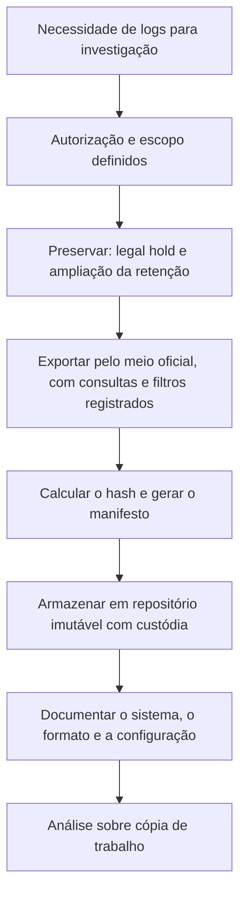

# Integridade, Retenção e Validade Jurídica dos Logs

> **Objetivo pedagógico:** garantir que os logs usados como evidência sejam íntegros, autênticos, retidos pelo prazo adequado e apresentados de forma defensável, tratando a privacidade dos dados pessoais neles contidos e as obrigações legais de guarda e de fornecimento.

> **Aviso:** este material é técnico-educacional e não substitui parecer jurídico. Valide cada caso com o Jurídico e com o DPO.

## 1. Requisitos de um log como evidência

| Requisito | Pergunta | Como demonstrar |
|---|---|---|
| Autenticidade | O log foi gerado pelo sistema indicado? | Origem identificada, configuração do sistema e declaração do custodiante |
| Integridade | O log foi alterado após a geração? | Hash, assinatura, armazenamento imutável e logs remotos independentes |
| Confiabilidade do relógio | O horário é confiável? | Sincronização NTP documentada e estimativa de desvio |
| Completude | Há lacunas? | Análise de lacunas e comparação com fontes independentes |
| Contexto | O sistema que gerou o log é compreendido? | Documentação do sistema e do formato |
| Rastreabilidade | Quem extraiu e quando? | Cadeia de custódia e registro de extração |
| Licitude | A coleta e o uso são legítimos? | Autorização, base legal e minimização |

## 2. Proteção da integridade

| Controle | Descrição |
|---|---|
| Envio remoto imediato | O log é enviado a um servidor central antes que um atacante local possa alterá-lo |
| Imutabilidade (WORM) | Armazenamento com retenção imutável (por exemplo, S3 Object Lock e blobs imutáveis) |
| Controle de acesso | Separação entre quem administra os sistemas e quem administra os logs |
| Hash e assinatura periódicos | Hashes de arquivos de log e de blocos, com assinatura e carimbo do tempo |
| Encadeamento de hashes | Cada bloco de log inclui o hash do bloco anterior, tornando alterações detectáveis |
| Selagem (journald) | Forward Secure Sealing do journald permite verificar a integridade (`journalctl --verify`) |
| Monitoramento | Alertas para parada de envio, truncamento e remoção |
| Redundância | Cópias em locais e domínios de falha distintos |

```bash
# journald: gerar chaves de selagem e verificar a integridade
sudo journalctl --setup-keys
journalctl --verify

# Hash e assinatura de um pacote de logs exportados
sha256sum logs_2026-10.tar.gz > logs_2026-10.tar.gz.sha256
gpg --armor --detach-sign logs_2026-10.tar.gz.sha256
gpg --verify logs_2026-10.tar.gz.sha256.asc logs_2026-10.tar.gz.sha256
```

## 3. Sincronização de tempo

| Item | Orientação |
|---|---|
| Fonte de tempo | NTP corporativo com fontes confiáveis; documentar a hierarquia |
| Monitoramento | Alertas de desvio (offset) acima de um limite |
| Registro | Guardar a configuração e os logs de sincronização (`chronyc tracking`, W32Time) |
| Na investigação | Estimar o desvio de cada fonte por eventos-âncora e declarar a margem de erro (ver pasta 05) |

## 4. Exportação de logs para investigação



| Boas práticas de exportação | Detalhe |
|---|---|
| Fonte oficial | Exportar do sistema de logs (SIEM, nuvem ou servidor), e não de cópias manuais |
| Conta nominal | Usar uma conta identificável e registrar o horário |
| Registro da consulta | Guardar o texto da consulta, o período, os filtros e os campos |
| Formato aberto | Exportar em formato aberto (CSV ou JSON) e preservar o bruto, quando possível |
| Hash e manifesto | Hash de cada arquivo e manifesto assinado |
| Retenção prévia | Verificar a retenção da fonte e exportar antes da expiração |
| Minimização | Exportar apenas o necessário e proteger dados pessoais |

## 5. Retenção: fatores e prazos de referência

| Fator | Orientação |
|---|---|
| Necessidade investigativa | Incidentes frequentemente são detectados meses depois; reter por prazo compatível |
| CIS Controls v8.1, 8.10 | Mínimo de 90 dias |
| PCI DSS v4.0, 10.5.1 | 12 meses, com 3 meses imediatamente disponíveis |
| Marco Civil da Internet, art. 13 | Provedores de conexão: guarda de registros de conexão por 1 ano |
| Marco Civil da Internet, art. 15 | Provedores de aplicações constituídos como pessoa jurídica, com atividade organizada, profissional e econômica: guarda de registros de acesso por 6 meses |
| Marco Civil da Internet, art. 15, §2º e art. 13, §2º | A autoridade pode requerer cautelarmente a guarda por prazo superior |
| Legal hold | Suspende o descarte de logs relevantes a litígios e investigações |
| LGPD | Reter por prazo necessário à finalidade e a obrigações legais |
| Regulações setoriais | Verificar exigências do setor (financeiro, saúde e outros) |

Estabeleça uma tabela de retenção por tipo de log e por criticidade, aprovada pelo Jurídico e pelo DPO.

| Tipo de log | Retenção quente | Retenção total | Justificativa |
|---|---|---|---|
| Autenticação e identidade | 3 meses | 12 meses ou mais | Investigações de acesso indevido e conformidade |
| Auditoria de dados sensíveis | 3 meses | 12 meses ou mais | LGPD, auditoria e litígios |
| Endpoint e EDR | 1 a 3 meses | 12 meses | Investigação de incidentes |
| Proxy e DNS | 1 a 3 meses | 12 meses | Exfiltração e C2 |
| Aplicações web | 1 a 3 meses | 12 meses | Exploração e fraude |
| Infraestrutura de baixo risco | 30 dias | 90 dias | Operação |

Os prazos acima são exemplos e devem ser ajustados à realidade da organização.

## 6. Privacidade e logs

Os logs contêm dados pessoais (usuários, IPs e comportamento). Observe:

| Tema | Orientação |
|---|---|
| Base legal | Obrigação legal, legítimo interesse em segurança e prevenção a fraudes e outras bases, conforme a análise do DPO (LGPD, art. 7º) |
| Necessidade e minimização | Registrar apenas o necessário; evitar registrar conteúdo de comunicações, senhas e dados sensíveis |
| Acesso | Restrito, com perfis e registro dos acessos aos próprios logs |
| Anonimização e pseudonimização | Em análises estatísticas e compartilhamentos |
| Transparência | Política de monitoramento comunicada aos usuários |
| Retenção e descarte | Prazos definidos e descarte seguro (LGPD, arts. 15 e 16) |
| Compartilhamento | Apenas o necessário e sob base legal; contratos com operadores |
| Registro das operações | LGPD, art. 37 |

Cuidado: nunca registre senhas, tokens e chaves em logs; verifique se aplicações os registram por engano (OWASP Logging Cheat Sheet).

## 7. Apresentação de logs como prova

| Elemento | Conteúdo |
|---|---|
| Explicação do sistema | Como o log é gerado, onde fica e como é protegido |
| Cadeia de custódia | Quem extraiu, quando e como; hash e manifesto |
| Método de análise | Consultas, filtros, ferramentas e versões |
| Normalização de tempo | Fusos, desvio e margem de erro |
| Limitações | Lacunas, retenção, auditoria desabilitada e fontes ausentes |
| Corroboração | Outras fontes independentes |
| Declaração do custodiante | Documento do responsável pelo sistema atestando a geração e a guarda regulares |

### 7.1 Modelo de Termo de Extração e Integridade de Logs

```
TERMO DE EXTRAÇÃO E INTEGRIDADE DE LOGS

Caso: DFL-AAAA-NNN
Sistema de origem: ______________________________  Responsável pelo sistema: ______________________
Período extraído (UTC): de ____/____/______ às ____:____ a ____/____/______ às ____:____
Método de extração (ferramenta, comando ou consulta): ______________________________
Conta utilizada: ______________________________   Data e hora da extração (UTC): ______________
Filtros aplicados: ______________________________
Arquivos gerados e hashes (SHA-256): ______________________________
Local de armazenamento: ______________________________
Relógio e sincronização da fonte (NTP, desvio estimado): ______________________________
Observações e limitações: ______________________________

Declaro que os arquivos acima foram extraídos do sistema indicado pelo método descrito,
sem alteração de conteúdo, e armazenados com controle de acesso.

Responsável pela extração: ______________________  Assinatura: ______________
Custodiante do sistema: _________________________  Assinatura: ______________
```

## 8. Lacunas e adulteração

| Indício | Verificação |
|---|---|
| Intervalos sem eventos em fonte normalmente ativa | Comparar com fontes independentes e com o volume habitual |
| Mudança súbita de volume | Alterações de configuração e incidentes |
| Eventos de limpeza (Windows 1102 e 104; arquivos de log truncados em Linux) | Verificar logs remotos e cópias |
| Parada de agentes | Logs do coletor e alertas de silêncio |
| Linhas fora de ordem ou com horários que retrocedem | Alteração de relógio ou edição |
| Mudança de permissões e de propriedade dos arquivos de log | Auditoria do sistema de arquivos |

Declare toda lacuna no relatório, com a explicação mais provável, as alternativas consideradas e o efeito sobre as conclusões.

## 9. Exemplo prático: log de acesso contestado

| Argumento | Resposta técnica |
|---|---|
| "O log foi alterado depois" | Logs enviados em tempo real ao servidor central e armazenados em repositório imutável; hash e manifesto assinados na extração |
| "O relógio estava errado" | Sincronização NTP documentada; desvio estimado em ±2 s com eventos-âncora de duas fontes |
| "O sistema registra erros" | Documentação do sistema, verificação de completude e corroboração por firewall e VPN |
| "A extração não é confiável" | Termo de extração, consulta registrada e hash do arquivo |
| Resultado | Os registros foram aceitos como confiáveis, com declaração das limitações |

## 10. Casos de uso corporativos

- Definição de política de retenção e de proteção de logs aprovada por Jurídico e DPO.
- Atendimento a ordens judiciais de fornecimento de registros.
- Preparação de dossiê de logs para ação trabalhista ou para auditoria.

## 11. Normas e frameworks relevantes

- NIST SP 800-92; NIST SP 800-53 Rev. 5 (AU-8, AU-9, AU-10 e AU-11)
- ISO/IEC 27002:2022, controles 8.15, 8.17 e 5.33 (proteção de registros)
- CIS Controls v8.1, safeguards 8.3, 8.4 e 8.10
- PCI DSS v4.0, requisito 10
- Marco Civil da Internet (arts. 10, 13, 15 e 22); LGPD (arts. 6º, 7º, 15, 16, 37 e 46)
- RFC 3161 (carimbo do tempo); ISO/IEC 27037:2012

## 12. Referências

- Kent, K.; Souppaya, M. NIST SP 800-92. 2006.
- Brasil. Lei nº 12.965/2014 (Marco Civil da Internet); Lei nº 13.709/2018 (LGPD).
- OWASP. Logging Cheat Sheet.
- Schneier, B.; Kelsey, J. Secure audit logs to support computer forensics. ACM Transactions on Information and System Security, v. 2, 1999.
- Adams, C. et al. RFC 3161. 2001.
- Documentação do systemd (Forward Secure Sealing).
