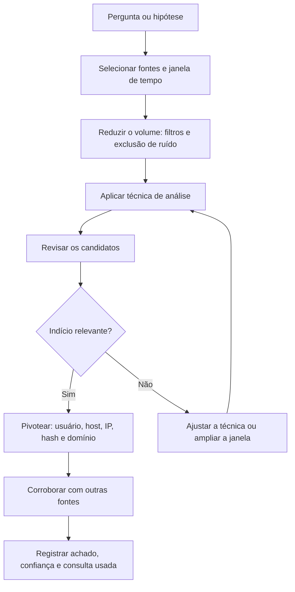

# Técnicas de Análise e Detecção de Anomalias

> **Objetivo pedagógico:** aplicar técnicas de análise de logs (análise de frequência, linhas de base, janelas de tempo, sessões, beaconing, primeira ocorrência e viagens impossíveis) para encontrar atividade incomum em grandes volumes de dados, calibrando limiares e documentando as limitações.

## 1. Abordagem geral



Regra de ouro: cada técnica produz candidatos, e não conclusões. A conclusão exige corroboração e contexto.

## 2. Técnicas principais

| Técnica | Descrição | Quando usar | Limitações |
|---|---|---|---|
| Análise de frequência (stacking) | Contar ocorrências por valor e analisar a cauda longa | Processos, domínios, user-agents, contas | Atividade rara legítima gera ruído |
| Linha de base (baseline) | Comparar o comportamento atual com o histórico | Volume, horários, destinos | Exige histórico confiável |
| Primeira ocorrência (first seen) | Detectar entidades nunca vistas no período-base | Novos domínios, binários, IPs e contas | Muitos itens novos legítimos |
| Janelas e rajadas | Agrupar eventos por tempo e procurar picos | Força bruta, exfiltração, criptografia em massa | Janela mal escolhida mascara o padrão |
| Sessionização | Agrupar eventos de um mesmo usuário ou host em sessões | Reconstrução de atividade | Definir o tempo de inatividade da sessão |
| Beaconing | Detectar conexões periódicas | C2 e malware | Atualizações e telemetria legítima também são periódicas |
| Sequência | Procurar padrões ordenados (falhas, depois sucesso) | Comprometimento de credenciais | Ordenação por tempo exige relógios corretos |
| Viagem impossível (geovelocidade) | Logons em locais distantes em intervalo incompatível | Contas de nuvem e VPN | VPNs, proxies e dados de geolocalização imprecisos |
| Análise de volume (bytes) | Maiores transferências por origem e destino | Exfiltração | Backups e sincronizações legítimas |
| Entropia e comprimento | Domínios e comandos com alta entropia ou muito longos | DGA, túneis DNS, comandos codificados | Falsos positivos em CDNs e redes de anúncio |
| Raridade combinada | Combinar raridade com contexto (usuário, host e horário) | Reduzir falsos positivos | Exige enriquecimento de dados |

## 3. Análise de frequência na prática

```bash
# Processos de criação por nome (CSV exportado de EDR): os mais raros primeiro
mlr --icsv --opprint count-distinct -f process_name then sort -nr count then tail -n 30 processos.csv

# User-agents mais raros em logs web
awk -F'"' '{print $6}' access.log | sort | uniq -c | sort -n | head -30

# Domínios consultados por poucas máquinas (candidatos a ferramentas direcionadas)
duckdb -c "
SELECT dominio, count(DISTINCT host) AS hosts, count(*) AS consultas
FROM read_csv_auto('dns.csv')
GROUP BY dominio
HAVING hosts <= 2 AND consultas >= 5
ORDER BY hosts, consultas DESC
LIMIT 50"
```

## 4. Detecção de beaconing

Beacons de malware tendem a se comunicar em intervalos regulares, com pequena variação (jitter). Uma medida simples é o coeficiente de variação (desvio padrão dividido pela média) dos intervalos entre conexões.

```python
import pandas as pd

df = pd.read_csv("proxy_utc.csv", parse_dates=["ts_utc"])   # colunas: ts_utc, src, dst_domain
res = []
for (src, dst), d in df.sort_values("ts_utc").groupby(["src", "dst_domain"]):
    if len(d) < 20:
        continue
    dt = d["ts_utc"].diff().dt.total_seconds().dropna()
    if dt.mean() == 0:
        continue
    res.append((src, dst, len(d), dt.mean(), dt.std(), dt.std() / dt.mean()))

out = pd.DataFrame(res, columns=["src", "dst", "n", "media_s", "desvio_s", "cv"]).sort_values("cv")
print(out.head(30))
```

| Indicador | Interpretação |
|---|---|
| Coeficiente de variação baixo (por exemplo, abaixo de 0,2) com muitas conexões | Comunicação muito regular: candidata a beacon |
| Tamanhos de resposta e de requisição semelhantes | Padrão de verificação (check-in) |
| Destino raro ou recém-registrado | Aumenta a suspeita |
| Horários contínuos, inclusive fora do expediente | Atividade automatizada |

Os limiares são exemplos e devem ser calibrados. Atualizações de software, sincronizações e aplicativos legítimos também são periódicos: exclua-os com listas de permissão e corrobore com o processo de origem (EDR) e com o conteúdo.

## 4.1 Detecção de túneis DNS e de DGA

| Indício | Descrição |
|---|---|
| Subdomínios muito longos e de alta entropia | Dados codificados em consultas |
| Alto volume de consultas a um único domínio de segundo nível | Canal de comunicação |
| Uso de registros TXT, NULL ou CNAME em excesso | Transporte de dados |
| Muitas consultas com NXDOMAIN de domínios aparentemente aleatórios | Algoritmo de geração de domínios (DGA) |
| Resolvedores externos usados diretamente pelos hosts | Evasão da política de DNS |

```bash
# Subdomínios mais longos em um log de DNS (campo 'query' na coluna 9; ajuste ao formato)
zeek-cut query < dns.log | awk '{print length($0), $0}' | sort -nr | head -20

# Domínios de segundo nível com maior número de consultas
zeek-cut query < dns.log | awk -F. '{print $(NF-1)"."$NF}' | sort | uniq -c | sort -nr | head -20
```

## 5. Viagem impossível e anomalias de identidade

| Verificação | Procedimento |
|---|---|
| Logons em locais distantes | Calcular a distância entre dois IPs geolocalizados e o tempo entre os logons |
| Novos países ou ASNs para o usuário | Comparar com o histórico |
| Novo dispositivo ou user-agent | Primeira ocorrência por conta |
| Logon fora do horário habitual | Comparar com o padrão do usuário |
| Muitas contas a partir de um único IP | Password spraying |
| Mudança de método de MFA ou novo método registrado | Possível tomada de conta |

Observação: VPNs, proxies corporativos e redes móveis geram falsos positivos; enriqueça com informações de rede e de dispositivo.

## 6. Sequências suspeitas típicas

| Sequência | Interpretação | Fontes |
|---|---|---|
| Muitas falhas e depois sucesso do mesmo IP | Credencial comprometida | Autenticação |
| Logon de rede (tipo 3 ou 10), criação de serviço e execução de comando | Movimentação lateral | EVTX, EDR |
| Acesso a muitos arquivos, criação de arquivo compactado e envio a destino externo | Coleta e exfiltração | Auditoria de arquivos, proxy |
| Criação de regra de caixa de entrada, encaminhamento externo e envio de e-mails | BEC | M365 |
| Concessão de consentimento OAuth, listagem de arquivos e downloads em massa | Abuso de aplicativo em nuvem | Audit log de nuvem |
| Exclusão de cópias de sombra, criptografia em massa e criação de notas | Ransomware | EDR, EVTX |

## 7. Calibração e redução de ruído

| Prática | Descrição |
|---|---|
| Listas de permissão | Contas de serviço, varreduras autorizadas e atividades conhecidas, com revisão periódica |
| Contexto | Papel do usuário, tipo do host e criticidade do ativo |
| Janelas adequadas | Janelas ajustadas à natureza do ataque |
| Segmentação | Linhas de base por grupo (por exemplo, por departamento) |
| Pontuação de risco | Combinar sinais fracos em uma pontuação por entidade |
| Retroalimentação | Registrar falsos e verdadeiros positivos e ajustar |

## 8. Exemplo prático: investigação de exfiltração por volume

| Etapa | Resultado |
|---|---|
| Consulta | Maiores volumes de saída por usuário no proxy, nos últimos 30 dias |
| Candidato | Usuário U com 18 GB enviados a um serviço de nuvem pessoal em 40 minutos, 36 vezes acima da média do grupo |
| Pivô | Logon do dispositivo do usuário, processo responsável (EDR) e arquivos acessados (auditoria) |
| Corroboração | `$UsnJrnl` mostra criação de arquivo compactado minutos antes; DLP registra alertas |
| Contexto | Colaborador em desligamento; sem tarefa de backup associada |
| Conclusão | Exfiltração provável por serviço de nuvem pessoal; confiança alta; ação: legal hold e contenção |

## 9. Casos de uso corporativos

- Caça a beacons e a túneis DNS em redes corporativas.
- Detecção de contas comprometidas em ambientes de nuvem e SaaS.
- Identificação de exfiltração por volume, horário e destino incomuns.

## 10. Normas e frameworks relevantes

- MITRE ATT&CK: T1071 (Application Layer Protocol), T1568.002 (DGA), T1071.004 (DNS), T1572, T1041, T1567, T1110, T1078
- NIST SP 800-61 Rev. 3; NIST SP 800-92
- CIS Controls v8.1, controles 8 e 13
- ISO/IEC 27002:2022, controles 8.15 e 8.16

## 11. Referências

- Bianco, D. The Pyramid of Pain. 2013 e Hunting Maturity Model.
- Davidoff, S.; Ham, J. Network Forensics: Tracking Hackers through Cyberspace. Prentice Hall, 2012.
- Sanders, C.; Smith, J. Applied Network Security Monitoring. Syngress, 2013.
- Chuvakin, A. et al. Logging and Log Management. Syngress, 2013.
- MITRE ATT&CK. https://attack.mitre.org
- SANS Institute. FOR572: Advanced Network Forensics; FOR508.
