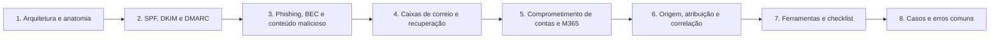

# 12 Forense de E-mail

## Objetivo

Investigar mensagens, caixas de correio e contas de e-mail para estabelecer origem, autenticidade, alcance e impacto de fraudes, phishing e comprometimentos, preservando a integridade das evidências, analisando conteúdo malicioso com segurança e tratando a atribuição com cautela.

## Trilha de estudo recomendada

## Conteúdo da pasta

| Ordem | Arquivo | Objetivo |
|---|---|---|
| 1 | [arquitetura-protocolos-e-anatomia-da-mensagem.md](arquitetura-protocolos-e-anatomia-da-mensagem.md) | Entrega, protocolos, envelope, cabeçalhos, Received e MIME |
| 2 | [autenticacao-spf-dkim-dmarc-e-spoofing.md](autenticacao-spf-dkim-dmarc-e-spoofing.md) | SPF, DKIM, DMARC, ARC, tipos de falsificação e domínios semelhantes |
| 3 | [phishing-bec-e-analise-de-conteudo-malicioso.md](phishing-bec-e-analise-de-conteudo-malicioso.md) | Tipologia, links e anexos, IOCs, alcance e resposta |
| 4 | [caixas-de-correio-formatos-e-recuperacao.md](caixas-de-correio-formatos-e-recuperacao.md) | EML, MSG, PST, OST, MBOX, Exchange e recuperação |
| 5 | [comprometimento-de-contas-de-email-e-m365.md](comprometimento-de-contas-de-email-e-m365.md) | Regras, encaminhamentos, delegações, OAuth, MFA e contenção |
| 6 | [rastreamento-de-origem-atribuicao-e-correlacao.md](rastreamento-de-origem-atribuicao-e-correlacao.md) | Infraestrutura, correlação, campanhas, IOCs e atribuição |
| 7 | [ferramentas-fluxo-modelos-e-checklist-de-email.md](ferramentas-fluxo-modelos-e-checklist-de-email.md) | Ferramentas, fluxo, modelos e checklist |
| 8 | [casos-de-uso-e-erros-comuns-em-email.md](casos-de-uso-e-erros-comuns-em-email.md) | Sete cenários, erros comuns e exercícios |

## Princípios

- Preservar a mensagem original (`.eml` ou exportação oficial) com hash, e nunca depender de impressões
- Confiar apenas nos cabeçalhos adicionados pela própria infraestrutura
- Entender que a autenticação (SPF, DKIM e DMARC) não prova a legitimidade do autor
- Analisar links e anexos somente em ambiente isolado e neutralizar URLs em relatórios
- Preservar antes de conter: exportar logs e configuração antes de remover regras ou redefinir contas
- Delimitar o alcance por logs: recebimento, abertura, clique, execução e autenticação
- Tratar a atribuição como hipótese, com grau de confiança explícito
- Respeitar a privacidade, o sigilo das comunicações e a minimização

## Relação com outras pastas

- 02-cadeia-de-custodia e 04-hash-e-integridade: custódia e hash de mensagens e exportações
- 05-timeline-analysis: horários dos cabeçalhos e linha do tempo da campanha
- 06-evidencias-digitais: autenticidade, ata notarial e valor probatório de e-mails
- 11-log-analysis: logs de gateway, proxy, DNS e identidade
- Pastas de malware, Microsoft 365, threat hunting e OSINT: aprofundamentos

## Referências

- RFC 5321 (SMTP), RFC 5322 (formato da mensagem), RFC 2045 a 2049 (MIME), RFC 7208 (SPF), RFC 6376 (DKIM), RFC 7489 (DMARC), RFC 8617 (ARC), RFC 8601 (Authentication-Results)
- NIST SP 800-177 Rev. 1: Trustworthy Email (2019); NIST SP 800-150 (2016); NIST SP 800-61 Rev. 3 (2025)
- MITRE ATT&CK (T1566, T1534, T1656, T1078.004, T1114, T1098.002, T1528, T1539)
- FBI IC3. Business Email Compromise; CISA. Phishing Guidance
- Microsoft Learn. Exchange Online, Microsoft Purview e Entra ID (auditoria e logs)
- Microsoft. [MS-PST]: Outlook Personal Folders (.pst) File Format
- Documentação do libpff, libpst, oletools, pdfid, dnstwist, dkimpy e MISP
- Casey, E. Digital Evidence and Computer Crime. 3. ed. (2011)
- SANS Institute. FOR508 e FOR509
