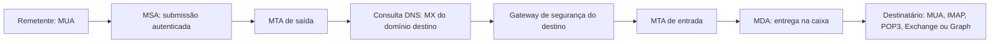
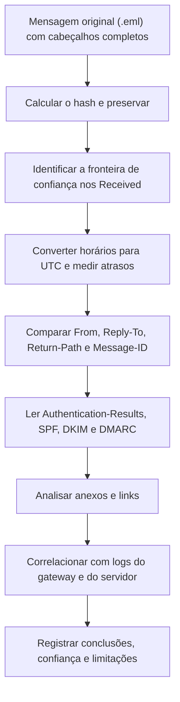

# Arquitetura, Protocolos e Anatomia da Mensagem de E-mail

> **Objetivo pedagógico:** compreender como o e-mail é transportado entre sistemas (agentes, protocolos, portas e DNS) e como a mensagem é estruturada (envelope, cabeçalhos, corpo e MIME), para interpretar cabeçalhos, rotas, datas e anexos de forma tecnicamente correta e distinguir o que é confiável do que pode ser forjado.

## 1. Arquitetura de entrega

| Componente | Sigla | Função |
|---|---|---|
| Agente de usuário de e-mail | MUA | Cliente (Outlook, Thunderbird, webmail) |
| Agente de submissão | MSA | Recebe a mensagem do usuário autenticado (porta 587 ou 465) |
| Agente de transferência | MTA | Encaminha a mensagem entre servidores (porta 25) |
| Agente de entrega | MDA | Entrega na caixa de correio do destinatário |
| Armazenamento | Mailbox | Caixa de correio em servidor ou serviço de nuvem |
| Gateway de segurança | SEG | Filtragem antispam, antiphishing e antimalware |



## 2. Protocolos e portas

| Protocolo | Porta | Função | Observação |
|---|---|---|---|
| SMTP (RFC 5321) | 25 | Transferência entre servidores | Pode usar STARTTLS |
| Submissão (RFC 6409) | 587 | Envio pelo cliente, com autenticação e STARTTLS | Padrão para clientes |
| SMTPS (RFC 8314) | 465 | Envio com TLS implícito | Reconhecida pela RFC 8314 |
| IMAP | 143 e 993 | Acesso à caixa mantendo as mensagens no servidor | 993 com TLS |
| POP3 | 110 e 995 | Download das mensagens | Pode apagar do servidor |
| MAPI, EWS, ActiveSync e Microsoft Graph | HTTPS | Acesso a Exchange e Exchange Online | Logs de acesso em servidores e na nuvem |
| MX (DNS) | n/a | Indica os servidores que recebem e-mails de um domínio | Consultar com `dig MX` |

Cada protocolo deixa registros diferentes: logs do MTA, do gateway, do servidor de caixas de correio e de autenticação. A investigação costuma combinar vários.

## 3. Envelope versus mensagem

O SMTP distingue o **envelope** (usado na entrega) do **conteúdo da mensagem** (cabeçalhos e corpo).

| Elemento | Origem | Característica |
|---|---|---|
| `MAIL FROM` (remetente do envelope) | Comando SMTP | Gera o cabeçalho `Return-Path` na entrega final; usado pelo SPF |
| `RCPT TO` | Comando SMTP | Destinatários reais, incluindo cópias ocultas (Bcc) |
| `HELO` ou `EHLO` | Comando SMTP | Identificação do servidor que envia |
| `From:` (cabeçalho) | Conteúdo da mensagem | Remetente exibido ao usuário; pode divergir do `MAIL FROM` |
| `To:`, `Cc:` | Conteúdo da mensagem | Destinatários exibidos; `Bcc` não aparece nas cópias entregues |

Consequência: o remetente que o usuário vê (`From`) e o remetente da entrega (`MAIL FROM`) podem ser diferentes, e esse desalinhamento é explorado em fraudes.

## 4. Cabeçalhos relevantes

| Cabeçalho | Significado | Confiabilidade |
|---|---|---|
| `Received` | Um por servidor intermediário, com `from`, `by`, protocolo, ID e horário | Os mais recentes (topo) são adicionados pela sua infraestrutura; os de baixo podem ser forjados |
| `Return-Path` | Remetente do envelope, adicionado na entrega final | Confiável se adicionado pelo seu servidor |
| `From`, `Sender`, `Reply-To` | Remetente exibido, remetente efetivo e endereço de resposta | Livremente definidos pelo remetente |
| `To`, `Cc`, `Date`, `Subject` | Dados da mensagem | Definidos pelo cliente; `Date` reflete o relógio do remetente |
| `Message-ID` | Identificador único (`<id@dominio>`) | Gerado pelo cliente ou servidor; útil para correlação |
| `In-Reply-To` e `References` | Encadeamento de conversas | Útil para identificar sequestro de conversa (thread hijacking) |
| `MIME-Version`, `Content-Type`, `Content-Transfer-Encoding` | Estrutura do conteúdo | Descrevem anexos e codificações |
| `Authentication-Results` | Resultado de SPF, DKIM, DMARC avaliado pelo servidor receptor | Confiável quando adicionado pelo seu servidor |
| `Received-SPF` | Resultado do SPF | Idem |
| `DKIM-Signature` | Assinatura do remetente | Verificável por DNS |
| `ARC-*` | Cadeia de autenticação em encaminhamentos | Útil com listas e redirecionamentos |
| `X-Originating-IP` | IP do cliente (alguns webmails) | Não padronizado; pode estar ausente |
| `X-...` (personalizados) | Marcadores de gateways e de clientes (por exemplo, pontuação de spam) | Variam por fornecedor |
| `List-Unsubscribe` | Cancelamento de listas | Indício de envio em massa |

### 4.1 Regra de ouro da confiança

Somente os cabeçalhos adicionados pela sua própria infraestrutura (o servidor ou o gateway que recebeu a mensagem) são confiáveis. Tudo o que vem de fora pode ter sido forjado. Identifique a primeira fronteira de confiança lendo a cadeia `Received` de baixo para cima e de cima para baixo.

## 5. Leitura da cadeia `Received`

Cada servidor acrescenta um cabeçalho `Received` no topo; logo, o primeiro (de cima) é o último salto, e o último (de baixo) é o mais próximo da origem.

```
Received: from mx.destino.exemplo (mx.destino.exemplo [192.0.2.10])
        by caixa.destino.exemplo with ESMTPS id ABC123
        for <ana@destino.exemplo>; Wed, 28 Oct 2026 13:22:15 +0000
Received: from srv-saida.origem.exemplo (srv-saida.origem.exemplo [198.51.100.25])
        by mx.destino.exemplo with ESMTPS id DEF456; Wed, 28 Oct 2026 13:22:12 +0000
Received: from [203.0.113.77] (helo=notebook) by srv-saida.origem.exemplo with ESMTPSA id GHI789;
        Wed, 28 Oct 2026 10:22:09 -0300
```

| Elemento | Interpretação |
|---|---|
| Linha 1 | Entrega final no servidor do destinatário (confiável) |
| Linha 2 | Servidor de saída entregando ao MX (IP `198.51.100.25`, observado pelo seu servidor) |
| Linha 3 | Submissão do cliente `203.0.113.77` ao servidor de origem, com autenticação (`ESMTPSA`) |
| Horários | Em fusos diferentes (`+0000` e `-0300`); converta para UTC antes de comparar |
| Atrasos | Compare as diferenças entre saltos; atrasos grandes podem indicar filas, quarentena ou envio manipulado |

## 6. Estrutura MIME e anexos

| Elemento | Descrição |
|---|---|
| `Content-Type: multipart/mixed` | Mensagem com corpo e anexos |
| `multipart/alternative` | Corpo em mais de uma versão (texto e HTML) |
| `multipart/related` | HTML com recursos embutidos (imagens por `cid:`) |
| `Content-Disposition` | `attachment` ou `inline`, com nome do arquivo |
| `Content-Transfer-Encoding` | `base64`, `quoted-printable`, `7bit` e `8bit` |
| Encoded-word (RFC 2047) | Cabeçalhos com caracteres não ASCII (`=?UTF-8?B?...?=`) |

Atenção a: diferenças entre a versão texto e HTML, links cujo texto exibido difere do destino, imagens remotas (rastreamento), anexos com extensões duplas e arquivos de contêiner (ISO, ZIP e HTML).

## 7. Exemplos práticos

### 7.1 Extração de cabeçalhos com Python

```python
from email import policy
from email.parser import BytesParser

with open("mensagem.eml", "rb") as f:
    msg = BytesParser(policy=policy.default).parse(f)

for h in ("From", "To", "Subject", "Date", "Message-ID", "Return-Path", "Reply-To", "Authentication-Results"):
    print(f"{h}: {msg[h]}")

print("--- Cadeia Received (da mais recente para a mais antiga) ---")
for r in msg.get_all("Received", []):
    print(" ".join(r.split()))

print("--- Anexos ---")
for parte in msg.iter_attachments():
    print(parte.get_filename(), parte.get_content_type())
```

### 7.2 Decodificação e hash de anexos

```python
import hashlib
from email import policy
from email.parser import BytesParser

with open("mensagem.eml", "rb") as f:
    msg = BytesParser(policy=policy.default).parse(f)

for parte in msg.iter_attachments():
    dados = parte.get_payload(decode=True)
    nome = parte.get_filename() or "sem_nome"
    print(nome, hashlib.sha256(dados).hexdigest())
```

Extraia os anexos apenas em ambiente isolado e registre o hash de cada um; não os abra em estações de uso comum.

### 7.3 Conversão de horários da cadeia

```bash
# Converter um horário de cabeçalho para UTC
date -u -d "Wed, 28 Oct 2026 10:22:09 -0300"
```

## 8. Fluxo de análise de um cabeçalho



## 9. Casos de uso corporativos

- Triagem de e-mails de phishing reportados por usuários.
- Verificação da autenticidade de mensagens apresentadas como prova.
- Reconstrução do caminho de uma mensagem entre o remetente e a caixa do destinatário.

## 10. Normas e frameworks relevantes

- RFC 5321 (SMTP), RFC 5322 (formato da mensagem), RFC 2045 a 2049 (MIME), RFC 2047 (cabeçalhos codificados), RFC 6409, RFC 8314
- RFC 8601 (Authentication-Results)
- ISO/IEC 27037:2012; ISO/IEC 27002:2022, controle 5.14 (transferência de informações)
- MITRE ATT&CK: T1566 (Phishing), T1656 (Impersonation)

## 11. Referências

- Klensin, J. RFC 5321: Simple Mail Transfer Protocol. 2008.
- Resnick, P. RFC 5322: Internet Message Format. 2008.
- Freed, N.; Borenstein, N. RFC 2045: MIME Part One. 1996.
- Moore, K. RFC 2047: MIME Part Three: Message Header Extensions for Non-ASCII Text. 1996.
- Kucherawy, M. RFC 8601: Message Header Field for Indicating Message Authentication Status. 2019.
- Casey, E. Digital Evidence and Computer Crime. 3. ed. Academic Press, 2011.
- Documentação do módulo `email` do Python.
