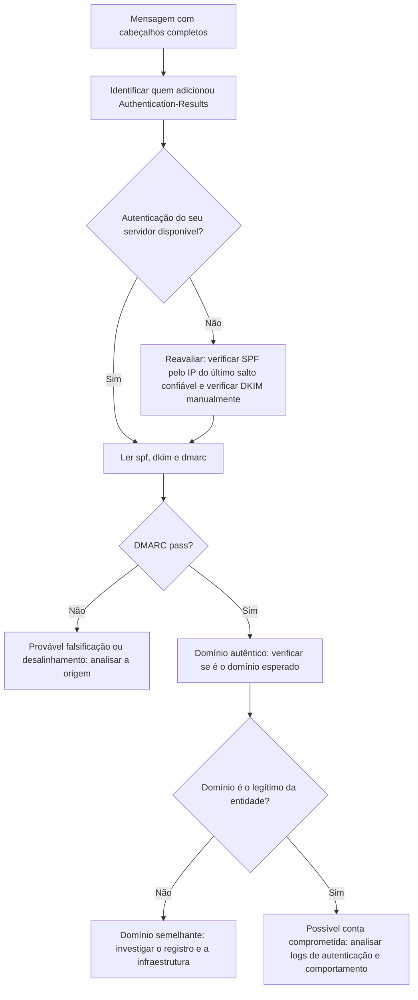

# Autenticação (SPF, DKIM, DMARC e ARC) e Spoofing

> **Objetivo pedagógico:** interpretar os mecanismos de autenticação de e-mail (SPF, DKIM, DMARC e ARC) para avaliar a autenticidade da origem de uma mensagem, entender quais fraudes eles detectam e quais não detectam, e verificar domínios semelhantes e registros DNS no curso de uma investigação.

## 1. Por que a autenticação importa (e seus limites)

O protocolo SMTP original não autentica o remetente. SPF, DKIM e DMARC acrescentam mecanismos para reduzir a falsificação do domínio de origem. Na forense, eles ajudam a responder: o servidor que enviou a mensagem estava autorizado a enviar em nome desse domínio? A mensagem foi alterada no trânsito? O remetente exibido é consistente com o domínio autenticado?

Limite essencial: uma mensagem que passa em SPF, DKIM e DMARC prova que foi enviada por infraestrutura autorizada do domínio, e não que o autor é quem diz ser. Uma conta legítima comprometida passa em todas as verificações.

## 2. SPF (Sender Policy Framework, RFC 7208)

| Aspecto | Descrição |
|---|---|
| O que valida | Se o IP do servidor que entregou a mensagem está autorizado a enviar para o domínio do `MAIL FROM` (e, quando aplicável, do `HELO`) |
| Registro | TXT no DNS do domínio (`v=spf1 ...`) |
| Mecanismos | `ip4`, `ip6`, `a`, `mx`, `include`, `redirect` e `all` |
| Qualificadores | `+` (pass), `-` (fail), `~` (softfail) e `?` (neutral) |
| Resultados | `pass`, `fail`, `softfail`, `neutral`, `none`, `temperror` e `permerror` |
| Limite | No máximo 10 consultas DNS nos mecanismos; acima disso, `permerror` |
| Limitação | Não valida o `From` visível; quebra em encaminhamentos simples |

```bash
dig +short TXT exemplo.com | grep -i "v=spf1"
```

## 3. DKIM (DomainKeys Identified Mail, RFC 6376)

| Aspecto | Descrição |
|---|---|
| O que valida | Que a mensagem foi assinada por um domínio que controla a chave pública, e que partes dela (cabeçalhos escolhidos e corpo) não foram alteradas |
| Cabeçalho | `DKIM-Signature` com `v`, `a`, `c`, `d` (domínio), `s` (seletor), `h` (cabeçalhos assinados), `bh` (hash do corpo), `b` (assinatura), `t` (horário) e `x` (expiração) |
| Chave pública | TXT em `seletor._domainkey.dominio` |
| Resultados | `pass`, `fail`, `neutral`, `policy`, `temperror` e `permerror` |
| Limitação | Alterações de lista de discussão e de rodapés de gateway podem invalidar a assinatura; o domínio `d=` pode ser diferente do `From` |
| Valor forense | Prova de integridade de partes assinadas e de associação a um domínio; o horário `t=` indica quando foi assinado |

```bash
# Consultar a chave pública do seletor
dig +short TXT seletor._domainkey.exemplo.com

# Verificar a assinatura DKIM de um .eml (biblioteca dkimpy)
dkimverify < mensagem.eml
```

## 4. DMARC (RFC 7489)

| Aspecto | Descrição |
|---|---|
| O que faz | Exige que SPF ou DKIM passe **e esteja alinhado** com o domínio do cabeçalho `From` visível |
| Alinhamento | Relaxado (mesmo domínio organizacional) ou estrito (domínio idêntico) |
| Política | `p=none`, `p=quarantine` ou `p=reject`; subdomínios (`sp`) e porcentagem (`pct`) |
| Relatórios | `rua` (agregados) e `ruf` (forenses) |
| Registro | TXT em `_dmarc.dominio` |
| Resultado | `pass` se SPF ou DKIM passar com alinhamento |
| Valor forense | Indica se o domínio protegia contra falsificação direta e o que o receptor fez |

```bash
dig +short TXT _dmarc.exemplo.com
```

## 5. ARC (Authenticated Received Chain, RFC 8617)

O ARC permite que intermediários (listas e encaminhadores) registrem os resultados de autenticação originais, ajudando a avaliar mensagens que passaram por redirecionamento. Cabeçalhos: `ARC-Authentication-Results`, `ARC-Message-Signature` e `ARC-Seal`. Ele não prova autenticidade por si só; indica o que o intermediário viu, e depende da confiança no intermediário.

## 6. Outras proteções e registros

| Mecanismo | Função |
|---|---|
| MTA-STS (RFC 8461) e TLS-RPT (RFC 8460) | Exigência de TLS na entrega entre servidores e relatórios de falhas |
| DANE (RFC 6698) | Vincula certificados de servidores de e-mail ao DNSSEC |
| BIMI | Exibição de marca em clientes, condicionada ao DMARC (em padronização) |
| Rótulos de DNSSEC | Autenticidade das respostas DNS |

## 7. Como ler o `Authentication-Results`

```
Authentication-Results: mx.destino.exemplo;
    spf=pass smtp.mailfrom=notificacoes@pagamentos-exemplo.com;
    dkim=pass header.d=pagamentos-exemplo.com header.s=sel1;
    dmarc=pass (p=reject) header.from=pagamentos-exemplo.com
```

| Campo | Significado |
|---|---|
| `spf=pass smtp.mailfrom=...` | SPF avaliado sobre o domínio do envelope |
| `dkim=pass header.d=... header.s=...` | Assinatura válida do domínio `d` com o seletor `s` |
| `dmarc=pass header.from=...` | DMARC avaliado sobre o domínio do `From` visível |
| `smtp.helo`, `smtp.remote-ip` | Dados do servidor que entregou |

Verifique qual servidor adicionou o cabeçalho (o nome após `Authentication-Results:`): somente o adicionado pela sua infraestrutura é confiável. Mensagens podem trazer `Authentication-Results` falsos, inseridos pelo remetente.

## 8. Tipos de falsificação e o que os mecanismos detectam

| Cenário | SPF | DKIM | DMARC | Observação |
|---|---|---|---|---|
| Falsificação direta do domínio do `From` por servidor não autorizado | Falha | Sem assinatura | Falha | Bloqueada se `p=reject` |
| Nome de exibição falso (`"Diretor Financeiro" <conta@outrodominio.com>`) | Passa para o domínio real do remetente | Pode passar | Passa para o domínio real | Não é falsificação de domínio; engenharia social |
| Domínio semelhante (typosquatting ou homógrafo) | Passa para o domínio do atacante | Pode passar | Passa para o domínio do atacante | O atacante controla o domínio; verificar o domínio |
| Conta legítima comprometida | Passa | Passa | Passa | Autenticação não detecta; analisar comportamento e logs |
| Mensagem encaminhada | Pode falhar (IP do encaminhador) | Pode passar se não alterada | Pode passar via DKIM | ARC ajuda |
| Lista de discussão que altera o assunto ou o rodapé | Passa para a lista | Pode quebrar | Pode falhar | Verificar ARC |
| Remetente do envelope diferente do `From` (domínio de terceiro) | Passa para o domínio do envelope | Pode passar para o terceiro | Falha por desalinhamento | DMARC detecta |
| Domínio sem registros de autenticação | `none` | Sem assinatura | `none` | Facilita a falsificação |

## 9. Verificação de domínios semelhantes e infraestrutura

```bash
# Registro do domínio (data de criação e registrante, quando disponível)
whois pagamentos-exemplo.com

# Registros DNS relevantes
dig +short MX pagamentos-exemplo.com
dig +short TXT pagamentos-exemplo.com
dig +short A pagamentos-exemplo.com

# Geração de variações do domínio (typosquatting e homógrafos) para busca e bloqueio
dnstwist --registered pagamentos-exemplo.com
```

| Indicador | Interpretação |
|---|---|
| Domínio registrado há poucos dias | Provável infraestrutura de campanha |
| Caracteres confundíveis (`rn` por `m`, `0` por `o`, letras de outros alfabetos) | Falsificação visual (homógrafo) |
| Registrante com privacidade e infraestrutura de baixa reputação | Aumenta a suspeita, mas não prova má-fé |
| Mesmo IP ou ASN usado por vários domínios recentes | Agrupamento de campanha |
| Ausência de SPF, DKIM e DMARC | Facilidade de abuso |

Faça as consultas a serviços externos por indicadores (domínio e IP), sem enviar conteúdo da mensagem.

## 10. Fluxo de avaliação da autenticidade



## 11. Exemplo prático: pedido de alteração de dados bancários

| Observação | Interpretação |
|---|---|
| `From: "Financeiro" <financeiro@fornecedor-exemplo.com>` | Domínio exibido |
| Domínio real do fornecedor: `fornecedorexemplo.com` (sem hífen) | O domínio exibido é diferente do legítimo |
| `spf=pass` e `dkim=pass` para `fornecedor-exemplo.com`; `dmarc=pass` | Infraestrutura do atacante, com autenticação própria |
| `whois` | Domínio criado há 6 dias |
| `Reply-To` com endereço de provedor gratuito | Respostas desviadas |
| Conclusão | Falsificação por domínio semelhante, com autenticação válida para o domínio do atacante; "pass" não indica legitimidade; confiança alta; ação: bloquear o domínio, orientar o fornecedor e verificar pagamentos |

## 12. Casos de uso corporativos

- Definição e monitoramento de políticas DMARC para os domínios da organização.
- Análise de relatórios DMARC agregados para identificar abuso do domínio.
- Triagem de fraudes de fornecedor (vendor email compromise) com verificação de domínio.

## 13. Normas e frameworks relevantes

- RFC 7208 (SPF), RFC 6376 (DKIM), RFC 7489 (DMARC), RFC 8617 (ARC), RFC 8601 (Authentication-Results)
- RFC 8461 (MTA-STS), RFC 8460 (TLS-RPT), RFC 6698 (DANE)
- NIST SP 800-177 Rev. 1: Trustworthy Email
- MITRE ATT&CK: T1566, T1656 (Impersonation), T1583.001 (Acquire Infrastructure: Domains), T1585.002
- ISO/IEC 27002:2022, controle 5.14

## 14. Referências

- Kitterman, S. RFC 7208: SPF. 2014.
- Crocker, D.; Hansen, T.; Kucherawy, M. RFC 6376: DKIM Signatures. 2011.
- Kucherawy, M.; Zwicky, E. RFC 7489: DMARC. 2015.
- Andersen, K. et al. RFC 8617: ARC. 2019.
- Rose, S.; Nightingale, J.; Garfinkel, S.; Chandramouli, R. NIST SP 800-177 Rev. 1. 2019.
- Documentação do dkimpy, do dnstwist e das ferramentas `dig` e `whois`.
