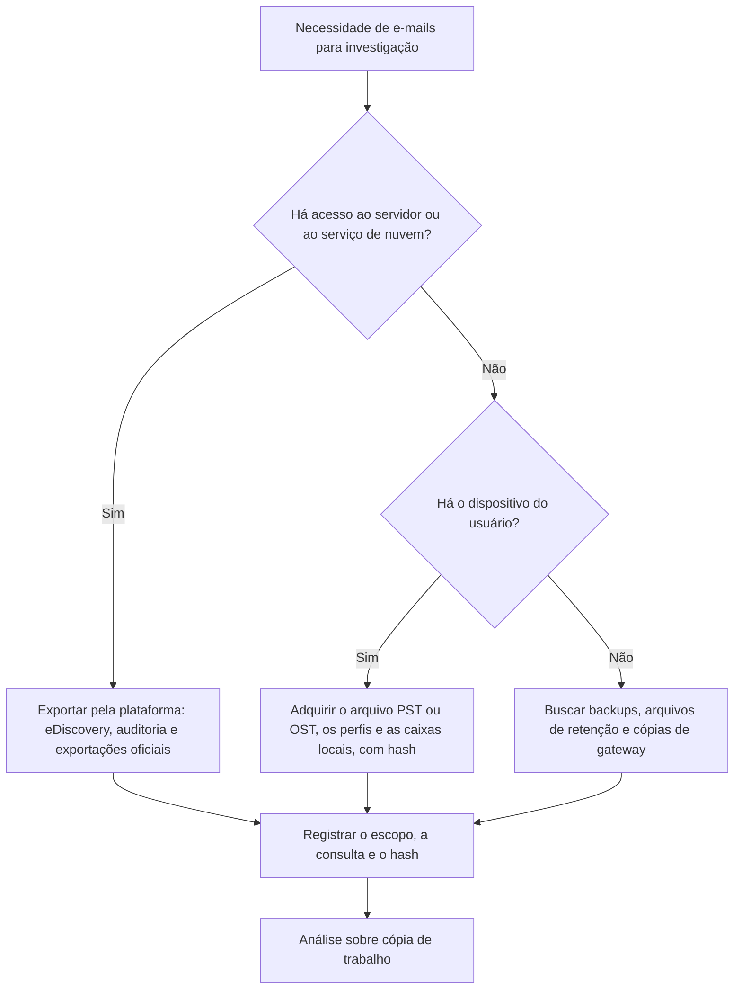

# Caixas de Correio: Formatos, Aquisição e Recuperação

> **Objetivo pedagógico:** conhecer os formatos de armazenamento de e-mail (EML, MSG, PST, OST, MBOX, Maildir, EDB e outros), adquirir e analisar caixas de correio de forma íntegra, e recuperar mensagens excluídas por meio das fontes de cliente, servidor, nuvem e backup.

## 1. Formatos e características

| Formato | Origem | Estrutura | Observações |
|---|---|---|---|
| EML | Padrão (RFC 5322) | Texto com cabeçalhos e corpo MIME | Uma mensagem por arquivo; preserva todos os cabeçalhos |
| MSG | Outlook | Contêiner OLE (formato proprietário) | Preserva propriedades MAPI, mas pode não conter todos os cabeçalhos de transporte |
| PST | Outlook (arquivo de dados) | Banco de dados proprietário (formato documentado pela Microsoft) | Formatos ANSI e Unicode; contém pastas, mensagens e anexos |
| OST | Outlook (cache de caixa do Exchange e do Microsoft 365) | Banco de dados proprietário | Cache local de uma conta; não é facilmente portável |
| MBOX | Thunderbird, Unix e exportação do Gmail (Takeout) | Mensagens concatenadas, separadas por linhas `From ` | Variantes (mboxo e mboxrd) |
| Maildir | Servidores Unix | Pastas `cur`, `new` e `tmp`, um arquivo por mensagem | Sinalizadores no nome do arquivo |
| EMLX | Apple Mail | Um arquivo por mensagem, com contagem de bytes e metadados em plist | Banco de índice em SQLite |
| EDB (Exchange) | Exchange Server local | Banco de dados ESE | Servidor local; Exchange Online não expõe o EDB |
| Webmail e caches de navegador | Clientes web | Fragmentos em cache e bancos de dados | Úteis quando não há outra fonte |

## 2. Escolha da fonte de aquisição



| Fonte | Vantagens | Limitações |
|---|---|---|
| Servidor ou nuvem (preferencial) | Dados autoritativos, com metadados e itens recuperáveis | Retenção e permissões; auditoria da exportação |
| Dispositivo do usuário (PST, OST e perfis) | Pode conter mensagens ausentes no servidor, rascunhos e anexos locais | OST depende do perfil; pode ter sido limpo |
| Gateways e arquivadores de e-mail | Cópias de mensagens em trânsito | Retenção e escopo |
| Backups | Estados anteriores | Disponibilidade e integridade |

Princípios: preferir a fonte primária à impressão; preservar o formato original; não encaminhar e-mails como evidência (o encaminhamento altera os cabeçalhos); calcular hash do arquivo exportado e registrar a custódia (pastas 02 e 04).

## 3. Aquisição

| Cenário | Procedimento |
|---|---|
| Microsoft 365 e Exchange Online | Pesquisa e exportação por Microsoft Purview (eDiscovery), com escopo, consulta e registro; ou exportação de itens por PowerShell conforme autorização |
| Google Workspace | Google Vault ou exportação do administrador; Google Takeout para o próprio usuário (formato MBOX) |
| Exchange local | Exportação de caixas por ferramentas administrativas (por exemplo, PST via `New-MailboxExportRequest`) e preservação de bancos de dados e logs |
| Cliente Outlook | Copiar os arquivos PST e OST com o Outlook fechado, ou usar imagem do disco; registrar perfis e contas |
| Thunderbird | Copiar o perfil (`%AppData%\Thunderbird\Profiles\` ou `~/.thunderbird/`) com mbox e índices |
| Apple Mail | Copiar a pasta `~/Library/Mail/` e os bancos de índice |
| Webmail | Exportação da plataforma e, se necessário, captura técnica (ver pasta 06) |

Para casos jurídicos, aplique legal hold antes da exportação e registre quem exportou, quando e com qual escopo.

## 4. Análise de PST e OST

```bash
# Informações do arquivo
pffinfo caixa.pst

# Exportar tudo, inclusive itens recuperáveis e excluídos (libpff)
pffexport -m all -t /mnt/saida/pffexport caixa.pst

# Converter para EML e MBOX com readpst (libpst): -r recursivo, -e arquivos .eml, -D inclui itens excluídos
readpst -r -e -D -o /mnt/saida/pst_exportado caixa.pst
```

| Informação | Uso |
|---|---|
| Hierarquia de pastas | Contexto e itens movidos |
| Propriedades de data | `PR_CLIENT_SUBMIT_TIME` (envio pelo cliente), `PR_MESSAGE_DELIVERY_TIME` (entrega), `PR_CREATION_TIME` e `PR_LAST_MODIFICATION_TIME` |
| Cabeçalhos de transporte | Pode estar completo nas mensagens recebidas |
| Anexos | Extração e hash |
| Itens excluídos e recuperáveis | Pasta "Itens Excluídos" e itens recuperáveis |
| Rascunhos e itens enviados | Atividade do usuário |
| Contatos, calendário e tarefas | Contexto e comunicação |

Diferenças de data: o cabeçalho `Date` reflete o relógio do remetente; a entrega registra o momento no servidor; a última modificação reflete ações no cliente. Use-as para reconstruir a sequência e para detectar inconsistências.

OST: é um cache vinculado a um perfil e a uma conta; para analisá-lo, use ferramentas forenses que o suportem ou reconstrua a partir da conta no servidor. Preserve também o arquivo `.nst`, os perfis e as informações da conta para contexto.

## 5. Análise de MBOX e Maildir

```bash
# Contar mensagens em um MBOX
grep -c '^From ' caixa.mbox

# Extrair mensagens e cabeçalhos com Python
python3 - <<'PY'
import mailbox
mb = mailbox.mbox("caixa.mbox")
for i, m in enumerate(mb):
    print(i, m["Date"], m["From"], m["Subject"])
PY

# Maildir: listar mensagens novas e lidas
ls -l Maildir/new Maildir/cur
```

## 6. Servidor Exchange e Exchange Online: itens recuperáveis

| Elemento | Descrição |
|---|---|
| Itens Excluídos (Deleted Items) | Pasta visível ao usuário |
| Recoverable Items: Deletions | Itens removidos da pasta "Itens Excluídos"; retenção por padrão de 14 dias, configurável até 30 |
| Recoverable Items: Versions | Cópias de itens alterados (quando há retenção) |
| Recoverable Items: Purges | Itens eliminados definitivamente, mantidos por retenção ou por hold |
| Recoverable Items: DiscoveryHolds | Itens preservados por litigation hold ou eDiscovery |
| Audits | Registros de auditoria de caixa |
| Litigation Hold e retenção | Preservam o conteúdo, inclusive o que o usuário exclui |

```powershell
# Exchange Online: verificar retenção e holds de uma caixa
Get-Mailbox usuario@exemplo.com | Format-List LitigationHoldEnabled,LitigationHoldDate,RetainDeletedItemsFor,InPlaceHolds

# Estatísticas de itens recuperáveis
Get-MailboxFolderStatistics usuario@exemplo.com -FolderScope RecoverableItems | Format-Table Name,ItemsInFolder,FolderSize
```

A recuperação de mensagens excluídas depende de retenção e de hold; aplique legal hold o quanto antes.

## 7. Recuperação de mensagens excluídas

| Fonte | Possibilidade |
|---|---|
| Itens Excluídos e Recoverable Items | Alta, enquanto dentro da retenção |
| Servidor (backup e arquivamento) | Depende da política e da cobertura |
| PST e OST locais | Itens podem existir no cliente mesmo que removidos do servidor |
| Espaço livre dentro do PST ou do OST | Mensagens excluídas podem permanecer em blocos livres; ferramentas especializadas as recuperam (`pffexport -m recovered` e ferramentas comerciais) |
| Disco (carving) | Arquivos EML, PST e cache de webmail excluídos |
| Gateways e arquivadores | Cópias das mensagens em trânsito |
| Destinatários | Cópias nas caixas de outras pessoas, com autorização |
| Logs | Message trace e logs do gateway comprovam o envio e o recebimento, mesmo sem o conteúdo |

```bash
# Recuperar itens residuais de um PST (modo de recuperação do libpff)
pffexport -m recovered -t /mnt/saida/pff_recuperados caixa.pst
```

## 8. Exemplo prático: executivo alega nunca ter recebido uma mensagem

| Fonte | Achado |
|---|---|
| Message trace (Exchange Online) | Mensagem entregue à caixa às 14:03Z |
| Auditoria de caixa | Item movido para "Itens Excluídos" às 14:05Z e removido às 14:06Z, pelo próprio usuário, a partir do cliente de desktop |
| Recoverable Items | O item recuperado com cabeçalhos completos |
| OST do notebook | Entrada correspondente com `PR_MESSAGE_DELIVERY_TIME` igual e flag de lida |
| Conclusão | A mensagem foi recebida, lida e excluída pelo usuário; confiança alta, com quatro fontes independentes |

## 9. Casos de uso corporativos

- Exportação de caixas de correio para ações trabalhistas e investigações de fraude.
- Recuperação de mensagens apagadas por colaboradores desligados.
- Verificação do recebimento e da leitura de mensagens críticas.

## 10. Normas e frameworks relevantes

- ISO/IEC 27037:2012; ISO/IEC 27050-1:2019 (e-discovery); modelo EDRM
- NIST SP 800-86; NIST IR 8387
- MITRE ATT&CK: T1114 (Email Collection), T1070.004 (File Deletion)
- LGPD, arts. 6º e 7º; Constituição Federal, art. 5º, X e XII; Marco Civil da Internet, art. 7º

## 11. Referências

- Microsoft. [MS-PST]: Outlook Personal Folders (.pst) File Format.
- Metz, J. Documentação do libpff e do libpst (readpst).
- Microsoft Learn. Documentação do Microsoft Purview eDiscovery, de Recoverable Items e de litigation hold.
- Google. Documentação do Google Vault e do Google Takeout.
- Casey, E. Digital Evidence and Computer Crime. 3. ed. 2011.
- EDRM. Electronic Discovery Reference Model.
