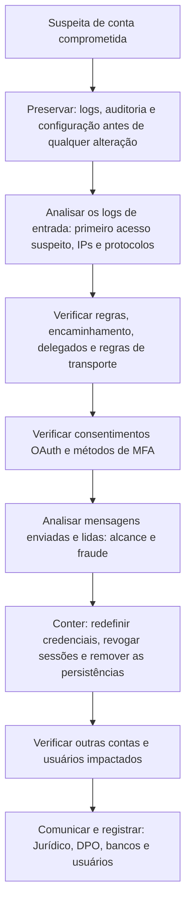

# Comprometimento de Contas de E-mail e Microsoft 365

> **Objetivo pedagógico:** investigar o comprometimento de contas de e-mail em nuvem e em servidores locais, com ênfase no Microsoft 365, identificando acessos indevidos, regras de caixa, encaminhamentos, delegações, consentimentos de aplicativos e alterações de autenticação, e conduzindo a preservação e a contenção na ordem correta.

## 1. O que o atacante faz após obter a conta

| Ação | ATT&CK | Objetivo |
|---|---|---|
| Acesso por credencial válida ou token roubado | T1078.004, T1539, T1550.001 | Entrar na conta |
| Fadiga de MFA | T1621 | Obter aprovação do usuário |
| Criar regras de caixa de entrada (excluir, mover e marcar como lida) | T1564.008 | Ocultar respostas e alertas |
| Configurar encaminhamento externo | T1114.003 | Receber cópias das mensagens |
| Adicionar permissões de delegado (Full Access e Send As) | T1098.002 | Manter acesso e enviar em nome do usuário |
| Consentir aplicativo OAuth | T1528 | Acesso persistente por token |
| Alterar métodos de MFA | T1556.006 | Persistência |
| Ler e pesquisar mensagens | T1114.002 | Coleta de informações |
| Enviar phishing interno e BEC | T1534, T1656 | Expansão e fraude |
| Excluir mensagens enviadas | T1070 | Ocultar rastros |

## 2. Fontes de evidência no Microsoft 365

| Fonte | O que mostra |
|---|---|
| Logs de entrada do Entra ID (Sign-in logs) | Origem, IP, aplicativo, dispositivo, resultado, MFA, protocolos legados e risco |
| Logs de auditoria do Entra ID | Alterações em usuários, métodos de MFA, aplicativos e consentimentos |
| Unified Audit Log (Microsoft Purview) | Operações em Exchange, SharePoint, OneDrive e Teams |
| Auditoria de caixas de correio | `Send`, `SoftDelete`, `HardDelete`, `MoveToDeletedItems`, `UpdateInboxRules` e `MailItemsAccessed` (conforme o licenciamento) |
| Rastreamento de mensagens (message trace) | Fluxo e entrega de mensagens, com origem e destino |
| Configuração da caixa e do tenant | Regras, encaminhamento, permissões e regras de fluxo de e-mail |
| Microsoft Defender XDR | Alertas, consultas de caça avançada e telemetria |
| Logs de proxy e EDR | Cliques em links e execução de anexos |

A disponibilidade, o detalhe e a retenção variam conforme o licenciamento e a configuração; verifique-os no início do caso e preserve o quanto antes.

## 3. Verificação da configuração da caixa

```powershell
# Conectar ao Exchange Online (módulo ExchangeOnlineManagement) com conta de investigação autorizada
Connect-ExchangeOnline

# Regras de caixa de entrada, inclusive ocultas
Get-InboxRule -Mailbox usuario@exemplo.com -IncludeHidden |
  Format-List Name,Enabled,Priority,From,SubjectContainsWords,DeleteMessage,MoveToFolder,MarkAsRead,ForwardTo,ForwardAsAttachmentTo,RedirectTo

# Encaminhamento no nível da caixa
Get-Mailbox usuario@exemplo.com | Format-List ForwardingAddress,ForwardingSmtpAddress,DeliverToMailboxAndForward

# Permissões de delegado
Get-MailboxPermission -Identity usuario@exemplo.com | Where-Object { $_.User -notlike "NT AUTHORITY*" }
Get-RecipientPermission -Identity usuario@exemplo.com          # Send As
(Get-Mailbox usuario@exemplo.com).GrantSendOnBehalfTo           # Send on Behalf

# Regras de fluxo de e-mail do tenant (podem desviar mensagens)
Get-TransportRule | Format-List Name,State,Priority,SentTo,RedirectMessageTo,BlindCopyTo
```

| Indício | Interpretação |
|---|---|
| Regra que move ou exclui mensagens com palavras como "fatura", "pagamento", "segurança" ou de remetentes específicos | Ocultação de comunicação da fraude ou de alertas |
| Regra com nome vazio ou nome curto (um ponto ou espaços) | Tentativa de ocultar a regra |
| Encaminhamento para domínio externo | Exfiltração contínua de mensagens |
| Permissões de delegado para contas desconhecidas | Persistência |
| Regra de transporte criada por conta recém-comprometida | Impacto sobre o tenant |

## 4. Auditoria e investigação de atividades

```powershell
# Operações relacionadas a regras e encaminhamento (Unified Audit Log)
Search-UnifiedAuditLog -StartDate "2026-10-20" -EndDate "2026-10-31" -UserIds usuario@exemplo.com `
  -Operations New-InboxRule,Set-InboxRule,UpdateInboxRules,Set-Mailbox,Add-MailboxPermission,Add-RecipientPermission `
  -ResultSize 5000 | Select-Object CreationDate,Operations,UserIds,AuditData |
  Export-Csv E:\saida\ual_regras.csv -NoTypeInformation

# Consentimento de aplicativos e alterações de MFA (Entra ID audit)
Search-UnifiedAuditLog -StartDate "2026-10-20" -EndDate "2026-10-31" -UserIds usuario@exemplo.com `
  -Operations "Consent to application","Add app role assignment grant to user","Update user" -ResultSize 5000 |
  Export-Csv E:\saida\ual_consent.csv -NoTypeInformation

# Rastreamento de mensagens enviadas pela conta (cmdlet pode variar conforme a versão: Get-MessageTrace ou Get-MessageTraceV2)
Get-MessageTrace -SenderAddress usuario@exemplo.com -StartDate (Get-Date).AddDays(-10) -EndDate (Get-Date) |
  Select-Object Received,SenderAddress,RecipientAddress,Subject,Status,FromIP |
  Export-Csv E:\saida\message_trace.csv -NoTypeInformation
```

No Entra ID, analise os logs de entrada por conta: IPs e ASNs incomuns, aplicativos e protocolos legados (IMAP, POP e SMTP autenticado), falhas e sucessos de MFA, dispositivos não gerenciados e padrões de viagem impossível (ver pasta 11).

| Operação de auditoria | Interpretação |
|---|---|
| `New-InboxRule`, `Set-InboxRule` e `UpdateInboxRules` | Criação ou alteração de regras |
| `Set-Mailbox` com `ForwardingSmtpAddress` | Configuração de encaminhamento |
| `Add-MailboxPermission` e `Add-RecipientPermission` | Delegações |
| `MailItemsAccessed` | Itens lidos (quando disponível) |
| `Send` e `SendAs` | Envios pela conta |
| `HardDelete` e `SoftDelete` | Exclusões |
| `Consent to application` | Consentimento OAuth |
| `User registered security info` e eventos de MFA | Alterações de autenticação |

## 5. Fluxo de investigação



## 6. Contenção e remediação (depois da preservação)

| Ação | Cuidado |
|---|---|
| Redefinir a senha e revogar sessões e tokens | Revogar sessões ativas (por exemplo, `Revoke-MgUserSignInSession`) |
| Revisar e remover métodos de MFA desconhecidos | Registrar o que foi removido |
| Remover regras, encaminhamentos e delegações maliciosos | Registrar a configuração antes de remover |
| Revogar consentimentos e aplicativos suspeitos | Revisar concessões de permissões no tenant |
| Bloquear o login da conta durante a investigação | Avaliar o impacto no negócio |
| Bloquear IPs e domínios identificados | Em gateway, proxy e políticas de acesso condicional |
| Revisar outras contas acessadas pelos mesmos IPs | Escopo ampliado |
| Habilitar proteções (MFA resistente a phishing, bloqueio de autenticação legada e acesso condicional) | Correção estrutural |
| Notificar | Usuários afetados, parceiros e bancos; Jurídico e DPO para comunicações regulatórias |

Preservar antes de conter: a contenção precipitada (por exemplo, excluir regras ou redefinir contas) pode apagar evidências e alertar o atacante; documente a configuração e exporte os logs antes.

## 7. Servidores Exchange locais

| Fonte | Uso |
|---|---|
| Message tracking logs (`Get-MessageTrackingLog`) | Fluxo e entrega de mensagens |
| Logs do IIS (OWA, EWS, ECP e Autodiscover) | Acessos, usuários e IPs |
| Logs de protocolo (SMTP, IMAP e POP) | Autenticações e transações |
| Logs de auditoria de caixa e de administrador | Alterações e acessos |
| Arquivos em diretórios web (OWA e ECP) | Web shells após exploração de vulnerabilidades |
| Logs do Windows | Autenticações e criação de processos |

Servidores Exchange expostos são alvos frequentes de exploração de vulnerabilidades (T1190); verifique web shells, contas criadas e processos filhos de `w3wp.exe` e do serviço de trabalho do Exchange.

## 8. Google Workspace

| Fonte | Uso |
|---|---|
| Logs de auditoria do Admin e de login | Autenticações, IPs e alterações |
| Logs de e-mail (Gmail log search) | Fluxo de mensagens |
| Configurações da caixa | Filtros, encaminhamento e delegação |
| Google Vault | Preservação e exportação |

## 9. Exemplo prático: BEC por conta comprometida

| Hora (UTC) | Fonte | Achado |
|---|---|---|
| 2026-10-26 02:11 | Sign-in logs | Entrada bem-sucedida da diretora financeira a partir de IP e ASN novos, com aplicativo "Outlook Web" e sem MFA aprovado pelo usuário (token reutilizado) |
| 02:19 | UAL | `New-InboxRule` com nome "." que move mensagens com "pagamento" para "RSS Subscriptions" |
| 02:21 | UAL | `Set-Mailbox` com `ForwardingSmtpAddress` para domínio externo |
| 02:40 a 03:10 | Message trace | 4 mensagens enviadas a fornecedores com dados bancários novos |
| 14:05 | Usuário | Relato de resposta estranha de um fornecedor |
| Conclusão | Tomada de conta (T1078.004, T1539), regras de ocultação (T1564.008), encaminhamento (T1114.003) e BEC; confiança alta; ação: preservar, conter, avisar fornecedores e o banco para tentar recall |

## 10. Casos de uso corporativos

- Resposta a incidentes de BEC e a contas de executivos comprometidas.
- Revisão periódica de regras, encaminhamentos, delegações e aplicativos de todo o tenant.
- Investigação de ataques que contornam MFA por roubo de sessão.

## 11. Normas e frameworks relevantes

- MITRE ATT&CK: T1078.004, T1114.002, T1114.003, T1098.002, T1528, T1539, T1550.001, T1556.006, T1564.008, T1621, T1534, T1656
- CISA. Orientações para Microsoft 365 e para investigações de BEC; FBI IC3
- NIST SP 800-61 Rev. 3; NIST SP 800-63B (autenticação)
- CIS Controls v8.1, controles 5, 6 e 8; ISO/IEC 27002:2022, controles 5.15, 8.5 e 8.15
- LGPD, art. 48 e Resolução CD/ANPD nº 15/2024 (comunicação de incidentes)

## 12. Referências

- Microsoft Learn. Documentação do Exchange Online PowerShell, do Microsoft Purview (auditoria) e do Entra ID (logs de entrada e auditoria).
- Microsoft. Guias de resposta a comprometimento de e-mail e de BEC.
- CISA. Untitled Goose Tool e orientações sobre Microsoft 365.
- Invictus IR. Microsoft-Extractor-Suite (documentação).
- FBI IC3. Business Email Compromise.
- MITRE ATT&CK. https://attack.mitre.org
