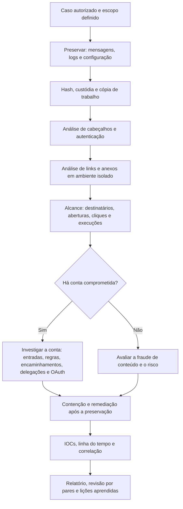

# Ferramentas, Fluxo, Modelos e Checklist de E-mail

> **Objetivo pedagógico:** padronizar as ferramentas, o fluxo de trabalho, os registros e a verificação de qualidade das investigações de e-mail, de modo que sejam reproduzíveis, rastreáveis e defensáveis.

## 1. Ferramentas por finalidade

| Finalidade | Ferramentas |
|---|---|
| Análise de cabeçalhos | Python (módulo `email`), Microsoft Message Header Analyzer, MXToolbox, PhishTool |
| Verificação de autenticação | `dig`, `dkimverify` (dkimpy), consultas SPF, DKIM e DMARC |
| Formatos de caixas | libpff (`pffinfo` e `pffexport`), libpst (`readpst`), Autopsy (Email Parser), ferramentas comerciais |
| Microsoft 365 | Exchange Online PowerShell, Microsoft Purview, Defender XDR, Microsoft-Extractor-Suite, Hawk, CISA Untitled Goose Tool |
| Exchange local | `Get-MessageTrackingLog`, logs do IIS, ferramentas de exportação |
| Anexos | oletools (`olevba`, `oleid` e `mraptor`), pdfid e pdf-parser, ExifTool, YARA |
| Infraestrutura | `dig`, `whois`, RDAP, dnstwist, fontes de inteligência de ameaças |
| Sandbox | Ambientes isolados de detonação, FLARE VM e REMnux |
| Indicadores | MISP, STIX, planilhas |
| Linha do tempo | Plaso, Timesketch, Timeline Explorer |

Registre nome, versão e origem; valide as ferramentas (NIST CFTT) e mantenha um ambiente isolado para o manuseio de conteúdo malicioso.

## 2. Fluxo de trabalho padronizado

## 3. Dez perguntas e como respondê-las

| Pergunta | Onde responder |
|---|---|
| 1. A mensagem original está preservada e íntegra? | `.eml` com hash, exportação oficial, custódia |
| 2. Qual o caminho e a primeira fronteira de confiança? | Cadeia `Received` e logs do gateway |
| 3. O domínio e o servidor estavam autenticados? | `Authentication-Results`, SPF, DKIM e DMARC |
| 4. O domínio é o legítimo ou é semelhante? | `whois`, DNS, dnstwist |
| 5. Que links e anexos existem e o que fazem? | Análise em sandbox, oletools e pdfid |
| 6. Quem recebeu, abriu, clicou e executou? | Message trace, auditoria, proxy, DNS e EDR |
| 7. Há conta comprometida? | Logs de entrada, regras, encaminhamento, delegações e OAuth |
| 8. Que dados foram acessados, enviados ou excluídos? | UAL, `MailItemsAccessed` e itens recuperáveis |
| 9. Quais indicadores devem ser bloqueados e compartilhados? | Registro de IOCs |
| 10. O que outras fontes confirmam? | Logs, EDR e rede |

## 4. Modelo A: Ficha de Mensagem

| Campo | Preenchimento |
|---|---|
| Identificador | DFL-AAAA-NNN-MNNN |
| Caso | |
| Origem da mensagem (caixa, servidor, gateway e backup) | |
| Método de obtenção (exportação, `.eml` e Purview) | |
| Data e hora de obtenção (UTC) e responsável | |
| Hash SHA-256 do arquivo | |
| `Message-ID` | |
| `Date` (original) e horário de entrega (UTC) | |
| `From`, `Reply-To` e `Return-Path` | |
| Destinatários (To, Cc) | |
| Assunto | |
| Anexos (nome e hash) | |
| Local de armazenamento | |
| Observações e limitações | |

## 5. Modelo B: Análise de Cabeçalho

| Item | Resultado |
|---|---|
| Primeira fronteira de confiança (servidor e IP) | |
| Cadeia `Received` (resumo em UTC, com atrasos) | |
| `Authentication-Results` (quem adicionou) | |
| SPF (resultado e domínio) | |
| DKIM (resultado, `d=` e `s=`) | |
| DMARC (resultado e política) | |
| Alinhamento `From` x `Return-Path` x `d=` | |
| Divergências (`Reply-To`, nome de exibição e domínio semelhante) | |
| Avaliação (autêntica, falsificada, conta comprometida provável ou inconclusiva) | |
| Confiança e justificativa | |

## 6. Modelo C: Registro de IOCs de E-mail

| ID | Tipo | Valor (neutralizado) | Origem (mensagem e campo) | Primeira observação (UTC) | Confiança | Ação (bloqueio, caça, compartilhamento) | Classificação (TLP) |
|---|---|---|---|---|---|---|---|
| IOC-001 | Domínio | | | | | | |
| IOC-002 | Hash | | | | | | |
| IOC-003 | URL | | | | | | |

## 7. Modelo D: Registro de Caixa de Correio Investigada

| Campo | Preenchimento |
|---|---|
| Conta | |
| Plataforma | Microsoft 365, Google Workspace ou Exchange local |
| Licenciamento e auditoria disponíveis | |
| Regras de caixa (nome e ação) | |
| Encaminhamento (endereço) | |
| Delegações (Full Access, Send As e Send on Behalf) | |
| Aplicativos OAuth e consentimentos | |
| Métodos de MFA (antes e depois) | |
| Primeiro acesso suspeito (UTC, IP e ASN) | |
| Mensagens enviadas e lidas em período suspeito | |
| Ações de contenção (data e responsável) | |

## 8. Modelo E: Relatório de Campanha

| Seção | Conteúdo |
|---|---|
| 1. Resumo | Descrição, período, alcance e impacto |
| 2. Linha do tempo | Envio, recebimento, cliques, execuções e contenção |
| 3. Análise técnica | Cabeçalhos, autenticação, links, anexos e infraestrutura |
| 4. Indicadores | Tabela de IOCs |
| 5. Alcance | Destinatários, aberturas, cliques e execuções |
| 6. Impacto | Contas, dados, valores e sistemas afetados |
| 7. Resposta | Ações realizadas e recomendações |
| 8. Limitações | Dados ausentes e incertezas |
| 9. Anexos | Hashes, consultas e custódia |

## 9. Checklist operacional de e-mail

**Caso:** DFL-AAAA-NNN
**Analista:** ____________________
**Data e hora (UTC):** ____________________

### 9.1 Preservação

- [ ] Mensagens originais preservadas (`.eml`, exportações) com hash
- [ ] Logs do gateway, do servidor e de auditoria preservados
- [ ] Configuração da caixa (regras, encaminhamento e delegações) exportada antes de qualquer alteração
- [ ] Legal hold aplicado quando necessário
- [ ] Custódia registrada

### 9.2 Análise da mensagem

- [ ] Fronteira de confiança e cadeia `Received` analisadas
- [ ] SPF, DKIM e DMARC verificados e interpretados
- [ ] Domínio verificado (registro, DNS e semelhança)
- [ ] Links extraídos e neutralizados; análise em ambiente isolado
- [ ] Anexos com hash e análise estática e dinâmica quando cabível

### 9.3 Alcance e contas

- [ ] Destinatários, aberturas, cliques e execuções levantados
- [ ] Contas potencialmente comprometidas identificadas
- [ ] Logs de entrada, regras, encaminhamento, delegações, OAuth e MFA revisados
- [ ] Mensagens enviadas e itens excluídos analisados

### 9.4 Contenção e comunicação

- [ ] Contenção realizada depois da preservação
- [ ] Mensagens removidas das caixas, com registro
- [ ] Indicadores bloqueados em gateway, proxy e EDR
- [ ] Jurídico, DPO, usuários e terceiros comunicados, quando aplicável

### 9.5 Relato

- [ ] Horários normalizados para UTC
- [ ] IOCs registrados e compartilhados com classificação
- [ ] Atribuição tratada como hipótese, com confiança declarada
- [ ] Limitações declaradas
- [ ] Revisão por pares realizada

## 10. Resultado da verificação

| Resultado | Condição |
|---|---|
| Conforme | Todos os itens aplicáveis marcados |
| Conforme com ressalvas | Pendências sem impacto nas conclusões, com plano de ação |
| Não conforme | Mensagens apenas em impressão, contenção antes da preservação, conclusões sem corroboração ou manuseio de amostras fora de ambiente isolado |

**Assinatura do analista:** ____________________
**Assinatura do revisor:** ____________________

## 11. Casos de uso corporativos

- Padronização do tratamento de e-mails reportados como phishing.
- Treinamento de analistas do SOC e do time de DFIR com os modelos.
- Auditoria da qualidade técnica de investigações de BEC.

## 12. Normas e frameworks relevantes

- ISO/IEC 27037:2012; ISO/IEC 27041:2015; ISO/IEC 27042:2015
- NIST SP 800-177 Rev. 1; NIST SP 800-61 Rev. 3; NIST CFTT
- MITRE ATT&CK; CIS Controls v8.1, controles 9 e 17

## 13. Referências

- Documentação do Exchange Online PowerShell, do Microsoft Purview e do Microsoft Defender XDR.
- Documentação do libpff, do libpst, do oletools, do pdfid e do dnstwist.
- Invictus IR. Microsoft-Extractor-Suite. CISA. Untitled Goose Tool.
- Casey, E. Digital Evidence and Computer Crime. 3. ed. 2011.
- SANS Institute. FOR508 e FOR509 (nuvem).
