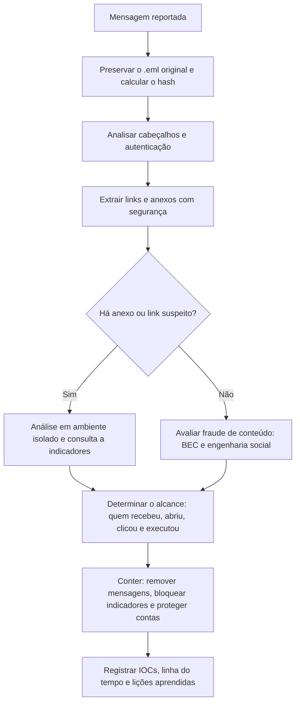

# Phishing, BEC e Análise de Conteúdo Malicioso

> **Objetivo pedagógico:** investigar campanhas de phishing e fraudes por e-mail (BEC, sequestro de conversa, phishing por QR code, kits AiTM e consentimento OAuth), analisando links e anexos com segurança, extraindo indicadores e conduzindo a resposta e a comunicação de forma adequada.

## 1. Tipologia

| Tipo | Característica | ATT&CK |
|---|---|---|
| Phishing em massa | Mensagens genéricas para muitos destinatários | T1566 |
| Spear phishing | Direcionado a pessoas ou áreas, com contexto | T1566.001, T1566.002 |
| Whaling | Direcionado a executivos | T1566 |
| BEC (Business Email Compromise) | Fraude financeira por impostores ou contas comprometidas: fraude do CEO, fraude de fornecedor, desvio de folha | T1656, T1586.002, T1114 |
| Sequestro de conversa (thread hijacking) | O atacante responde em conversas reais, a partir de conta comprometida ou de domínio semelhante | T1534 |
| Phishing interno | Mensagens enviadas de contas internas comprometidas | T1534 |
| Phishing de credenciais | Páginas falsas de login para coleta de senhas | T1598.003, T1056 |
| AiTM (adversary-in-the-middle) | Proxy reverso que captura credenciais e cookies de sessão, contornando MFA | T1557, T1539 |
| Consentimento OAuth | Aplicativo malicioso que pede permissões sobre a conta | T1528 |
| Quishing | Link malicioso em QR code, frequentemente em imagem | T1566.002 |
| Phishing de retorno de chamada | O e-mail induz o usuário a ligar para um número | T1566, T1598 |
| Entrega de malware | Anexos e links com executáveis, macros e contêineres | T1566.001, T1204 |

## 2. Indicadores de uma mensagem maliciosa

| Categoria | Indicadores |
|---|---|
| Remetente | Domínio semelhante, nome de exibição enganoso, `Reply-To` divergente, domínio recém-registrado |
| Conteúdo | Urgência, ameaça, pedido de alteração de dados bancários, solicitação de sigilo, tom incomum |
| Contexto | Conversa existente interrompida, cópia de pessoas que não participavam, pedido fora do processo |
| Links | Texto diferente do destino, encurtadores, domínios novos, redirecionamentos, parâmetros com o e-mail do destinatário |
| Anexos | Extensões duplas, contêineres (ISO, IMG, ZIP, RAR), arquivos HTML, atalhos (`.lnk`), documentos com macros, PDFs com links e senhas no corpo da mensagem |
| Imagens | QR codes, imagens que substituem texto para evadir filtros |
| Cabeçalhos | Falhas de autenticação, rota incomum, horários inconsistentes |

## 3. Triagem e investigação



## 4. Análise segura de links

| Cuidado | Orientação |
|---|---|
| Não clicar em estação de uso comum | Use ambiente isolado e sem credenciais |
| Neutralizar ao registrar | Escreva `hxxps://dominio[.]com` (defang) em relatórios e e-mails |
| Redirecionamentos | Seguir a cadeia com ferramentas controladas, em máquina isolada |
| Consulta de reputação | Consultar por domínio, URL ou hash em fontes de inteligência; não envie o conteúdo da mensagem |
| Conteúdo dinâmico | Páginas podem mostrar conteúdos diferentes por origem e por tempo; capture quando possível (ver pasta 06) |
| Alvo da campanha | Parâmetros do link podem identificar o destinatário |

```bash
# Extrair URLs de um .eml (apenas texto, sem acessar)
grep -a -o -E "https?://[^\" >)]+" mensagem.eml | sort -u

# Exemplo de neutralização de URLs para relatório
sed -E 's#https?://#hxxp://#; s#\.#[.]#g' urls.txt > urls_defanged.txt
```

Acesse URLs somente em ambiente isolado, com egress controlado, e registre cada ação. Evite interagir com a infraestrutura do atacante quando não for estritamente necessário.

## 5. Análise de anexos

| Tipo | Ferramentas e abordagem |
|---|---|
| Documentos Office com macros | `oleid`, `olevba`, `mraptor` (oletools) e `oledump.py`; examine macros e o gatilho de execução |
| PDF | `pdfid.py` e `pdf-parser.py`: procurar `/JS`, `/JavaScript`, `/OpenAction`, `/Launch` e URLs |
| HTML e SVG (HTML smuggling) | Inspecionar scripts e dados codificados (base64) que reconstroem arquivos no navegador (T1027.006) |
| Atalhos (`.lnk`) | Ler o alvo e os argumentos (por exemplo, com ferramentas de análise de LNK) |
| ISO, IMG, ZIP e RAR | Listar o conteúdo sem executar; atentar a arquivos protegidos por senha |
| Executáveis e scripts | Análise estática e dinâmica em laboratório (ver pasta de malware) |
| OneNote e outros formatos incomuns | Extração de objetos incorporados |
| Imagens com QR code | Decodificar o QR em ambiente isolado e analisar a URL |

```bash
sha256sum anexo.docm
file anexo.docm
exiftool anexo.docm

# oletools
olevba anexo.docm
oleid anexo.docm
mraptor anexo.docm

# PDF
pdfid.py anexo.pdf
pdf-parser.py --search javascript anexo.pdf
```

Realize detonação em sandbox quando necessário, registrando o ambiente, a versão e o comportamento observado (processos, arquivos, rede e persistência). Não execute amostras fora de ambiente isolado.

## 6. Extração de indicadores (IOCs)

| Indicador | Origem |
|---|---|
| Endereços de remetente e de `Reply-To` | Cabeçalhos |
| Domínios e IPs de servidores | `Received` e links |
| URLs (com parâmetros) | Corpo e anexos |
| Hashes de anexos | SHA-256 dos arquivos |
| Assuntos, nomes de arquivos e padrões de texto | Campanha |
| Domínios de infraestrutura de C2 e de coleta | Análise dos anexos e das páginas |
| Mutexes, chaves e artefatos de malware | Análise de anexos |

Registre cada IOC com a fonte, a data e a confiança (ver arquivo de rastreamento), e compartilhe de forma estruturada (por exemplo, STIX e MISP) com classificação de sensibilidade.

## 7. Determinação do alcance

| Pergunta | Fonte |
|---|---|
| Quem recebeu a mensagem? | Rastreamento de mensagens (message trace), logs do gateway |
| Quem abriu ou leu? | Auditoria de caixas de correio, recibos, logs do cliente (quando disponíveis) |
| Quem clicou no link? | Logs de proxy e DNS, EDR, proteção de links |
| Quem abriu ou executou o anexo? | EDR, Prefetch, Amcache e logs de processos |
| Quem inseriu credenciais? | Logs de proxy (POST), logs de autenticação, alertas de inteligência de ameaças |
| Há contas comprometidas? | Logs de entrada, regras de caixa, MFA e OAuth (ver arquivo de comprometimento de contas) |
| A campanha continua? | Novos envios com os mesmos indicadores |

## 8. Resposta

| Ação | Observação |
|---|---|
| Preservar | Mensagens, cabeçalhos, anexos, logs e capturas, antes de remover |
| Remover as mensagens (purge) | Das caixas afetadas, conforme a política e o registro do que foi removido |
| Bloquear indicadores | Domínios, URLs, IPs e hashes em gateway, proxy e EDR |
| Proteger contas | Redefinir senhas, revogar sessões, exigir MFA e revisar regras e OAuth quando houver comprometimento |
| Comunicar | Usuários, gestão e, quando houver dados pessoais ou perdas, Jurídico, DPO e, se aplicável, autoridades e bancos (recall de pagamentos) |
| Registrar | IOCs, linha do tempo e lições aprendidas |

## 9. Exemplo prático: campanha de HTML smuggling

| Etapa | Evidência |
|---|---|
| Mensagem | `.eml` com anexo `fatura.html` e `Reply-To` de provedor gratuito; DMARC falhou |
| Anexo | O HTML contém um bloco base64 e um script que monta e baixa `fatura.iso` |
| ISO | Contém `fatura.lnk`, que executa um comando oculto com `rundll32` |
| Rede | DNS e proxy mostram resolução e conexão ao domínio de C2 pelos hosts afetados |
| Alcance | 38 destinatários, 6 abriram o anexo, 2 executaram o atalho (EDR) |
| Resposta | Purge nas 38 caixas, bloqueio do domínio e do hash, isolamento de 2 estações, revisão de credenciais |
| Conclusão | Spear phishing com HTML smuggling (T1566.001, T1027.006, T1204.002); confiança alta |

## 10. Casos de uso corporativos

- Resposta a campanhas de phishing reportadas pelos usuários.
- Investigação de fraudes de pagamento e de alteração de dados bancários.
- Produção de indicadores para as equipes de detecção e de bloqueio.

## 11. Normas e frameworks relevantes

- MITRE ATT&CK: T1566.001, T1566.002, T1566.003, T1534, T1598, T1656, T1204.001, T1204.002, T1027.006, T1557, T1539, T1528
- NIST SP 800-177 Rev. 1; NIST SP 800-61 Rev. 3
- CISA. Phishing Guidance; FBI IC3. Alertas sobre Business Email Compromise
- CIS Controls v8.1, controle 9 (proteções de e-mail e navegador)
- ISO/IEC 27002:2022, controles 5.14, 6.3 (conscientização) e 8.23 (filtragem web)

## 12. Referências

- Rose, S. et al. NIST SP 800-177 Rev. 1: Trustworthy Email. 2019.
- FBI. Internet Crime Complaint Center (IC3): Business Email Compromise.
- CISA. Phishing Guidance: Stopping the Attack Cycle at Phase One. 2023.
- Lagadec, P. Documentação do oletools. Stevens, D. pdfid e pdf-parser.
- Sikorski, M.; Honig, A. Practical Malware Analysis. No Starch Press, 2012.
- MITRE ATT&CK. https://attack.mitre.org
