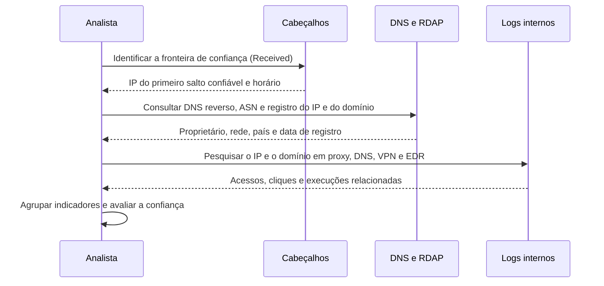

# Rastreamento de Origem, Atribuição e Correlação

> **Objetivo pedagógico:** rastrear a origem técnica de uma mensagem (IPs, domínios, infraestrutura e horários), correlacioná-la com logs e com outras mensagens para identificar campanhas, extrair e compartilhar indicadores, e tratar a atribuição com cautela, distinguindo o que é fato técnico do que é inferência.

## 1. O que é possível (e o que não é)

| Possível | Limitação |
|---|---|
| Identificar o servidor de origem e o primeiro salto confiável | Cabeçalhos antes da fronteira de confiança podem ser forjados |
| Identificar a infraestrutura (IP, ASN, domínio, hospedagem) | O IP pode ser de proxy, VPN, rede Tor, serviço de nuvem ou dispositivo comprometido |
| Agrupar mensagens por semelhança de infraestrutura e de conteúdo | Semelhança não prova a mesma autoria |
| Correlacionar com cliques, execuções e acessos | Depende da cobertura de logs |
| Identificar a conta usada | Pode ser uma conta comprometida de terceiros |
| Estimar horários e fusos do remetente | Relógios e fusos podem ser manipulados |
| Atribuir a uma pessoa ou a um grupo | Exige evidências fortes, geralmente fora do e-mail, e processos legais |

Regra: relate a infraestrutura e os indicadores como fatos técnicos; trate a atribuição a pessoas ou grupos como hipótese com grau de confiança explícito.

## 2. Procedimento de rastreamento



## 3. Análise de endereços e domínios

```bash
# DNS reverso e informações do IP
host 198.51.100.25
dig -x 198.51.100.25 +short
whois 198.51.100.25 | head -n 40

# Domínio: registros e datas
whois exemplo-suspeito.com | head -n 40
dig +short A exemplo-suspeito.com
dig +short MX exemplo-suspeito.com
dig +short TXT exemplo-suspeito.com

# RDAP (protocolo estruturado de consulta de registro)
curl -s https://rdap.org/domain/exemplo-suspeito.com | jq '.events, .entities[0].vcardArray'
```

| Dado | Uso |
|---|---|
| ASN e provedor | Tipo de infraestrutura (hospedagem, residencial, nuvem) |
| País e geolocalização do IP | Contexto; impreciso e passível de ocultação por VPN |
| Data de registro do domínio | Domínios recentes indicam campanhas |
| Registros A, MX, TXT e NS | Infraestrutura associada e política de autenticação |
| DNS passivo e certificados | Descoberta de domínios e IPs relacionados (fontes especializadas) |
| Reputação | Listas e inteligência de ameaças |

Observação: consultas a serviços de terceiros devem enviar apenas indicadores técnicos (IP e domínio). Evite interagir diretamente com a infraestrutura do atacante, para não alertá-lo nem criar riscos.

## 4. Análise de horários e fusos

| Fonte de tempo | Observação |
|---|---|
| `Date` do cabeçalho | Relógio e fuso do remetente; pode ser manipulado |
| `Received` (primeiro salto confiável) | Horário do seu servidor; confiável |
| Tempo entre saltos | Atrasos grandes indicam filas, retransmissões ou envios agendados |
| Padrão de horários de campanhas | Distribuição de horários de envio sugere fuso do operador, mas não prova a localização |
| Horário de criação do domínio e do certificado | Prepara a linha do tempo da campanha |

Converta tudo para UTC e relacione com a linha do tempo do caso (pasta 05).

## 5. Correlação com logs internos

| Fonte | Pergunta |
|---|---|
| Gateway e message trace | Quem recebeu a mensagem e com qual resultado |
| Auditoria de caixa e logs do cliente | Quem abriu, respondeu, encaminhou ou excluiu |
| Proxy e DNS | Quem acessou o link ou o domínio, e quando |
| EDR | Quem abriu o anexo e quais processos surgiram |
| Logs de autenticação | Se houve uso de credenciais depois do clique |
| Logs de rede | Comunicação com a infraestrutura do atacante |

Construa a linha do tempo por destinatário: recebimento, abertura, clique, execução, autenticação e comunicação externa.

## 6. Agrupamento de campanhas

| Critério | Exemplos |
|---|---|
| Infraestrutura | Mesmos IPs, ASNs, domínios, certificados e registrantes |
| Conteúdo | Mesmo texto, estrutura HTML, modelos, linguagem e erros |
| Anexos | Mesmos hashes ou hashes difusos semelhantes (ver pasta 04) |
| Técnicas | Mesmo uso de HTML smuggling, contêineres ou kits de phishing |
| Tempo | Envios em janelas e padrões semelhantes |
| Alvos | Mesmos grupos, setores ou funções |

```bash
# Hashes difusos de anexos para agrupar variantes
ssdeep -r anexos/ > anexos.ssdeep
ssdeep -m anexos.ssdeep -b novo_anexo.html
```

## 7. Indicadores de e-mail e compartilhamento

| Tipo | Exemplo | Observações |
|---|---|---|
| Endereço de remetente | `financeiro@dominio-suspeito[.]com` | Pode ser conta comprometida |
| Domínio | `dominio-suspeito[.]com` | Registrar a data e a fonte |
| IP | `198.51.100.25` | Pode ser compartilhado |
| URL | `hxxps://dominio-suspeito[.]com/login` | Neutralizar ao registrar |
| Hash de anexo | SHA-256 | Estável para o arquivo exato |
| `Message-ID` | `<abc@dominio>` | Útil para correlação interna |
| Assunto e nome de arquivo | Texto | Úteis para caça, de baixa durabilidade |

Compartilhe com classificação (por exemplo, o protocolo TLP) e em formatos estruturados (STIX e MISP), respeitando a LGPD: não compartilhe dados pessoais de vítimas além do necessário.

## 8. Cuidados com a atribuição

| Cuidado | Descrição |
|---|---|
| Linguagem | "Compatível com", "associado a", com grau de confiança; evite "foi o grupo X" sem evidências fortes |
| Falsa bandeira | Atores podem imitar infraestrutura, idioma e técnicas |
| Infraestrutura compartilhada | Serviços de hospedagem e de e-mail usados por muitos |
| Dados pessoais | O endereço de um remetente pode pertencer a uma vítima |
| Processo legal | A identificação de pessoas depende de ordem judicial e de dados de provedores |
| Escopo | Para a empresa, o foco é proteger, delimitar o incidente e preservar provas, e não atribuir |

## 9. Exemplo prático: campanha contra o setor financeiro

| Observação | Resultado |
|---|---|
| 38 destinatários, remetentes de 3 domínios diferentes | Domínios criados entre 2026-10-20 e 2026-10-24 |
| IPs de saída | Dois ASNs de hospedagem, com 4 IPs em comum com mensagens de outra empresa do setor (informação de parceiro) |
| Anexos | 3 arquivos HTML com hashes distintos, mas ssdeep com semelhança de 91% |
| Logs internos | 6 aberturas, 2 execuções e comunicação com o mesmo domínio de C2 |
| Conclusão técnica | Campanha única com variantes do mesmo kit; indicadores compartilhados com o setor; atribuição a ator específico não determinada |

## 10. Casos de uso corporativos

- Entrega de indicadores consolidados à equipe de detecção e a parceiros do setor.
- Apoio ao Jurídico em notificações à plataforma de e-mail e ao registrador do domínio.
- Elaboração de relatório de campanha para a diretoria.

## 11. Normas e frameworks relevantes

- MITRE ATT&CK: T1583 (Acquire Infrastructure), T1585 (Establish Accounts), T1586 (Compromise Accounts), T1566
- STIX 2.1 e TAXII 2.1 (OASIS); Traffic Light Protocol (FIRST)
- NIST SP 800-150: Guide to Cyber Threat Information Sharing
- LGPD, arts. 6º e 7º (compartilhamento de indicadores com dados pessoais)

## 12. Referências

- NIST SP 800-150: Guide to Cyber Threat Information Sharing. 2016.
- OASIS. STIX 2.1 e TAXII 2.1. FIRST. Traffic Light Protocol (TLP).
- ICANN. RDAP: documentação e perfis.
- Documentação do MISP, do dnstwist e do ssdeep.
- Rid, T.; Buchanan, B. Attributing Cyber Attacks. Journal of Strategic Studies, v. 38, 2015.
- MITRE ATT&CK. https://attack.mitre.org
