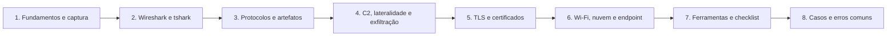

# 13 Forense de Rede

## Objetivo

Capturar, preservar e analisar tráfego e metadados de rede (pacotes, fluxos, logs e alertas) para reconstruir comunicações, identificar varreduras, comando e controle, movimentação lateral, ataques a credenciais e exfiltração, em redes cabeadas, sem fio, em nuvem e em contêineres, com integridade, base legal e limitações declaradas.

## Trilha de estudo recomendada

## Conteúdo da pasta

| Ordem | Arquivo | Objetivo |
|---|---|---|
| 1 | [fundamentos-de-rede-e-modelos-de-captura.md](fundamentos-de-rede-e-modelos-de-captura.md) | Tipos de evidência, pontos de captura, formatos, dimensionamento e aspectos legais |
| 2 | [analise-de-pcap-com-wireshark-e-tshark.md](analise-de-pcap-com-wireshark-e-tshark.md) | Triagem, filtros, sessões, objetos e manipulação de capturas |
| 3 | [protocolos-e-artefatos-por-camada.md](protocolos-e-artefatos-por-camada.md) | O que cada protocolo revela e seus abusos típicos |
| 4 | [deteccao-de-ameacas-c2-lateralidade-e-exfiltracao.md](deteccao-de-ameacas-c2-lateralidade-e-exfiltracao.md) | Varredura, C2, credenciais, lateralidade, exfiltração e IDS |
| 5 | [trafego-criptografado-tls-e-certificados.md](trafego-criptografado-tls-e-certificados.md) | Metadados TLS, JA3 e JA4, certificados, QUIC e decriptação |
| 6 | [redes-sem-fio-nuvem-containers-e-captura-no-endpoint.md](redes-sem-fio-nuvem-containers-e-captura-no-endpoint.md) | Wi-Fi, logs de fluxo, contêineres e captura no endpoint |
| 7 | [ferramentas-fluxo-modelos-e-checklist-de-rede.md](ferramentas-fluxo-modelos-e-checklist-de-rede.md) | Ferramentas, fluxo, modelos, laboratório e checklist |
| 8 | [casos-de-uso-e-erros-comuns-em-rede.md](casos-de-uso-e-erros-comuns-em-rede.md) | Sete cenários, erros comuns e exercícios |

## Princípios

- Capturar somente com autorização, base legal e no menor escopo necessário
- Documentar o ponto de captura, o filtro, o `snaplen`, o tempo e as perdas, e calcular o hash
- Analisar cópias em ambiente isolado e com ferramentas atualizadas
- Combinar pacotes, fluxos, metadados, alertas e evidências de endpoint
- Tratar a criptografia como limite técnico e usar metadados e corroboração
- Declarar pontos cegos: a ausência de captura não prova ausência de comunicação
- Tratar impressões digitais (JA3, JA4 e HASSH) como indícios
- Proteger as capturas como dados pessoais e confidenciais

## Relação com outras pastas

- 02-cadeia-de-custodia e 04-hash-e-integridade: custódia e hash das capturas
- 05-timeline-analysis: normalização de tempo e linha do tempo
- 06-evidencias-digitais: validade e apresentação de evidências de rede
- 09-memory-forensics: segredos de sessão e conexões em memória
- 11-log-analysis: logs de DNS, proxy, firewall e Zeek
- 12-email-forensics: tráfego SMTP, phishing e infraestrutura de campanhas

## Referências

- Davidoff, S.; Ham, J. Network Forensics: Tracking Hackers through Cyberspace (2012)
- Bejtlich, R. The Practice of Network Security Monitoring (2013)
- Sanders, C. Practical Packet Analysis. 3. ed. (2017); Sanders, C.; Smith, J. Applied Network Security Monitoring (2013)
- Chappell, L. Wireshark Network Analysis. 2. ed. (2012)
- NIST SP 800-86 (2006); NIST SP 800-94 (2007); NIST SP 800-52 Rev. 2 (2019); NIST SP 800-153 (2012); NIST SP 800-190 (2017)
- RFC 8446 (TLS 1.3), RFC 9000 (QUIC), RFC 7011 (IPFIX), RFC 4120 (Kerberos)
- MITRE ATT&CK (T1040, T1046, T1071, T1557, T1558, T1021, T1041, T1048)
- Documentação do Wireshark, Zeek, Suricata, Arkime, RITA e Security Onion
- Brasil. Constituição Federal, art. 5º, XII; Lei nº 9.296/1996; Lei nº 12.965/2014; Lei nº 13.709/2018
- SANS Institute. FOR572: Advanced Network Forensics
