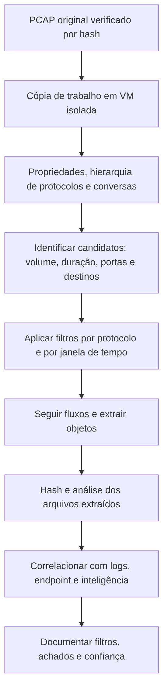

# Análise de PCAP com Wireshark e tshark

> **Objetivo pedagógico:** analisar capturas de pacotes de forma metódica com Wireshark e tshark (preparação, triagem estatística, filtros, reconstrução de sessões e extração de objetos), documentando os passos para que a análise seja reproduzível, e conhecendo os cuidados de segurança no manuseio de capturas.

## 1. Preparação

| Item | Orientação |
|---|---|
| Ambiente | Máquina virtual isolada, com Wireshark e tshark atualizados; capturas podem explorar falhas de dissectores |
| Cópia de trabalho | Verifique o hash do original e trabalhe em cópia |
| Fuso e horário | Configure a exibição em UTC (Wireshark: Exibir > Formato de exibição de tempo > UTC data e hora do dia) |
| Perfil de análise | Crie um perfil com colunas úteis (hora UTC, IP e portas de origem e destino, protocolo, informações e fluxo TCP) |
| Informações da captura | Registre início, fim, número de pacotes, interface, filtro e perdas |

```bash
sha256sum cap.pcap && cp cap.pcap cap_trabalho.pcap
capinfos cap_trabalho.pcap
```

## 2. Triagem estatística

| Estatística (Wireshark: menu Estatísticas) | Para que serve |
|---|---|
| Propriedades do arquivo de captura | Datas, duração, pacotes, bytes e comentários |
| Hierarquia de protocolos | Quais protocolos existem e em que proporção |
| Conversas e pontos finais | Principais comunicações, volumes e durações |
| Gráficos de E/S | Picos e padrões temporais |
| Informações de especialistas | Retransmissões, anomalias e alertas do dissecador |
| DNS, HTTP, TLS (por protocolo) | Visão rápida de consultas, requisições e handshakes |

```bash
# Resumo por conversa TCP e pontos finais IP
tshark -r cap_trabalho.pcap -q -z conv,tcp
tshark -r cap_trabalho.pcap -q -z conv,udp
tshark -r cap_trabalho.pcap -q -z endpoints,ip

# Hierarquia de protocolos
tshark -r cap_trabalho.pcap -q -z io,phs

# Estatísticas por intervalo de 60 segundos
tshark -r cap_trabalho.pcap -q -z io,stat,60
```

## 3. Filtros de exibição úteis

Os filtros de exibição do Wireshark (`-Y` no tshark) são diferentes dos filtros de captura (BPF).

| Pergunta | Filtro |
|---|---|
| Tráfego de ou para um host | `ip.addr == 10.1.2.3` |
| Janela de tempo | `frame.time >= "2026-10-28 13:00:00" && frame.time <= "2026-10-28 14:00:00"` |
| Início de conexões TCP | `tcp.flags.syn == 1 && tcp.flags.ack == 0` |
| Reinícios (RST) | `tcp.flags.reset == 1` |
| Consultas DNS por domínio | `dns.qry.name contains "exemplo"` |
| Respostas DNS com erro | `dns.flags.rcode != 0` |
| Requisições HTTP POST | `http.request.method == "POST"` |
| Host HTTP | `http.host contains "exemplo"` |
| User-agent | `http.user_agent contains "python"` |
| SNI do TLS | `tls.handshake.extensions_server_name contains "exemplo"` |
| Início de handshake TLS (Client Hello) | `tls.handshake.type == 1` |
| SMB2 | `smb2` |
| Acesso a compartilhamentos administrativos | `smb2.tree contains "ADMIN$" or smb2.tree contains "C$"` |
| Kerberos: tipo de mensagem | `kerberos.msg_type == 13` (TGS-REP) |
| Kerberos com RC4 | `kerberos.etype == 23` |
| Credenciais em texto claro (FTP) | `ftp.request.command == "PASS"` |
| Autenticação HTTP básica | `http.authorization` |
| DHCP | `dhcp` |
| ARP | `arp` |
| ICMP | `icmp` |

Os nomes de campos podem variar entre versões do Wireshark; verifique com a ajuda do campo (clique no campo e leia a barra de status).

## 4. Seguir sessões e reconstruir conteúdo

| Ação | Wireshark | tshark |
|---|---|---|
| Seguir fluxo TCP ou UDP | Botão direito > Seguir > Fluxo TCP | `tshark -r cap.pcap -q -z follow,tcp,ascii,0` |
| Extrair objetos HTTP | Arquivo > Exportar objetos > HTTP | `tshark -r cap.pcap --export-objects http,/saida/http` |
| Extrair objetos SMB | Arquivo > Exportar objetos > SMB | `--export-objects smb,/saida/smb` |
| Extrair e-mails (IMF) | Exportar objetos > IMF | `--export-objects imf,/saida/imf` |
| Extrair TFTP e DICOM | Exportar objetos | `--export-objects tftp,/saida/tftp` |

Depois de extrair arquivos: calcule o hash, registre o fluxo de origem (IPs, portas e horário) e analise em ambiente isolado; arquivos de capturas podem ser maliciosos.

```bash
mkdir -p /saida/http && tshark -r cap_trabalho.pcap --export-objects http,/saida/http
find /saida/http -type f -exec sha256sum {} \; > /saida/http_hashes.sha256
```

## 5. Extração de campos para análise tabular

```bash
# Requisições HTTP com horário em UTC
tshark -r cap_trabalho.pcap -t ud -Y "http.request" -T fields \
  -e frame.time -e ip.src -e ip.dst -e http.host -e http.request.method -e http.request.uri -e http.user_agent \
  -E header=y -E separator=, > http_requests.csv

# Consultas DNS
tshark -r cap_trabalho.pcap -t ud -Y "dns.flags.response == 0" -T fields \
  -e frame.time -e ip.src -e dns.qry.name -e dns.qry.type -E header=y -E separator=, > dns_queries.csv

# Handshakes TLS (SNI)
tshark -r cap_trabalho.pcap -t ud -Y "tls.handshake.type == 1" -T fields \
  -e frame.time -e ip.src -e ip.dst -e tls.handshake.extensions_server_name -E header=y -E separator=, > tls_sni.csv

# Resumo dos IPs com maior volume enviado
tshark -r cap_trabalho.pcap -q -z conv,ip | sort -k 6 -nr | head
```

Use o resultado em planilhas, no Miller, no DuckDB ou em Python (ver pasta 11) para contagens e agrupamentos.

## 6. Manipulação de arquivos de captura

```bash
# Recortar uma janela de tempo
editcap -A "2026-10-28 13:00:00" -B "2026-10-28 14:00:00" cap_trabalho.pcap janela.pcap

# Unir várias capturas
mergecap -w unido.pcapng cap1.pcap cap2.pcap

# Dividir por número de pacotes
editcap -c 100000 cap_trabalho.pcap parte.pcap

# Remover duplicatas (quando a captura foi feita em dois pontos)
editcap -d cap_trabalho.pcap sem_duplicatas.pcap
```

Registre as operações e preserve os originais. Capturas recortadas são derivadas e devem ter hash próprio.

## 7. Fluxo de análise



## 8. Receitas de análise

| Objetivo | Procedimento |
|---|---|
| Principais comunicantes | Estatísticas > Conversas, ordenar por bytes |
| Conexões longas | Conversas TCP ordenadas por duração |
| Portas incomuns | Filtro `not (tcp.port in {80 443 53 22 25 110 143 993 995})` e revisar |
| Varredura de portas | Muitos SYN sem ACK, de uma origem para muitas portas ou hosts |
| Conexões com falha | `tcp.flags.reset == 1` e SYN sem resposta |
| Credenciais em texto claro | Filtros de FTP, HTTP básico, POP3, IMAP, Telnet e SNMP |
| Downloads de executáveis | Exportar objetos HTTP e filtrar por tipo e por `MZ` |
| Beaconing | Filtrar o par origem e destino e observar o intervalo entre pacotes (gráfico de E/S ou estatísticas) |
| DNS suspeito | Consultas com nomes longos, TXT e NXDOMAIN em volume |
| Movimentação lateral | SMB para `ADMIN$`, RPC e WinRM entre estações e servidores |

## 9. Boas práticas de documentação

| Item | Registro |
|---|---|
| Versões | Wireshark, tshark, dissectores e perfil |
| Arquivos | Nome e hash de cada PCAP e de cada derivado |
| Filtros e comandos | Todos os filtros e comandos usados, em ordem |
| Captura de tela | Evidências visuais de achados importantes, com o filtro aplicado |
| Interpretação | Fato (o que está no pacote), inferência e confiança |
| Tempo | UTC, com a margem de erro do relógio do sensor |
| Limitações | Perdas, truncamento (`snaplen`), criptografia e filtros de captura |

## 10. Exemplo prático: identificação de download e execução remota

| Passo | Resultado |
|---|---|
| Conversas | Estação 10.1.2.3 com 18 MB recebidos de 198.51.100.9 na porta 80 |
| Filtro HTTP | `GET /update.exe` com `User-Agent: Microsoft BITS`... (ou ferramenta de linha de comando) |
| Exportar objetos | `update.exe` extraído, hash registrado |
| Análise do arquivo | Executável PE sem assinatura; hash desconhecido em fontes de inteligência |
| Sequência | 40 s depois, a estação inicia conexões TLS ao IP 203.0.113.50 na porta 443 em intervalos regulares |
| Conclusão | Download de executável e início de comunicação periódica; técnicas T1105 e T1071; confiança média no PCAP isolado e alta com o EDR corroborando a execução |

## 11. Casos de uso corporativos

- Confirmação de downloads maliciosos e de exfiltração a partir de capturas.
- Reconstrução de sessões para disputas e investigações internas.
- Treinamento de analistas com capturas públicas.

## 12. Normas e frameworks relevantes

- NIST SP 800-86; ISO/IEC 27037:2012; ISO/IEC 27042:2015
- MITRE ATT&CK: T1105, T1071, T1040, T1046
- CIS Controls v8.1, controle 13

## 13. Referências

- Sanders, C. Practical Packet Analysis. 3. ed. No Starch Press, 2017.
- Chappell, L. Wireshark Network Analysis. 2. ed. Protocol Analysis Institute, 2012.
- Wireshark Foundation. Wireshark User's Guide e Display Filter Reference.
- Documentação do tshark, do editcap, do mergecap e do capinfos.
- Davidoff, S.; Ham, J. Network Forensics. Prentice Hall, 2012.
- SANS Institute. FOR572: Advanced Network Forensics.
