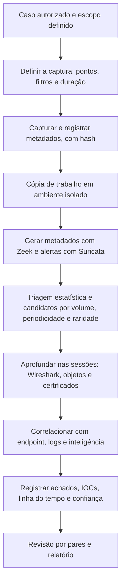

# Ferramentas, Fluxo, Modelos e Checklist de Rede

> **Objetivo pedagógico:** padronizar o ambiente de análise, as ferramentas, o fluxo de trabalho, os registros e a verificação de qualidade das investigações de rede, de modo que sejam reproduzíveis, rastreáveis e defensáveis.

## 1. Ferramentas por finalidade

| Finalidade | Ferramentas |
|---|---|
| Captura | tcpdump, Wireshark e tshark, dumpcap, pktmon, `netsh trace`, TAPs e packet brokers |
| Análise de pacotes | Wireshark, tshark, NetworkMiner, ngrep, tcpflow |
| Manipulação de capturas | capinfos, editcap, mergecap |
| Metadados e logs de rede | Zeek (e zeek-cut), RITA, Arkime |
| Detecção | Suricata, Snort, regras Sigma para logs de rede |
| Fluxos | nfdump, SiLK, pmacct, coletores NetFlow e IPFIX |
| Extração de arquivos | Wireshark (exportar objetos), Zeek (framework de arquivos), NetworkMiner, tcpflow |
| Visualização e consulta | Kibana, Grafana, Jupyter, DuckDB, Miller |
| Plataformas integradas | Security Onion, Arkime, Elastic e OpenSearch |
| Inteligência | Consulta de domínios, IPs e hashes em fontes de reputação |
| Análise de arquivos extraídos | oletools, pdfid, YARA, sandbox e FLARE VM e REMnux |

Registre nome, versão e origem das ferramentas; valide-as em ambiente de testes (NIST CFTT) e mantenha as regras e as assinaturas versionadas.

## 2. Ambiente de análise

| Requisito | Orientação |
|---|---|
| VM isolada | Sem acesso à rede de produção; capturas podem conter conteúdo malicioso e explorar falhas de dissectores |
| Versões atualizadas | Wireshark, Zeek e Suricata; registre as versões |
| Recursos | Armazenamento e memória para capturas grandes |
| Armazenamento seguro | Repositório com controle de acesso, criptografia e imutabilidade |
| Documentação | Perfil do Wireshark, scripts e consultas em repositório versionado |

## 3. Fluxo de trabalho padronizado



## 4. Processamento rápido de um PCAP com Zeek e Suricata

```bash
# Zeek: gerar logs a partir do PCAP (saída em diretório separado)
mkdir -p /saida/zeek && cd /saida/zeek
zeek -r /dados/cap_trabalho.pcap local

# Suricata: processar o PCAP offline e gerar eve.json
suricata -r /dados/cap_trabalho.pcap -l /saida/suricata

# Hash dos resultados
sha256sum /saida/zeek/*.log /saida/suricata/eve.json > /saida/hashes_derivados.sha256
```

Os arquivos derivados dependem das versões e das regras utilizadas; registre-as.

## 5. Dez perguntas e como respondê-las

| Pergunta | Onde responder |
|---|---|
| 1. A captura é íntegra e quais são seus limites? | Hash, `capinfos`, metadados da captura, perdas, `snaplen` e filtros |
| 2. Quais são os principais comunicantes e volumes? | Conversas e pontos finais, `conn.log` |
| 3. Há varredura ou reconhecimento? | Contagem de destinos e portas, `conn_state` |
| 4. Há comunicação periódica suspeita? | Intervalos, JA3 e JA4, SNI, DNS |
| 5. Há exploração ou entrega de cargas? | `http.log`, `files.log`, objetos extraídos e IDS |
| 6. Há credenciais expostas ou ataques de credenciais? | Protocolos em texto claro, Kerberos, NTLM e LLMNR |
| 7. Há movimentação lateral? | SMB, RDP, WinRM, WMI e SSH internos |
| 8. Há exfiltração? | Assimetria de volume e destinos novos |
| 9. Quais indicadores devem ser bloqueados? | IPs, domínios, certificados, JA3 e hashes |
| 10. O que os endpoints e os logs confirmam? | EDR, EVTX, proxy, DNS e autenticação |

## 6. Modelo A: Registro de Captura

| Campo | Preenchimento |
|---|---|
| Identificador | DFL-AAAA-NNN-NNNN (NNNN: número da captura) |
| Caso | |
| Ponto de captura (TAP, SPAN, host ou nuvem) | |
| Interface e equipamento | |
| Ferramenta e versão | |
| Filtro de captura (BPF) | |
| `snaplen` | |
| Início e fim (UTC) | |
| Sincronização de tempo e desvio | |
| Pacotes capturados e perdidos | |
| Tamanho do arquivo e hash SHA-256 | |
| Responsável e autorização | |
| Local de armazenamento | |
| Limitações | |

## 7. Modelo B: Inventário de Conversas Suspeitas

| ID | Origem | Destino | Porta e protocolo | Primeiro e último horário (UTC) | Volume enviado e recebido | Motivo da suspeita | Corroboração | Avaliação |
|---|---|---|---|---|---|---|---|---|
| N-001 | | | | | | | | |
| N-002 | | | | | | | | |

## 8. Modelo C: Registro de Arquivos e Objetos Extraídos

| ID | Fluxo de origem (IPs, portas e horário) | Protocolo | Nome e tipo | Tamanho | Hash SHA-256 | Método de extração | Resultado da análise |
|---|---|---|---|---|---|---|---|
| X-001 | | | | | | | |

## 9. Modelo D: Registro de Indicadores de Rede

| ID | Tipo (IP, domínio, URL, JA3, certificado ou hash) | Valor (neutralizado) | Contexto | Primeira observação (UTC) | Confiança | Ação (bloqueio, caça ou compartilhamento) |
|---|---|---|---|---|---|---|
| IOC-N01 | | | | | | |

## 10. Modelo E: Estrutura do Relatório de Análise de Rede

| Seção | Conteúdo |
|---|---|
| 1. Resumo | Descrição, período e principais conclusões |
| 2. Fontes e método | Capturas, logs, ferramentas, versões e filtros |
| 3. Visibilidade e limitações | Pontos de captura, perdas, criptografia e lacunas |
| 4. Linha do tempo | Eventos de rede em UTC, com fontes |
| 5. Análise técnica | Padrões, protocolos, sessões e objetos |
| 6. Indicadores | Tabela de IOCs |
| 7. Correlação | Endpoints, logs e inteligência |
| 8. Mapeamento ATT&CK | Técnicas e evidências |
| 9. Recomendações | Contenção, detecção e visibilidade |
| 10. Anexos | Hashes, consultas e custódia |

## 11. Laboratório e dados de prática

| Componente | Opções |
|---|---|
| Plataforma | Security Onion, ou Zeek, Suricata e Arkime em VMs |
| Geração de tráfego | VMs Windows e Linux, servidor web e DNS de teste |
| Capturas públicas | Exemplos do Wireshark (SampleCaptures), Malware-Traffic-Analysis.net, listas de capturas do NETRESEC e capturas de desafios do Honeynet Project |
| Conjuntos de pesquisa | CTU-13 e outros conjuntos do Stratosphere IPS, CIC-IDS2017 |

Use sempre capturas e amostras em ambiente isolado.

## 12. Checklist operacional de rede

**Caso:** DFL-AAAA-NNN
**Analista:** ____________________
**Data e hora (UTC):** ____________________

### 12.1 Captura e preservação

- [ ] Autorização, base legal e escopo definidos; DPO e Jurídico consultados
- [ ] Ponto de captura, filtro e `snaplen` registrados
- [ ] Relógio do sensor sincronizado e desvio documentado
- [ ] Perdas de pacotes verificadas e registradas
- [ ] Hash e manifesto das capturas gerados; custódia registrada
- [ ] Armazenamento com controle de acesso, criptografia e imutabilidade

### 12.2 Preparação da análise

- [ ] Cópia de trabalho em VM isolada
- [ ] Ferramentas e versões registradas
- [ ] Exibição de tempo em UTC configurada
- [ ] Metadados da captura documentados (`capinfos`)

### 12.3 Análise

- [ ] Estatísticas: conversas, pontos finais e hierarquia de protocolos
- [ ] Varredura, C2, credenciais, lateralidade e exfiltração verificadas
- [ ] DNS, HTTP, TLS e SMB analisados com filtros documentados
- [ ] Arquivos e objetos extraídos com hash e em análise isolada
- [ ] Tráfego criptografado: SNI, JA3 e JA4, e certificados avaliados
- [ ] Falsos positivos avaliados e registrados

### 12.4 Corroboração e relato

- [ ] Achados corroborados com endpoint, logs e inteligência
- [ ] Horários normalizados para UTC
- [ ] IOCs registrados e compartilhados com classificação
- [ ] Limitações (criptografia, perdas e pontos cegos) declaradas
- [ ] Mapeamento para MITRE ATT&CK
- [ ] Revisão por pares realizada

## 13. Resultado da verificação

| Resultado | Condição |
|---|---|
| Conforme | Todos os itens aplicáveis marcados |
| Conforme com ressalvas | Pendências sem impacto nas conclusões, com plano de ação |
| Não conforme | Captura sem hash, filtros e perdas não registrados, conclusões sem corroboração ou manuseio de conteúdo malicioso fora de ambiente isolado |

**Assinatura do analista:** ____________________
**Assinatura do revisor:** ____________________

## 14. Casos de uso corporativos

- Padronização das análises de rede do SOC e do time de DFIR.
- Treinamento com laboratório e capturas públicas.
- Auditoria da qualidade técnica de investigações que dependem de evidências de rede.

## 15. Normas e frameworks relevantes

- ISO/IEC 27037:2012; ISO/IEC 27041:2015; ISO/IEC 27042:2015; NIST SP 800-86
- NIST SP 800-94; NIST CFTT
- MITRE ATT&CK; CIS Controls v8.1, controles 13 e 17

## 16. Referências

- Documentação do Wireshark, do Zeek, do Suricata, do Arkime e do Security Onion.
- Documentação do RITA, do nfdump e do SiLK.
- Davidoff, S.; Ham, J. Network Forensics. Prentice Hall, 2012.
- Bejtlich, R. The Practice of Network Security Monitoring. 2013.
- Stratosphere Laboratory. Datasets CTU-13; University of New Brunswick. CIC-IDS2017.
- SANS Institute. FOR572: Advanced Network Forensics.
