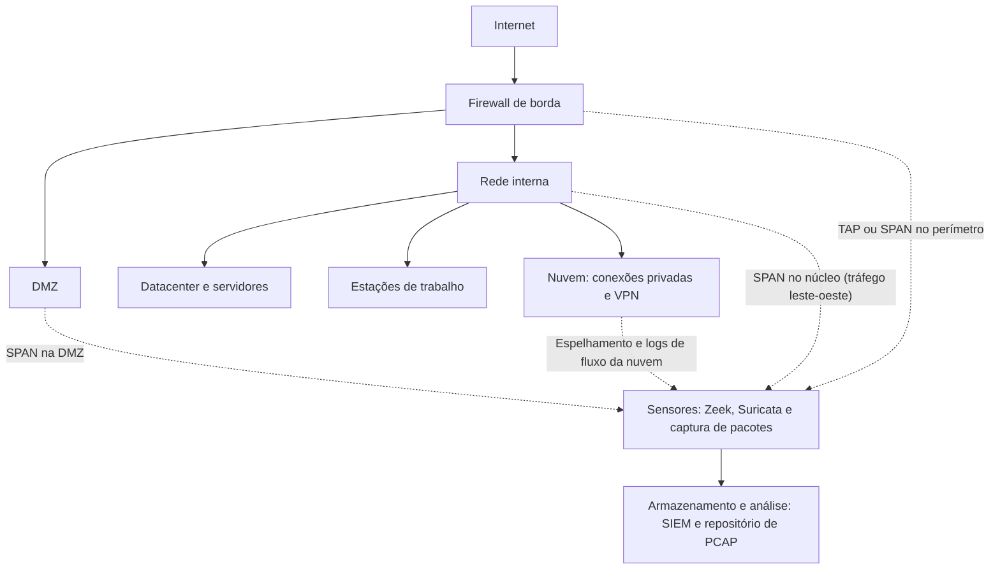

# Fundamentos de Rede e Modelos de Captura

> **Objetivo pedagógico:** compreender os tipos de evidência de rede (captura completa de pacotes, fluxos, metadados e alertas), os pontos e os métodos de captura (TAP, espelhamento, inline e captura no host), os formatos de arquivo e os limites legais e de capacidade, de modo a projetar e avaliar uma capacidade de forense de rede antes e durante um incidente.

## 1. Tipos de evidência de rede

| Tipo | Descrição | Vantagens | Limitações |
|---|---|---|---|
| Captura completa de pacotes (full packet capture, PCAP) | Todos os pacotes, com cabeçalhos e carga | Máxima fidelidade; permite reconstruir sessões, arquivos e comandos | Armazenamento muito grande; conteúdo criptografado ilegível; implicações de privacidade |
| Captura parcial (snaplen reduzido) | Somente os primeiros bytes de cada pacote | Menor volume; preserva cabeçalhos | Perde carga e conteúdo |
| Registros de fluxo (NetFlow, IPFIX e sFlow) | Resumo das conexões: endereços, portas, protocolo, bytes, pacotes e horários | Baixo custo e longa retenção | Sem conteúdo |
| Metadados de protocolo (Zeek) | Registros estruturados de conexões, DNS, HTTP, TLS, SMB, Kerberos e outros | Boa visibilidade com volume moderado | Depende da interpretação do analisador |
| Alertas de IDS e IPS (Suricata e Snort) | Eventos detectados por assinaturas | Priorização | Cobertura limitada pelas regras; falsos positivos |
| Logs de equipamentos (firewall, proxy, DNS e VPN) | Registros produzidos pelos dispositivos | Fáceis de obter | Granularidade e retenção variáveis (ver pasta 11) |
| Evidências do endpoint | Conexões por processo, telemetria de EDR | Liga a rede ao processo | Depende do agente |

Abordagem recomendada: combinar fluxos e metadados com retenção longa e capturar pacotes completos de forma seletiva ou em pontos críticos.

## 2. Modelo de captura: onde e como

| Método | Descrição | Pontos de atenção |
|---|---|---|
| TAP de rede | Dispositivo que replica o tráfego de um enlace sem alterá-lo | Fidelidade e baixa interferência; custo; exige instalação |
| Porta espelhada (SPAN, RSPAN e ERSPAN) | O switch copia o tráfego de portas ou VLANs para uma porta de monitoramento | Pode descartar pacotes sob carga; consome recursos do switch; não replica erros físicos |
| Captura em linha (inline) | Equipamento no caminho do tráfego (firewall, IPS e proxy) | Pode bloquear; risco de ponto único de falha |
| Intermediário de pacotes (network packet broker) | Agrega, filtra e distribui tráfego a várias ferramentas | Reduz o custo de captura em escala |
| Captura no host | `tcpdump`, Wireshark, `pktmon` e `netsh trace` no equipamento | Visão de um único host; consome recursos; pode ser comprometida |
| Espelhamento em nuvem | Serviços de espelhamento de tráfego do provedor | Requer configuração prévia; limitações por tipo de instância |
| Logs de fluxo da nuvem | Registros de conexões da rede virtual | Sem conteúdo |



### 2.1 Cobertura e pontos cegos

| Ponto | Visibilidade | Pontos cegos comuns |
|---|---|---|
| Perímetro (norte-sul) | Tráfego de e para a internet | Tráfego interno (leste-oeste), tráfego criptografado e tráfego que não passa pelo perímetro (redes móveis e tethering) |
| Núcleo e datacenter | Movimentação lateral e acesso a servidores | Tráfego dentro de um mesmo host ou hipervisor |
| Rede de estações | Atividade dos usuários | Dispositivos fora da rede corporativa (trabalho remoto) |
| Nuvem | Fluxos entre VPCs, internet e serviços | Tráfego entre serviços gerenciados e plano de controle |
| Wi-Fi | Clientes sem fio | Redes não gerenciadas e dispositivos pessoais |

Documente os pontos cegos no relatório, pois a ausência de evidência de rede não prova a ausência de comunicação.

## 3. Formatos de captura e metadados

| Formato | Característica |
|---|---|
| pcap | Formato clássico; um único tipo de enlace; resolução de microssegundos ou nanossegundos conforme o cabeçalho |
| pcapng | Formato moderno; vários enlaces, comentários por arquivo e por pacote, metadados da captura (interface, filtro e sistema) |
| ETL (Windows) | Rastreamentos do `netsh trace` e do `pktmon`; precisam de conversão |
| Registros Zeek e Suricata (`eve.json`) | Metadados derivados dos pacotes |

| Parâmetro | Importância |
|---|---|
| Tamanho de captura (`snaplen`) | Valor 0 (ou o máximo) captura o pacote inteiro; valores pequenos truncam a carga |
| Tipo de enlace | Ethernet, 802.11, Linux cooked e outros; influi na leitura |
| Resolução de tempo | Fundamental para a sequência de eventos |
| Filtro de captura (BPF) | Define o que foi capturado; registre-o, pois o que foi filtrado não pode ser recuperado |
| Perdas | Registre o número de pacotes perdidos pelo kernel e pelo equipamento de captura |
| Relógio | Sincronizado por NTP ou PTP; documente o desvio |

## 4. Captura com tcpdump: exemplos

```bash
# Captura completa de uma interface, sem resolução de nomes, com rotação horária e 24 arquivos
sudo tcpdump -i eth1 -nn -s 0 -w '/capturas/cap_%Y%m%d_%H%M%S.pcap' -G 3600 -W 24 -Z root

# Captura direcionada a um host e uma porta (filtro BPF)
sudo tcpdump -i eth1 -nn -s 0 -w caso_host.pcap 'host 10.1.2.3 and (port 443 or port 53)'

# Exclusão de tráfego administrativo da própria captura
sudo tcpdump -i eth1 -nn -s 0 -w cap.pcap 'not port 22'

# Leitura com horários completos em UTC
tcpdump -nn -tttt -r cap.pcap | head

# Estatísticas e metadados do arquivo (Wireshark)
capinfos cap.pcap
sha256sum cap.pcap > cap.pcap.sha256
```

Ao capturar: grave em mídia diferente da interface monitorada; proteja o arquivo (permissões e criptografia); registre o comando, o equipamento, o horário e o hash; mantenha o relógio sincronizado.

## 5. Dimensionamento de armazenamento

| Cálculo | Exemplo |
|---|---|
| Taxa média | Enlace de 1 Gbps com 30% de utilização média: cerca de 37,5 MB/s |
| Volume diário | 37,5 MB/s × 86.400 s ≈ 3,24 TB por dia |
| Retenção de 7 dias | Cerca de 22,7 TB |
| Estratégias de redução | Captura seletiva; limitar o tamanho por pacote em tráfego criptografado; reter metadados por mais tempo que os pacotes; captura sob demanda ao detectar um incidente |

Defina a política: quais enlaces são capturados continuamente, por quanto tempo, e quais são capturados sob demanda.

## 6. Aspectos legais e de privacidade

> **Aviso:** este material é técnico-educacional e não substitui parecer jurídico. Valide cada caso com o Jurídico e com o DPO.

| Tema | Orientação |
|---|---|
| Sigilo das comunicações | A Constituição Federal (art. 5º, XII) protege o sigilo das comunicações; o Marco Civil da Internet (art. 7º) assegura a inviolabilidade e o sigilo do fluxo e do conteúdo das comunicações privadas |
| Interceptação | A Lei nº 9.296/1996 trata da interceptação de comunicações para investigação criminal e instrução processual penal, mediante ordem judicial |
| Monitoramento corporativo | Exige política e comunicação prévia aos usuários, finalidade legítima, proporcionalidade e base legal definida pelo Jurídico e pelo DPO (LGPD, arts. 6º e 7º) |
| Acesso indevido | A captura de redes ou de dispositivos de terceiros sem autorização pode configurar crime (Código Penal, art. 154-A) |
| Dados pessoais no tráfego | Minimize a captura, restrinja o acesso, defina a retenção e proteja os arquivos (LGPD, arts. 6º, 15, 16 e 46) |
| Conteúdo sensível | Comunicações com advogados, dados de saúde e credenciais exigem tratamento restrito |
| Cooperação internacional | A Convenção de Budapeste (promulgada pelo Decreto nº 11.491/2023) prevê a coleta de dados de tráfego e a interceptação (arts. 20 e 21) em cooperação entre Estados |

Boas práticas: capture apenas o necessário e no menor escopo; documente a autorização; use filtros por host ou por serviço; trate os PCAPs como dados pessoais e confidenciais.

## 7. Integridade e custódia da captura

| Elemento | Prática |
|---|---|
| Hash | SHA-256 de cada arquivo de captura e manifesto (ver pasta 04) |
| Metadados | Interface, filtro, `snaplen`, horário de início e fim, equipamento, sistema e versão da ferramenta |
| Armazenamento | Repositório com controle de acesso, criptografia e imutabilidade |
| Custódia | Formulários de custódia para as capturas exportadas (pasta 02) |
| Cópia de trabalho | Analisar sempre cópias; preservar o original |
| Tempo | Documentar a sincronização de tempo do sensor |

## 8. Exemplo prático: projeto de cobertura para um incidente

| Item | Decisão |
|---|---|
| Fluxos | NetFlow de todos os roteadores de núcleo e logs de fluxo da nuvem, retenção de 13 meses |
| Metadados | Zeek no perímetro e no núcleo, com retenção de 90 dias |
| Pacotes | Captura contínua somente na DMZ (7 dias); captura sob demanda no núcleo durante incidentes |
| Alertas | Suricata no perímetro e no núcleo, integrado ao SIEM |
| Privacidade | Política de monitoramento aprovada pelo Jurídico e pelo DPO; PCAPs com acesso restrito e criptografados |
| Lacunas | Rede de trabalho remoto e tráfego de estações fora da rede corporativa cobertos por EDR e por logs de nuvem |

## 9. Casos de uso corporativos

- Projeto de visibilidade de rede para o SOC e a resposta a incidentes.
- Definição de retenção e de política de captura alinhada à LGPD.
- Planejamento de captura sob demanda durante a resposta a um incidente.

## 10. Normas e frameworks relevantes

- NIST SP 800-86 (tráfego de rede como fonte de dados); NIST SP 800-94 (sistemas de detecção e prevenção de intrusão)
- ISO/IEC 27002:2022, controles 8.15, 8.16, 8.20 (segurança de redes) e 8.17
- CIS Controls v8.1, controle 13 (monitoramento e defesa de rede)
- MITRE ATT&CK: T1040 (Network Sniffing), tática Command and Control
- RFC 3954 (NetFlow v9) e RFC 7011 (IPFIX)

## 11. Referências

- Davidoff, S.; Ham, J. Network Forensics: Tracking Hackers through Cyberspace. Prentice Hall, 2012.
- Bejtlich, R. The Practice of Network Security Monitoring. No Starch Press, 2013.
- Sanders, C. Practical Packet Analysis. 3. ed. No Starch Press, 2017.
- Claise, B. et al. RFC 7011: IPFIX. 2013.
- Scarfone, K.; Mell, P. NIST SP 800-94. 2007.
- Brasil. Constituição Federal, art. 5º, XII; Lei nº 9.296/1996; Lei nº 12.965/2014; Lei nº 13.709/2018.
- Documentação do tcpdump, do Wireshark (capinfos) e do Zeek.
