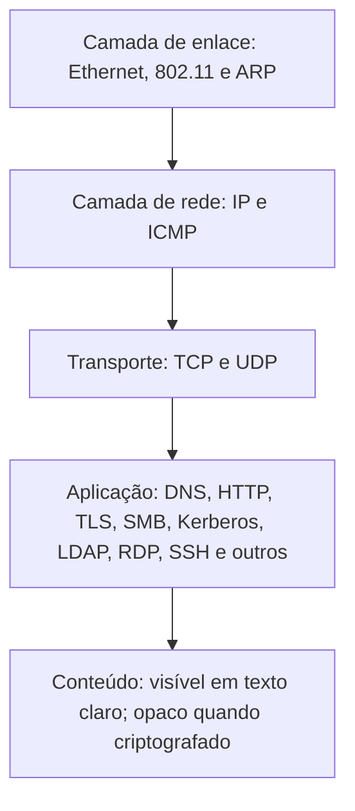

# Protocolos e Artefatos por Camada

> **Objetivo pedagógico:** conhecer o que cada protocolo revela em uma captura, quais artefatos têm valor forense, quais são os abusos típicos e como identificá-los, para interpretar o tráfego com precisão e distinguir o comportamento legítimo do malicioso.

## 1. Visibilidade por camada

## 2. Camadas de enlace e de rede

| Protocolo | O que revela | Valor forense | Abusos típicos |
|---|---|---|---|
| Ethernet | Endereços MAC, VLANs | Identificação de dispositivos e de segmentos | Troca de MAC, VLAN hopping |
| ARP | Mapeamento IP e MAC | Identificar o dispositivo de um IP; inconsistências | Envenenamento de ARP: respostas não solicitadas, um IP associado a vários MACs ou um MAC com vários IPs (T1557) |
| DHCP | Concessões de IP, nome do host, MAC e opções (como a classe do fornecedor) | Ligar um IP a um dispositivo em um instante | Servidor DHCP não autorizado (rogue) |
| IPv4 e IPv6 | Endereços, TTL, fragmentação | Origem e destino; TTL sugere o sistema operacional e a distância | Fragmentação para evadir inspeção, IPv6 não monitorado |
| ICMP | Eco, erros e redirecionamentos | Diagnóstico e varredura de hosts | Túneis ICMP (cargas grandes ou regulares), redirecionamentos maliciosos (T1095) |

## 3. Camada de transporte

### 3.1 TCP

| Elemento | Interpretação |
|---|---|
| Handshake (SYN, SYN+ACK e ACK) | Conexão estabelecida; o analisador registra a direção (quem iniciou) |
| SYN sem resposta (S0) | Porta filtrada ou host inativo |
| RST em resposta ao SYN | Porta fechada |
| Muitos SYN de uma origem a muitas portas ou hosts | Varredura (T1046) |
| FIN e RST | Encerramento normal ou abrupto |
| Retransmissões e janelas | Problemas de rede ou de desempenho, não necessariamente maliciosos |
| Portas atípicas para o protocolo | Evasão ou serviço não padrão |
| Conexões longas e de pouco volume | Canais persistentes (C2) |

Estados de conexão do Zeek (`conn_state`) resumem o comportamento: `S0` (sem resposta), `SF` (conexão normal), `REJ` (rejeitada), `RSTO` e `RSTR` (reinício), entre outros.

### 3.2 UDP

Sem estado de conexão; a análise depende do protocolo de aplicação (DNS, NTP, SNMP, QUIC e DHCP). Fluxos grandes e assimétricos podem indicar amplificação ou exfiltração.

## 4. Camada de aplicação

| Protocolo | O que revela | Valor forense | Abusos típicos |
|---|---|---|---|
| DNS | Nomes consultados, tipos, respostas e códigos | Atividade de rede de cada host; infraestrutura de C2 | Túneis, DGA, consultas a domínios recentes (T1071.004 e T1568) |
| HTTP | Método, host, URI, cabeçalhos, user-agent, cookies, conteúdo | Download e upload de arquivos, exploração web, C2 | Web shells, exfiltração por POST, user-agents de ferramentas (T1071.001) |
| TLS | Versão, SNI, certificado (até TLS 1.2), cifras, JA3 e JA4 | Identificação de serviço e de cliente sem ler o conteúdo | C2 criptografado, certificados autoassinados (T1573) |
| SMB | Sessões, compartilhamentos, arquivos e pipes | Movimentação lateral e acesso a dados | `ADMIN$`, `IPC$`, pipes `svcctl` e `atsvc`, cópia de ferramentas (T1021.002) |
| Kerberos | Mensagens AS, TGS e AP, contas, tipos de criptografia | Autenticação de domínio e abusos | Kerberoasting (TGS-REP com RC4, T1558.003), AS-REP roasting |
| NTLM | Mensagens de autenticação com usuário, domínio e estação | Quem se autenticou e de onde | Relay de NTLM (T1557.001), força bruta |
| LDAP | Consultas ao diretório | Reconhecimento do Active Directory | Enumeração em massa de objetos (T1087 e T1018) |
| RDP | Conexão X.224, negociação de segurança, cookie `mstshash` (nome de usuário em alguns clientes) | Acesso remoto interativo | RDP exposto e de movimentação lateral (T1021.001) |
| SSH | Banner de versão, algoritmos, impressão HASSH | Identificação de clientes e servidores; acesso remoto | Túneis, acesso persistente (T1021.004 e T1572) |
| RPC e DCOM (porta 135 e dinâmicas) | Chamadas RPC e interfaces | Execução remota e administração | WMI e DCOM para execução lateral (T1047 e T1021.003) |
| WinRM (5985 e 5986) | Sessões de PowerShell Remoting | Administração remota | Movimentação lateral (T1021.006) |
| SMTP, IMAP e POP3 | Remetentes, destinatários e conteúdo (sem TLS) | Fluxo de e-mails e exfiltração | Envio de dados por e-mail |
| FTP e TFTP | Comandos, credenciais e arquivos em texto claro | Transferência de arquivos | Exfiltração (T1048) |
| Telnet | Sessões em texto claro | Credenciais e comandos | Acesso a dispositivos legados |
| SNMP | Comunidades e consultas | Mapeamento de dispositivos | Strings de comunidade padrão |
| NTP | Sincronização de tempo | Desvio de relógio; amplificação | DDoS por reflexão |
| mDNS, LLMNR e NBT-NS | Resolução de nomes local | Reconhecimento | Envenenamento de resposta e captura de hashes (T1557.001) |
| QUIC e HTTP/3 (UDP 443) | Conexões criptografadas | Metadados do handshake | Evasão de inspeção baseada em TCP |
| MQTT, Modbus e outros (IoT e OT) | Mensagens de dispositivos | Controle e telemetria | Comandos não autorizados |

## 5. Filtros e campos úteis por protocolo

| Protocolo | Filtros ou campos do Wireshark e do Zeek |
|---|---|
| DNS | `dns.qry.name`, `dns.qry.type`, `dns.flags.rcode`; `dns.log` |
| HTTP | `http.host`, `http.request.uri`, `http.user_agent`; `http.log` |
| TLS | `tls.handshake.extensions_server_name`, `tls.handshake.ja3` e `ja4` (versões recentes); `ssl.log` e `x509.log` |
| SMB | `smb2.tree`, `smb2.filename`, `ntlmssp.auth.username`; `smb_files.log` e `smb_mapping.log` |
| Kerberos | `kerberos.msg_type`, `kerberos.CNameString`, `kerberos.etype`; `kerberos.log` |
| NTLM | `ntlmssp.auth.username`, `ntlmssp.auth.domain`; `ntlm.log` |
| RDP | Cookie `mstshash` no pedido de conexão; `rdp.log` |
| SSH | Banner e algoritmos; `ssh.log` (com HASSH, se habilitado) |
| DHCP | `dhcp.option.hostname`, `dhcp.hw.mac_addr`; `dhcp.log` |
| RPC | `dcerpc.cn_bind_to_uuid`; `dce_rpc.log` |

## 6. Interpretação de sinais comuns

| Sinal | Interpretação possível | O que verificar |
|---|---|---|
| Muitos SYN e RST de uma origem interna | Varredura interna | Origem, alvos e horários; atividade legítima de gestão de vulnerabilidades |
| Consultas DNS com nomes longos e aleatórios | Túnel ou DGA | Volume por domínio, tipos TXT e entropia |
| TLS com SNI ausente ou com IP no lugar do nome | Cliente atípico | JA3 e JA4, certificado e processo (EDR) |
| SMB para `ADMIN$` de uma estação para vários servidores | Movimentação lateral | Contas, horário e criação de serviços (7045) |
| TGS-REP com RC4 para várias contas de serviço | Kerberoasting | Conta solicitante e quantidade de serviços |
| Consultas LLMNR e NBT-NS com respostas de um host incomum | Envenenamento de nomes | Host que respondeu e hashes subsequentes |
| Pedidos HTTP com user-agent de biblioteca de programação | Ferramenta automatizada | Destino e frequência |
| Conexão de saída contínua em porta incomum | Canal de comando | Processo no endpoint e reputação do destino |

## 7. Exemplo prático: interpretação de uma sessão SMB suspeita

| Observação | Interpretação |
|---|---|
| Estação 10.1.2.30 conecta em 10.1.5.10 (servidor) na porta 445 às 02:14Z | Acesso SMB entre estação e servidor |
| `ntlmssp.auth.username` `svc_backup`, domínio `CORP` | Conta de serviço usada interativamente |
| `smb2.tree` com `\\10.1.5.10\ADMIN$` e escrita de `PSEXESVC.exe` | Cópia de ferramenta para execução remota |
| Pipe `svcctl` (criação e início de serviço) | Instalação de serviço remoto |
| Conclusão | Movimentação lateral por SMB com execução remota de serviço (T1021.002 e T1569.002); confiança alta; corroborar com EVTX 7045 e 4624 tipo 3 no servidor |

## 8. Casos de uso corporativos

- Interpretação de capturas de incidentes envolvendo autenticação de domínio e movimentação lateral.
- Treinamento de analistas para reconhecer padrões de protocolo suspeitos.
- Definição de regras de detecção a partir do comportamento dos protocolos.

## 9. Normas e frameworks relevantes

- MITRE ATT&CK: T1040, T1046, T1557, T1557.001, T1558.003, T1021.001, T1021.002, T1021.004, T1021.006, T1047, T1071, T1095, T1572, T1573
- RFC 791 (IP), RFC 793 e 9293 (TCP), RFC 1035 (DNS), RFC 9110 (HTTP), RFC 8446 (TLS 1.3), RFC 4120 (Kerberos), RFC 4253 (SSH)
- NIST SP 800-94; CIS Controls v8.1, controle 13

## 10. Referências

- Chappell, L. Wireshark Network Analysis. 2. ed. 2012.
- Sanders, C. Practical Packet Analysis. 3. ed. 2017.
- Neuman, C. et al. RFC 4120: The Kerberos Network Authentication Service (V5). 2005.
- Rescorla, E. RFC 8446: TLS 1.3. 2018.
- Documentação do Zeek (logs `conn`, `dns`, `http`, `ssl`, `smb`, `kerberos`, `ntlm` e `rdp`).
- Salesforce Engineering. JA3 e HASSH; FoxIO. JA4+.
- MITRE ATT&CK. https://attack.mitre.org
