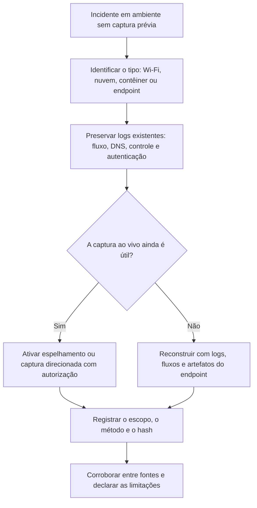

# Redes Sem Fio, Nuvem, Contêineres e Captura no Endpoint

> **Objetivo pedagógico:** estender a forense de rede a ambientes que não têm um ponto de captura tradicional: redes sem fio (Wi-Fi), nuvem, contêineres e orquestradores, e capturas feitas no próprio endpoint (Windows e Linux), conhecendo as fontes, os procedimentos e as limitações de cada um.

## 1. Redes sem fio (802.11)

### 1.1 Tipos de quadros

| Tipo | Exemplos | Valor forense |
|---|---|---|
| Gerenciamento | Beacon, Probe Request e Response, Authentication, Association, Deauthentication e Disassociation | Redes presentes, dispositivos e tentativas de acesso |
| Controle | RTS, CTS e ACK | Coordenação de acesso ao meio |
| Dados | Dados do usuário (criptografados em redes protegidas) | Volumes e padrões |
| Autenticação (EAPOL) | Handshake de 4 vias de WPA2 e WPA3, EAP em redes corporativas | Autenticações e tentativas |

### 1.2 Ameaças e indícios

| Ameaça | Indício |
|---|---|
| Evil twin e ponto de acesso falso (rogue AP) | Mesmo SSID com BSSID, canal ou segurança diferentes do legítimo |
| Ataques de desautenticação | Rajadas de quadros Deauthentication a clientes |
| Captura de handshakes e ataques offline | Muitos handshakes capturados e desautenticações seguidas |
| Honeypots de Wi-Fi (KARMA e similares) | Respostas a Probe Requests de redes variadas |
| Dispositivos não autorizados | Clientes desconhecidos associados a APs corporativos |
| Uso de redes abertas ou de convidados | Atividade sem identificação forte |

```bash
# Captura em modo monitor (Linux) em um canal específico
sudo ip link set wlan0 down && sudo iw dev wlan0 set type monitor && sudo ip link set wlan0 up
sudo iw dev wlan0 set channel 6
sudo tcpdump -i wlan0 -nn -s 0 -w wifi_canal6.pcap
```

Filtros do Wireshark: `wlan.fc.type_subtype == 0x0c` (Deauthentication), `wlan.fc.type_subtype == 0x08` (Beacon), `wlan.fc.type_subtype == 0x04` (Probe Request), `eapol` (handshake) e `wlan.ssid == "NomeDaRede"`.

### 1.3 Fontes infra-estruturais

| Fonte | Informação |
|---|---|
| Controlador de rede sem fio (WLC) e pontos de acesso | Associações, desassociações, falhas de autenticação, rogue APs detectados e RSSI |
| Servidor RADIUS (802.1X) | Autenticações por usuário e dispositivo, com identificadores de sessão |
| DHCP | IP, MAC e nome do host associados no período |
| Logs do portal cativo | Identificação de convidados |
| Sistema de prevenção de intrusão sem fio (WIPS) | Alertas de ataques e de APs não autorizados |

Observações: a localização por intensidade de sinal (RSSI) é aproximada; endereços MAC podem ser aleatorizados pelos dispositivos; a captura passiva de redes de terceiros pode ter restrições legais (ver o arquivo de fundamentos).

## 2. Nuvem

### 2.1 Fontes de evidência de rede

| Provedor | Fontes | Observação |
|---|---|---|
| AWS | VPC Flow Logs (campos de origem, destino, portas, protocolo, bytes, pacotes, ação e período), VPC Traffic Mirroring, logs de balanceadores e do Route 53 Resolver | O espelhamento depende do tipo de instância e de configuração prévia |
| Azure | Logs de fluxo (NSG e de redes virtuais, conforme a disponibilidade vigente), Network Watcher (captura de pacotes), logs de firewall e de gateways | Confirme os recursos disponíveis e as datas de descontinuação na documentação atual |
| Google Cloud | VPC Flow Logs, Packet Mirroring e logs de Cloud DNS e de balanceadores | Configuração prévia necessária |
| SaaS e identidade | Logs de acesso e de auditoria dos serviços | Substituem a captura de rede (ver pastas de nuvem) |

Os logs de fluxo da nuvem não têm conteúdo e podem ter atraso de agregação (de minutos). Ative-os antes que ocorram incidentes e defina a retenção.

```text
# Exemplo de registro de VPC Flow Log (AWS, formato padrão):
# versão conta interface origem destino porta_origem porta_destino protocolo pacotes bytes início fim ação status
2 123456789012 eni-0a1b2c3d 10.0.1.25 203.0.113.50 49152 443 6 20 4500 1761657600 1761657660 ACCEPT OK
```

### 2.2 Boas práticas

| Prática | Descrição |
|---|---|
| Habilitar logs de fluxo em todas as redes virtuais críticas | Antes do incidente |
| Centralizar e proteger | Armazenamento imutável e acesso restrito |
| Espelhamento sob demanda | Plano de ativação do espelhamento para investigações |
| Corroborar com logs de API | Mudanças de grupos de segurança, rotas e gateways |
| Cobertura de DNS | Logs do resolvedor da nuvem |

## 3. Contêineres e Kubernetes

| Fonte | Observação |
|---|---|
| Captura dentro do espaço de rede do contêiner | `nsenter -t <PID> -n tcpdump ...` a partir do host |
| Contêiner auxiliar de diagnóstico | Contêiner com ferramentas de rede compartilhando o namespace de rede do alvo |
| Logs do plano de dados (CNI) e observabilidade por eBPF | Por exemplo, Cilium Hubble |
| Logs de malha de serviços (service mesh) | Requisições entre serviços |
| Políticas de rede e logs de firewall do nó | Conexões permitidas e negadas |
| Logs de auditoria da API do Kubernetes | Quem criou ou alterou recursos (ver pasta 08) |

```bash
# Capturar o tráfego do namespace de rede de um contêiner Docker, a partir do host
PID=$(docker inspect -f '{{.State.Pid}}' <container>)
sudo nsenter -t $PID -n tcpdump -i eth0 -nn -s 0 -w /mnt/evidencias/DFL-2026-001-C001.pcap

# Contêiner auxiliar compartilhando a rede do alvo (imagem de diagnóstico de rede)
docker run --rm -it --net container:<container> nicolaka/netshoot tcpdump -i eth0 -nn -w /tmp/cap.pcap
```

Contêineres são efêmeros: capture ou colete os logs antes de reiniciar ou recriar o pod, e documente a captura.

## 4. Captura no endpoint

### 4.1 Windows

```powershell
# pktmon (Windows 10 e posteriores): captura e conversão
pktmon start --capture --pkt-size 0 -f C:\evid\cap.etl
# ... reproduzir o tráfego ...
pktmon stop
pktmon etl2pcap C:\evid\cap.etl --out C:\evid\cap.pcap     # em versões recentes: pktmon pcapng

# netsh trace (rastreamento circular, ETL)
netsh trace start capture=yes tracefile=C:\evid\trace.etl maxsize=1024 filemode=circular
netsh trace stop
# Conversão: ferramenta etl2pcapng (Microsoft)
```

### 4.2 Linux

```bash
sudo tcpdump -i any -nn -s 0 -w /mnt/evidencias/DFL-2026-001-E003-cap.pcap 'not port 22'
ss -tunap > /mnt/evidencias/DFL-2026-001-E003-sockets.txt
```

| Aspecto | Observação |
|---|---|
| Impacto | A captura consome CPU e disco; execute com filtros e limite de tamanho |
| Integridade | O sistema pode estar comprometido; trate os resultados com cautela e corrobore em outro ponto |
| Associação ao processo | Registre as conexões ativas (`ss -tunap` e `Get-NetTCPConnection`) para ligar tráfego e processo |
| Registro | Horário, filtro, ferramenta, versão e hash |

## 5. OT, IoT e equipamentos especiais

| Ambiente | Cuidados |
|---|---|
| Redes industriais (Modbus, DNP3 e outros) | Usar captura passiva por TAP ou SPAN; nunca gerar tráfego ativo; coordenar com a equipe de operação |
| Dispositivos IoT | Muitos usam serviços de nuvem e protocolos leves (por exemplo, MQTT); capturar na borda e nos logs do serviço |
| Equipamentos de rede | Logs, configurações e tabelas (ARP, MAC e roteamento) como evidência; preserve antes de reiniciar |

## 6. Fluxo para ambientes sem ponto de captura



## 7. Exemplo prático: investigação de evil twin em escritório

| Fonte | Achado |
|---|---|
| Alerta do WIPS | SSID corporativo anunciado por BSSID desconhecido, canal 11 |
| Captura em modo monitor | Beacons duplicados e rajadas de Deauthentication aos clientes legítimos |
| WLC e RADIUS | Três usuários com tentativas de autenticação 802.1X ao AP falso (EAP externo) |
| DHCP e proxy | Um notebook recebeu IP de uma rede estranha e acessou um portal de login falso |
| Resposta | Localização do dispositivo (por RSSI e inspeção física), remoção, redefinição de credenciais dos três usuários e ajuste de política (validação do certificado do servidor RADIUS) |
| Conclusão | Evil twin com coleta de credenciais; confiança alta com corroboração de WIPS, captura e autenticação |

## 8. Casos de uso corporativos

- Investigação de pontos de acesso não autorizados e de ataques a Wi-Fi corporativo.
- Resposta a incidentes em nuvem com logs de fluxo e espelhamento sob demanda.
- Captura em contêineres de aplicações críticas durante um incidente.

## 9. Normas e frameworks relevantes

- IEEE 802.11 e 802.1X; WPA2 e WPA3
- MITRE ATT&CK: T1557, T1040, T1465 (Rogue Wi-Fi Access Points), T1610, T1611
- NIST SP 800-153 (diretrizes de segurança de LANs sem fio); NIST SP 800-190 (contêineres); NIST SP 800-94
- CIS Benchmarks (nuvem e contêineres); CIS Controls v8.1, controles 12 e 13
- ISO/IEC 27002:2022, controles 8.20, 8.21 (segurança de serviços de rede) e 8.22 (segregação de redes)

## 10. Referências

- Souppaya, M.; Scarfone, K. NIST SP 800-153: Guidelines for Securing Wireless Local Area Networks. 2012.
- Souppaya, M.; Morello, J.; Scarfone, K. NIST SP 800-190. 2017.
- Amazon Web Services. Documentação de VPC Flow Logs e VPC Traffic Mirroring.
- Microsoft Learn. Documentação do Azure Network Watcher e de logs de fluxo; do `pktmon` e do `netsh trace`.
- Google Cloud. Documentação de VPC Flow Logs e Packet Mirroring.
- Documentação do Cilium (Hubble), do Docker e do Kubernetes.
- Wireshark Foundation. Documentação de captura 802.11.
