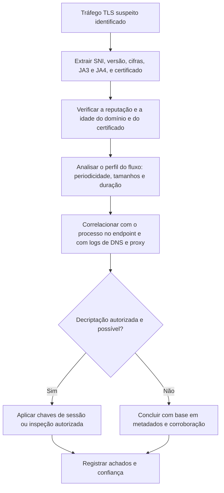

# Tráfego Criptografado, TLS e Certificados

> **Objetivo pedagógico:** investigar tráfego criptografado a partir de metadados (SNI, certificados, versões, impressões digitais JA3, JA4 e HASSH, tamanhos e tempos), compreender as diferenças entre TLS 1.2 e 1.3, QUIC, DoH e VPNs, e conhecer as opções, os limites técnicos e os cuidados legais de decriptação.

## 1. O que se vê em tráfego criptografado

| Elemento | TLS 1.2 | TLS 1.3 |
|---|---|---|
| Endereços e portas | Visíveis | Visíveis |
| SNI (nome do servidor) | Visível no Client Hello | Visível, exceto com ECH (Encrypted Client Hello, em adoção gradual) |
| Certificado do servidor | Visível no handshake | Criptografado |
| Cifras e extensões oferecidas | Visíveis no Client Hello | Visíveis no Client Hello |
| Conteúdo | Criptografado | Criptografado |
| Tamanhos e tempos dos registros | Visíveis | Visíveis |
| Resumo (JA3, JA4) | Disponível | Disponível |

A análise de tráfego criptografado trabalha com metadados e padrões, e não com conteúdo.

## 2. Metadados e impressões digitais

| Elemento | O que é | Uso |
|---|---|---|
| SNI | Nome do servidor solicitado | Identificar o serviço de destino |
| JA3 e JA3S | Hash dos parâmetros do Client Hello (JA3) e do Server Hello (JA3S) | Identificar a implementação do cliente (por exemplo, malware ou biblioteca) |
| JA4 e família JA4+ | Impressões digitais mais robustas do cliente (JA4), servidor (JA4S), HTTP (JA4H), certificados (JA4X) e outros | Identificação e agrupamento menos sensíveis à aleatorização de extensões |
| HASSH | Impressão digital do handshake de SSH | Identificar clientes e servidores SSH |
| ALPN | Protocolo de aplicação negociado (`h2`, `http/1.1` e `h3`) | Contexto do tráfego |
| Versão e cifras | Parâmetros de segurança | Clientes antigos ou ferramentas |
| Certificado (TLS 1.2, e em logs de inspeção) | Emissor, sujeito, validade, SAN, número de série e chave pública | Atribuição de infraestrutura e detecção de certificados suspeitos |
| Tamanhos, direção e tempo dos pacotes | Perfil do fluxo | Distinguir navegação, transferência e beaconing |

Limites das impressões digitais: não são provas de identidade; muitos clientes legítimos compartilham o mesmo JA3, e atacantes podem imitar impressões conhecidas. Use-as como indícios para agrupar e priorizar.

## 3. Extração com tshark e Zeek

```bash
# Handshakes TLS: horário, origem, destino, SNI e JA3 (campos disponíveis conforme a versão do Wireshark)
tshark -r cap.pcap -t ud -Y "tls.handshake.type == 1" -T fields \
  -e frame.time -e ip.src -e ip.dst -e tls.handshake.extensions_server_name -e tls.handshake.ja3 \
  -E header=y -E separator=, > tls_clienthello.csv

# Zeek: servidores, versões, cifras e JA3 (ssl.log), e certificados (x509.log)
zeek-cut ts id.orig_h id.resp_h server_name version cipher ja3 < ssl.log | head
zeek-cut ts certificate.subject certificate.issuer certificate.not_valid_before certificate.not_valid_after < x509.log | head

# SNI mais raros
zeek-cut server_name < ssl.log | sort | uniq -c | sort -n | head -30
```

O JA3 e o JA4 podem exigir pacotes do Zeek ou do Wireshark com suporte (por exemplo, o JA4 em versões recentes do Wireshark e por pacotes do Zeek).

## 4. Análise de certificados

| Indicador | Interpretação |
|---|---|
| Autoassinado | Infraestrutura improvisada ou serviços internos |
| Emissor e sujeito com valores padrão (por exemplo, nomes genéricos de ferramentas) | Infraestrutura de ferramentas ofensivas |
| Validade muito curta ou recém-emitido | Infraestrutura descartável |
| Certificado emitido por CA gratuita e automática para domínio recente | Comum em legítimos e em maliciosos; avaliar o contexto |
| Número de série e chave reutilizados em muitos hosts | Agrupamento de infraestrutura |
| Divergência entre o SNI e o nome do certificado | Evasão ou configuração incorreta |
| Domínios semelhantes aos de marcas | Phishing |

```bash
# Inspeção de um certificado de servidor (ambiente isolado)
openssl s_client -connect exemplo.com:443 -servername exemplo.com </dev/null 2>/dev/null | openssl x509 -noout -subject -issuer -dates -serial -fingerprint -sha256

# Registros de Certificate Transparency para um domínio (JSON)
curl -s "https://crt.sh/?q=%25.exemplo.com&output=json" | jq -r '.[] | [.id,.entry_timestamp,.name_value,.issuer_name] | @tsv' | head
```

Faça consultas externas apenas por indicadores públicos (domínio e hash), sem enviar conteúdo da organização.

## 5. QUIC, HTTP/3, DNS criptografado e VPNs

| Tecnologia | Característica | Implicações |
|---|---|---|
| QUIC e HTTP/3 (RFC 9000 e 9114) | UDP 443; cabeçalhos criptografados; metadados do handshake inicial | Ferramentas centradas em TCP perdem visibilidade; avalie política de bloqueio de QUIC quando necessário |
| DNS sobre HTTPS e sobre TLS (RFC 8484 e RFC 7858) | Consultas DNS criptografadas | Contorna o DNS corporativo; controle por política e por bloqueio de resolvedores externos |
| VPNs (IPsec e IKEv2, OpenVPN, WireGuard) | Tráfego criptografado entre pontos | Visibilidade apenas dos endpoints e do volume; investigar no concentrador e no endpoint |
| Túneis SSH | Encapsulam outros protocolos | HASSH, duração, volume e destinos |
| Tor e redes de anonimato | Tráfego com padrões de TLS e conexões a relays | Comparar com listas de relays públicos; bloquear conforme política |
| Proxies e serviços de acesso remoto de terceiros | Canais legítimos usados para acesso persistente | Inventariar ferramentas autorizadas |

## 6. Opções de decriptação

| Opção | Como funciona | Limites |
|---|---|---|
| Chaves de sessão do cliente (`SSLKEYLOGFILE`) | Navegadores e bibliotecas gravam os segredos de sessão, que o Wireshark usa para decifrar | Só em sistemas controlados pelo investigador; sem acesso ao ambiente do atacante |
| Chave privada do servidor | Decripta sessões com troca de chaves RSA (sem sigilo perfeito adiante) | Ineficaz com ECDHE e com TLS 1.3 |
| Proxy de inspeção TLS (interceptação autorizada) | O proxy encerra e reestabelece sessões TLS | Exige política, certificados de CA nos clientes e atenção a privacidade |
| Logs de endpoint e de aplicações | Dados antes da criptografia | Depende de agentes e de configurações |
| Captura de memória | Segredos de sessão em memória do processo | Técnica avançada (ver pasta 09) |

```bash
# Exemplo de laboratório: gerar chaves de sessão de um navegador e usá-las no Wireshark
SSLKEYLOGFILE=$HOME/keys.log chromium &
# Wireshark: Editar > Preferências > Protocolos > TLS > (Pre)-Master-Secret log filename

# tshark com arquivo de chaves
tshark -r cap.pcap -o tls.keylog_file:keys.log -Y "http" -T fields -e frame.time -e http.host -e http.request.uri
```

## 7. Aspectos legais e de privacidade da decriptação

| Tema | Orientação |
|---|---|
| Autorização | Qualquer decriptação de tráfego de usuários exige base legal, política e comunicação prévia, validadas pelo Jurídico e pelo DPO |
| Proporcionalidade | Evitar inspecionar categorias sensíveis (bancário, saúde e comunicações privadas) quando não for necessário |
| Dados pessoais | Minimização, acesso restrito e retenção mínima (LGPD, arts. 6º, 15, 16 e 46) |
| Segredo e sigilo profissional | Comunicações com advogados e outras categorias protegidas exigem tratamento específico |
| Dispositivos pessoais | Exigem consentimento e política claros |
| Registro | Documentar a finalidade, o escopo, as chaves e quem acessou os dados decifrados |

Este material é técnico-educacional e não substitui parecer jurídico.

## 8. Fluxo de análise de tráfego criptografado



## 9. Exemplo prático: C2 por HTTPS identificado sem decriptação

| Observação | Resultado |
|---|---|
| `ssl.log` | Estação 10.1.2.3 conecta a `cdn-updates[.]exemplo` (SNI) a cada 60 s, 1.400 vezes em 24 h |
| JA3 | Valor raro na organização (visto somente em 2 hosts) |
| Certificado | Emitido há 3 dias por CA automática; sujeito genérico |
| Perfil do fluxo | Requisições pequenas (300 bytes) e respostas de tamanho quase constante (120 bytes) |
| DNS | Domínio registrado há 5 dias; resolvido para hospedagem de baixo custo |
| EDR | Processo `svc.exe` em `C:\ProgramData` é o originador |
| Conclusão | C2 por HTTPS (T1071.001 e T1573), identificado por metadados e corroborado pelo EDR; confiança alta, sem acesso ao conteúdo |

## 10. Casos de uso corporativos

- Caça a C2 criptografado em ambientes com inspeção TLS limitada.
- Definição de política de inspeção TLS e de bloqueio de DNS e QUIC não corporativos.
- Agrupamento de infraestrutura de campanhas por certificados e JA3.

## 11. Normas e frameworks relevantes

- RFC 8446 (TLS 1.3), RFC 5246 (TLS 1.2), RFC 9000 (QUIC), RFC 9114 (HTTP/3), RFC 8484 (DoH), RFC 7858 (DoT), RFC 5280 (certificados X.509)
- MITRE ATT&CK: T1071.001, T1573, T1568, T1572, T1090
- NIST SP 800-52 Rev. 2 (diretrizes de TLS); NIST SP 800-94
- LGPD, arts. 6º, 7º e 46; CIS Controls v8.1, controle 13

## 12. Referências

- Rescorla, E. RFC 8446. 2018; Iyengar, J.; Thomson, M. RFC 9000. 2021.
- McKay, M. NIST SP 800-52 Rev. 2: Guidelines for TLS Implementations. 2019.
- Althouse, J.; Atkinson, J.; Atkins, J. JA3: a method for profiling SSL/TLS clients (Salesforce Engineering).
- FoxIO. JA4+ Network Fingerprinting. Salesforce. HASSH.
- Certificate Transparency (RFC 9162) e documentação do crt.sh.
- Documentação do Wireshark (TLS) e do Zeek (ssl.log e x509.log).
- Sanders, C.; Smith, J. Applied Network Security Monitoring. Syngress, 2013.
