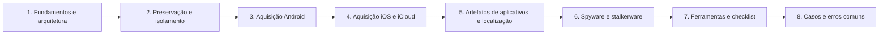

# 14 Forense Mobile

## Objetivo

Preservar, adquirir e analisar dispositivos móveis (Android e iOS) e as fontes associadas (nuvem, operadora, MDM e dispositivos pareados), reconstruindo comunicações, atividade de aplicativos e localização, e identificando comprometimentos por spyware e stalkerware, com integridade, base legal, minimização de dados e limitações declaradas.

## Trilha de estudo recomendada

## Conteúdo da pasta

| Ordem | Arquivo | Objetivo |
|---|---|---|
| 1 | [fundamentos-de-forense-mobile-e-arquitetura.md](fundamentos-de-forense-mobile-e-arquitetura.md) | Segurança de Android e iOS, estados BFU e AFU, níveis de extração e aspectos legais |
| 2 | [preservacao-isolamento-e-triagem-no-local.md](preservacao-isolamento-e-triagem-no-local.md) | Energia, isolamento de rede, bloqueio, MDM, embalagem e custódia |
| 3 | [aquisicao-de-dispositivos-android.md](aquisicao-de-dispositivos-android.md) | Métodos de aquisição, ADB e documentação |
| 4 | [aquisicao-de-dispositivos-ios-e-icloud.md](aquisicao-de-dispositivos-ios-e-icloud.md) | Backups, libimobiledevice, pareamento, iCloud e processo legal |
| 5 | [artefatos-de-aplicativos-comunicacoes-e-localizacao.md](artefatos-de-aplicativos-comunicacoes-e-localizacao.md) | SQLite, mensagens, mídia, localização e dados excluídos |
| 6 | [spyware-stalkerware-e-comprometimento-mobile.md](spyware-stalkerware-e-comprometimento-mobile.md) | MVT, indicadores, análise e segurança das pessoas envolvidas |
| 7 | [ferramentas-fluxo-modelos-e-checklist-mobile.md](ferramentas-fluxo-modelos-e-checklist-mobile.md) | Ferramentas, validação, modelos, minimização e checklist |
| 8 | [casos-de-uso-e-erros-comuns-em-mobile.md](casos-de-uso-e-erros-comuns-em-mobile.md) | Sete cenários, erros comuns e exercícios |

## Princípios

- Não desligar um aparelho ligado, e mantê-lo com energia e isolado da rede
- Documentar o estado e cada interação com o aparelho antes e durante a aquisição
- Obter a credencial por via lícita e jamais tentar senhas sem plano
- Escolher o método conforme modelo, versão e estado, e declarar o nível de extração
- Validar a extração (hash, abertura e contagens) e as ferramentas
- Rotular registros recuperados e declarar o grau de confiança
- Aplicar escopo e minimização: dados de terceiros, privilegiados e sensíveis
- Preservar antes de remover, e proteger a segurança das pessoas envolvidas em casos de stalkerware

## Relação com outras pastas

- 02-cadeia-de-custodia e 04-hash-e-integridade: embalagem, lacre, custódia e hash
- 03-coleta-de-evidencias: princípios gerais de coleta e privacidade
- 05-timeline-analysis: épocas e formatos de data dos bancos móveis
- 06-evidencias-digitais: autenticidade de mensagens e ata notarial
- 10-disk-forensics: cartões SD, APFS e SQLite em imagens
- 12-email-forensics e 13-network-forensics: e-mail, DNS e tráfego dos aplicativos

## Referências

- Ayers, R.; Brothers, S.; Jansen, W. NIST SP 800-101 Rev. 1: Guidelines on Mobile Device Forensics (2014)
- Souppaya, M.; Scarfone, K. NIST SP 800-124 Rev. 2 (2023)
- SWGDE. Best Practices for Mobile Device Evidence Collection & Preservation, Handling, and Acquisition
- Apple. Apple Platform Security Guide e Legal Process Guidelines; Google. Android Security (AOSP)
- Tamma, R. et al. Practical Mobile Forensics. 4. ed. (2020); Epifani, M.; Stirparo, P. Learning iOS Forensics. 2. ed. (2016); Hoog, A. Android Forensics (2011)
- Amnesty International Security Lab. Mobile Verification Toolkit; Citizen Lab; Coalition Against Stalkerware
- MITRE ATT&CK Mobile; OWASP MASVS e MASTG
- ISO/IEC 27037:2012; ISO/IEC 27042:2015; NIST IR 8387
- Brasil. Constituição Federal, art. 5º; Lei nº 12.965/2014; Lei nº 13.709/2018; STJ, RHC 51.531/RO; STF, Tema 977
- SANS Institute. FOR585: Smartphone Forensic Analysis In-Depth
