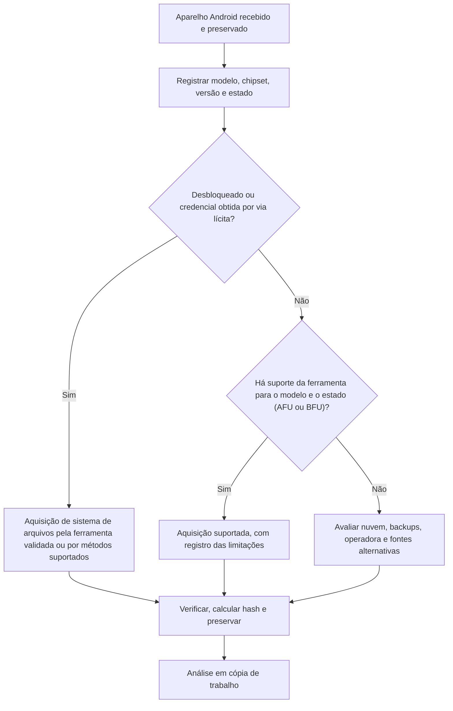

# Aquisição de Dispositivos Android

> **Objetivo pedagógico:** conhecer os métodos de aquisição de dispositivos Android (lógica, sistema de arquivos e física), seus limites diante da criptografia, o uso controlado do ADB e de ferramentas forenses, e o procedimento de documentação e de verificação, reconhecendo o impacto de cada ação sobre o aparelho.

## 1. Pontos de partida

| Pergunta | Por que importa |
|---|---|
| Qual o fabricante, o modelo, o chipset e a versão do Android? | Determina os métodos suportados |
| O aparelho está desbloqueado, em AFU ou em BFU? | Determina o acesso às chaves e aos dados |
| A depuração USB está habilitada e autorizada para o computador? | Habilita o ADB |
| Há bloqueio de tela, biometria e criptografia por arquivo? | Define se os dados são legíveis |
| O bootloader está bloqueado? | Desbloqueá-lo apaga os dados |
| Há perfil de trabalho, múltiplos usuários, MDM ou aplicativos de segurança? | Escopo e restrições |
| Quais contas de nuvem estão associadas (Google e fabricante)? | Fontes adicionais |

## 2. Métodos de aquisição

| Método | Descrição | Alcance | Limitações |
|---|---|---|---|
| Manual | Navegação na tela com registro fotográfico | Somente o visível | Altera o estado; frágil |
| Lógica por ADB e protocolos | Cópia de arquivos acessíveis e consultas a provedores de conteúdo | Mídia e dados expostos | A depuração USB precisa estar habilitada; o backup do ADB é restrito em versões recentes |
| Lógica por agente de ferramenta forense | Instalação de um agente que exporta dados acessíveis | Contatos, SMS, chamadas, mídia e alguns aplicativos | Altera o aparelho (o agente é instalado); sujeito à versão |
| Sistema de arquivos completo | Acesso a `/data` e a bancos de aplicativos por exploração ou por acesso privilegiado suportado pela ferramenta | Dados de aplicativos e do sistema | Depende do modelo e da versão; criptografia por arquivo exige o desbloqueio |
| Física | Imagem dos blocos de armazenamento, por modos de inicialização e de fabricante | Espaço não alocado e partições | Em dispositivos com criptografia por arquivo, a imagem é ilegível sem as chaves; suporte cada vez mais restrito |
| Chip-off | Remoção física da memória | Imagem de memória | Destrutiva; criptografia impede a leitura sem chaves |
| Nuvem | Dados da conta Google e do fabricante | Backups, fotos e localização | Exige credenciais e autorização legal |

Observação: métodos de desbloqueio e de exploração de vulnerabilidades dependem de ferramentas comerciais ou de laboratórios especializados, que mantêm a compatibilidade com modelos e versões. Utilize apenas ferramentas e métodos validados, e registre as versões.

## 3. Fluxo de decisão



## 4. Uso controlado do ADB

O Android Debug Bridge (ADB) permite comunicação com o aparelho quando a depuração USB está habilitada e o computador foi autorizado. **Cada comando altera o estado do aparelho** (por exemplo, cria registros, aciona serviços e atualiza chaves de autorização). Use-o apenas com autorização, em equipamento de análise registrado, e documente todos os comandos.

```bash
# Verificar dispositivos conectados e autorizados
adb devices -l

# Informações básicas do aparelho
adb shell getprop ro.product.manufacturer
adb shell getprop ro.product.model
adb shell getprop ro.build.version.release
adb shell getprop ro.build.version.security_patch
adb shell date -u

# Lista de aplicativos instalados (caminhos e pacotes)
adb shell pm list packages -f > pacotes.txt

# Relatório do sistema (inclui dumpsys, logs e informações de aplicativos)
adb bugreport bugreport_E005.zip

# Logs do sistema (captura do buffer atual)
adb logcat -d > logcat_E005.txt

# Cópia de arquivos acessíveis de armazenamento compartilhado
adb pull /sdcard/ ./sdcard_E005/

# Informações de serviços úteis
adb shell dumpsys battery
adb shell dumpsys wifi > dumpsys_wifi.txt
adb shell dumpsys usagestats > dumpsys_usagestats.txt
adb shell dumpsys package > dumpsys_package.txt
```

| Observação | Detalhe |
|---|---|
| Backup do ADB | O comando `adb backup` foi descontinuado e é limitado em versões recentes (Android 12 e posteriores) |
| Acesso a `/data` | Sem privilégio elevado, o ADB só acessa armazenamento compartilhado e interfaces expostas |
| Aplicativos com restrição de backup | Muitos aplicativos excluem seus dados do backup |
| Registro | Guardar a saída dos comandos, o horário e o hash dos arquivos obtidos |

## 5. Dados acessíveis sem privilégio elevado

| Fonte | Exemplos |
|---|---|
| Armazenamento compartilhado (`/sdcard`) | Fotos, vídeos, downloads, documentos, `Android/media` e pastas de aplicativos com permissão |
| Provedores de conteúdo | Contatos, SMS e chamadas por consultas controladas, quando permitido |
| `dumpsys` e `bugreport` | Estado dos serviços, redes Wi-Fi, uso e pacotes |
| Cartão SD | Dados externos, com imagem preferencial |
| Contas e backups em nuvem | Por autorização e credenciais |

## 6. Criptografia e credencial

| Situação | Implicação |
|---|---|
| Aparelho com criptografia por arquivo, em BFU | Muitos dados permanecem criptografados e inacessíveis |
| Aparelho em AFU | Chaves em memória: ferramentas suportadas obtêm maior acesso |
| Aparelho desbloqueado | Acesso máximo para o método disponível |
| Chaves protegidas por hardware (TEE e StrongBox) | Não é possível exportá-las; os dados dependem do desbloqueio |
| Desbloquear o bootloader ou restaurar de fábrica | Apaga os dados; **não** é um método de preservação |

## 7. Aplicativos e backups específicos

| Fonte | Observação |
|---|---|
| Backup do Google | Mensagens, contatos e dados de aplicativos compatíveis; acesso pela conta |
| Backup de aplicativos (por exemplo, WhatsApp) | Arquivos `.crypt14` e `.crypt15` em `Android/media/com.whatsapp/WhatsApp/Databases/` e no Google Drive; exigem a chave ou a conta |
| Contas de fabricante (Samsung e outras) | Backups e localização |
| Perfil de trabalho | Dados corporativos em contêiner separado |
| Aplicativos duplicados ou clonados | Múltiplas instâncias de aplicativos |

## 8. Verificação e documentação

| Item | Registro |
|---|---|
| Aparelho | Fabricante, modelo, número de série, IMEI, versão do sistema e patch de segurança |
| Estado | Bloqueado, AFU, BFU ou desbloqueado; nível de bateria |
| Método | Lógica, sistema de arquivos, física ou nuvem; ferramenta e versão |
| Parâmetros | Opções da ferramenta e comandos ADB executados |
| Saídas | Arquivos gerados, tamanhos e hashes SHA-256 |
| Alterações | Agentes instalados, autorizações de depuração e outras alterações no aparelho |
| Erros e limitações | O que não foi possível obter e por quê |
| Hora | UTC, com a diferença do relógio do aparelho |
| Custódia | Formulários C e B (pasta 02) |

Calcule o hash do pacote de extração (arquivo `.ufdx`, `.ad1`, `.tar` e outros) e registre-o; valide o resultado abrindo-o na ferramenta de análise e conferindo as contagens (por exemplo, número de mensagens) com a tela do aparelho quando possível.

## 9. Ferramentas

| Categoria | Exemplos |
|---|---|
| Comerciais | Cellebrite UFED, Magnet AXIOM e GrayKey, MSAB XRY, Oxygen Forensic Detective |
| Código aberto | ADB, `androidqf` e Mobile Verification Toolkit (MVT), ALEAPP (análise), Autopsy (módulo Android Analyzer), Andriller |
| Suporte | Bancos de compatibilidade de modelos e versões, publicados pelos fornecedores |

Valide as ferramentas com aparelhos de teste e consulte a documentação de suporte (modelo, versão e estado) antes do uso em casos reais; consulte também os testes do NIST CFTT para ferramentas móveis.

## 10. Exemplo prático: aquisição de um Android em AFU

| Etapa | Resultado |
|---|---|
| 1 | Aparelho Android 13, ligado e bloqueado, em AFU, preservado em bolsa de Faraday com energia |
| 2 | A ferramenta forense validada suporta o modelo e a versão para extração de sistema de arquivos em AFU |
| 3 | A extração é realizada com os parâmetros registrados; 41 GB, 2 h 10 min |
| 4 | Hash SHA-256 do pacote calculado; a abertura do pacote e a conferência de contagens são realizadas |
| 5 | Complemento: `adb bugreport` (depuração USB já habilitada pelo usuário) |
| 6 | Registro das alterações (agente da ferramenta instalado e removido), das limitações e dos horários |
| Conclusão | Aquisição de sistema de arquivos em AFU concluída; dados de aplicativos acessíveis; alterações documentadas |

## 11. Casos de uso corporativos

- Aquisição de aparelhos Android de colaboradores em investigações internas.
- Análise de aparelhos corporativos gerenciados com perfil de trabalho.
- Validação de ferramentas de aquisição para o laboratório.

## 12. Normas e frameworks relevantes

- NIST SP 800-101 Rev. 1; NIST CFTT (ferramentas de forense mobile); SWGDE (mobile)
- ISO/IEC 27037:2012; ISO/IEC 27041:2015 (validação do método)
- MITRE ATT&CK Mobile (referência para técnicas de coleta e de abuso)
- LGPD, arts. 6º, 7º e 46

## 13. Referências

- Ayers, R.; Brothers, S.; Jansen, W. NIST SP 800-101 Rev. 1. 2014.
- Google. Android Developers: Android Debug Bridge (ADB) e Android Security.
- Hoog, A. Android Forensics: Investigation, Analysis and Mobile Security for Google Android. Syngress, 2011.
- Tamma, R. et al. Practical Mobile Forensics. 4. ed. Packt, 2020.
- Documentação do Mobile Verification Toolkit (androidqf), do ALEAPP e do Andriller.
- SANS Institute. FOR585.
