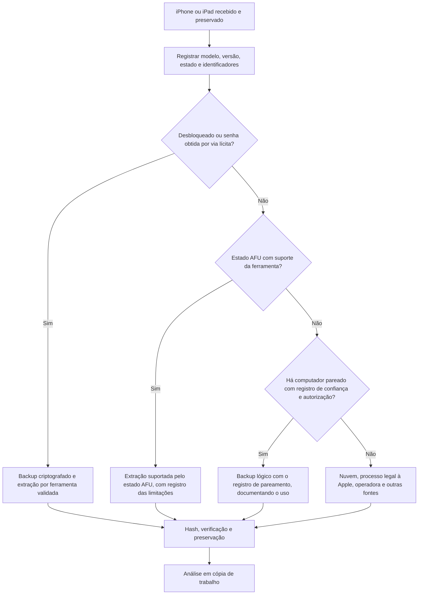

# Aquisição de Dispositivos iOS e iCloud

> **Objetivo pedagógico:** conhecer os métodos de aquisição de iPhones e iPads (backups lógicos, extração de sistema de arquivos e dados do iCloud), a influência do estado do aparelho e das classes de proteção de dados, o uso de ferramentas de código aberto para backups e registros, e as vias legais de obtenção de dados da conta Apple.

## 1. Pontos de partida

| Pergunta | Por que importa |
|---|---|
| Modelo (chip) e versão do iOS | Determinam os métodos de extração suportados |
| Estado: desbloqueado, AFU ou BFU | Determina quais chaves de proteção de dados estão disponíveis |
| O aparelho foi pareado a algum computador? | Registros de pareamento (lockdown) podem permitir acesso lógico, com autorização legal |
| Modo de bloqueio e modo USB restrito | Podem impedir conexões por cabo |
| Backup criptografado habilitado? | Backups criptografados incluem mais categorias de dados e exigem a senha do backup |
| Há conta do iCloud e Proteção Avançada de Dados? | Afeta o que pode ser obtido em nuvem |
| Há outros dispositivos Apple (relógio, Mac e iPad)? | Fontes adicionais e sincronizações |

## 2. Métodos de aquisição

| Método | Descrição | Alcance | Limitações |
|---|---|---|---|
| Manual | Navegação na tela | Somente o visível | Altera o estado; frágil |
| Backup lógico (iTunes, Finder ou ferramentas compatíveis) | Cópia de dados que o iOS expõe para backup | Contatos, mensagens, fotos, dados de muitos aplicativos; com backup criptografado, também chaveiro, senhas salvas e saúde | Requer aparelho desbloqueado ou pareamento prévio; não inclui todos os dados do sistema; senha do backup |
| Lógica avançada e sistema de arquivos completo | Extração por ferramentas forenses que utilizam métodos específicos de cada modelo e versão | Arquivos de aplicativos, bancos SQLite e artefatos do sistema | Suporte depende do chip e da versão; criptografia por arquivo e estado do aparelho |
| Acesso a partir de computador pareado | Uso de registros de pareamento para backup sem desbloqueio | Backup lógico | Requer o computador em que o aparelho foi pareado e autorização legal |
| Nuvem (iCloud) | Backups e dados sincronizados | Backups, fotos, mensagens (conforme configuração) | Requer credenciais e/ou processo legal; Proteção Avançada de Dados limita as categorias |
| Processo legal à Apple | Dados fornecidos pela Apple conforme as diretrizes legais | Dados de conta e de iCloud disponíveis à Apple | Escopo limitado; categorias protegidas por criptografia de ponta a ponta não são fornecidas |

Observação: a extração de sistema de arquivos em aparelhos recentes depende de ferramentas comerciais especializadas e de condições específicas (por exemplo, estado AFU e versão suportada). Métodos baseados em vulnerabilidades específicas de chips antigos funcionam apenas em modelos limitados. Aparelhos recentes em BFU têm acesso muito restrito.

## 3. Fluxo de decisão



## 4. Backups lógicos

### 4.1 Backup criptografado versus não criptografado

| Aspecto | Não criptografado | Criptografado |
|---|---|---|
| Chaveiro e senhas salvas | Não incluídos | Incluídos |
| Dados de saúde e de atividade | Geralmente não | Incluídos |
| Configurações de Wi-Fi e de aplicativos | Parcial | Mais completo |
| Exigência | Nenhuma | Senha do backup (se desconhecida, a aquisição é limitada) |

Recomendação: quando a aquisição lógica for autorizada e a senha do backup for conhecida ou puder ser definida (por exemplo, o aparelho desbloqueado, com a criação de senha de backup documentada), prefira o backup criptografado e registre a senha em cofre seguro.

### 4.2 Ferramentas de código aberto (libimobiledevice)

```bash
# Verificar dispositivos reconhecidos e obter informações (exigem pareamento e confiança)
idevice_id -l
ideviceinfo > ideviceinfo_E006.txt

# Backup completo para um diretório (verifique as opções na sua versão)
idevicebackup2 backup --full /mnt/evidencias/DFL-2026-001-E006/backup

# Registros do sistema em tempo real e relatórios de falhas
idevicesyslog > syslog_E006.txt
idevicecrashreport -k /mnt/evidencias/DFL-2026-001-E006/crashes
```

```bash
# Hash dos resultados
find /mnt/evidencias/DFL-2026-001-E006 -type f -exec sha256sum {} \; > /mnt/evidencias/DFL-2026-001-E006_hashes.sha256
```

Alternativas: ferramentas como pymobiledevice3 oferecem funções semelhantes e adicionais. Cada conexão pode criar ou alterar registros de pareamento e de logs no aparelho; documente.

## 5. Estrutura de um backup do iOS

| Elemento | Descrição |
|---|---|
| `Manifest.db` | Banco SQLite que mapeia o identificador de cada arquivo (hash) ao domínio e ao caminho original |
| `Manifest.plist` | Metadados do backup: criptografia, versão e dispositivo |
| `Info.plist` | Informações do dispositivo: nome, número de série, IMEI, versão e data do último backup |
| `Status.plist` | Estado e horário do backup |
| Arquivos com nomes de hash | Dados dos aplicativos e do sistema |

```bash
# Localizar o arquivo de mensagens no backup
sqlite3 Manifest.db "select fileID, domain, relativePath from Files where relativePath like '%sms.db%'"

# Exemplo: o arquivo sms.db costuma corresponder ao fileID 3d0d7e5fb2ce288813306e4d4636395e047a3d28 (HomeDomain)
```

Se o backup for criptografado, descriptografe-o na estação de análise com ferramentas compatíveis (por exemplo, `mvt-ios decrypt-backup`) e a senha, mantendo o original intacto.

```bash
mvt-ios decrypt-backup -p 'SENHA_DO_BACKUP' -d /mnt/analise/backup_decifrado /mnt/evidencias/DFL-2026-001-E006/backup
```

## 6. Registros de pareamento (lockdown)

Quando um iPhone é conectado a um computador e o usuário toca em "Confiar", é criado um registro de pareamento que permite ao computador acessar o aparelho por determinadas interfaces, inclusive quando ele estiver bloqueado, desde que o estado e as versões permitam. Esses registros ficam em pastas do sistema do computador (por exemplo, `/var/db/lockdown` no macOS e `%ProgramData%\Apple\Lockdown` no Windows).

| Aspecto | Observação |
|---|---|
| Valor forense | Pode permitir backup lógico de aparelho bloqueado, a partir do computador previamente pareado |
| Preservação | Preservar o computador e as pastas relevantes e registrar os arquivos de pareamento |
| Limitações | Registros podem expirar ou ser invalidados (reinícios, mudanças de senha e atualizações) |
| Legalidade | O uso do registro exige a autorização legal de acesso ao aparelho e aos dados |

## 7. iCloud e conta Apple

| Fonte | Conteúdo | Observações |
|---|---|---|
| Backup do iCloud | Dados do aparelho (conforme configuração) | Credenciais, ou processo legal; backup pode estar criptografado de ponta a ponta com a Proteção Avançada de Dados |
| iCloud Fotos, Drive, Notas, Contatos e Calendário | Dados sincronizados | Disponíveis conforme a configuração |
| Mensagens no iCloud | Histórico de mensagens sincronizado | Criptografia de ponta a ponta quando ativada pela conta |
| Chaveiro do iCloud | Senhas e chaves | Criptografia de ponta a ponta |
| Buscar (Find My) | Localização de dispositivos | Depende de ativação e de acesso à conta |
| Autenticação em dois fatores | Código de verificação | Exige o aparelho confiável ou meio de recuperação |

Vias legais: processos legais dirigidos à Apple, conforme as diretrizes da empresa para autoridades, e solicitações de preservação; para empresas, os dados da conta corporativa gerenciada (Apple Business Manager) e de MDM. Contas pessoais exigem credenciais e consentimento ou ordem judicial.

## 8. Registros e artefatos de diagnóstico

| Fonte | Uso |
|---|---|
| Registros em tempo real (`idevicesyslog`) | Atividade do sistema (apenas durante a captura) |
| Relatórios de falhas (`idevicecrashreport`) | Aplicativos que falharam e processos executados |
| Sysdiagnose | Pacote de diagnóstico completo gerado por combinação de botões ou por configuração; contém registros e estados do sistema (útil em análises de comprometimento) |
| Registros unificados | Eventos do sistema, conforme a configuração |

## 9. Verificação e documentação

| Item | Registro |
|---|---|
| Aparelho | Modelo, número de série, IMEI, versão do iOS, nome e identificadores |
| Estado | Bloqueado, AFU, BFU ou desbloqueado; modo de bloqueio e USB restrito |
| Método | Backup lógico, sistema de arquivos ou nuvem; ferramenta e versão |
| Senha do backup | Definida ou conhecida; guardada em cofre |
| Saídas | Arquivos, tamanhos e hashes |
| Alterações no aparelho | Confiança concedida, backups criados e registros gerados |
| Limitações | Categorias não obtidas e justificativas |
| Hora | UTC e diferença do relógio do aparelho |
| Custódia | Formulários da pasta 02 |

## 10. Exemplo prático: iPhone corporativo de executivo

| Etapa | Resultado |
|---|---|
| Situação | iPhone com iOS 17.x, ligado, bloqueado, em AFU, gerenciado por MDM |
| Preservação | Isolado em bolsa de Faraday com energia; MDM consultado para o inventário, sem acionar ações remotas |
| Autorização | Termo de autorização assinado pelo Jurídico, DPO e CISO; o executivo fornece a senha por escrito |
| Aquisição | Backup criptografado (senha definida e guardada em cofre) e extração de sistema de arquivos por ferramenta suportada |
| Verificação | Hashes calculados; abertura nas ferramentas de análise com conferência de contagens |
| Complementos | Logs do MDM, do e-mail corporativo e do iCloud corporativo |
| Conclusão | Aquisição completa do aparelho e das fontes corporativas, com alterações documentadas |

## 11. Casos de uso corporativos

- Aquisição de iPhones corporativos em investigações internas e em desligamentos.
- Obtenção de dados de contas corporativas gerenciadas e do MDM.
- Planejamento de políticas de uso de iCloud e de backup em dispositivos corporativos.

## 12. Normas e frameworks relevantes

- NIST SP 800-101 Rev. 1; SWGDE (mobile); NIST CFTT (forense mobile)
- ISO/IEC 27037:2012; NIST IR 8387
- Apple Platform Security Guide; Apple Legal Process Guidelines
- LGPD, arts. 6º, 7º, 11 e 46

## 13. Referências

- Apple. Apple Platform Security Guide; Legal Process Guidelines: Government & Law Enforcement.
- Epifani, M.; Stirparo, P. Learning iOS Forensics. 2. ed. Packt, 2016.
- Hoog, A.; Strzempka, K. iPhone and iOS Forensics. Syngress, 2011.
- Documentação do libimobiledevice, do pymobiledevice3 e do Mobile Verification Toolkit.
- Mahalik, H. et al. Mobile Forensics: Advanced Investigative Strategies. Packt, 2016.
- SANS Institute. FOR585.
