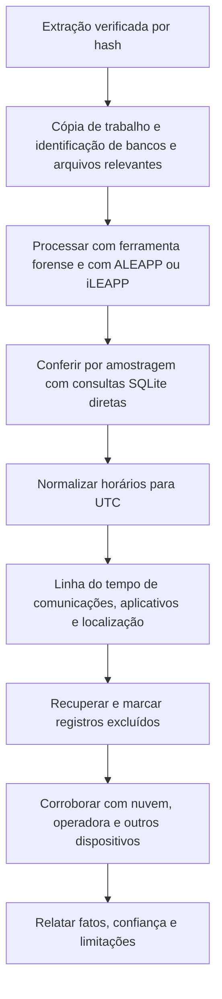

# Artefatos de Aplicativos, Comunicações e Localização

> **Objetivo pedagógico:** analisar os principais artefatos de dispositivos móveis (SMS, chamadas, contatos, aplicativos de mensagens, mídia, navegadores, uso do sistema e localização), localizar e consultar seus bancos de dados SQLite, converter corretamente os horários e tratar dados excluídos e variações por versão.

## 1. Modelo geral dos dados móveis

| Elemento | Descrição |
|---|---|
| Sandbox de aplicativos | Cada aplicativo tem sua pasta de dados isolada |
| Bancos SQLite | Principal formato de armazenamento (mensagens, histórico, configurações) |
| Arquivos auxiliares | Mídias, caches, anexos e listas de propriedades (plist, em iOS) |
| Sincronização | Dados do aparelho e da nuvem podem divergir; mensagens podem existir apenas em um dos lados |
| Versões | O esquema dos bancos muda entre versões dos aplicativos e do sistema; valide sempre os campos |

## 2. Localização dos artefatos principais

### 2.1 Android (caminhos típicos, exigem extração de sistema de arquivos)

| Artefato | Caminho típico |
|---|---|
| SMS e MMS | `/data/data/com.android.providers.telephony/databases/mmssms.db` |
| Registro de chamadas | `/data/data/com.android.providers.contacts/databases/calllog.db` |
| Contatos | `/data/data/com.android.providers.contacts/databases/contacts2.db` |
| Mídia (índice) | `/data/data/com.android.providers.media.module/databases/external.db` e a pasta `DCIM` |
| WhatsApp | `/data/data/com.whatsapp/databases/msgstore.db` e `wa.db`; mídias em `/sdcard/Android/media/com.whatsapp/WhatsApp/Media/` |
| Chrome | `/data/data/com.android.chrome/app_chrome/Default/History` |
| Uso de aplicativos | Serviço de estatísticas de uso (`usagestats`) |
| Redes Wi-Fi salvas | Configurações do sistema |

### 2.2 iOS (caminhos típicos)

| Artefato | Caminho típico |
|---|---|
| SMS e iMessage | `/private/var/mobile/Library/SMS/sms.db` |
| Chamadas | `/private/var/mobile/Library/CallHistoryDB/CallHistory.storedata` |
| Contatos | `/private/var/mobile/Library/AddressBook/AddressBook.sqlitedb` |
| Fotos (índice e metadados) | `/private/var/mobile/Media/PhotoData/Photos.sqlite` |
| Safari | `/private/var/mobile/Library/Safari/History.db` |
| WhatsApp | `ChatStorage.sqlite` no contêiner de grupo `group.net.whatsapp.WhatsApp.shared` |
| Locais significativos e rotinas | `/private/var/mobile/Library/Caches/com.apple.routined/` |
| Uso e atividade | `knowledgeC.db` (`/private/var/mobile/Library/CoreDuet/Knowledge/`) e, em versões mais recentes, a infraestrutura Biome |
| Notas | `NoteStore.sqlite` no contêiner de grupo `group.com.apple.notes` |

Em backups do iOS, os arquivos aparecem com nomes de hash; use o `Manifest.db` para mapear caminhos (ver o arquivo de aquisição de iOS).

## 3. Horários e formatos de data

| Plataforma e artefato | Formato do horário | Conversão para UTC (SQLite) |
|---|---|---|
| Android, `mmssms.db` (campo `date`) | Milissegundos desde 1970 | `datetime(date/1000,'unixepoch')` |
| Android, WhatsApp `msgstore.db` (`timestamp`) | Milissegundos desde 1970 | `datetime(timestamp/1000,'unixepoch')` |
| iOS, `sms.db` (campo `date`, iOS 11 e posteriores) | Nanossegundos desde 2001-01-01 | `datetime(date/1000000000 + 978307200,'unixepoch')` |
| iOS, WhatsApp `ZWAMESSAGE.ZMESSAGEDATE` | Segundos desde 2001-01-01 | `datetime(ZMESSAGEDATE + 978307200,'unixepoch')` |
| iOS, `CallHistory.storedata` (`ZDATE`) | Segundos desde 2001-01-01 | `datetime(ZDATE + 978307200,'unixepoch')` |
| Chrome (`History`) | Microssegundos desde 1601-01-01 | `datetime(last_visit_time/1000000 - 11644473600,'unixepoch')` |
| Safari (`History.db`) | Segundos desde 2001-01-01 | `datetime(visit_time + 978307200,'unixepoch')` |

Veja a pasta 05 para as épocas e para a normalização de fusos. Sempre registre o fuso e a diferença do relógio do aparelho.

## 4. Consultas SQLite de exemplo

```bash
# Abrir bancos sempre em cópia de trabalho; listar as tabelas
sqlite3 mmssms.db ".tables"
sqlite3 mmssms.db ".schema sms"

# SMS no Android: horário, endereço, tipo (1 = recebido, 2 = enviado) e texto
sqlite3 -header -csv mmssms.db \
 "select datetime(date/1000,'unixepoch') as data_utc, address, type, body from sms order by date;" > sms_android.csv

# SMS e iMessage no iOS: junção com handle para o remetente
sqlite3 -header -csv sms.db \
 "select datetime(m.date/1000000000+978307200,'unixepoch') as data_utc, h.id as contato, m.is_from_me, m.service, m.text
  from message m left join handle h on m.handle_id = h.ROWID order by m.date;" > mensagens_ios.csv

# WhatsApp iOS (esquema típico; valide as tabelas na sua versão)
sqlite3 -header -csv ChatStorage.sqlite \
 "select datetime(ZMESSAGEDATE+978307200,'unixepoch') as data_utc, ZISFROMME, ZTEXT from ZWAMESSAGE order by ZMESSAGEDATE;" > whatsapp_ios.csv
```

Observação: bancos podem estar em modo WAL (arquivos `-wal` e `-shm`); copie os três arquivos juntos e abra a cópia, para que as transações recentes sejam consideradas. As consultas acima são ilustrativas: o esquema muda entre versões, e as ferramentas de análise (ALEAPP, iLEAPP e suítes comerciais) já tratam essas variações.

## 5. Aplicativos de mensagens

| Aplicativo | Armazenamento | Observações forenses |
|---|---|---|
| WhatsApp | `msgstore.db` (Android) e `ChatStorage.sqlite` (iOS); backups `.crypt14` e `.crypt15` | Mensagens, mídias, grupos, status de leitura e entrega; mensagens apagadas podem permanecer em espaço livre do SQLite; backups exigem a chave ou a conta |
| Telegram | Bancos próprios (por exemplo, `cache4.db` no Android) | Parte do conteúdo reside na nuvem; chats secretos não sincronizam |
| Signal | Banco criptografado (SQLCipher), com chave protegida pelo sistema | Acesso depende do desbloqueio e do suporte da ferramenta; mensagens temporárias |
| iMessage | `sms.db` (iOS) | Sincronização com outros dispositivos Apple e iCloud |
| E-mail (Gmail, Outlook e outros) | Bancos de cache dos aplicativos | Mensagens recentes; o servidor é a fonte principal (ver pasta 12) |
| Redes sociais | Caches de aplicativos | Conteúdo parcial; o provedor mantém os dados |

Mensagens temporárias e a exclusão automática reduzem a disponibilidade; o ciclo de vida do dado depende da configuração do aplicativo.

## 6. Mídia e metadados

| Dado | Uso |
|---|---|
| EXIF de fotos e vídeos | Data de captura, modelo do aparelho, coordenadas e software |
| Índices de mídia (Photos.sqlite e MediaStore) | Datas de criação, de modificação e de importação, álbuns, local e origem |
| Miniaturas e caches | Indícios de mídia excluída |
| Capturas de tela | Evidência de atividade e de conteúdo visualizado |
| Arquivos "excluídos recentemente" | Lixeira de fotos |

Os metadados de datas podem variar entre o momento de captura, o de importação e o de modificação; registre todos.

## 7. Localização

| Fonte | Descrição | Cuidados |
|---|---|---|
| EXIF de fotos | Coordenadas no momento da captura | Podem estar ausentes ou ser removidas |
| Locais significativos (iOS) e rotinas | Locais frequentes inferidos pelo sistema | Inferência do sistema; aproximada |
| Histórico de localização do Google (Android e Maps) | Linha do tempo, hoje mantida no aparelho e com backups criptografados | Disponibilidade depende da configuração |
| Redes Wi-Fi e torres de celular | Indícios de proximidade | Precisão limitada |
| Aplicativos (transporte, fitness, redes sociais) | Trajetos e check-ins | Dados no aparelho e no provedor |
| Registros da operadora | Antenas e horários | Obtidos por via legal |
| Bluetooth e dispositivos pareados | Proximidade de carros, fones e relógios | Corroboração |

A localização forense é uma estimativa com margem de erro: apresente-a com intervalos de confiança, a fonte e as limitações, e corrobore com outras fontes (por exemplo, câmeras, pagamentos e logs de rede).

## 8. Uso do sistema e atividade

| Fonte | Valor |
|---|---|
| Estatísticas de uso (Android `usagestats`) e KnowledgeC e Biome (iOS) | Aplicativos usados, em primeiro plano, bloqueio e desbloqueio da tela, carregamento |
| Notificações | Mensagens e eventos recebidos, inclusive de aplicativos já removidos |
| Teclado e dicionário | Palavras digitadas e aprendidas |
| Bluetooth e Wi-Fi | Redes e dispositivos conectados, com horários |
| Calendário, notas e lembretes | Atividade e planos |
| Saúde e atividade | Passos, sono e exercícios (indicam atividade e presença em determinados horários) |

## 9. Dados excluídos e recuperação

| Mecanismo | Possibilidade |
|---|---|
| Registros apagados em SQLite | Podem permanecer em páginas livres, no arquivo WAL e no journal; ferramentas de recuperação reconstroem registros |
| Lixeiras de aplicativos | Itens recentemente excluídos |
| Mensagens temporárias | Menor chance de recuperação |
| Compactação do banco (VACUUM) e `secure_delete` | Eliminam resíduos |
| Backups | Estados anteriores |
| Nuvem | Cópias em serviços de sincronização |

Ferramentas: suítes forenses comerciais e utilitários de recuperação de registros SQLite (por exemplo, undark e SQLite Dissect). Marque claramente o que é registro ativo e o que é registro recuperado, pois o grau de confiança é diferente.

## 10. Análise com ferramentas de código aberto

```bash
# ALEAPP (Android) e iLEAPP (iOS): processam extrações e geram relatórios em HTML
python3 aleappGUI.py        # interface gráfica; também há execução por linha de comando (consulte a documentação)
python3 ileapp.py -t fs -i /mnt/analise/ios_extracao -o /mnt/saida/ileapp
```

Registre a versão e as opções, e valide por amostragem os resultados contra a consulta direta aos bancos.

## 11. Fluxo de análise de artefatos



## 12. Exemplo prático: reconstrução de uma sequência de eventos

| Hora (UTC) | Artefato | Evento |
|---|---|---|
| 17:42 | Bluetooth e conectividade | Conexão a um dispositivo USB de armazenamento? (não se aplica); conexão a um Wi-Fi do escritório |
| 17:44 | Foto (EXIF e `Photos.sqlite`) | Captura de foto de um documento na sala de reuniões |
| 17:46 | WhatsApp | Envio da foto para o contato Z (mídia e registro em `ChatStorage`) |
| 17:47 | `knowledgeC.db` | Aplicativo de mensagens em primeiro plano por 3 minutos |
| 17:52 | WhatsApp | Mensagem apagada pelo usuário (recuperada de espaço livre do banco) |
| 18:10 | Localização (locais significativos) | Saída do escritório |
| Conclusão | Fotografou e enviou o documento por mensagem, apagando a mensagem depois; confiança alta para o envio (mídia, registro e aplicativo) e média para o conteúdo apagado (registro recuperado) |

## 13. Casos de uso corporativos

- Reconstrução de comunicações em investigações de vazamento e de fraude.
- Análise de mensagens e de localização em disputas trabalhistas.
- Verificação de uso de aplicativos não autorizados em dispositivos corporativos.

## 14. Normas e frameworks relevantes

- NIST SP 800-101 Rev. 1; SWGDE (mobile); ISO/IEC 27042:2015
- MITRE ATT&CK Mobile (coleta: T1636 Protected User Data, T1430 Location Tracking, T1429 Audio Capture, T1417 Input Capture)
- LGPD, arts. 6º, 7º, 11 e 46

## 15. Referências

- Mahalik, H.; Tamma, R.; Bommisetty, S. Practical Mobile Forensics. Packt, 2016 e edições posteriores.
- Hoog, A. Android Forensics. Syngress, 2011.
- Epifani, M.; Stirparo, P. Learning iOS Forensics. 2. ed. 2016.
- Brignoni, A. ALEAPP e iLEAPP (documentação). Documentação do SQLite (WAL e formato de arquivo).
- SANS Institute. FOR585: Smartphone Forensic Analysis In-Depth.
