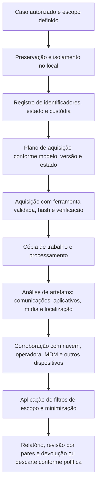

# Ferramentas, Fluxo, Modelos e Checklist Mobile

> **Objetivo pedagógico:** padronizar as ferramentas, a validação, o fluxo de trabalho, os registros e a verificação de qualidade das investigações em dispositivos móveis, de modo que sejam reproduzíveis, rastreáveis, proporcionais ao escopo e defensáveis.

## 1. Ferramentas por finalidade

| Finalidade | Ferramentas |
|---|---|
| Aquisição e análise integradas (comerciais) | Cellebrite UFED e Physical Analyzer, Magnet AXIOM e GrayKey, MSAB XRY, Oxygen Forensic Detective, Elcomsoft |
| Aquisição de código aberto (Android) | ADB, `androidqf` |
| Aquisição de código aberto (iOS) | libimobiledevice (`idevice_id`, `ideviceinfo`, `idevicebackup2`, `idevicesyslog`, `idevicecrashreport`), pymobiledevice3 |
| Análise de artefatos | ALEAPP, iLEAPP, Autopsy, DB Browser for SQLite, `sqlite3`, undark e SQLite Dissect |
| Detecção de comprometimento | Mobile Verification Toolkit (MVT), listas de IOCs |
| Mídia e metadados | ExifTool, FFmpeg (ffprobe) |
| Linha do tempo | Plaso, Timesketch, Timeline Explorer |
| Gestão corporativa | Consoles de MDM (Intune, Workspace ONE, Jamf e Google Endpoint Management) |
| Documentação e custódia | Formulários da pasta 02 e do modelo do laboratório |

## 2. Validação de ferramentas e métodos

| Prática | Descrição |
|---|---|
| Aparelhos de teste | Manter um conjunto de aparelhos e versões representativos para testar as ferramentas |
| Matriz de suporte | Registrar, por modelo e versão, o método suportado e o resultado |
| Dados de referência | Aparelhos com dados conhecidos, para verificar a completude e a exatidão da extração |
| Segunda ferramenta | Comparar os resultados de ferramentas diferentes em casos críticos |
| Versões congeladas | Registrar a versão de cada ferramenta usada no caso |
| Atualizações | Retestar após atualizações importantes |
| Referências | Relatórios de testes de ferramentas móveis do NIST CFTT e guias do SWGDE |

## 3. Fluxo de trabalho padronizado

## 4. Minimização e escopo

| Medida | Descrição |
|---|---|
| Escopo por período | Limitar a análise e o relatório ao intervalo relevante |
| Escopo por aplicativo, contato ou tema | Filtros definidos com o Jurídico |
| Conteúdo de terceiros | Mensagens e fotos de pessoas fora do caso: restringir e tratar conforme a LGPD |
| Conteúdo privilegiado | Comunicações com advogados e outras categorias protegidas: filtro e revisão pelo Jurídico |
| Dados sensíveis | Saúde, sexualidade e religião: acesso restrito e justificativa de uso |
| Relatório | Incluir apenas o necessário, com anexos protegidos |
| Retenção e descarte | Prazos definidos e descarte seguro (pasta 02) |

## 5. Dez perguntas e como respondê-las

| Pergunta | Onde responder |
|---|---|
| 1. Qual o aparelho, a versão e o estado? | Identificadores, configurações e registro de preservação |
| 2. A extração é íntegra e completa? | Hash, verificação de contagens e relatório da ferramenta |
| 3. Quais comunicações existem e entre quem? | SMS, chamadas, aplicativos de mensagens e e-mail |
| 4. O que foi apagado e é recuperável? | SQLite (WAL, páginas livres), lixeiras e backups |
| 5. Onde estava o aparelho em determinado período? | EXIF, locais significativos, Wi-Fi, aplicativos e operadora |
| 6. Quais aplicativos foram usados e quando? | Estatísticas de uso, KnowledgeC e Biome, notificações |
| 7. Há indícios de comprometimento? | MVT, aplicativos, permissões, perfis e certificados |
| 8. Que dados existem na nuvem e em outros dispositivos? | Contas, backups e pareamentos |
| 9. O que a conta e a operadora confirmam? | Registros por via legal |
| 10. Que limitações precisam ser declaradas? | Estado BFU, criptografia, suporte da ferramenta e escopo |

## 6. Modelo A: Registro do Dispositivo

| Campo | Preenchimento |
|---|---|
| Identificador da evidência | DFL-AAAA-NNN-ENNN |
| Caso | |
| Fabricante, modelo e cor | |
| Número de série e IMEI (todos) | |
| Sistema e versão; patch de segurança | |
| Estado ao receber (desligado, bloqueado BFU ou AFU, desbloqueado) | |
| Nível de bateria e tipo de energia | |
| Contas associadas (nuvem, e-mail e fabricante) | |
| SIM (ICCID e operadora) e cartão SD | |
| Gerenciamento (MDM, perfil de trabalho) | |
| Credencial obtida (por qual via e com qual autorização) | |
| Fotografias | |
| Responsável e data e hora (UTC) | |
| Observações | |

## 7. Modelo B: Registro de Aquisição Mobile

| Campo | Preenchimento |
|---|---|
| Identificador da aquisição | DFL-AAAA-NNN-ENNN-AQNN |
| Dispositivo | |
| Método (lógica, sistema de arquivos, física, backup ou nuvem) | |
| Ferramenta, versão e parâmetros | |
| Comandos executados (por exemplo, ADB e libimobiledevice) | |
| Início e fim (UTC) e relógio do aparelho | |
| Arquivos gerados, tamanhos e hashes SHA-256 | |
| Verificação (abertura, contagens e conferência com a tela) | |
| Alterações no aparelho (agentes, confianças e backups criados) | |
| Erros e limitações | |
| Analista | |
| Armazenamento e custódia | |

## 8. Modelo C: Registro de Análise de Artefatos

| ID | Artefato (banco e caminho) | Hash | Achado | Horário (UTC) | Registro ativo ou recuperado | Interpretação | Confiança | Corroboração |
|---|---|---|---|---|---|---|---|---|
| M-001 | | | | | | | | |
| M-002 | | | | | | | | |

## 9. Modelo D: Registro de Verificação de Comprometimento

| Item | Resultado |
|---|---|
| Ferramenta e versão (por exemplo, MVT) | |
| Listas de IOCs (origem e data) | |
| Aplicativos de terceiros e permissões críticas | |
| Acessibilidade e administradores do dispositivo | |
| Perfis, certificados, VPN e proxy | |
| Indicadores encontrados | |
| Avaliação e confiança | |
| Medidas adotadas | |

## 10. Modelo E: Estrutura do Relatório Mobile

| Seção | Conteúdo |
|---|---|
| 1. Resumo | Objetivo, escopo e principais conclusões |
| 2. Autorização e base legal | Referências, limites e consentimentos |
| 3. Dispositivo e preservação | Identificadores, estado e custódia |
| 4. Método de aquisição | Ferramenta, versão, nível e limitações |
| 5. Resultados | Achados por categoria, com horários em UTC |
| 6. Corroboração | Nuvem, operadora, MDM e outras fontes |
| 7. Registros recuperados | Identificados e com a confiança correspondente |
| 8. Limitações | Estado, criptografia, suporte e escopo |
| 9. Minimização | O que foi excluído do relatório e por quê |
| 10. Anexos | Hashes, custódia e consultas |

## 11. Checklist operacional mobile

**Caso:** DFL-AAAA-NNN
**Dispositivo:** ____________________
**Analista:** ____________________
**Data e hora (UTC):** ____________________

### 11.1 Autorização e preservação

- [ ] Autorização, base legal e escopo definidos; Jurídico e DPO consultados
- [ ] Estado do aparelho registrado antes de qualquer interação
- [ ] Dispositivo mantido ligado, com energia e isolado da rede
- [ ] Nenhuma ação remota (apagamento ou bloqueio) acionada no MDM
- [ ] Identificadores (IMEI, série e SIM) registrados
- [ ] Credencial obtida por via lícita e registrada de forma segura
- [ ] Custódia iniciada e embalagem lacrada

### 11.2 Aquisição

- [ ] Método escolhido conforme modelo, versão e estado, com justificativa
- [ ] Ferramenta validada, versão registrada
- [ ] Comandos e parâmetros registrados
- [ ] Hash do pacote de extração calculado
- [ ] Verificação da abertura e das contagens
- [ ] Alterações no aparelho documentadas
- [ ] Cópia de trabalho criada

### 11.3 Análise

- [ ] Comunicações, mídia, aplicativos e localização analisados
- [ ] Horários normalizados para UTC
- [ ] Registros recuperados identificados como tal
- [ ] Verificação de comprometimento realizada, quando aplicável
- [ ] Corroboração com nuvem, operadora, MDM ou outros dispositivos

### 11.4 Privacidade e relato

- [ ] Filtros de escopo e minimização aplicados
- [ ] Conteúdo de terceiros e privilegiado tratado
- [ ] Limitações e grau de confiança declarados
- [ ] Revisão por pares realizada
- [ ] Acesso ao relatório e aos anexos restrito
- [ ] Retenção e descarte definidos

## 12. Resultado da verificação

| Resultado | Condição |
|---|---|
| Conforme | Todos os itens aplicáveis marcados |
| Conforme com ressalvas | Pendências sem impacto nas conclusões, com plano de ação |
| Não conforme | Acesso sem autorização, desligamento ou ação remota antes da preservação, aquisição sem hash ou ferramenta sem registro; comunicar o líder e o Jurídico |

**Assinatura do analista:** ____________________
**Assinatura do revisor:** ____________________

## 13. Casos de uso corporativos

- Padronização da aquisição e da análise de dispositivos móveis do laboratório.
- Treinamento de analistas com aparelhos de teste, modelos e checklist.
- Auditoria da qualidade técnica e da conformidade com a privacidade.

## 14. Normas e frameworks relevantes

- NIST SP 800-101 Rev. 1; NIST SP 800-124 Rev. 2; NIST CFTT
- SWGDE Best Practices for Mobile Device Evidence Collection & Preservation, Handling, and Acquisition
- ISO/IEC 27037:2012; ISO/IEC 27041:2015; ISO/IEC 27042:2015
- LGPD, arts. 6º, 7º, 11 e 46

## 15. Referências

- Ayers, R.; Brothers, S.; Jansen, W. NIST SP 800-101 Rev. 1. 2014.
- Souppaya, M.; Scarfone, K. NIST SP 800-124 Rev. 2. 2023.
- SWGDE. Best Practices for Mobile Device Evidence Collection & Preservation, Handling, and Acquisition.
- Tamma, R. et al. Practical Mobile Forensics. 4. ed. Packt, 2020.
- Documentação do ALEAPP, do iLEAPP, do MVT, do libimobiledevice e das suítes forenses.
- SANS Institute. FOR585.
