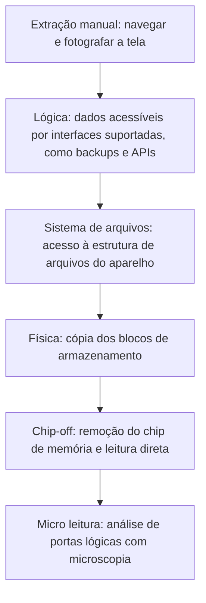

# Fundamentos de Forense Mobile e Arquitetura

> **Objetivo pedagógico:** compreender a arquitetura de segurança de dispositivos Android e iOS (criptografia, enclaves seguros, estados do dispositivo e restrições de acesso), os níveis de extração de dados e os identificadores do aparelho, para planejar a aquisição, antecipar o que é possível obter e declarar as limitações com precisão.

## 1. Por que a forense mobile é diferente

| Característica | Consequência |
|---|---|
| Dispositivo sempre conectado (rede móvel, Wi-Fi e Bluetooth) | Risco de apagamento remoto e de alteração de dados após a apreensão |
| Criptografia ativada por padrão | Sem a credencial de desbloqueio, o conteúdo é em geral inacessível |
| Hardware e software fechados e variados | Cada modelo e versão exige suporte específico de ferramentas |
| Ciclos rápidos de atualização | Métodos de extração deixam de funcionar com novas versões |
| Dados distribuídos entre aparelho, nuvem e dispositivos pareados | A evidência pode estar fora do aparelho |
| Dados pessoais e sensíveis em grande volume | Exige base legal, escopo e minimização rigorosos |
| Aplicativos com bancos de dados próprios e criptografia | Parsers e chaves específicos |

## 2. Identificadores do dispositivo e do assinante

| Identificador | Descrição | Como obter |
|---|---|---|
| IMEI | Identificador internacional do equipamento (um por modem) | `*#06#` no discador, configurações do aparelho, etiqueta e caixa |
| IMSI | Identificador do assinante no SIM | Ferramentas de extração e operadora |
| ICCID | Número de série do cartão SIM | Impresso no SIM e extraído por ferramentas |
| MSISDN | Número de telefone | Configurações e operadora |
| Número de série | Identificador do fabricante | Configurações e etiqueta |
| Endereços MAC (Wi-Fi e Bluetooth) | Identificadores de rede (podem ser aleatorizados) | Configurações e extração |
| UDID, Android ID e identificadores de publicidade | Identificadores de software | Extração e configurações |
| eSIM (EID) | Identificador do SIM embutido | Configurações |

Registre todos os identificadores na ficha da evidência. Eles permitem solicitar registros às operadoras e vincular o aparelho a outras fontes.

## 3. Estados do dispositivo

| Estado | Descrição | Implicação |
|---|---|---|
| Desligado | Sem energia | Ao ligar, o aparelho inicia em BFU |
| BFU (Before First Unlock) | Ligado, mas ainda não desbloqueado desde a inicialização | Grande parte dos dados permanece criptografada com chaves ainda indisponíveis |
| AFU (After First Unlock) | Desbloqueado ao menos uma vez desde a inicialização, atualmente bloqueado | Muitas chaves já estão em memória; maior acesso por ferramentas forenses |
| Desbloqueado | Em uso, com a tela liberada | Máximo acesso; risco de bloqueio por inatividade |
| Modo avião ou isolado | Sem rede | Reduz o risco de apagamento remoto, mas não protege contra todos os gatilhos |

Regra prática: **não desligue um dispositivo ligado**, pois o desligamento leva ao estado BFU, que dificulta ou impede a extração. Versões recentes de iOS e de Android podem reiniciar o aparelho após longos períodos sem desbloqueio, voltando ao estado BFU; por isso, a agilidade na aquisição é importante.

## 4. Arquitetura de segurança do Android

| Elemento | Descrição | Efeito forense |
|---|---|---|
| Criptografia de arquivos (FBE) | Cada arquivo é criptografado com chaves ligadas às credenciais do usuário (obrigatória em dispositivos lançados com Android 10 ou posterior) | Sem a credencial, os dados do usuário permanecem cifrados |
| Criptografia de metadados | Reforço em versões mais recentes | Menos informações em claro |
| Armazenamento de chaves protegido por hardware (Keystore, TEE e StrongBox) | Chaves não exportáveis | Impede a extração das chaves de aplicativos |
| Inicialização verificada (Verified Boot) e partições A/B | Integridade do sistema | Dificulta modificações do sistema |
| Bootloader bloqueado e desbloqueio | Desbloquear o bootloader apaga os dados do usuário | Não é um método de preservação |
| SELinux e sandbox de aplicativos | Isolamento por aplicativo | Dados de aplicativos em `/data/data` acessíveis somente com privilégios elevados |
| Armazenamento com escopo (scoped storage) | Restringe o acesso a arquivos | Mais dados fora do alcance de acessos comuns |
| Perfis de trabalho e múltiplos usuários | Espaços separados | Escopo da apreensão deve cobrir todos |
| Variações por fabricante (Samsung Knox e outros) | Camadas adicionais | Suporte de ferramentas variável |

## 5. Arquitetura de segurança do iOS

| Elemento | Descrição | Efeito forense |
|---|---|---|
| Secure Enclave (SEP) | Processador separado que gerencia chaves e a verificação de credenciais | Limita tentativas de senha e protege chaves |
| Classes de proteção de dados | Proteção completa, completa até a primeira autenticação, completa a menos que aberto e sem proteção | Determinam o que é acessível em BFU e AFU |
| Keychain | Armazena credenciais e segredos com proteção por classe | Acesso depende do estado e do método |
| APFS | Sistema de arquivos com criptografia por arquivo e por volume | Ver pasta 10 |
| Modo USB restrito | Bloqueia dados por USB após um período com o aparelho bloqueado | Exige agilidade e acessórios confiáveis |
| Modo de bloqueio (Lockdown Mode) | Reduz a superfície de ataque | Pode impedir ferramentas de extração |
| Registros de pareamento (lockdown records) | Confiança estabelecida com computadores | Podem permitir acesso a partir de computador previamente confiável (com autorização legal) |
| Backups do iTunes ou do Finder | Criptografados ou não | Backups criptografados incluem mais categorias de dados |
| iCloud e Proteção Avançada de Dados | Sincronização e backups em nuvem; categorias com criptografia de ponta a ponta quando ativada | Afeta o que a Apple pode fornecer em processos legais |

## 6. Níveis de extração

| Nível | O que obtém | Observações |
|---|---|---|
| Manual | O que aparece na tela | Útil como complemento; altera o estado do aparelho; frágil como prova isolada |
| Lógica | Dados expostos por backups, APIs e protocolos (contatos, SMS, chamadas, mídia e alguns aplicativos) | Menos invasiva; não recupera dados excluídos de forma consistente |
| Sistema de arquivos completo | Arquivos de aplicativos, bancos de dados SQLite e artefatos do sistema | Normalmente por ferramentas especializadas; principal fonte de evidência atualmente |
| Física | Imagem dos blocos, inclusive espaço não alocado | Cada vez mais limitada por criptografia por arquivo; depende do chipset e da versão |
| Chip-off | Leitura direta da memória | Destrutiva e especializada; ineficaz sem as chaves se houver criptografia |
| Micro leitura | Análise ao nível dos transistores | Raríssima; fora do escopo rotineiro |

O NIST SP 800-101 Rev. 1 descreve a classificação das ferramentas por esses níveis. Informe no relatório o nível utilizado e o motivo.

## 7. Dados que podem estar fora do aparelho

| Fonte | Observação |
|---|---|
| Conta de nuvem (iCloud, Google, Samsung e outras) | Backups, fotos, mensagens, localização e dispositivos pareados |
| Operadora | Registros de chamadas e de mensagens, localização aproximada por antenas, dados cadastrais |
| Aplicativos e serviços | Registros dos provedores de aplicativos (mensagens, redes sociais e e-mail) |
| Dispositivos pareados | Relógios, fones, carros e casas inteligentes |
| MDM e gestão corporativa | Registros de inventário, aplicativos, configurações e ações remotas |
| Computador do usuário | Backups, pareamentos e sincronizações |

## 8. Aspectos legais e de privacidade

> **Aviso:** este material é técnico-educacional e não substitui parecer jurídico. Valide cada caso com o Jurídico e com o DPO.

| Tema | Orientação |
|---|---|
| Sigilo e intimidade | A Constituição Federal (art. 5º, X e XII) e o Marco Civil da Internet (art. 7º) protegem a intimidade e o sigilo das comunicações |
| Acesso a dados de celular apreendido | A jurisprudência trata o acesso a mensagens e a dados de aparelhos apreendidos sem autorização judicial como questão sensível (por exemplo, o STJ no RHC 51.531/RO e o Tema 977 do STF); consulte o Jurídico sobre o entendimento vigente |
| Dispositivos corporativos | Política de uso aceitável comunicada, base legal e escopo definidos |
| Dispositivos pessoais (BYOD) | Consentimento específico, escopo restrito e coleta mínima |
| Dados de terceiros | Mensagens e contatos incluem dados de pessoas fora do caso; minimize e restrinja o acesso |
| Direito de não produzir prova contra si mesmo | Considerar nas regras sobre fornecimento de senhas e biometria (CF, art. 5º, LXIII) |
| Cooperação internacional | Dados em nuvem fora do Brasil exigem instrumentos próprios |
| LGPD | Necessidade, finalidade e segurança (arts. 6º, 7º e 46); dados sensíveis (art. 11) |

## 9. Exemplo prático: planejamento a partir do estado do aparelho

| Situação | Decisão |
|---|---|
| iPhone ligado e bloqueado, em AFU, de colaborador em desligamento | Isolar da rede, manter a energia, registrar identificadores e priorizar a aquisição por ferramenta com suporte ao modelo e à versão, antes de qualquer reinício |
| Android desbloqueado, em uso, em reunião | Com autorização, desativar o bloqueio automático e a rede de forma controlada, documentar a tela e adquirir o sistema de arquivos |
| Android desligado, com bloqueio por senha desconhecida | Avaliar a obtenção da credencial por via lícita, a aquisição em nuvem e a limitação de acesso em BFU |
| Dispositivo corporativo gerenciado | Consultar o MDM para inventário, localização e logs; preservar sem acionar o apagamento remoto |

## 10. Casos de uso corporativos

- Investigação interna de vazamento de dados envolvendo aparelhos corporativos.
- Resolução de disputas sobre mensagens e ligações em ações trabalhistas.
- Planejamento da política de dispositivos móveis (BYOD e corporativos) com foco em preservação.

## 11. Normas e frameworks relevantes

- NIST SP 800-101 Rev. 1: Guidelines on Mobile Device Forensics (2014)
- SWGDE Best Practices for Mobile Device Evidence Collection & Preservation, Handling, and Acquisition
- ISO/IEC 27037:2012; NIST IR 8387
- MITRE ATT&CK Mobile; OWASP Mobile Application Security (MASVS e MASTG)
- LGPD, arts. 6º, 7º, 11 e 46; Constituição Federal, art. 5º; Marco Civil da Internet, art. 7º

## 12. Referências

- Ayers, R.; Brothers, S.; Jansen, W. NIST SP 800-101 Rev. 1. 2014.
- Apple. Apple Platform Security Guide.
- Google. Android Security (documentação do Android Open Source Project: criptografia, Keystore e Verified Boot).
- Tamma, R.; Skulkin, O.; Mahalik, H.; Bommisetty, S. Practical Mobile Forensics. 4. ed. Packt, 2020.
- Epifani, M.; Stirparo, P. Learning iOS Forensics. 2. ed. Packt, 2016.
- SANS Institute. FOR585: Smartphone Forensic Analysis In-Depth.
- Brasil. STJ, RHC 51.531/RO; STF, Tema 977 da repercussão geral.
