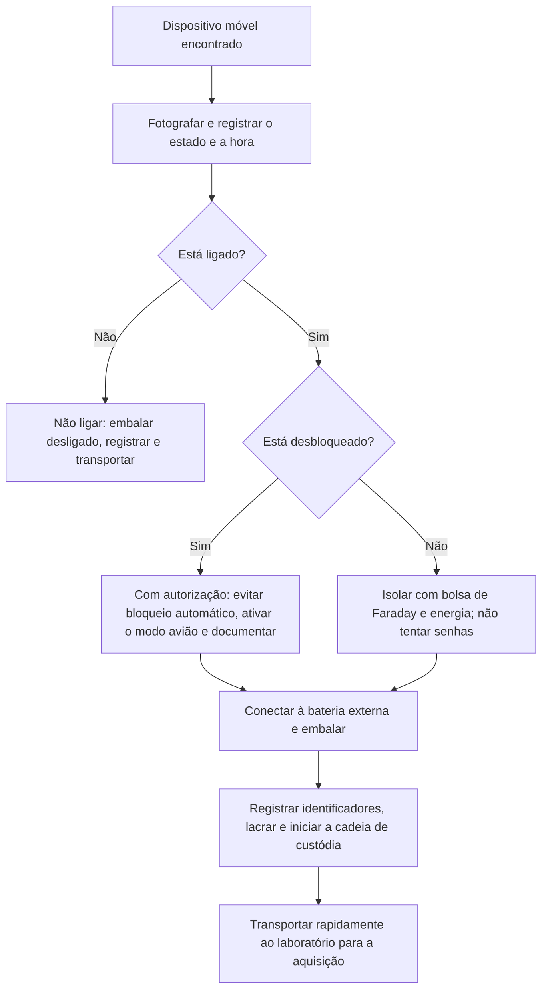

# Preservação, Isolamento e Triagem no Local

> **Objetivo pedagógico:** executar a preservação de um dispositivo móvel no local da apreensão ou da coleta, decidindo com base no estado do aparelho sobre energia, isolamento de rede, bloqueio, documentação e embalagem, de modo a reduzir o risco de apagamento, de alteração e de perda de acesso antes da aquisição.

## 1. Princípios

| Princípio | Aplicação |
|---|---|
| Não alterar o aparelho além do necessário | Cada interação gera artefatos e pode alterar dados |
| Manter a energia | Dispositivos ligados não devem ser desligados nem deixar a bateria esgotar |
| Isolar da rede | Evitar apagamento remoto, novas mensagens e sincronização |
| Documentar antes de tocar | Fotografar o estado, a tela, os acessórios e o ambiente |
| Preservar o acesso | Evitar bloqueios por inatividade, reinícios e tentativas de senha |
| Agir sob autorização | Escopo, base legal e termos definidos antes de acessar o conteúdo |
| Registrar cada ação | Hora (UTC), responsável, ação e motivo |

## 2. Primeira avaliação

| Pergunta | Ação |
|---|---|
| O dispositivo está ligado? | Se sim, mantenha-o ligado; se não, não o ligue |
| Está desbloqueado? | Se desbloqueado e houver autorização, evite o bloqueio automático e documente |
| Qual o nível de bateria? | Conecte a uma fonte de energia ou a uma bateria externa |
| Há conexão à rede? | Decida o isolamento (ver abaixo) |
| Há sinais de risco imediato (mensagens de apagamento, pedidos de senha)? | Registre e isole sem insistir |
| Há outros dispositivos (relógio, tablet e computador)? | Identifique pareamentos e apreenda conforme o escopo |
| Há SIM, cartão SD e acessórios? | Registre e preserve; não remova o SIM sem necessidade e planejamento |

## 3. Isolamento de rede

| Método | Vantagens | Cuidados |
|---|---|---|
| Modo avião | Rápido; não exige acessórios | Exige interação com o aparelho (alterações no estado); Wi-Fi e Bluetooth podem ser reativados; não bloqueia todas as funções em todos os casos |
| Bolsa ou caixa de Faraday | Bloqueia sinais sem interagir com o aparelho | O aparelho pode consumir mais bateria ao procurar sinal; alguns eventos (por exemplo, perda de rede) podem acionar rotinas; teste a eficácia da bolsa |
| Remoção do SIM | Interrompe a rede celular | Pode acionar bloqueios e alterar estados; não resolve Wi-Fi |
| Gestão remota (MDM) | Permite restringir sem tocar | Depende de políticas e de conexão; evite acionar apagamento |
| Desligar o aparelho | Evita rede | **Não recomendado**: leva ao estado BFU e pode perder a evidência volátil |

Recomendação geral: isolar com bolsa de Faraday acompanhada de bateria externa e cabo (com o dispositivo ainda conectado à energia) ou, se o aparelho estiver desbloqueado e autorizado, ativar o modo avião e desligar Wi-Fi e Bluetooth, documentando cada passo.

## 4. Dispositivo desbloqueado e autorizado: procedimento

| Passo | Ação | Observação |
|---|---|---|
| 1 | Fotografar a tela e registrar a hora do aparelho | Compare com UTC |
| 2 | Evitar o bloqueio automático (ajustar o tempo de bloqueio para o máximo) | Anotar a alteração; em alguns aparelhos, a opção "manter ativa" ajuda |
| 3 | Ativar o modo avião e desativar Wi-Fi e Bluetooth | Documentar |
| 4 | Registrar a versão do sistema, o modelo e os identificadores (Configurações > Sobre) | Fotografar |
| 5 | Verificar contas e pareamentos | Anotar contas de nuvem e dispositivos pareados |
| 6 | Verificar as opções de desenvolvedor, a depuração USB e o gerenciamento corporativo | Fotografar |
| 7 | Conectar à energia e embalar com lacre | Manter ligado |
| 8 | Registrar as ações no formulário de custódia | Hora (UTC), responsável e motivo |

Não navegue no conteúdo desnecessariamente: cada interação altera o aparelho e pode extrapolar o escopo autorizado.

## 5. Dispositivo bloqueado

| Situação | Conduta |
|---|---|
| Senha desconhecida | Não tente adivinhar: tentativas erradas podem causar atrasos, bloqueios ou apagamento |
| Biometria | Não force a biometria; o uso depende de base legal e de regras do procedimento; falhas repetidas exigem a senha |
| Notificações na tela | Fotografe o que estiver visível sem desbloquear |
| Obtenção da credencial | Por via lícita (usuário, administrador, MDM ou decisão judicial) |
| Aquisição do estado atual | Priorizar o método suportado para o estado (AFU ou BFU) |

## 6. SIM, cartão SD, wearables e acessórios

| Item | Cuidado |
|---|---|
| SIM | Registrar o ICCID e o número; a remoção pode acionar bloqueios; se for necessária (por exemplo, para a análise do cartão), faça-o no laboratório |
| Cartão SD | Preservar e adquirir a imagem com bloqueio de escrita (ver pasta 10) |
| Relógios e pulseiras | Dados de saúde e de notificações; podem ter backup no telefone pareado |
| Fones e acessórios | Registros de pareamento e uso |
| Carregadores e cabos | Apreender os cabos específicos; usar cabos de dados confiáveis, sem sincronização automática |
| Computador pareado | Pode conter backups, pareamentos e chaves de confiança |

## 7. Dispositivos corporativos e gerenciados (MDM)

| Fonte | Uso |
|---|---|
| Console de MDM (Intune, Workspace ONE, Jamf, Google Endpoint Management e outros) | Inventário, versão, aplicativos, conformidade, localização (quando habilitada) e registros de ações |
| Políticas | Bloqueios, restrições, perfis e certificados instalados |
| Ações remotas | Bloqueio, redefinição de senha e apagamento: **não acione** antes da preservação |
| Logs de e-mail e de acesso condicional | Dispositivos que acessaram contas corporativas |
| Contas corporativas no aparelho | E-mail, calendário e arquivos sincronizados |

Antes de qualquer ação remota, o líder do caso deve autorizar a preservação (por exemplo, impedir apagamento por inatividade) e registrar o estado do dispositivo no console.

## 8. Embalagem, transporte e custódia

| Medida | Descrição |
|---|---|
| Embalagem | Bolsa de Faraday, lacre numerado e etiqueta com identificador (ver pasta 02) |
| Energia | Bateria externa conectada e carregada; registre o nível de bateria |
| Transporte | Direto ao laboratório, sob guarda, minimizando o tempo |
| Registro | Formulários A, B e E (pasta 02), com identificadores do aparelho |
| Armazenamento | Em local protegido, com energia contínua quando necessário à aquisição |
| Comunicação | Informar o laboratório sobre o estado (AFU, BFU e desbloqueado) para planejar a aquisição |

## 9. Triagem no local (quando permitida)

| Objetivo | Procedimento |
|---|---|
| Decidir prioridades de aquisição | Identificar rapidamente quais aparelhos são relevantes (por pessoa e por função) |
| Evitar a aquisição de aparelhos irrelevantes | Critérios definidos no plano de coleta |
| Triagem lógica com ferramenta de campo | Extrações rápidas, com ferramentas validadas e registro |

A triagem não substitui a aquisição completa; declare no relatório o que foi e o que não foi examinado.

## 10. Exemplo prático: apreensão em desligamento de colaborador

| Etapa | Registro |
|---|---|
| Situação | Smartphone corporativo, ligado e bloqueado, 47% de bateria, com Wi-Fi conectado |
| Fixação | Fotos da tela, do aparelho e do ambiente; hora 14:12Z |
| Isolamento | Colocado em bolsa de Faraday com bateria externa, sem desligar |
| Identificadores | IMEI e série pela etiqueta e pela configuração, obtidos com a bolsa fechada pelo MDM (inventário) |
| Contas | MDM mostra e-mail corporativo e perfil de trabalho |
| Custódia | Lacre nº 000412, formulário B preenchido e transporte direto |
| Comunicação | Laboratório informado: AFU, iOS 17.x (versão registrada) |
| Resultado | Aquisição de sistema de arquivos iniciada em 55 minutos |

## 11. Casos de uso corporativos

- Resposta rápida a incidentes envolvendo dispositivos de executivos.
- Procedimentos padronizados para apreensão e coleta em desligamentos.
- Treinamento de equipes de RH, de TI e de segurança em preservação de dispositivos.

## 12. Normas e frameworks relevantes

- NIST SP 800-101 Rev. 1; SWGDE Best Practices for Mobile Device Evidence Collection & Preservation, Handling, and Acquisition
- ISO/IEC 27037:2012; NIST IR 8387
- CPP, arts. 158-A a 158-F (cadeia de custódia); LGPD, arts. 6º, 7º e 46

## 13. Referências

- Ayers, R.; Brothers, S.; Jansen, W. NIST SP 800-101 Rev. 1. 2014.
- SWGDE. Best Practices for Mobile Device Evidence Collection & Preservation, Handling, and Acquisition.
- ABNT NBR ISO/IEC 27037:2013; NIST IR 8387. 2022.
- Tamma, R. et al. Practical Mobile Forensics. 4. ed. Packt, 2020.
- SANS Institute. FOR585: Smartphone Forensic Analysis In-Depth.
