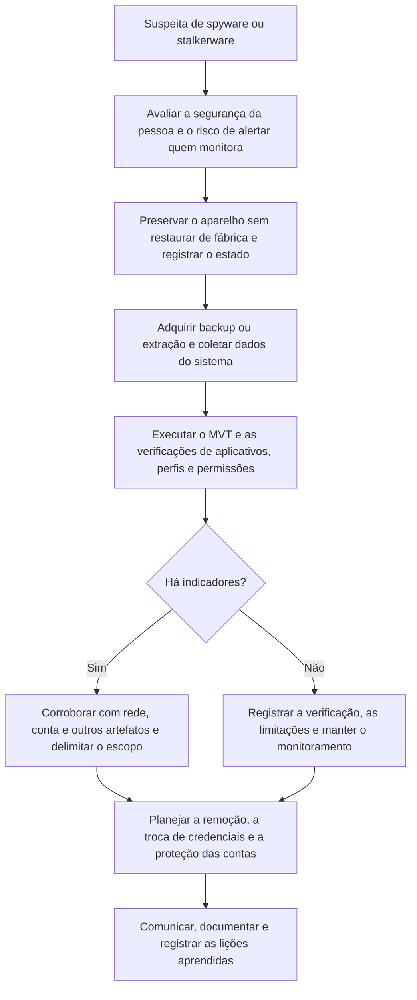

# Spyware, Stalkerware e Comprometimento de Dispositivos Móveis

> **Objetivo pedagógico:** identificar e investigar o comprometimento de dispositivos móveis por stalkerware, spyware comercial, aplicativos maliciosos e abuso de configurações (perfis, certificados e permissões), com ferramentas como o MVT, interpretando indicadores com cautela e protegendo a segurança das pessoas envolvidas.

## 1. Categorias de ameaças

| Categoria | Descrição | Exemplos de comportamento |
|---|---|---|
| Stalkerware | Aplicativos de monitoramento instalados por pessoa próxima da vítima, sem consentimento | Acesso a mensagens, localização, microfone e câmera |
| Spyware comercial avançado | Ferramentas de vigilância vendidas a governos, com exploração de vulnerabilidades, muitas vezes sem interação do usuário | Comprometimento profundo; poucos artefatos |
| Aplicativos maliciosos | Trojans bancários, adware, ladrões de credenciais e fraudes | Sobreposição de telas, abuso de acessibilidade |
| Abuso de perfis e de gerenciamento (MDM) | Perfis de configuração ou certificados maliciosos | Interceptação de tráfego, instalação de aplicativos |
| Phishing e smishing | Mensagens com links ou anexos maliciosos | Credenciais e instalação |
| Troca de SIM (SIM swap) e fraudes com a operadora | Transferência do número para outro SIM | Interceptação de códigos de verificação |
| Dispositivos modificados (root e jailbreak) | Remoção de proteções do sistema | Risco de comprometimento |

Para o ATT&CK Mobile, consulte as técnicas de coleta e de controle como T1417 (Input Capture), T1429 (Audio Capture), T1430 (Location Tracking) e T1636 (Protected User Data).

## 2. Sinais e indicadores

| Sinal | Interpretação |
|---|---|
| Bateria e dados consumidos de forma inexplicável | Possível atividade em segundo plano (inconclusivo isoladamente) |
| Aplicativos desconhecidos ou com nomes genéricos ("Serviço do sistema") | Possível stalkerware ou malware |
| Serviços de acessibilidade ou administrador do dispositivo habilitados para aplicativos desconhecidos | Abuso de privilégios (Android) |
| Instalação de fontes desconhecidas habilitada | Facilita a instalação de aplicativos maliciosos |
| Certificados de CA instalados pelo usuário ou perfis de configuração desconhecidos | Interceptação de tráfego ou gerenciamento indevido |
| VPN ou proxy configurados sem conhecimento do usuário | Redirecionamento de tráfego |
| Ícones ocultos ou aplicativos sem ícone | Ocultação |
| Aquecimento, reinícios inesperados e falhas | Indícios, não prova |
| Alertas de ameaça da Apple ou do Google | Indício relevante; seguir a orientação oficial |
| Comunicação com domínios e IPs associados a infraestrutura conhecida de spyware | Indicadores de rede (DNS e proxy) |
| Jailbreak ou root não autorizado | Remoção das proteções |

Nenhum sinal isolado prova o comprometimento; combine fontes (aparelho, conta, rede e comportamento).

## 3. Mobile Verification Toolkit (MVT)

O MVT (projeto da Amnesty International Security Lab) busca indicadores de comprometimento em backups e extrações, usando listas de IOCs (formato STIX2).

```bash
# Obter as listas de indicadores públicas
mvt-ios download-iocs
mvt-android download-iocs

# iOS: descriptografar o backup (se criptografado) e verificar
mvt-ios decrypt-backup -p 'SENHA_DO_BACKUP' -d /mnt/analise/backup_decifrado /mnt/evidencias/E006/backup
mvt-ios check-backup --output /mnt/saida/mvt_ios /mnt/analise/backup_decifrado

# iOS: verificar uma extração de sistema de arquivos
mvt-ios check-fs --output /mnt/saida/mvt_ios_fs /mnt/analise/ios_fs

# iOS: com arquivos de IOCs adicionais
mvt-ios check-backup --iocs /caminho/iocs.stix2 --output /mnt/saida/mvt_ios /mnt/analise/backup_decifrado

# Android: verificação via ADB, backup do ADB ou coleta com androidqf
mvt-android check-adb --output /mnt/saida/mvt_android
mvt-android check-androidqf --output /mnt/saida/mvt_android_qf /mnt/analise/androidqf_coleta
```

| Resultado do MVT | Interpretação |
|---|---|
| Sem correspondências | Ausência de indicadores **conhecidos**; não prova que o aparelho está limpo |
| Correspondência de IOC | Indício forte a ser corroborado: verifique o contexto, a lista de origem, o horário e outros artefatos |
| Registros de falhas, de uso de dados e de reinícios | Artefatos utilizados em investigações de spyware avançado |

O MVT depende da atualização e da qualidade das listas de IOCs. Registre a versão do MVT e a data e a origem das listas.

## 4. Análise em iOS

| Artefato | Valor |
|---|---|
| Relatórios de falhas e sysdiagnose | Processos que falharam ou foram executados de forma incomum |
| `DataUsage.sqlite` | Uso de rede por processo, útil para identificar processos suspeitos que usaram dados |
| `Shutdown.log` (no sysdiagnose) | Registros de processos ativos no desligamento, usados em investigações de spyware |
| Perfis de configuração e MDM instalados | Gerenciamento indevido |
| Lista de aplicativos e de contas | Aplicativos desconhecidos |
| Registros de pareamento e de dispositivos | Acessos anteriores |
| Alertas de ameaça da Apple | Notificações oficiais enviadas às contas em casos de ataque patrocinado |
| Modo de bloqueio | Medida de proteção em risco elevado |

## 5. Análise em Android

```bash
# Aplicativos de terceiros e permissões
adb shell pm list packages -3
adb shell dumpsys package <pacote> > pacote_info.txt

# Serviços de acessibilidade e administradores do dispositivo
adb shell settings get secure enabled_accessibility_services
adb shell dumpsys device_policy > device_policy.txt

# Operações permitidas a aplicativos (câmera, microfone e localização)
adb shell dumpsys appops > appops.txt

# Certificados instalados pelo usuário e configurações de VPN e proxy
adb shell settings get global http_proxy
```

| Verificação | Interpretação |
|---|---|
| Aplicativo com permissões de SMS, localização, câmera e microfone sem função aparente | Possível stalkerware |
| Aplicativo com acessibilidade e sobreposição de tela | Trojan bancário ou stalkerware |
| Administrador do dispositivo desconhecido | Dificulta a remoção; possível malware |
| Aplicativos instalados fora da loja oficial (origem desconhecida) | Risco elevado |
| Certificado de CA de usuário | Interceptação de tráfego |

## 6. Indicadores de rede

| Fonte | Uso |
|---|---|
| Logs de DNS e de proxy | Resolução e acesso a domínios de infraestrutura de spyware (IOCs publicados) |
| Logs de MDM e de acesso condicional | Dispositivos com configurações suspeitas |
| Fluxos e certificados | Conexões a servidores de comando e controle |
| Logs de e-mail e de nuvem | Acessos de aplicativos não autorizados à conta |

## 7. Fluxo de investigação



## 8. Segurança das pessoas envolvidas

| Cuidado | Orientação |
|---|---|
| Risco para a vítima | Se houver suspeita de stalkerware instalado por pessoa próxima, remover o aplicativo ou restaurar o aparelho pode alertar o autor e aumentar o risco; planeje com a vítima |
| Comunicação segura | Use um dispositivo e contas seguros e não comprometidos para tratar do assunto |
| Preservação antes da remoção | Registre o aplicativo, suas permissões e dados, para eventual denúncia |
| Apoio especializado | Organizações de apoio (por exemplo, a Coalition Against Stalkerware e serviços de apoio a vítimas) e as autoridades competentes |
| Contas | Troque credenciais e revise acessos a partir de um dispositivo seguro |
| Aspectos legais | Instalação não autorizada de aplicativos de monitoramento pode configurar crimes (por exemplo, Código Penal, art. 154-A, e outros); consulte o Jurídico |

## 9. Resposta e remediação

| Ação | Cuidado |
|---|---|
| Preservar | Backup e extração antes de qualquer remoção |
| Remover | Aplicativos, perfis, certificados e permissões, documentando cada item |
| Restaurar e reinstalar | Em casos de comprometimento profundo, restaure de fábrica e reconfigure sem restaurar backup suspeito |
| Trocar credenciais | Senhas, chaves, tokens e métodos de autenticação em dispositivo seguro |
| Atualizar | Sistema e aplicativos para as versões mais recentes |
| Proteger | Ativar o modo de bloqueio (iOS) ou o Play Protect e restringir instalações de fontes desconhecidas |
| Monitorar | Conta, rede e dispositivo após a remediação |
| Notificar | Jurídico, DPO e, se for o caso, ANPD e autoridades |

## 10. Exemplo prático: stalkerware em aparelho de executiva

| Etapa | Resultado |
|---|---|
| Situação | Executiva percebe que informações privadas chegam ao conhecimento de terceiros |
| Preservação | Aparelho Android isolado, sem restauração de fábrica |
| Verificação | `pm list packages -3` mostra "Atualização do Sistema" (pacote desconhecido) com permissões de SMS, localização, microfone e acessibilidade |
| Origem | Instalado de fonte desconhecida, 7 semanas antes, durante empréstimo do aparelho |
| Rede | Conexões periódicas a um domínio de uma plataforma comercial de monitoramento |
| Plano | Preservar o pacote e seus dados, trocar credenciais a partir de um dispositivo seguro, remover o aplicativo e comunicar ao Jurídico |
| Conclusão | Stalkerware instalado por acesso físico, com coleta de mensagens e localização; confiança alta |

## 11. Casos de uso corporativos

- Verificação de dispositivos de executivos e de equipes de alto risco.
- Resposta a alertas de ameaça de fabricantes a contas corporativas.
- Auditoria de perfis, certificados e aplicativos em dispositivos corporativos.

## 12. Normas e frameworks relevantes

- MITRE ATT&CK Mobile; OWASP Mobile Security Testing Guide (MASTG)
- NIST SP 800-124 Rev. 2: Guidelines for Managing the Security of Mobile Devices in the Enterprise
- Coalition Against Stalkerware (orientações para vítimas e profissionais)
- Código Penal, art. 154-A; LGPD, arts. 6º, 46 e 48

## 13. Referências

- Amnesty International Security Lab. Mobile Verification Toolkit (documentação e listas de IOCs).
- Souppaya, M.; Scarfone, K. NIST SP 800-124 Rev. 2. 2023.
- Citizen Lab. Relatórios de pesquisa sobre spyware comercial.
- Coalition Against Stalkerware. Recursos e orientações.
- OWASP. Mobile Application Security Verification Standard (MASVS) e MASTG.
- Apple. Documentação do Modo de Bloqueio e das notificações de ameaças; Google. Play Protect.
