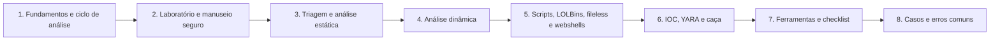

# 15 Forense de Malware

## Objetivo

Analisar código malicioso e seus efeitos em sistemas comprometidos, com foco defensivo e de resposta a incidentes: identificar, classificar e caracterizar amostras (estática, dinâmica e de memória), extrair indicadores, escrever detecções, delimitar o escopo no ambiente e compartilhar inteligência, com laboratório isolado, manuseio seguro de amostras, base legal e limitações declaradas.

## Trilha de estudo recomendada

## Conteúdo da pasta

| Ordem | Arquivo | Objetivo |
|---|---|---|
| 1 | [fundamentos-e-ciclo-de-analise-de-malware.md](fundamentos-e-ciclo-de-analise-de-malware.md) | Taxonomia, níveis de análise, ATT&CK e aspectos legais |
| 2 | [laboratorio-seguro-e-manuseio-de-amostras.md](laboratorio-seguro-e-manuseio-de-amostras.md) | Laboratório isolado, redes simuladas, armazenamento e compartilhamento |
| 3 | [triagem-e-analise-estatica.md](triagem-e-analise-estatica.md) | Hashes, strings, PE, capa, empacotamento, ELF, scripts e documentos |
| 4 | [analise-dinamica-e-comportamental.md](analise-dinamica-e-comportamental.md) | Monitoramento, Sysmon, evasão, memória e sandboxes |
| 5 | [scripts-lolbins-fileless-e-webshells.md](scripts-lolbins-fileless-e-webshells.md) | Scripts, binários legítimos, execução em memória e webshells |
| 6 | [do-artefato-ao-escopo-ioc-yara-e-caca.md](do-artefato-ao-escopo-ioc-yara-e-caca.md) | Indicadores, YARA, caça, escopo e compartilhamento |
| 7 | [ferramentas-fluxo-modelos-e-checklist-de-malware.md](ferramentas-fluxo-modelos-e-checklist-de-malware.md) | Ferramentas, fluxo, modelos e checklist |
| 8 | [casos-de-uso-e-erros-comuns-em-malware.md](casos-de-uso-e-erros-comuns-em-malware.md) | Sete cenários, erros comuns e exercícios |

## Princípios

- Executar amostras somente em laboratório isolado, a partir de instantâneo limpo
- Calcular hash e preservar a amostra, neutralizada, em armazenamento controlado
- Preferir serviços simulados à internet real e evitar alertar o atacante
- Consultar reputação por hash e evitar enviar amostras com dados internos a serviços públicos
- Avançar de nível de análise somente quando as perguntas do caso exigirem
- Considerar a evasão do ambiente e declarar que o comportamento não observado não prova a ausência
- Priorizar detecções de comportamento e validar indicadores antes de bloquear
- Proteger dados de vítimas e compartilhar com minimização e TLP

## Relação com outras pastas

- 04-hash-e-integridade: hashes, ssdeep e similaridade
- 07-windows-forensics e 08-linux-forensics: persistência, artefatos de execução e logs
- 09-memory-forensics: injeção, `malfind` e extração de configuração
- 11-log-analysis: Sigma e detecção, registros de PowerShell e de processos
- 12-email-forensics e 13-network-forensics: entrega por e-mail e comunicação de rede
- 16-ransomware-investigation: classe de malware com investigação própria

## Referências

- Sikorski, M.; Honig, A. Practical Malware Analysis (2012)
- Ligh, M. H. et al. The Art of Memory Forensics (2014)
- Monnappa, K. A. Learning Malware Analysis (2018); Kleymenov, A.; Thabet, A. Mastering Malware Analysis. 2. ed. (2022)
- NIST SP 800-83 Rev. 1 (2013); NIST SP 800-61 Rev. 3 (2025); NIST SP 800-150 (2016)
- MITRE ATT&CK e MAEC; STIX 2.1 e TAXII 2.1; FIRST TLP
- LOLBAS Project; SigmaHQ; VirusTotal (YARA e YARA-X); abuse.ch
- Documentação do FLARE-VM, REMnux, capa, FLOSS, Ghidra, Sysmon, Volatility e CAPEv2
- Bianco, D. The Pyramid of Pain (2013)
- Código Penal, art. 154-A; Lei nº 13.709/2018 (LGPD)
- SANS Institute. FOR610: Reverse-Engineering Malware
