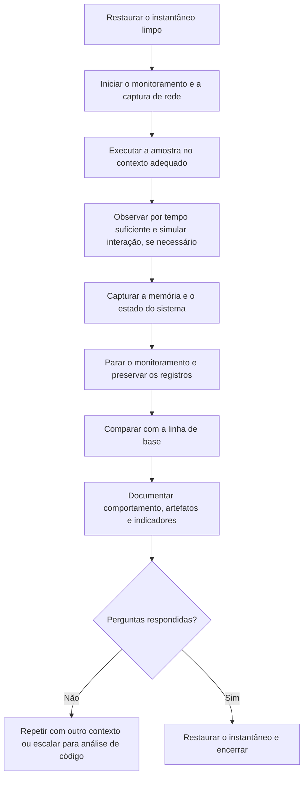

# Análise Dinâmica e Comportamental

> **Objetivo pedagógico:** executar e observar amostras em ambiente controlado, registrando o comportamento em arquivos, registro, processos, memória e rede, interpretar relatórios de sandbox, reconhecer comportamentos de evasão do ambiente de análise e traduzir o comportamento observado em artefatos forenses e técnicas do ATT&CK.

A análise dinâmica é feita somente no laboratório isolado (ver o arquivo de laboratório), a partir de um instantâneo limpo.

## 1. Preparação

| Item | Prática |
|---|---|
| Linha de base | Instantâneo limpo e, se necessário, captura do estado (processos, serviços, tarefas, inicialização e registro) antes da execução |
| Monitoramento | Procmon, Process Explorer, Sysmon, Autoruns, Regshot e captura de rede |
| Rede | Serviços simulados (INetSim ou FakeNet-NG) e captura de pacotes |
| Contexto de execução | Mesmo usuário, privilégios e interação esperados (por exemplo, abrir o documento ou executar como administrador) |
| Relógio | Registrar o horário de início em UTC e a diferença do relógio da VM |
| Registro | Descrever cada passo para que a análise seja reproduzível |

## 2. Ferramentas de monitoramento

| Ferramenta | Informação obtida |
|---|---|
| Process Monitor (Sysinternals) | Operações de arquivo, registro, processos e threads em tempo real |
| Process Explorer e System Informer (antigo Process Hacker) | Árvore de processos, DLLs carregadas, handles, strings em memória e rede por processo |
| Sysmon | Registros detalhados: criação de processos, conexões, carregamento de imagens, injeção, acesso a processos, arquivos, registro, pipes, WMI e DNS |
| Autoruns | Comparação de pontos de persistência |
| Regshot | Diferença do registro e do sistema de arquivos entre dois instantes |
| Wireshark, INetSim e FakeNet-NG | Tráfego e requisições |
| API Monitor e depuradores | Chamadas de API e controle fino (nível 4) |
| ProcDump | Captura de memória de um processo |
| Linux: `strace`, `ltrace`, `auditd` e `sysdig` | Chamadas de sistema, bibliotecas, auditoria e eventos |

### 2.1 Eventos do Sysmon úteis

| ID | Evento | Uso |
|---|---|---|
| 1 | Criação de processo (com linha de comando e hashes) | Árvore de processos e execução |
| 3 | Conexão de rede | Comunicação por processo |
| 7 | Carregamento de imagem (DLL) | Carregamento lateral e injeção |
| 8 | CreateRemoteThread | Injeção de código |
| 10 | Acesso a processo | Roubo de credenciais (acesso ao LSASS) |
| 11 | Criação de arquivo | Arquivos soltos |
| 12, 13 e 14 | Operações de registro | Persistência e configuração |
| 15 | Fluxo de dados alternativo | Dados ocultos |
| 17 e 18 | Pipes nomeados | Comunicação interna e movimentação lateral |
| 19, 20 e 21 | Assinaturas de WMI | Persistência por WMI |
| 22 | Consulta DNS | Domínios resolvidos por processo |
| 23 | Exclusão de arquivo | Remoção de rastros |
| 25 | Adulteração de processo | Esvaziamento de processo e variantes |

## 3. Procedimento de execução



Cada execução deve partir de um instantâneo limpo. Preserve os registros (Procmon, Sysmon, captura de rede e memória) com hash, antes de restaurar a VM.

## 4. O que observar

| Categoria | Perguntas | Exemplos de artefatos |
|---|---|---|
| Processos | Que processos criou? Injetou em outros? Qual a árvore? | Sysmon 1, 8 e 10; Process Explorer |
| Arquivos | Que arquivos criou, modificou, copiou ou excluiu? | Procmon; Sysmon 11 e 23; MFT e USN |
| Registro | Que chaves criou ou alterou? | Run, Services, Winlogon, IFEO e configurações |
| Persistência | Serviço, tarefa agendada, WMI, pasta de inicialização, DLL carregada? | Autoruns; EVTX 7045 e 4698; Sysmon 19 a 21 |
| Rede | Que domínios resolve? Com que IPs e portas se comunica? Qual o protocolo e o agente de usuário? | DNS; INetSim; captura de pacotes |
| Credenciais | Acessa o LSASS, o armazenamento do navegador ou o gerenciador de senhas? | Sysmon 10; arquivos de perfis de navegador |
| Coleta e exfiltração | Que arquivos lê e envia? | Procmon e rede |
| Impacto | Criptografa, exclui cópias de sombra ou apaga arquivos? | Arquivos alterados; comandos `vssadmin` |
| Evasão | Verifica ambiente, tempo e usuário? Encerra-se ao detectar a análise? | Consultas a hardware, registro e processos; atrasos longos |
| Ferramentas do sistema | Usa PowerShell, WMI, `certutil`, `rundll32` e outros binários legítimos? | Linhas de comando (ver o arquivo de LOLBins) |

## 5. Comportamentos de evasão do ambiente de análise

Muitas amostras verificam se estão em um ambiente de análise e alteram o comportamento. Reconhecer esses sinais evita conclusões erradas.

| Comportamento observado | Interpretação |
|---|---|
| A amostra termina logo após consultar informações de hardware, nome de usuário, processos ou chaves de registro de virtualização | Verificação do ambiente |
| Atrasos longos (esperas) antes de qualquer atividade | Tentativa de ultrapassar o tempo de sandbox |
| Exige atividade do usuário (cliques e movimento do mouse) | Verificação de interação |
| Só ativa em determinado idioma, região, domínio ou horário | Direcionamento ao alvo |
| Depende de C2 acessível | Sem o C2, não mostra o comportamento completo |
| Detecta depuradores ou ferramentas de monitoramento | Evasão antianálise (T1497) |

Respostas defensivas legítimas: tornar o laboratório mais realista (hardware, usuário, documentos e tempo de atividade), aumentar a janela de observação, simular a interação, reproduzir o contexto do alvo (idioma e domínio) e, quando os indícios indicarem, recorrer à análise estática e de memória. Registre as limitações: um comportamento não observado não prova que não existe.

## 6. Captura de memória durante a análise

| Técnica | Uso |
|---|---|
| ProcDump (`procdump -ma <PID> saida.dmp`) | Memória do processo malicioso, útil para obter o código desempacotado e a configuração |
| Instantâneo de memória da VM (por exemplo, o arquivo de memória do hipervisor) | Imagem completa para análise com Volatility (ver pasta 09) |
| Volatility | Processos, conexões, regiões injetadas, `malfind`, strings e configuração |

Desempacotar por memória costuma ser mais prático que desempacotar manualmente: execute a amostra, aguarde a descompactação e capture o processo ou a região de memória com o código real.

## 7. Relatórios de sandbox

| Seção do relatório | Como usar |
|---|---|
| Árvore de processos | Verifique a sequência e os argumentos |
| Atividade de arquivo e de registro | Identifique persistência e artefatos |
| Rede (DNS, HTTP e conexões) | Extraia indicadores |
| Capturas de tela e comportamentos assinalados | Contexto, com validação manual |
| Assinaturas e pontuações | São heurísticas; valide as conclusões |
| Dumps e arquivos soltos | Analise separadamente |
| Limitações | Verifique se a amostra executou integralmente |

Nunca baseie a conclusão somente em uma pontuação de sandbox.

## 8. Linux e contêineres

```bash
# Chamadas de sistema (na VM de análise Linux, em cópia da amostra)
strace -f -tt -s 256 -o strace_S001.txt ./amostra.elf

# Arquivos, rede e processos abertos durante a execução (outro terminal)
ss -tunap
lsof -p <PID>
```

Observe: criação de arquivos em `/tmp`, `/dev/shm` e diretórios de inicialização, alterações em `crontab`, `systemd`, `ld.so.preload` e chaves SSH, conexões de saída e consumo de CPU (mineradores).

## 9. Mapeamento comportamento, artefato e ATT&CK

| Comportamento | Artefato típico | ATT&CK |
|---|---|---|
| Criação de serviço | EVTX 7045; chave `Services` | T1543.003 |
| Chave Run | Registro `Run` e `RunOnce` | T1547.001 |
| Tarefa agendada | EVTX 4698; pasta `Tasks` | T1053.005 |
| Injeção em processo | Sysmon 8 e 10; regiões RWX | T1055 |
| Execução por script | Linhas de comando e EVTX 4104 | T1059 |
| Comunicação periódica | DNS e conexões | T1071 |
| Acesso ao LSASS | Sysmon 10 | T1003.001 |
| Exclusão de cópias de sombra | `vssadmin` e `wmic shadowcopy` | T1490 |
| Limpeza de arquivos e de logs | Sysmon 23; EVTX 1102 | T1070 |
| Verificação de ambiente | Consultas de hardware e de registro | T1497 |

## 10. Exemplo prático: comportamento de um loader

| Observação (UTC da VM) | Evidência | Interpretação |
|---|---|---|
| 10:02:01 | Sysmon 1: `updater.exe` iniciado por `explorer.exe` | Execução pelo usuário |
| 10:02:03 | Sysmon 22: consulta DNS a `cdn-updates[.]exemplo` (resolvido pelo INetSim) | Comunicação com C2 |
| 10:02:04 | Sysmon 11: cria `C:\ProgramData\svc\svchost.dat` | Arquivo de carga |
| 10:02:05 | Sysmon 1: `updater.exe` inicia `notepad.exe` suspenso | Possível esvaziamento de processo |
| 10:02:05 | Sysmon 8 e 10: `updater.exe` acessa e cria thread em `notepad.exe` | Injeção (T1055) |
| 10:02:09 | Sysmon 13: chave `Run` com `C:\ProgramData\svc\svc.exe` | Persistência (T1547.001) |
| 10:02:30 em diante | Requisições HTTP a cada 60 s com agente de usuário `Updater/1.0` | Beaconing (T1071) |
| Memória | `malfind` no `notepad.exe` mostra região executável com cabeçalho PE | Carga desempacotada para análise |
| Conclusão | Loader que injeta a carga em processo legítimo, persiste por chave Run e se comunica periodicamente; confiança alta; indicadores extraídos |

## 11. Casos de uso corporativos

- Confirmar o comportamento e a persistência de uma amostra encontrada em um incidente.
- Obter indicadores de rede e de host para bloqueio e caça.
- Validar detecções com amostras do ambiente.

## 12. Normas e frameworks relevantes

- MITRE ATT&CK: T1055, T1059, T1071, T1497, T1547.001, T1053.005, T1543.003, T1003.001, T1070, T1490
- NIST SP 800-83 Rev. 1; ISO/IEC 27042:2015
- CIS Controls v8.1, controles 8 e 10

## 13. Referências

- Sikorski, M.; Honig, A. Practical Malware Analysis. 2012.
- Ligh, M. H. et al. The Art of Memory Forensics. 2014.
- Russinovich, M. et al. Windows Sysinternals (documentação do Procmon, do Sysmon e do ProcDump).
- Documentação do FakeNet-NG, do INetSim, do CAPEv2 e do Volatility.
- Monnappa, K. A. Learning Malware Analysis. 2018.
- SANS Institute. FOR610: Reverse-Engineering Malware.
