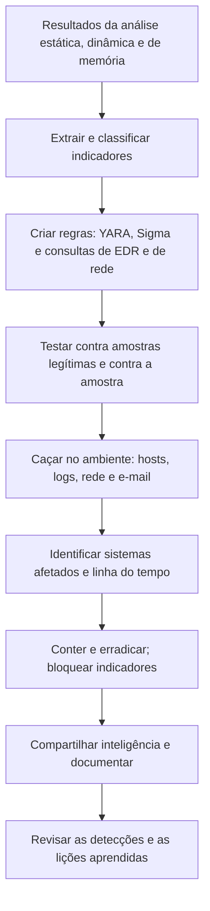

# Do Artefato ao Escopo: IOC, YARA e Caça

> **Objetivo pedagógico:** converter os resultados da análise de uma amostra em indicadores de comprometimento (IOCs), regras de detecção (YARA e Sigma) e consultas de caça, para delimitar o escopo do incidente no ambiente, orientar a contenção e compartilhar inteligência de forma responsável.

## 1. Da amostra ao ambiente



## 2. Tipos de indicadores

| Tipo | Exemplos | Durabilidade | Observações |
|---|---|---|---|
| Hashes de arquivos | SHA-256, MD5 | Baixa (variam com recompilação) | Precisos, ótimos para busca exata |
| Endereços IP | IPs de C2 | Baixa a média | Compartilhados e reciclados; cuidado com falsos positivos |
| Domínios e URLs | Domínios de C2 e de distribuição | Média | Verificar registro e reputação |
| Artefatos de host | Nomes de arquivos, caminhos, chaves de registro, mutexes, serviços e tarefas | Média | Úteis para caça em endpoints |
| Artefatos de rede | Agentes de usuário, padrões de URI, certificados, JA3 e JA4 | Média | Úteis em proxy e em captura |
| Comportamentos e técnicas (TTPs) | Cadeias de processos e padrões ATT&CK | Alta | Mais difíceis de alterar; detecções robustas |
| Ferramentas | Famílias e frameworks | Alta | Requerem análise de código e inteligência |

A Pirâmide da Dor (Bianco) relaciona o tipo de indicador ao esforço do adversário para mudá-lo: hashes são triviais de alterar; comportamentos e ferramentas são custosos. Priorize detecções de comportamento, mas use os indicadores simples para resposta imediata.

## 3. Extração e registro de indicadores

| Fonte | Indicadores obtidos |
|---|---|
| Análise estática | Hashes, strings, caminhos, domínios, chaves, certificados e importações |
| Análise dinâmica | Processos, arquivos, registro, persistência, DNS e conexões |
| Memória | Configuração descriptografada do malware, URLs e chaves |
| Logs do ambiente | Contas, horários e hosts |
| E-mail e proxy | Remetentes, URLs e anexos |

Registre cada indicador com: valor (neutralizado), tipo, fonte (qual análise), data e hora (UTC), confiança, contexto e ação (bloquear, caçar ou apenas monitorar). Valide indicadores antes de bloquear em larga escala (por exemplo, um IP compartilhado de CDN pode causar impacto).

## 4. Regras YARA: autoria e boas práticas

### 4.1 Estrutura

```
rule Familia_Exemplo_Loader
{
    meta:
        description = "Detecta loader de exemplo com base em strings e estrutura"
        author = "Digital Forensics Lab"
        date = "2026-11-05"
        reference = "DFL-2026-001"
        hash = "<sha256 da amostra de referência>"
    strings:
        $a1 = "Updater/1.0" ascii
        $a2 = "\\ProgramData\\svc\\" ascii wide
        $b1 = { 48 8B ?? ?? 48 83 EC ?? E8 }   // padrão de bytes (exemplo ilustrativo)
    condition:
        uint16(0) == 0x5A4D and filesize < 3MB and (2 of ($a*)) and $b1
}
```

### 4.2 Boas práticas

| Prática | Motivo |
|---|---|
| Combinar vários elementos independentes (strings, estrutura e tamanho) | Reduz falsos positivos |
| Preferir strings específicas e características do código a strings genéricas | Evita detectar software legítimo |
| Limitar por tipo de arquivo (`uint16(0) == 0x5A4D`) e por tamanho | Desempenho e precisão |
| Evitar condições custosas (expressões regulares abertas em arquivos grandes) | Desempenho |
| Documentar no `meta` a origem, a data e a referência | Rastreabilidade |
| Testar contra um conjunto de arquivos legítimos (goodware) e contra variantes | Medir falsos positivos e a cobertura |
| Versionar e revisar por pares | Qualidade |
| Escrever regras para o comportamento do código, e não apenas para a amostra exata | Cobertura de variantes |

```bash
# Testar a regra contra a amostra e contra um diretório de arquivos legítimos
yara -s regra.yar amostra.bin
yara -r regra.yar /mnt/baseline_goodware/ | head

# Varredura de uma imagem montada ou de uma coleta
yara -r -s regra.yar /mnt/imagem_montada/ > resultados_yara.txt
```

O YARA-X (reimplementação em Rust do YARA) é uma evolução do projeto; verifique a compatibilidade das regras com a sua versão.

## 5. Detecções de comportamento: Sigma e consultas de EDR

| Fonte | Exemplo de detecção |
|---|---|
| Sigma (logs do Windows) | Processo filho incomum de aplicativos do Office; criação de tarefa agendada por processo incomum |
| EDR | Consulta por hash, caminho, linha de comando ou cadeia de processos em todos os endpoints |
| Proxy e DNS | Acessos aos domínios e URLs do C2; agentes de usuário específicos |
| E-mail | Mensagens com o mesmo remetente, assunto ou anexo (ver pasta 12) |
| Rede | JA3 e JA4, certificados e padrões de beaconing (ver pasta 13) |

Veja a pasta 11 para a autoria de regras Sigma e o ciclo de engenharia de detecção.

## 6. Caça (hunting) no ambiente

| Alvo | Consulta |
|---|---|
| Endpoints | Hashes, nomes e caminhos de arquivos, chaves de registro, serviços, tarefas, mutexes e comandos |
| Memória | Regras YARA aplicadas a memória (por exemplo, o `yarascan` do Volatility em imagens) |
| Servidores | Varredura de arquivos com YARA em volumes e em coletas; ferramentas de varredura de indicadores (como o Loki, de código aberto) |
| Logs e SIEM | Domínios, IPs, agentes de usuário e comandos nos períodos relevantes |
| E-mail | Pesquisa de mensagens por remetente, URL e anexo; remoção (purge) quando confirmado |
| Rede | Conexões históricas aos destinos identificados (NetFlow e DNS) |
| Nuvem | Atividade nas contas e nos recursos com os mesmos indicadores |

Delimite o escopo pela **primeira e pela última ocorrência** de cada indicador, e pela lista de hosts e contas afetados. Hosts com apenas um indicador fraco devem ser verificados antes de serem declarados comprometidos.

## 7. Enriquecimento e inteligência de ameaças

| Fonte | Uso |
|---|---|
| Serviços de reputação (por hash, domínio e IP) | Contexto e família; consulte sem enviar a amostra |
| Bases abertas (por exemplo, MalwareBazaar, URLhaus e ThreatFox, da abuse.ch) | Amostras, URLs e indicadores de campanhas |
| MITRE ATT&CK e MAEC | Classificação de técnicas e de comportamentos |
| Relatórios públicos e de parceiros | Contexto de campanhas e de adversários |
| Passive DNS e certificados | Infraestrutura relacionada (ver pasta 12) |

Evite pesquisar dados internos em serviços públicos; use apenas indicadores técnicos. Trate a atribuição como hipótese com grau de confiança explícito.

## 8. Compartilhamento

| Formato e protocolo | Uso |
|---|---|
| STIX 2.1 e TAXII 2.1 | Intercâmbio estruturado de inteligência de ameaças |
| MISP | Plataforma de compartilhamento de indicadores e de eventos |
| OpenIOC | Formato de indicadores |
| Regras YARA e Sigma | Compartilhamento de detecções |
| TLP | Classificação de sensibilidade (CLEAR, GREEN, AMBER, AMBER+STRICT e RED) |

Compartilhe somente o necessário, sem dados pessoais de vítimas e sem informações que identifiquem a organização, salvo se houver base e acordo. Consulte o Jurídico e o DPO.

## 9. Contenção e erradicação orientadas pelos indicadores

| Ação | Cuidado |
|---|---|
| Bloquear domínios, IPs e hashes | Em proxy, firewall, DNS, e-mail e EDR; registrar a data e o motivo |
| Isolar hosts afetados | Preservar antes de reconstruir (memória e imagem) |
| Remover persistência | Documentar cada item removido (chaves, tarefas, serviços e assinaturas de WMI) |
| Redefinir credenciais | Contas expostas e contas de serviço |
| Reconstruir sistemas comprometidos | Preferível a "limpar" quando há suspeita de comprometimento profundo |
| Monitorar | Regras e consultas de caça mantidas por período adequado para detectar a reincidência |

## 10. Exemplo prático: do loader ao escopo

| Etapa | Resultado |
|---|---|
| Amostra | `updater.exe` em SRV-FIN-02 (ver arquivos anteriores) |
| Indicadores | Hash, domínio `cdn-updates[.]exemplo`, agente de usuário `Updater/1.0`, caminho `C:\ProgramData\svc\` e chave `Run` |
| Regras | YARA por strings e estrutura; consulta de EDR por caminho e chave; regra de proxy por agente de usuário |
| Caça | O EDR encontra o caminho em 3 servidores e 14 estações; o proxy mostra o agente de usuário em 17 hosts (14 estações, 3 servidores) |
| Linha do tempo | Primeira ocorrência há 19 dias, em uma estação da área financeira, a partir de e-mail com anexo (ver pasta 12) |
| Escopo | 17 hosts afetados, 2 contas de serviço expostas; 2 hosts adicionais com indício fraco, verificados e descartados |
| Ações | Isolamento e coleta de memória nos 17 hosts, bloqueios, redefinição de credenciais, reconstrução de servidores |
| Compartilhamento | Indicadores enviados ao CSIRT do setor sob TLP:AMBER, sem dados da organização |

## 11. Casos de uso corporativos

- Delimitar o escopo de um incidente a partir de uma única amostra.
- Criar uma biblioteca interna de regras YARA e Sigma, com testes e versionamento.
- Compartilhar inteligência com parceiros e com o CSIRT setorial.

## 12. Normas e frameworks relevantes

- MITRE ATT&CK; MITRE MAEC; STIX 2.1 e TAXII 2.1 (OASIS); OpenIOC; FIRST TLP
- NIST SP 800-150: Guide to Cyber Threat Information Sharing; NIST SP 800-61 Rev. 3
- CIS Controls v8.1, controles 10 e 17
- LGPD, arts. 6º, 46 e 48

## 13. Referências

- Bianco, D. The Pyramid of Pain. 2013.
- VirusTotal. Documentação do YARA e do YARA-X.
- SigmaHQ. Sigma: Specification and Rules.
- abuse.ch. MalwareBazaar, URLhaus e ThreatFox.
- Johnson, C. et al. NIST SP 800-150. 2016.
- OASIS. STIX 2.1 e TAXII 2.1. MISP Project (documentação).
- Ligh, M. H. et al. The Art of Memory Forensics. 2014.
