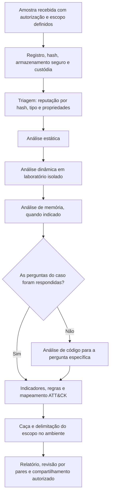

# Ferramentas, Fluxo, Modelos e Checklist de Malware

> **Objetivo pedagógico:** padronizar as ferramentas, o fluxo de trabalho, os registros e a verificação de qualidade das análises de malware, de modo que sejam reproduzíveis, seguras, rastreáveis e úteis para a resposta ao incidente.

## 1. Ferramentas por finalidade

| Finalidade | Ferramentas |
|---|---|
| Distribuições e ambientes | FLARE-VM (Windows) e REMnux (Linux) |
| Identificação e hashes | `sha256sum`, ssdeep, TLSH, Detect It Easy, ExifTool |
| Strings e capacidades | `strings`, FLOSS, capa |
| Estrutura de executáveis | PE-bear, PEStudio, CFF Explorer, `pefile`, `readelf` e `objdump` |
| Documentos e scripts | oletools (`oleid`, `olevba` e `mraptor`), pdfid, pdf-parser, CyberChef |
| Desmontagem e depuração | Ghidra, IDA, Binary Ninja, radare2, Cutter, x64dbg e WinDbg |
| .NET, Java e Python | ILSpy, dnSpyEx, descompiladores e extratores |
| Monitoramento dinâmico | Process Monitor, Process Explorer, System Informer, Sysmon, Autoruns e Regshot |
| Rede | Wireshark, tcpdump, INetSim e FakeNet-NG |
| Sandboxes | CAPEv2 e serviços comerciais ou públicos (com a política de privacidade avaliada) |
| Memória | Volatility 3, ProcDump (ver pasta 09) |
| Detecção | YARA, YARA-X, Sigma, regras de EDR e Suricata |
| Inteligência | MISP, STIX e bases abertas |
| Documentação | Modelos deste arquivo, repositório versionado de relatórios |

Registre o nome, a versão e a origem das ferramentas; valide as ferramentas e as regras e mantenha-as atualizadas no laboratório.

## 2. Fluxo de trabalho padronizado

## 3. Dez perguntas e como respondê-las

| Pergunta | Onde responder |
|---|---|
| 1. A amostra está preservada e identificada? | Hashes, armazenamento e custódia |
| 2. É conhecida e o que se sabe dela? | Consulta por hash, capa e inteligência |
| 3. Está empacotada ou ofuscada? | Entropia, importações, DIE e strings |
| 4. Que capacidades tem? | capa, importações, strings e análise dinâmica |
| 5. O que faz ao ser executada? | Sysmon, Procmon, Regshot e rede |
| 6. Como persiste? | Registro, serviços, tarefas e WMI |
| 7. Com quem se comunica e como? | DNS, captura, configuração extraída da memória |
| 8. Que dados acessou ou enviou? | Procmon, logs, memória e rede |
| 9. Que hosts e contas foram afetados? | Indicadores, YARA e caça |
| 10. Que limitações e grau de confiança existem? | Evasão, execução parcial e ambiente de análise |

## 4. Modelo A: Ficha da Amostra

| Campo | Preenchimento |
|---|---|
| Identificador | DFL-AAAA-NNN-SNNN |
| Caso | |
| Origem (host, caminho, e-mail ou URL) e coletor | |
| Data e hora de coleta (UTC) | |
| Nome original e tamanho | |
| SHA-256, MD5, SHA-1 | |
| ssdeep, TLSH e imphash | |
| Tipo de arquivo (verificado) | |
| Armazenamento (local e método de neutralização) | |
| Consulta de reputação (por hash) e resultado | |
| Envio a serviços externos (sim ou não; justificativa e autorização) | |
| Custódia | |

## 5. Modelo B: Registro de Análise Estática

| Item | Resultado |
|---|---|
| Ferramentas e versões | |
| Empacotador, compilador e linguagem | |
| Seções, entropia e overlay | |
| Importações e exportações relevantes | |
| Recursos incorporados | |
| Assinatura digital | |
| Strings relevantes (neutralizadas) | |
| Capacidades (capa) | |
| Hipóteses e confiança | |
| Próximos passos | |

## 6. Modelo C: Registro de Análise Dinâmica

| Item | Resultado |
|---|---|
| Ambiente (VM, sistema, instantâneo, rede e relógio) | |
| Contexto de execução (usuário, privilégios e interação) | |
| Início e fim (UTC) | |
| Processos criados e árvore | |
| Arquivos criados, modificados e excluídos | |
| Registro e persistência | |
| Rede (DNS, URLs, IPs, protocolos e agentes de usuário) | |
| Comportamentos de evasão observados | |
| Capturas (logs, rede e memória) com hashes | |
| Técnicas ATT&CK e evidências | |
| Limitações | |

## 7. Modelo D: Registro de IOCs de Malware

| ID | Tipo | Valor (neutralizado) | Fonte (análise) | Primeira observação (UTC) | Confiança | Ação (bloquear, caçar ou monitorar) | TLP |
|---|---|---|---|---|---|---|---|
| IOC-M01 | Hash | | | | | | |
| IOC-M02 | Domínio | | | | | | |
| IOC-M03 | Caminho ou chave | | | | | | |

## 8. Modelo E: Estrutura do Relatório de Análise de Malware

| Seção | Conteúdo |
|---|---|
| 1. Resumo executivo | Do que se trata, impacto e recomendações, em linguagem acessível |
| 2. Identificação | Ficha da amostra e classificação |
| 3. Método e ambiente | Ferramentas, versões, laboratório e limitações |
| 4. Análise estática | Propriedades, capacidades e ofuscação |
| 5. Análise dinâmica | Comportamento, persistência e rede |
| 6. Análise de memória | Achados e configuração extraída (se houver) |
| 7. Mapeamento ATT&CK | Técnicas e evidências |
| 8. Indicadores e detecções | IOCs, regras YARA e Sigma, consultas |
| 9. Escopo no ambiente | Hosts, contas e linha do tempo |
| 10. Recomendações | Contenção, erradicação, detecção e prevenção |
| 11. Limitações e confiança | O que não foi possível determinar |
| 12. Anexos | Hashes, registros, capturas e custódia |

## 9. Checklist operacional de malware

**Caso:** DFL-AAAA-NNN
**Amostra:** DFL-AAAA-NNN-SNNN
**Analista:** ____________________
**Data e hora (UTC):** ____________________

### 9.1 Recebimento e segurança

- [ ] Autorização, finalidade e escopo definidos
- [ ] Origem registrada; hashes calculados na origem e no laboratório
- [ ] Amostra neutralizada e armazenada em volume criptografado e com acesso restrito
- [ ] Custódia registrada
- [ ] Laboratório verificado: isolamento, instantâneo limpo e integrações desativadas
- [ ] Decisão sobre o envio a serviços externos documentada (consulta por hash)

### 9.2 Análise

- [ ] Triagem e análise estática registradas (empacotamento, strings e capacidades)
- [ ] Análise dinâmica realizada a partir de instantâneo limpo, com contexto documentado
- [ ] Capturas (Sysmon, Procmon, rede e memória) preservadas com hash
- [ ] Comportamentos de evasão considerados e registrados
- [ ] Análise de memória realizada, quando indicada
- [ ] Análise de código aplicada apenas a perguntas específicas
- [ ] Técnicas mapeadas ao ATT&CK, com evidências

### 9.3 Indicadores e escopo

- [ ] IOCs extraídos, validados e classificados
- [ ] Regras YARA e de comportamento escritas e testadas contra arquivos legítimos
- [ ] Caça realizada em endpoints, rede, e-mail, nuvem e logs
- [ ] Hosts e contas afetados identificados, com linha do tempo
- [ ] Persistência e artefatos de remoção documentados

### 9.4 Relato e compartilhamento

- [ ] Resultados com o grau de confiança e as limitações declaradas
- [ ] Horários normalizados para UTC
- [ ] Indicadores neutralizados em relatórios
- [ ] Compartilhamento autorizado, minimizado e com TLP
- [ ] Dados pessoais de vítimas protegidos
- [ ] Revisão por pares realizada
- [ ] Laboratório restaurado e registros arquivados

## 10. Resultado da verificação

| Resultado | Condição |
|---|---|
| Conforme | Todos os itens aplicáveis marcados |
| Conforme com ressalvas | Pendências sem impacto nas conclusões, com plano de ação |
| Não conforme | Amostra executada fora do laboratório isolado, envio não autorizado a serviço público, conclusões sem evidência ou indicadores bloqueados sem validação; comunicar o líder |

**Assinatura do analista:** ____________________
**Assinatura do revisor:** ____________________

## 11. Casos de uso corporativos

- Padronização das análises de malware do time de resposta a incidentes.
- Treinamento de analistas com laboratório, amostras de exercício e modelos.
- Auditoria da segurança do laboratório e da qualidade dos relatórios.

## 12. Normas e frameworks relevantes

- NIST SP 800-83 Rev. 1; NIST SP 800-61 Rev. 3; NIST SP 800-150
- ISO/IEC 27037:2012; ISO/IEC 27041:2015; ISO/IEC 27042:2015
- MITRE ATT&CK e MAEC; FIRST TLP; STIX 2.1
- CIS Controls v8.1, controles 10 e 17

## 13. Referências

- Sikorski, M.; Honig, A. Practical Malware Analysis. 2012.
- Kleymenov, A.; Thabet, A. Mastering Malware Analysis. 2. ed. 2022.
- Ligh, M. H. et al. The Art of Memory Forensics. 2014.
- Documentação do FLARE-VM, do REMnux, do capa, do FLOSS, do YARA, do Ghidra, do Sysmon e do Volatility.
- SANS Institute. FOR610: Reverse-Engineering Malware.
