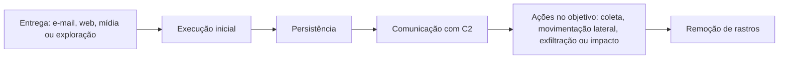

# Fundamentos e Ciclo de Análise de Malware

> **Objetivo pedagógico:** compreender a taxonomia de malware, a diferença entre a análise forense de malware (entender o que o código fez no ambiente e delimitar o incidente) e a engenharia reversa completa, os níveis de análise e os limites éticos e legais do manuseio de amostras, para escolher a profundidade adequada a cada caso.

> **Escopo defensivo:** este material trata de análise para resposta a incidentes, detecção e investigação. Não ensina a criar, aprimorar ou distribuir código malicioso.

## 1. Taxonomia de malware

| Classe | Descrição | Exemplos de comportamento |
|---|---|---|
| Vírus e worms | Replicam-se; worms espalham-se pela rede sem ação do usuário | Propagação por SMB, e-mail e mídias removíveis |
| Trojans | Disfarçam-se de software legítimo | Instaladores falsos e documentos "faturas" |
| Backdoors e RATs | Acesso remoto persistente ao sistema | Execução de comandos, captura de tela, transferência de arquivos |
| Downloaders, droppers e loaders | Entregam e executam outras cargas | Primeiro estágio de campanhas |
| Infostealers | Coletam credenciais, cookies, carteiras e arquivos | Leitura de navegadores e do gerenciador de senhas |
| Trojans bancários | Fraudes financeiras | Sobreposição de telas e injeção em navegadores |
| Ransomware | Criptografa ou rouba dados para extorsão | Criptografia em massa e exclusão de cópias de sombra (ver pasta 16) |
| Wipers | Destroem dados | Sobrescrita de discos e de MBR |
| Rootkits e bootkits | Ocultam presença no sistema ou no processo de inicialização | Ocultação de processos, arquivos e conexões |
| Webshells | Acesso remoto a servidores web por scripts | Execução de comandos por HTTP |
| Cryptominers | Uso de recursos para mineração | Alto consumo de CPU; persistência em servidores e contêineres |
| Botnets | Dispositivos controlados remotamente | DDoS, spam e proxy |
| Malware sem arquivo (fileless) | Executa em memória ou usa ferramentas do sistema | PowerShell, WMI e carregamento reflexivo |
| Ataques à cadeia de suprimentos | Componentes legítimos adulterados | Pacotes e atualizações trojanizados |
| Adware e programas potencialmente indesejados | Comportamento intrusivo, com menor gravidade | Injeção de anúncios e extensões abusivas |
| Stalkerware e spyware | Vigilância de pessoas | Ver pasta 14 |

Uma amostra frequentemente combina classes (por exemplo, um loader que instala um infostealer e um RAT). Classifique pelo comportamento observado, e não apenas pelo nome atribuído por antivírus.

## 2. Ciclo de vida e relação com o incidente

A análise forense do malware responde às perguntas do incidente em cada etapa: como chegou, o que executou, como persiste, com quem se comunica, o que acessou e o que deixou para trás.

## 3. Análise forense de malware versus engenharia reversa

| Aspecto | Análise forense de malware | Engenharia reversa completa |
|---|---|---|
| Objetivo | Responder às perguntas do caso: escopo, impacto, indicadores e contenção | Entender integralmente o funcionamento do código |
| Profundidade típica | Triagem, análise estática básica, comportamental e de memória | Análise de código com desmontador e depurador |
| Prazo | Horas a poucos dias, orientado pela resposta ao incidente | Dias a semanas |
| Produto | Indicadores, comportamento, linha do tempo e recomendações | Documentação detalhada de capacidades e protocolo |
| Quando aprofundar | Quando indicadores e comportamento não bastam (criptografia, protocolo próprio, família desconhecida) | Pesquisa de ameaças e desenvolvimento de detecções avançadas |

## 4. Níveis de análise

| Nível | Descrição | Resultado |
|---|---|---|
| 1. Análise totalmente automatizada | Envio a sandbox e a ferramentas automáticas | Relatório inicial rápido; pode falhar diante de evasão |
| 2. Propriedades estáticas | Hashes, tipo, strings, estrutura, importações e capacidades | Classificação e indicadores sem execução |
| 3. Comportamento interativo | Execução em laboratório com monitoramento de sistema e rede | Comportamento real, persistência e comunicação |
| 4. Engenharia reversa do código | Desmontagem e depuração | Detalhes de lógica, criptografia e protocolo |

Avance de nível somente quando o anterior não responder às perguntas do caso. Registre o motivo da escalada.

## 5. Perguntas que a análise deve responder

| Pergunta | Fonte principal |
|---|---|
| O que é a amostra e é conhecida? | Hashes, assinaturas, inteligência e capacidades |
| Como foi entregue e executada? | Artefatos do sistema, e-mail e logs |
| O que faz no sistema? | Análise dinâmica e de memória |
| Como persiste? | Registro, serviços, tarefas e inicialização |
| Com quem se comunica e como? | Rede e configuração extraída |
| Que dados acessou, coletou ou enviou? | Logs, memória e comportamento |
| Que outros sistemas foram afetados? | Indicadores, YARA e caça |
| Como detectar e conter? | Indicadores, regras e recomendações |
| Qual a confiança e quais as limitações? | Evidências, lacunas e variações de ambiente |

## 6. Mapeamento ao MITRE ATT&CK

Cada comportamento observado deve ser associado a uma técnica do ATT&CK, com a evidência que o sustenta. Exemplos: T1204 (Execução pelo usuário), T1059 (Interpretadores de comando e scripts), T1547.001 (Chaves de inicialização do registro), T1053.005 (Tarefa agendada), T1055 (Injeção de processos), T1027 (Ofuscação), T1071 (Protocolos de aplicação para C2), T1041 (Exfiltração por C2) e T1486 (Dados criptografados para impacto). O MAEC (Malware Attribute Enumeration and Characterization) oferece um vocabulário para descrever comportamentos e famílias.

## 7. Aspectos legais, éticos e de privacidade

> **Aviso:** este material é técnico-educacional e não substitui parecer jurídico. Valide cada caso com o Jurídico e com o DPO.

| Tema | Orientação |
|---|---|
| Finalidade legítima | A posse e a análise de amostras para resposta a incidentes e defesa são atividades legítimas, quando autorizadas e documentadas |
| Não distribuir | Não difundir códigos maliciosos fora de canais de pesquisa e de resposta; o Código Penal (art. 154-A, §1º) trata da produção e da difusão de programas destinados a invadir dispositivos |
| Compartilhamento responsável | Compartilhar indicadores e amostras com classificação (TLP) e com parceiros confiáveis |
| Dados da vítima | Amostras e relatórios de sandbox podem conter dados pessoais (documentos, credenciais e imagens de tela): trate como confidenciais |
| Plataformas públicas | Enviar amostras a serviços públicos pode expor a amostra e dados internos a terceiros, inclusive ao atacante; prefira consultar por hash e usar sandbox privada |
| Interação com a infraestrutura do atacante | Evite contato direto: pode alertar o atacante e criar riscos legais |
| Convenção de Budapeste | Prevê a criminalização do uso indevido de dispositivos e reconhece usos autorizados para proteção |
| Registro | Autorização, finalidade, local, ferramentas e responsáveis |

## 8. Exemplo prático: escolha do nível de análise

| Situação | Decisão |
|---|---|
| Executável conhecido, com hash detectado por vários mecanismos e comportamento descrito em relatórios | Nível 1 e 2 bastam: confirmar, extrair indicadores e buscar no ambiente |
| Documento com macro que baixa um segundo estágio | Nível 2 e 3: extrair o script, observar o comportamento e coletar a URL e o segundo estágio |
| Binário desconhecido, empacotado, com comunicação criptografada, em servidor crítico | Nível 3 e, se necessário, nível 4 para a configuração e o protocolo; análise de memória do host |
| Sistema com suspeita de rootkit | Análise de memória e comparação de visões (ver pasta 09) |

## 9. Casos de uso corporativos

- Resposta a incidentes: determinar capacidades, persistência e indicadores de uma amostra encontrada.
- Elaboração de detecções (YARA, Sigma e regras de rede) a partir de amostras do próprio ambiente.
- Produção de inteligência de ameaças interna a partir de incidentes.

## 10. Normas e frameworks relevantes

- NIST SP 800-83 Rev. 1: Guide to Malware Incident Prevention and Handling for Desktops and Laptops; NIST SP 800-61 Rev. 3
- ISO/IEC 27037:2012; ISO/IEC 27042:2015
- MITRE ATT&CK; MITRE MAEC
- CIS Controls v8.1, controles 10 (defesas contra malware) e 17 (resposta a incidentes)
- Código Penal, art. 154-A; LGPD, arts. 6º, 46 e 48

## 11. Referências

- Sikorski, M.; Honig, A. Practical Malware Analysis. No Starch Press, 2012.
- Ligh, M. H.; Case, A.; Levy, J.; Walters, A. The Art of Memory Forensics. Wiley, 2014.
- Monnappa, K. A. Learning Malware Analysis. Packt, 2018.
- Kleymenov, A.; Thabet, A. Mastering Malware Analysis. 2. ed. Packt, 2022.
- Zeltser, L. Reverse-Engineering Malware (material do curso SANS FOR610) e REMnux.
- Souppaya, M.; Scarfone, K. NIST SP 800-83 Rev. 1. 2013.
- MITRE. ATT&CK e MAEC.
