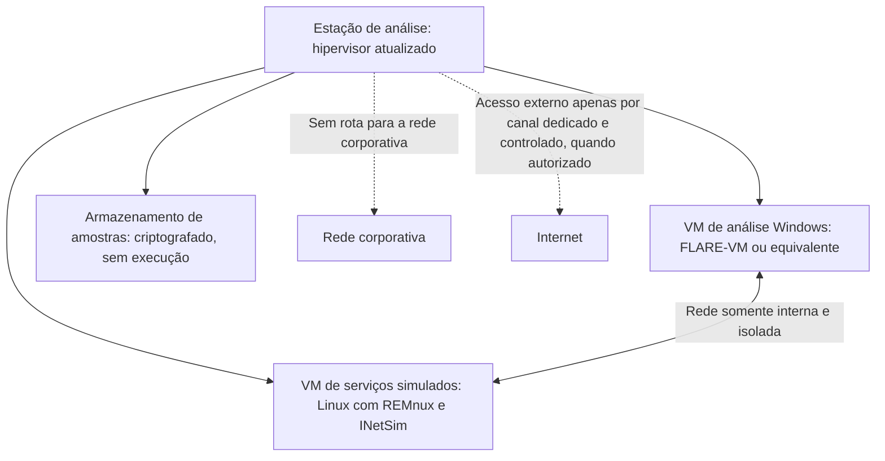

# Laboratório Seguro e Manuseio de Amostras

> **Objetivo pedagógico:** projetar um laboratório de análise de malware isolado, com redes simuladas e instantâneos, e adotar procedimentos seguros de recebimento, armazenamento, identificação, análise e compartilhamento de amostras, reduzindo o risco de infecção do ambiente real, de vazamento de dados e de alerta ao atacante.

## 1. Princípios de segurança do laboratório

| Princípio | Aplicação |
|---|---|
| Isolamento | O laboratório não pode alcançar a rede corporativa nem a internet de forma descontrolada |
| Reversibilidade | Máquinas virtuais com instantâneos (snapshots) para retornar a um estado limpo |
| Mínimo de integração | Desativar pastas compartilhadas, área de transferência, arrastar e soltar e dispositivos USB compartilhados com o hospedeiro |
| Atualização do hospedeiro | Hipervisor e sistema do hospedeiro atualizados (existem vulnerabilidades de escape de VM) |
| Estação dedicada | Análise em estação separada do uso cotidiano, de preferência fisicamente |
| Controle de acesso | Somente analistas autorizados; registro de uso |
| Documentação | Configuração, versões e alterações do laboratório registradas |
| Sem credenciais reais | Nenhuma conta, token ou dado real nas VMs de análise |

## 2. Arquitetura de referência



| Componente | Função |
|---|---|
| VM de análise Windows | Executa a amostra; contém ferramentas de monitoramento e de análise (por exemplo, FLARE-VM) |
| VM de serviços simulados | Responde a DNS, HTTP, SMTP e outros serviços falsos (INetSim e FakeNet-NG), registrando as requisições da amostra |
| Rede interna isolada | Conecta as VMs apenas entre si (tipo "rede interna" ou "host-only" sem NAT) |
| Armazenamento de amostras | Pasta ou volume criptografado, sem execução, com controle de acesso |
| Canal de internet controlado (opcional) | Conexão separada, sem relação com a organização, usada apenas quando necessária e autorizada |

## 3. Conectividade com a internet

| Opção | Vantagens | Riscos |
|---|---|---|
| Sem internet, com serviços simulados | Segura; reproduzível | Amostras que dependem de C2 real podem não revelar todo o comportamento |
| Internet por canal separado e controlado | Permite observar a comunicação real | Alerta o atacante, pode gerar impacto a terceiros, atrai bloqueios do IP e cria riscos legais |
| Internet por rede de anonimato | Oculta a origem | Pode ser bloqueada ou observada; avaliar política |

Decisão: por padrão, use serviços simulados. Permita acesso real à internet apenas com justificativa, autorização do líder e do Jurídico, e registro completo. Evite interagir com a infraestrutura do atacante além do estritamente necessário.

## 4. Preparação das VMs

| Prática | Descrição |
|---|---|
| Sistema e aplicativos | Instalar versões comuns de sistema e de aplicativos usados pelos alvos (navegador, Office e leitor de PDF) |
| Realismo | Documentos, histórico de navegação, nomes de usuário e tempo de atividade plausíveis (algumas amostras verificam o ambiente) |
| Ferramentas | FLARE-VM (Windows) e REMnux (Linux) reúnem ferramentas de análise |
| Instantâneo de linha de base | Criar após a configuração; restaurar após cada análise |
| Relógio | Registrar a diferença do relógio da VM em relação a UTC |
| Antivírus | Decidir conscientemente: desativado no ambiente de análise, com isolamento, ou ativado em VMs de teste de detecção |

```bash
# VirtualBox: criar e restaurar instantâneos
VBoxManage snapshot "VM-Analise-Win" take "baseline"
VBoxManage snapshot "VM-Analise-Win" restore "baseline"

# Listar instantâneos existentes
VBoxManage snapshot "VM-Analise-Win" list
```

## 5. Serviços de rede simulados

| Ferramenta | Função |
|---|---|
| INetSim | Simula serviços de internet (DNS, HTTP, HTTPS, SMTP, FTP e outros) em uma VM Linux, registrando as requisições |
| FakeNet-NG | Intercepta e simula o tráfego na própria máquina de análise (Windows ou Linux) |
| Wireshark, tcpdump | Captura do tráfego gerado pela amostra (ver pasta 13) |

Configure a VM de análise para usar a VM de serviços simulados como gateway e servidor DNS. Os registros mostram os domínios, os URLs, os agentes de usuário e os protocolos que a amostra tentou usar.

## 6. Recebimento e armazenamento de amostras

| Etapa | Procedimento |
|---|---|
| Origem | Registrar de onde veio (host, caminho, e-mail e URL) e quem coletou |
| Coleta | Coletar preservando metadados; para arquivos em hosts vivos, copiar sem executar, com hash |
| Hash | Calcular SHA-256 (e outros hashes úteis) na origem e no destino |
| Neutralização | Armazenar em arquivo compactado com senha convencional (por exemplo, `infected`) ou com extensão alterada, para evitar execução acidental |
| Identificação | Atribuir um identificador do caso (por exemplo, `DFL-2026-001-S001`) |
| Armazenamento | Volume criptografado, com controle de acesso e sem execução |
| Cadeia de custódia | Registrar transferências e acessos (pasta 02) |
| Descarte | Conforme a política, com registro |

```bash
# Calcular os hashes antes de qualquer outra ação
sha256sum amostra.bin && md5sum amostra.bin

# Compactar com senha e cabeçalhos criptografados (formato 7z), mantendo a convenção "infected"
7z a -p"infected" -mhe=on DFL-2026-001-S001.7z amostra.bin
sha256sum DFL-2026-001-S001.7z > DFL-2026-001-S001.7z.sha256
```

Nunca abra, execute ou visualize amostras no hospedeiro. Use somente a VM de análise.

## 7. Compartilhamento e consulta externa

| Ação | Cuidado |
|---|---|
| Consultar um hash em serviços de reputação | Seguro quando feito pelo hash; não revela a amostra |
| Enviar a amostra a serviços públicos | Torna a amostra pública, pode conter dados internos e alertar o atacante; decidir com o líder e o Jurídico |
| Sandbox privada ou interna | Preferível para amostras com dados sensíveis |
| Compartilhar com parceiros e CSIRT | Sob acordo, com classificação TLP e minimização |
| Indicadores | Registrar e compartilhar em formato estruturado (STIX e MISP) |
| Relatórios | Neutralizar URLs e endereços (defang): `hxxps://dominio[.]exemplo` |

## 8. Sandboxes automatizadas

| Tipo | Exemplos | Observações |
|---|---|---|
| Autohospedadas | CAPEv2 (sucessor do Cuckoo, que foi descontinuado) | Controle total; exigem manutenção |
| Serviços comerciais ou públicos | ANY.RUN, Hybrid Analysis, Joe Sandbox, Triage e VirusTotal (comportamento) | Avaliar a política de privacidade e a exposição |
| Limitações | Evasão por detecção de ambiente, dependência de interação do usuário e de C2 | Sempre complementar com análise manual quando o resultado for incompleto |

## 9. Segurança operacional e riscos

| Risco | Mitigação |
|---|---|
| Execução acidental no hospedeiro | Compactar com senha, extensões neutras e nunca abrir fora da VM |
| Escape da VM | Hipervisor atualizado, estação dedicada e sem integrações |
| Propagação pela rede | Rede interna isolada, sem rota para a rede corporativa |
| Vazamento de dados de vítimas | Armazenamento criptografado e acesso restrito |
| Alerta ao atacante | Sem contato direto; consultas por hash; atenção a pesquisas públicas de domínios |
| Contaminação cruzada de amostras | Restaurar instantâneos e usar VMs limpas por amostra |
| Perda de evidências | Backup do laboratório e da documentação, com hash |

## 10. Checklist de prontidão do laboratório

- [ ] Hospedeiro e hipervisor atualizados
- [ ] Rede isolada verificada (sem rota para a rede corporativa e sem internet direta)
- [ ] Integrações com o hospedeiro desativadas (pastas, área de transferência e USB)
- [ ] VMs com instantâneo de linha de base e relógio documentado
- [ ] Serviços simulados em operação (INetSim ou FakeNet-NG)
- [ ] Captura de rede disponível
- [ ] Armazenamento de amostras criptografado e com acesso controlado
- [ ] Procedimento de entrada e de saída de amostras e de dados documentado
- [ ] Política de acesso à internet e de uso de serviços externos aprovada

## 11. Exemplo prático: recebimento de amostra de um servidor comprometido

| Etapa | Registro |
|---|---|
| Origem | `C:\ProgramData\svc\updater.exe` do servidor SRV-FIN-02, coletado pelo EDR em 2026-11-02T14:20Z |
| Hash | SHA-256 calculado no EDR e conferido no laboratório; coincidem |
| Armazenamento | Arquivo compactado com senha, volume criptografado, identificador `DFL-2026-001-S001` |
| Consulta | Hash pesquisado em fontes de reputação: sem correspondência (amostra provavelmente exclusiva ou nova) |
| Decisão | Análise em sandbox privada e na VM isolada; sem envio a serviços públicos pela presença de caminhos internos nas strings |
| Custódia | Entrada registrada no formulário |

## 12. Casos de uso corporativos

- Montagem do laboratório de análise de malware de um time de resposta a incidentes.
- Definição de procedimentos de manuseio de amostras e de compartilhamento com parceiros.
- Auditoria da segurança do ambiente de análise.

## 13. Normas e frameworks relevantes

- NIST SP 800-83 Rev. 1; NIST SP 800-61 Rev. 3; ISO/IEC 27037:2012
- Traffic Light Protocol (FIRST); STIX 2.1 e TAXII 2.1
- CIS Controls v8.1, controles 10 e 17
- ISO/IEC 27002:2022, controles 5.24 a 5.28 (gestão de incidentes) e 8.31 (separação de ambientes)
- Código Penal, art. 154-A; LGPD, arts. 6º e 46

## 14. Referências

- Sikorski, M.; Honig, A. Practical Malware Analysis. No Starch Press, 2012 (capítulo sobre laboratório).
- Mandiant (FLARE). FLARE-VM e FakeNet-NG (documentação).
- Zeltser, L. REMnux: A Linux Toolkit for Reverse-Engineering and Analyzing Malware.
- INetSim (documentação). CAPEv2 (documentação).
- Souppaya, M.; Scarfone, K. NIST SP 800-83 Rev. 1. 2013.
- FIRST. Traffic Light Protocol.
