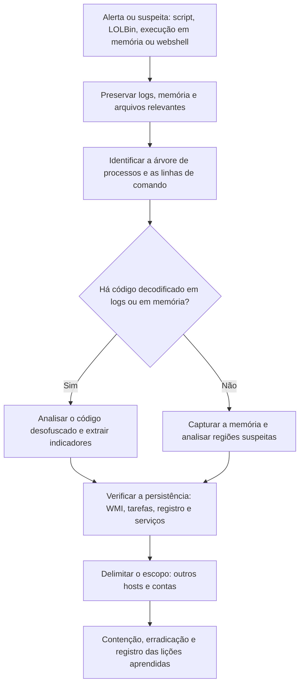

# Scripts, LOLBins, Fileless e Webshells

> **Objetivo pedagógico:** investigar ameaças que dependem de scripts, de binários legítimos do sistema (LOLBins), de execução em memória (fileless) e de webshells, identificando os artefatos, os registros e as decisões de análise, com foco em detecção, preservação e resposta, e não na construção dessas técnicas.

## 1. Por que essas ameaças são diferentes

| Característica | Consequência para a investigação |
|---|---|
| Poucos ou nenhum arquivo executável novo em disco | Antivírus baseado em arquivo detecta pouco; a evidência está em logs, memória e registro |
| Uso de ferramentas legítimas do sistema | Distinguir uso administrativo de abuso exige contexto e linhas de comando |
| Código decodificado e executado em memória | Capturar a memória e os registros de blocos de script |
| Persistência em locais não tradicionais (WMI, tarefas e registro) | Verificar pontos de persistência além de arquivos |
| Webshells em servidores | A evidência está no webroot, nos logs web e nos processos filhos do servidor |

## 2. Scripts e interpretadores

| Interpretador | Registros e artefatos |
|---|---|
| PowerShell | EVTX 4104 (registro de blocos de script), 4103 (registro de módulos), transcrições, histórico do PSReadLine, AMSI; Sysmon 1 com linha de comando |
| Windows Script Host (VBScript e JScript) | Sysmon 1 (`wscript.exe` e `cscript.exe`), arquivos `.vbs`, `.js` e `.wsf` |
| HTA e `mshta.exe` | Linha de comando e arquivos `.hta`, conexões de rede do processo |
| Macros do Office | `olevba`; processo filho do Office (`winword.exe` criando `cmd.exe` ou `powershell.exe`) |
| Bash e Python em Linux | Histórico, `auditd`, tarefas agendadas e arquivos em `/tmp` |
| JavaScript no navegador e em Node | Extensões, pacotes e scripts de instalação |

Práticas de análise de scripts ofuscados: preserve o original; decodifique em camadas com ferramentas como o CyberChef; leia o código sem executá-lo; use o registro de blocos de script (4104), que costuma conter o código já desofuscado; execute somente no laboratório isolado, quando necessário.

## 3. Binários legítimos abusados (LOLBins)

O projeto LOLBAS cataloga binários, scripts e bibliotecas do Windows usados de forma indevida. A tabela resume o que procurar (para detecção e investigação).

| Binário | Uso legítimo | Abuso típico | O que procurar |
|---|---|---|---|
| `powershell.exe` | Administração | Execução de código codificado ou baixado | `-enc`, `-EncodedCommand`, `IEX`, `DownloadString`, processo pai incomum |
| `mshta.exe` | Aplicativos HTA | Execução de código remoto | URL ou arquivo `.hta` na linha de comando |
| `rundll32.exe` | Execução de funções de DLL | Execução de DLL maliciosa | DLL em caminho incomum e funções exportadas incomuns (T1218.011) |
| `regsvr32.exe` | Registro de componentes | Execução remota por scripts | Parâmetros com URL ou `scrobj.dll` (T1218.010) |
| `certutil.exe` | Certificados | Download e decodificação de arquivos | `-urlcache`, `-decode` (T1105 e T1140) |
| `bitsadmin.exe` e BITS | Transferências | Download e persistência | Jobs BITS com URLs externas (T1197) |
| `wmic.exe` e WMI | Administração | Execução remota e persistência | Chamadas de processo e assinaturas permanentes (T1047 e T1546.003) |
| `msbuild.exe`, `installutil.exe` | Compilação e instalação | Execução de código compilado em memória | Arquivos de projeto ou assemblies em locais incomuns (T1127 e T1218) |
| `schtasks.exe` e `at` | Agendamento | Persistência e execução remota | Tarefas novas com comandos incomuns (T1053.005) |
| `cmd.exe` e `wscript.exe` | Shell e scripts | Encadeamento de comandos | Processo pai (Office e navegador) |

Princípio: o uso do binário não é anormal por si só; avalie o **processo pai, a linha de comando, o usuário, o horário e a rede**. Veja as árvores de processos no Sysmon 1 e no EVTX 4688 (com linha de comando habilitada).

## 4. Execução em memória e carregamento lateral

| Técnica | Descrição | Evidência |
|---|---|---|
| Injeção de processos (T1055) | Código executado dentro de outro processo | Sysmon 8 e 10, regiões de memória executáveis e não mapeadas (`malfind`) |
| Carregamento reflexivo (T1620) | Código carregado a partir da memória, sem arquivo correspondente | Regiões executáveis sem arquivo de origem; registros de blocos de script |
| Esvaziamento de processos (T1055.012) | Processo legítimo iniciado suspenso e substituído | Sysmon 25; divergências entre o caminho e o conteúdo mapeado |
| Carregamento lateral de DLL (T1574.002) | Executável legítimo carrega uma DLL maliciosa do mesmo diretório | Sysmon 7: DLL não assinada ou em caminho incomum carregada por executável assinado |
| Assemblies .NET em memória | Carregamento de assemblies sem gravar em disco | Registros de ETW, memória e `.NET` em processos incomuns |

A análise de memória (pasta 09) é a principal ferramenta: `malfind`, listagem de DLLs, linhas de comando e conexões por processo.

## 5. Persistência sem arquivo e em locais não tradicionais

| Mecanismo | Registro e artefato | ATT&CK |
|---|---|---|
| Assinatura permanente de WMI | EVTX Microsoft-Windows-WMI-Activity/Operational (5861); Sysmon 19, 20 e 21; repositório WMI | T1546.003 |
| Tarefa agendada | EVTX 4698; pasta `System32\Tasks` | T1053.005 |
| Chaves de registro de inicialização | `Run`, `RunOnce`, `Winlogon` e `IFEO` | T1547.001 |
| Serviços | EVTX 7045; chave `Services` | T1543.003 |
| Perfil do PowerShell | Arquivos `profile.ps1` | T1546.013 |
| Cron, systemd e `ld.so.preload` (Linux) | Arquivos de configuração e unidades | T1053.003, T1543.002 e T1574.006 |
| Extensões de navegador | Diretórios de extensões e políticas | T1176 |

Veja as pastas 07 e 08 para a coleta desses artefatos.

## 6. Webshells

### 6.1 O que são

Webshells são scripts colocados em servidores web que permitem a execução remota de comandos por requisições HTTP (T1505.003). Costumam surgir após a exploração de uma vulnerabilidade, de um upload inseguro ou de credenciais comprometidas.

### 6.2 Como encontrar

| Abordagem | Procedimento |
|---|---|
| Arquivos novos ou alterados no webroot | Comparar com o repositório de código ou com um backup; analisar datas (ver pasta 05) |
| Caracteres e funções suspeitas | Procurar funções de execução e de decodificação em arquivos de script |
| Logs web | Requisições POST repetidas a um mesmo arquivo recente, parâmetros longos e codificados, user-agents incomuns (ver pasta 11) |
| Processos filhos do servidor web | Processo do servidor criando shells e utilitários (`cmd.exe`, `powershell.exe`, `/bin/sh`) |
| YARA | Regras para famílias e padrões conhecidos |
| Integridade | Verificação de hash dos arquivos do aplicativo contra uma linha de base |

```bash
# Linux: arquivos de script alterados recentemente no webroot
find /var/www -type f \( -name "*.php" -o -name "*.jsp" -o -name "*.aspx" \) -mtime -14 -printf "%TY-%Tm-%Td %TH:%TM  %p\n" | sort

# Funções frequentemente presentes em webshells (indícios, e não prova)
grep -R -n -E "(eval|assert|system|passthru|shell_exec|base64_decode)\s*\(" /var/www/html --include=*.php | head -100
```

```powershell
# Windows (IIS): arquivos de script alterados nos últimos 14 dias
Get-ChildItem C:\inetpub\wwwroot -Recurse -Include *.aspx,*.ashx,*.asp,*.php |
  Where-Object { $_.LastWriteTime -gt (Get-Date).AddDays(-14) } |
  Sort-Object LastWriteTime | Select-Object LastWriteTime, FullName
```

Funções como `eval` e `base64_decode` também aparecem em código legítimo: avalie o contexto e compare com a linha de base.

### 6.3 Preservação e análise

| Passo | Ação |
|---|---|
| Preservar | Copiar o arquivo com metadados e hash; preservar os logs web e do sistema do período |
| Não executar | Analisar o conteúdo em modo de leitura, em ambiente isolado |
| Reconstruir o uso | Requisições ao arquivo nos logs: horários, origens, parâmetros e tamanhos de resposta |
| Delimitar o acesso inicial | Primeira requisição relacionada (upload ou exploração) |
| Verificar o impacto | Processos filhos, contas criadas, arquivos acessados e conexões de saída |
| Procurar outros | Outros arquivos modificados no mesmo período e outros servidores com o mesmo padrão |

## 7. Fluxo de investigação



## 8. Configuração de registros para melhorar a visibilidade

| Controle | Benefício |
|---|---|
| Registro de blocos de script e de módulos do PowerShell | Código desofuscado nos eventos 4104 e 4103 |
| Auditoria de criação de processos com linha de comando (4688) e Sysmon | Árvore de processos e argumentos |
| Registro de WMI e de tarefas | Persistência |
| Centralização de logs e retenção adequada | Evidências preservadas (ver pasta 11) |
| Modo de linguagem restrito e controle de aplicativos | Redução da superfície |
| Logs do servidor web com campos detalhados | Reconstrução de uso de webshells |
| Integridade de arquivos do webroot | Detecção de alterações |

## 9. Exemplo prático: PowerShell codificado com persistência por WMI

| Hora (UTC) | Evidência | Interpretação |
|---|---|---|
| 08:15:02 | Sysmon 1: `winword.exe` inicia `powershell.exe -enc ...` | Macro executando PowerShell (T1059.001) |
| 08:15:03 | EVTX 4104: bloco desofuscado contém o download de um segundo estágio de `hxxps://dominio[.]exemplo/a` | Código e URL obtidos sem executar a amostra |
| 08:15:10 | Sysmon 3: `powershell.exe` conecta ao domínio | C2 e download |
| 08:16:30 | Sysmon 19, 20 e 21 e EVTX 5861: filtro, consumidor e vínculo permanentes de WMI | Persistência por WMI (T1546.003) |
| 08:17:00 | Memória: `malfind` em `powershell.exe` mostra região executável sem arquivo | Execução em memória (T1620) |
| Conclusão | Macro, PowerShell com carga em memória e persistência por WMI; confiança alta; ações: remover a assinatura de WMI, isolar o host, bloquear o domínio, buscar os mesmos IOCs |

## 10. Casos de uso corporativos

- Investigação de intrusões que usam ferramentas legítimas do sistema.
- Caça a webshells em servidores expostos.
- Melhoria de logging e de detecção para scripts e comportamento de LOLBins.

## 11. Normas e frameworks relevantes

- MITRE ATT&CK: T1059, T1218, T1105, T1140, T1197, T1047, T1546.003, T1053, T1055, T1574.002, T1620, T1505.003, T1190
- LOLBAS Project (Living Off The Land Binaries, Scripts and Libraries)
- NIST SP 800-83 Rev. 1; CIS Controls v8.1, controles 8, 10 e 13
- ISO/IEC 27002:2022, controles 8.7 (proteção contra malware) e 8.15

## 12. Referências

- LOLBAS Project. https://lolbas-project.github.io
- Microsoft. Documentação de PowerShell (registro de blocos de script, AMSI e modo de linguagem restrito).
- Ligh, M. H. et al. The Art of Memory Forensics. 2014.
- MITRE ATT&CK. https://attack.mitre.org
- NSA e ASD. Web Shell Threat Hunting and Detection (orientações públicas).
- SANS Institute. FOR508 e FOR610.
