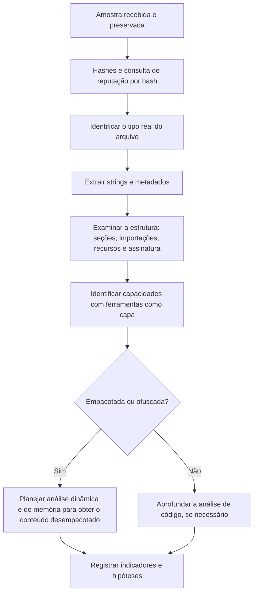

# Triagem e Análise Estática

> **Objetivo pedagógico:** realizar a triagem e a análise estática de amostras (executáveis do Windows e do Linux, scripts, documentos e pacotes) sem executá-las, extraindo propriedades, capacidades e indicadores, reconhecendo empacotamento e ofuscação, e decidindo quando avançar para a análise dinâmica.

Toda a análise deste arquivo é feita na VM de análise (ver o arquivo de laboratório).

## 1. Fluxo de triagem



## 2. Identificação e hashes

| Elemento | Finalidade |
|---|---|
| SHA-256 (e MD5 e SHA-1 por compatibilidade) | Identificação inequívoca e consulta de reputação |
| ssdeep e TLSH | Hashes de similaridade para agrupar variantes (ver pasta 04) |
| Import hash (imphash) | Agrupa binários com as mesmas importações |
| Tipo real do arquivo | Evita ser enganado por extensões |
| Tamanho e entropia | Indícios de compressão ou de criptografia |

```bash
sha256sum amostra.bin
ssdeep amostra.bin
file amostra.bin
exiftool amostra.bin
```

A ferramenta Detect It Easy (DIE) identifica o tipo, o compilador, o empacotador e a entropia por seção.

## 3. Strings

| Tipo | Valor |
|---|---|
| ASCII e Unicode (UTF-16) | Caminhos, nomes de arquivos, domínios, URLs, chaves de registro, comandos e mensagens |
| Strings ofuscadas em pilha ou decodificadas em tempo de execução | Extraídas por ferramentas como FLOSS |
| Importações e nomes de APIs | Capacidades prováveis |
| Artefatos de desenvolvimento | Caminhos de projeto (PDB), idiomas e nomes de usuário |

```bash
# ASCII e UTF-16 (little-endian), com mínimo de 8 caracteres
strings -a -n 8 amostra.bin > strings_ascii.txt
strings -a -el -n 8 amostra.bin > strings_utf16.txt

# FLOSS: extrai strings ofuscadas e decodificadas
floss amostra.bin > floss.txt
```

Strings são indícios, não provas: podem ser iscas, bibliotecas incorporadas ou resíduos.

## 4. Estrutura de executáveis do Windows (PE)

| Elemento | O que observar |
|---|---|
| Cabeçalhos | Arquitetura, subsistema (GUI ou console) e características (DLL ou EXE) |
| Carimbo de data e hora de compilação | Pode ser falsificado ou zerado; use apenas como indício |
| Seções | Nomes incomuns, tamanhos discrepantes (virtual muito maior que o bruto) e entropia alta (acima de cerca de 7) sugerem compressão ou criptografia |
| Importações | Poucas importações (por exemplo, apenas carregamento dinâmico) sugerem empacotamento |
| Exportações | Funções exportadas por DLLs, importantes para carregamento lateral de DLL |
| Recursos | Dados incorporados (executáveis, configurações e ícones) |
| Assinatura digital | Assinada, expirada, revogada ou ausente; certificados roubados |
| Rich header | Informações do ambiente de compilação, úteis para agrupar |
| Sobreposição (overlay) | Dados anexados ao final do arquivo |

```python
# Exemplo de leitura de PE com pefile (use na VM de análise)
import sys
import pefile

pe = pefile.PE(sys.argv[1])
print("Carimbo de compilação (época Unix):", pe.FILE_HEADER.TimeDateStamp)
print("Seções:")
for s in pe.sections:
    nome = s.Name.rstrip(b"\x00").decode(errors="ignore")
    print(f"  {nome:10} VA={hex(s.VirtualAddress)} bruto={s.SizeOfRawData} virtual={s.Misc_VirtualSize} entropia={s.get_entropy():.2f}")
print("Importações:")
for entrada in getattr(pe, "DIRECTORY_ENTRY_IMPORT", []):
    nomes = [i.name.decode() for i in entrada.imports if i.name]
    print(" ", entrada.dll.decode(), nomes[:12])
print("Imphash:", pe.get_imphash())
```

Ferramentas gráficas: PE-bear, PEStudio e CFF Explorer.

### 4.1 Importações e capacidades prováveis

| Grupo de APIs (exemplos) | Capacidade sugerida |
|---|---|
| `VirtualAlloc`, `WriteProcessMemory`, `CreateRemoteThread`, `NtUnmapViewOfSection` | Injeção em processos |
| `RegSetValueEx`, `CreateService`, `ITaskService` | Persistência |
| `InternetOpen`, `WinHttpOpen`, `WSAStartup`, `connect` | Comunicação de rede |
| `CryptEncrypt`, `BCrypt*`, `CryptGenKey` | Criptografia (ransomware ou proteção de comunicação) |
| `IsDebuggerPresent`, `CheckRemoteDebuggerPresent`, `GetTickCount` | Verificações antianálise |
| `CreateToolhelp32Snapshot`, `Process32First` | Enumeração de processos |
| `SetWindowsHookEx`, `GetAsyncKeyState` | Captura de teclas |
| `OpenProcess` com acesso ao LSASS | Roubo de credenciais |

Uma API isolada não prova nada; avalie combinações, contexto e comportamento.

## 5. Capacidades automáticas com capa

A ferramenta `capa` (Mandiant) identifica capacidades de executáveis (por exemplo, "cria serviço", "criptografa dados com AES", "comunica por HTTP") e as mapeia ao ATT&CK.

```bash
capa amostra.exe
capa -vv amostra.exe > capa_detalhado.txt
```

Os resultados são hipóteses baseadas em regras; confirme-as com análise dinâmica ou de código.

## 6. Empacotamento, compressão e ofuscação

| Indício | Interpretação |
|---|---|
| Entropia alta em quase todo o arquivo | Dados comprimidos ou criptografados |
| Poucas importações e strings legíveis | Empacotador ou carregador |
| Nomes de seção de empacotadores conhecidos (por exemplo, UPX) | Empacotamento identificado |
| Ponto de entrada fora da seção de código principal | Empacotamento |
| Recursos grandes com dados de alta entropia | Carga incorporada |
| Binários .NET com nomes ofuscados | Ofuscação de .NET |

Abordagem: identificar o empacotador (DIE) e, quando possível, usar o desempacotador conhecido (por exemplo, `upx -d` para UPX, em cópia da amostra). Para empacotadores personalizados, a forma mais prática é executar a amostra no laboratório e obter o código desempacotado da memória (ver o arquivo de análise dinâmica e a pasta 09).

## 7. Outros formatos

### 7.1 Linux (ELF)

```bash
file amostra.elf
readelf -h amostra.elf          # cabeçalho
readelf -S amostra.elf          # seções
readelf -d amostra.elf          # dependências dinâmicas
strings -a -n 8 amostra.elf | head -200
```

**Não use `ldd` em binários não confiáveis**: ele pode executar o programa. Use `readelf -d` ou `objdump -p`. Em macOS, use `otool -L` e `codesign -dv` com as mesmas precauções.

### 7.2 Scripts (PowerShell, JavaScript, VBS, Python e shell)

| Verificação | Observação |
|---|---|
| Ofuscação | Codificação em Base64, concatenação de strings, caracteres escapados, compressão |
| Decodificação | Ferramentas como o CyberChef permitem decodificar em camadas sem executar |
| Alvos e cargas | URLs, caminhos, comandos e chaves |
| Execução | Não execute o script para "ver o que acontece" fora do laboratório isolado |

### 7.3 Documentos do Office, PDF e arquivos de atalho

```bash
# Office: macros e indicadores
oleid documento.docm
olevba documento.docm
mraptor documento.docm

# PDF: elementos ativos
pdfid.py documento.pdf
pdf-parser.py --search javascript documento.pdf
```

Atalhos (`.lnk`): examine o alvo, os argumentos e os metadados. Arquivos HTML e SVG: procure scripts e blocos codificados (ver pasta 12). Imagens de disco (`.iso` e `.img`) e arquivos compactados: liste o conteúdo sem executar.

### 7.4 .NET, Java e Python compilado

| Formato | Ferramentas |
|---|---|
| .NET | ILSpy, dnSpyEx e dotPeek recuperam código-fonte aproximado |
| Java (JAR) | Descompiladores Java |
| Python empacotado (por exemplo, PyInstaller) | Extratores (como `pyinstxtractor`) e descompiladores de bytecode |

### 7.5 Pacotes de software (npm, PyPI e outros)

Examine scripts de instalação (`postinstall`), dependências recém-adicionadas, domínios e URLs em strings, e diferenças entre versões. Os pacotes devem ser baixados e inspecionados sem instalar nem executar.

## 8. Desmontadores e depuradores

| Ferramenta | Uso |
|---|---|
| Ghidra (código aberto, NSA) | Desmontagem e descompilação |
| IDA e Binary Ninja | Desmontagem e descompilação comerciais |
| radare2 e Cutter | Análise em código aberto |
| x64dbg e WinDbg | Depuração (análise dinâmica) |

Análise de código é o nível 4; use-a para perguntas específicas (algoritmo de criptografia, formato do protocolo e extração de configuração), e não como ponto de partida.

## 9. Regras YARA a partir da análise estática

Exemplo de regra baseada em strings únicas de uma amostra do caso (adapte e teste com amostras legítimas para evitar falsos positivos):

```
rule Exemplo_Amostra_DFL_2026_001
{
    meta:
        description = "Regra de exemplo para uma amostra do caso DFL-2026-001"
        author = "Digital Forensics Lab"
        date = "2026-11-05"
        reference = "DFL-2026-001"
    strings:
        $s1 = "C:\\ProgramData\\svc\\update.log" ascii wide
        $s2 = "Mozilla/5.0 (compatible; Updater/1.0)" ascii
    condition:
        uint16(0) == 0x5A4D and filesize < 2MB and all of ($s*)
}
```

```bash
yara -s regra.yar amostra.bin
```

Veja o arquivo sobre indicadores e YARA para boas práticas de autoria.

## 10. Exemplo prático: triagem de um executável encontrado em servidor

| Passo | Resultado |
|---|---|
| Hashes | SHA-256 sem correspondência em fontes públicas |
| Tipo | PE32+ (64 bits), executável, linguagem C++ |
| Seções | `.text` com entropia 6,1 e `.rsrc` com 7,8 e 480 KB |
| Importações | Conjunto reduzido, incluindo `VirtualAlloc`, `LoadLibraryA`, `GetProcAddress` |
| Strings (FLOSS) | `User-Agent` incomum, caminho `ProgramData\svc` e nome de um domínio |
| capa | "Descriptografa dados com RC4" e "cria processo e injeta código" |
| Interpretação | Possível loader que descriptografa a carga do recurso e a injeta |
| Próximo passo | Análise dinâmica em laboratório e captura de memória para obter a carga desempacotada |

## 11. Casos de uso corporativos

- Triagem rápida de amostras coletadas por EDR durante incidentes.
- Extração de indicadores para bloqueio e caça.
- Produção de regras YARA para varredura do ambiente.

## 12. Normas e frameworks relevantes

- MITRE ATT&CK: T1027 (Ofuscação), T1027.002 (Empacotamento), T1140, T1055, T1620, T1036 (Masquerading), T1553.002 (Assinatura de código)
- MITRE MAEC; NIST SP 800-83 Rev. 1
- ISO/IEC 27042:2015; CIS Controls v8.1, controle 10

## 13. Referências

- Sikorski, M.; Honig, A. Practical Malware Analysis. 2012.
- Kleymenov, A.; Thabet, A. Mastering Malware Analysis. 2. ed. 2022.
- Mandiant (FLARE). capa e FLOSS (documentação).
- VirusTotal. YARA (documentação) e YARA-X.
- Documentação do pefile, do oletools, do pdfid, do Ghidra, do Detect It Easy e do CyberChef.
- SANS Institute. FOR610: Reverse-Engineering Malware.
