# 16 Investigação de Ransomware

## Objetivo

Conduzir a resposta e a investigação forense de incidentes de ransomware: conter o avanço, preservar evidências, identificar a família e as opções de recuperação, reconstruir a intrusão (acesso inicial, credenciais, movimentação lateral, exfiltração e implantação), apoiar decisões de extorsão e notificações legais, e recuperar o ambiente de forma segura, com lições aprendidas e endurecimento.

## Trilha de estudo recomendada

```mermaid
flowchart LR
    A["1. Fundamentos e ecossistema"] --> B["2. Resposta inicial e preservação"]
    B --> C["3. Família e análise da amostra"]
    C --> D["4. Acesso inicial, lateralidade e exfiltração"]
    D --> E["5. Extorsão, pagamento e notificação"]
    E --> F["6. Recuperação e endurecimento"]
    F --> G["7. Ferramentas e checklist"]
    G --> H["8. Casos e erros comuns"]
```

## Conteúdo da pasta

| Ordem | Arquivo | Objetivo |
|---|---|---|
| 1 | [fundamentos-e-ecossistema-do-ransomware.md](fundamentos-e-ecossistema-do-ransomware.md) | Ecossistema, anatomia do ataque, ATT&CK e enquadramento legal |
| 2 | [resposta-inicial-contencao-e-preservacao.md](resposta-inicial-contencao-e-preservacao.md) | Primeiras horas, contenção, preservação e papéis |
| 3 | [identificacao-da-familia-e-analise-da-amostra.md](identificacao-da-familia-e-analise-da-amostra.md) | Família, decifradores, comportamento, ESXi e vias de recuperação |
| 4 | [acesso-inicial-movimentacao-lateral-e-exfiltracao.md](acesso-inicial-movimentacao-lateral-e-exfiltracao.md) | Reconstrução da intrusão, domínio, exfiltração e linha do tempo |
| 5 | [extorsao-pagamento-e-notificacao.md](extorsao-pagamento-e-notificacao.md) | Verificação de alegações, decisão de pagamento e notificações |
| 6 | [recuperacao-erradicacao-e-endurecimento.md](recuperacao-erradicacao-e-endurecimento.md) | Recuperação do AD, backups, erradicação e medidas de endurecimento |
| 7 | [ferramentas-fluxo-modelos-e-checklist-de-ransomware.md](ferramentas-fluxo-modelos-e-checklist-de-ransomware.md) | Ferramentas, modelos de decisão e de notificação e checklist |
| 8 | [casos-de-uso-e-erros-comuns-em-ransomware.md](casos-de-uso-e-erros-comuns-em-ransomware.md) | Sete cenários, erros comuns e exercícios |

## Princípios

- Isolar em vez de apagar, e proteger backups e controladores de domínio nas primeiras horas
- Usar canal de comunicação fora de banda e registrar todas as decisões
- Preservar logs, memória e artefatos prioritários antes de reconstruir
- Investigar a intrusão desde o acesso inicial, e não apenas a criptografia
- Presumir a exfiltração na ausência de evidências em contrário
- Tomar decisões de extorsão com a direção, o Jurídico e especialistas, com triagem de sanções
- Cumprir as notificações nos prazos, independentemente da decisão sobre pagamento
- Erradicar antes de restaurar, validar backups e decifradores em ambiente isolado
- Reconstruir identidade e domínio com redefinição de credenciais, inclusive `krbtgt`
- Fechar o vetor de entrada e endurecer; revisar as lições aprendidas

## Relação com outras pastas

- 02-cadeia-de-custodia e 04-hash-e-integridade: custódia e hash das evidências do incidente
- 05-timeline-analysis: linha do tempo mestra do ataque
- 07-windows-forensics e 08-linux-forensics: artefatos de execução, persistência e credenciais
- 09-memory-forensics: memória, chaves e processos do atacante
- 11-log-analysis e 13-network-forensics: logs de identidade, VPN, proxy e fluxos de exfiltração
- 12-email-forensics e 15-malware-forensics: entrega por phishing e análise de amostras e de ferramentas

## Referências

- CISA; MS-ISAC. #StopRansomware Guide
- NIST IR 8374: Ransomware Risk Management (2022); NIST SP 800-61 Rev. 3 (2025); NIST SP 800-184 (2016); NIST CSF 2.0 (2024)
- MITRE ATT&CK (T1486, T1490, T1489, T1078, T1133, T1003, T1021, T1567, T1562.001, T1484.001)
- ISO/IEC 27035; ISO/IEC 27037:2012; ISO 22301
- Brasil. Lei nº 13.709/2018 (LGPD); Resolução CD/ANPD nº 15/2024; Código Penal, arts. 154-A e 158
- OFAC. Updated Advisory on Potential Sanctions Risks for Facilitating Ransomware Payments (2021)
- No More Ransom Project; ID Ransomware
- Microsoft. Human-operated ransomware attacks: A preventable disaster; Active Directory Forest Recovery Guide
- The DFIR Report; CISA. Cybersecurity Tabletop Exercise Packages (CTEP)
- SANS Institute. FOR508 e SEC504
