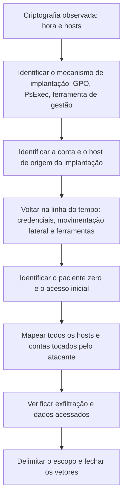

# Acesso Inicial, Movimentação Lateral e Exfiltração

> **Objetivo pedagógico:** reconstruir a intrusão anterior à criptografia (acesso inicial, ferramentas do atacante, comprometimento de credenciais e do domínio, movimentação lateral, desativação de defesas, exfiltração e implantação), identificando as evidências em cada fase e construindo a linha do tempo e o escopo do incidente.

## 1. Estratégia de investigação

A criptografia é o fim do ataque, e não o começo. A investigação deve voltar no tempo até o **primeiro acesso do atacante**, para (a) fechar a porta de entrada, (b) saber o que foi acessado e roubado, (c) encontrar todos os sistemas e contas afetados e (d) garantir que o atacante não permaneça.



## 2. Acesso inicial: evidências por vetor

| Vetor | Evidências | Fontes |
|---|---|---|
| Credenciais válidas em VPN ou portais (sem MFA ou com MFA contornado) | Logins bem-sucedidos de IPs, países e dispositivos incomuns; horários atípicos; falhas seguidas de sucesso | Logs de VPN, do provedor de identidade e do Entra ID (ver pasta 11) |
| RDP exposto | EVTX 4624 (tipo 10 e tipo 3), 1149 (RemoteConnectionManager), 21, 22 e 25 (LocalSessionManager), muitos 4625 antes | Logs do Windows, firewall e Shodan interno |
| Phishing | Mensagem, anexo ou link, execução e carregadores (ver pasta 12) | E-mail, proxy, EDR |
| Exploração de equipamentos de borda e de aplicações expostas | Requisições suspeitas, web shells, processos filhos do servidor, criação de contas | Logs de equipamentos e web, EDR (ver pastas 11 e 15) |
| Provedores de serviços gerenciados e relações de confiança | Uso de ferramentas de gestão remota e de contas de terceiros fora do padrão | Logs do MSP, do RMM e do domínio |
| Credenciais de infostealers e corretores de acesso | Acesso legítimo com credenciais válidas, sem exploração | Inteligência e logs de autenticação |
| Instaladores falsos e anúncios maliciosos | Download e execução por usuários | Proxy, DNS e EDR |

```powershell
# Logons de RDP bem-sucedidos (RemoteConnectionManager), a partir de uma coleta de EVTX
Get-WinEvent -FilterHashtable @{LogName='Microsoft-Windows-TerminalServices-RemoteConnectionManager/Operational'; Id=1149} |
  Select-Object TimeCreated, @{n='Usuario';e={$_.Properties[0].Value}}, @{n='Origem';e={$_.Properties[2].Value}} |
  Sort-Object TimeCreated | Format-Table -AutoSize
```

Para análise em massa de arquivos EVTX, use Hayabusa e Chainsaw (ver pasta 11), com a linha do tempo em UTC.

## 3. Ferramentas e técnicas do atacante (fases anteriores)

| Categoria | Exemplos de ferramentas | Evidências |
|---|---|---|
| Comando e controle | Frameworks de pós-exploração (como Cobalt Strike, Sliver e outros) | Beacons periódicos, processos injetados e pipes nomeados (ver pastas 13 e 15) |
| Acesso remoto legítimo abusado | Ferramentas de gestão remota (AnyDesk, ScreenConnect, Atera, Splashtop, TeamViewer e similares) | Instalações novas, serviços e conexões a domínios de gestão remota |
| Descoberta do Active Directory | AdFind, BloodHound e SharpHound, ADExplorer | Consultas LDAP em massa, arquivos de saída (ZIP e JSON) |
| Credenciais | Ferramentas de extração de credenciais, cópias do LSASS e do `ntds.dit` | Sysmon 10 (acesso ao LSASS), uso de `comsvcs.dll` e de ferramentas de dump, `ntdsutil` e cópias de sombra |
| Movimentação lateral | PsExec, WMI, RDP, SMB, WinRM e tarefas agendadas remotas | Eventos 4624 tipo 3 e 10, 7045, 4698, Sysmon 17 e 18 |
| Evasão de defesas | Desativação do antivírus, remoção de agentes, adulteração de políticas, drivers vulneráveis usados para encerrar o EDR (BYOVD) | Eventos de serviço, alterações de política (`Set-MpPreference`), carregamento de drivers incomuns (Sysmon 6) |
| Exfiltração | Rclone, MEGAsync, WinSCP, FileZilla, 7-Zip e WinRAR | Linhas de comando, arquivos de configuração (`rclone.conf`), volumes de saída |

## 4. Comprometimento de credenciais e do domínio

| Indicador | Evento ou artefato | Observação |
|---|---|---|
| Acesso ao LSASS | Sysmon 10 com acesso ao processo `lsass.exe` por processo incomum | Dump de credenciais (T1003.001) |
| Replicação de diretório (DCSync) | Evento 4662 com os GUIDs `1131f6aa-9c07-11d1-f79f-00c04fc2dcd2` e `1131f6ad-9c07-11d1-f79f-00c04fc2dcd2`, a partir de uma conta ou host que não é um controlador de domínio | T1003.006 |
| Cópia do `ntds.dit` | Uso de `ntdsutil`, cópias de sombra e arquivos `ntds.dit` e `SYSTEM` copiados | T1003.003 |
| Kerberoasting | Eventos 4769 em volume com criptografia RC4 para contas de serviço | T1558.003 |
| Novas contas e privilégios | 4720 (conta criada), 4728, 4732 e 4756 (inclusão em grupos), 4672 | T1136 e T1098 |
| Alterações de GPO | 5136 (alteração de objeto do diretório), 5137 e alterações em SYSVOL | T1484.001 |
| Autenticações anômalas | 4768, 4769, 4776, 4648 (credenciais explícitas) | Contas privilegiadas usadas de hosts incomuns |
| Limpeza de logs | EVTX 1102 e 104 | T1070.001 |

## 5. Movimentação lateral: reconstrução

| Procedimento | Descrição |
|---|---|
| Grafo de autenticações | Mapear contas e hosts: quem se autenticou em quê, a partir de onde e quando |
| Primeira ocorrência de ferramentas | Para cada host, quando o primeiro artefato do atacante surgiu (ver Amcache, Prefetch e Sysmon) |
| Sequência temporal | Ordenar por UTC as primeiras ocorrências para identificar a direção da propagação |
| Contas de serviço e de administradores | Verificar o uso fora do padrão |
| Rede | Conexões SMB, RDP e WinRM internas (ver pasta 13) |

O **paciente zero** é o primeiro sistema comprometido; o **host de implantação** é de onde foi distribuída a criptografia. Eles costumam ser diferentes. Identifique ambos.

## 6. Exfiltração: como investigar

| Pergunta | Fontes e métodos |
|---|---|
| Houve exfiltração? | Fluxos e proxy (volumes de saída), DNS, logs de nuvem, EDR, ferramentas de transferência |
| Para onde? | Domínios e IPs de destino (por exemplo, armazenamento em nuvem e servidores do atacante) |
| O que foi enviado? | Arquivos compactados criados antes do envio (diretórios de preparação, 7-Zip e WinRAR), logs de acesso a arquivos, registros do USN e da MFT |
| Quando? | Primeiro e último horário, picos de volume; correlacionar com acessos aos arquivos |
| Quais contas e hosts? | Logs de autenticação e de EDR |
| Qual o volume? | NetFlow, proxy e logs do provedor |
| O que o atacante afirma ter? | Lista de arquivos e amostras publicadas ou enviadas na negociação; verificar a veracidade |

```bash
# Maiores volumes enviados por origem (Zeek conn.log); veja a pasta 13
zeek-cut id.orig_h id.resp_h orig_bytes < conn.log | awk '$3!="-" {b[$1" "$2]+=$3} END{for(k in b) print b[k], k}' | sort -nr | head -20
```

```powershell
# Procurar arquivos compactados grandes criados em um período, em um servidor de arquivos
Get-ChildItem D:\ -Recurse -Include *.7z,*.zip,*.rar -ErrorAction SilentlyContinue |
  Where-Object { $_.CreationTimeUtc -gt (Get-Date).AddDays(-30).ToUniversalTime() -and $_.Length -gt 500MB } |
  Select-Object CreationTimeUtc, Length, FullName | Sort-Object CreationTimeUtc
```

Os dados roubados são o maior fator de impacto legal e reputacional. Sem evidências de que **não** houve exfiltração, o tratamento prudente é presumi-la e avaliar a classificação dos dados potencialmente expostos.

## 7. Implantação da criptografia

| Mecanismo | Evidências |
|---|---|
| Política de Grupo (GPO) | Nova GPO ou tarefa imediata em SYSVOL; eventos 5136 e 4698 distribuídos; execução simultânea em muitos hosts |
| PsExec e ferramentas similares | Serviço `PSEXESVC` (7045), conexões SMB para `ADMIN$` e processos filhos |
| Ferramentas de gestão (SCCM, RMM e EDR) | Pacotes e tarefas de implantação a partir do console |
| Scripts e tarefas agendadas | Tarefas criadas remotamente (4698) |
| Execução manual em servidores por RDP | Sessões interativas (21 e 25) e processos iniciados por `explorer.exe` |

## 8. Linha do tempo e escopo

| Elemento | Prática |
|---|---|
| Linha do tempo mestra | Todos os eventos em UTC, por fonte, com identificadores (ver pasta 05) |
| Marcos | Primeiro acesso, primeira ferramenta, comprometimento do domínio, desativação de defesas, exfiltração e implantação |
| Tempo de permanência (dwell time) | Primeiro acesso até a criptografia |
| Conjunto de sistemas | Hosts com artefatos do atacante, hosts apenas "tocados" e hosts sem evidência |
| Conjunto de contas | Contas usadas, criadas ou expostas |
| Confiança | Evidência direta versus inferência; declare as lacunas (logs ausentes ou limpos) |

## 9. Exemplo prático: linha do tempo condensada

| Dia e hora (UTC) | Evento | Evidência |
|---|---|---|
| D-11, 03:12 | Login por VPN com a conta de `j.silva`, de IP de hospedagem | Log da VPN; sem MFA configurado |
| D-11, 03:40 | Instalação de ferramenta de acesso remoto na estação do usuário | Sysmon 1 e serviço novo |
| D-10 a D-9 | Descoberta do domínio com ferramenta de enumeração | Consultas LDAP em massa; arquivo ZIP de saída |
| D-7, 22:15 | Acesso ao LSASS no servidor de aplicação | Sysmon 10 |
| D-6, 01:05 | DCSync a partir do servidor de aplicação | EVTX 4662 no controlador de domínio |
| D-4 a D-2 | Movimentação lateral por RDP e SMB a servidores de arquivos e de backup | 4624 tipos 3 e 10; 7045 |
| D-2, 02:30 | Exclusão do catálogo de backup | Logs do servidor de backup |
| D-1, 23:00 a D-0, 01:30 | 380 GB compactados e enviados a armazenamento em nuvem por ferramenta de sincronização | Proxy e linhas de comando |
| D-0, 03:00 | GPO criada e distribuída; criptografia em 214 hosts | 5136; EDR |
| Conclusão | Tempo de permanência de 11 dias; paciente zero: a estação de `j.silva`; vetor: VPN sem MFA; exfiltração confirmada; domínio comprometido |

## 10. Casos de uso corporativos

- Determinação do vetor e do escopo para fechar as brechas e planejar a recuperação.
- Avaliação da exfiltração para as notificações legais.
- Fornecimento de evidências ao seguro, a reguladores e às autoridades.

## 11. Normas e frameworks relevantes

- MITRE ATT&CK: T1078, T1133, T1190, T1566, T1199, T1219, T1003, T1558.003, T1482, T1021, T1047, T1569.002, T1562.001, T1484.001, T1567, T1048, T1560
- NIST SP 800-61 Rev. 3; NIST IR 8374; CISA #StopRansomware Guide
- CIS Controls v8.1, controles 5, 6, 8, 13 e 17
- ISO/IEC 27002:2022, controles 8.15, 8.16 e 8.5

## 12. Referências

- The DFIR Report. Relatórios de intrusões com ransomware (linhas do tempo e ferramentas).
- Microsoft. Human-operated ransomware attacks: A preventable disaster.
- CISA. #StopRansomware: avisos conjuntos por família e por grupo.
- Metcalf, S. Active Directory Security (adsecurity.org): DCSync e persistência no domínio.
- MITRE ATT&CK. https://attack.mitre.org
- SANS Institute. FOR508: Advanced Incident Response, Threat Hunting, and Digital Forensics.
