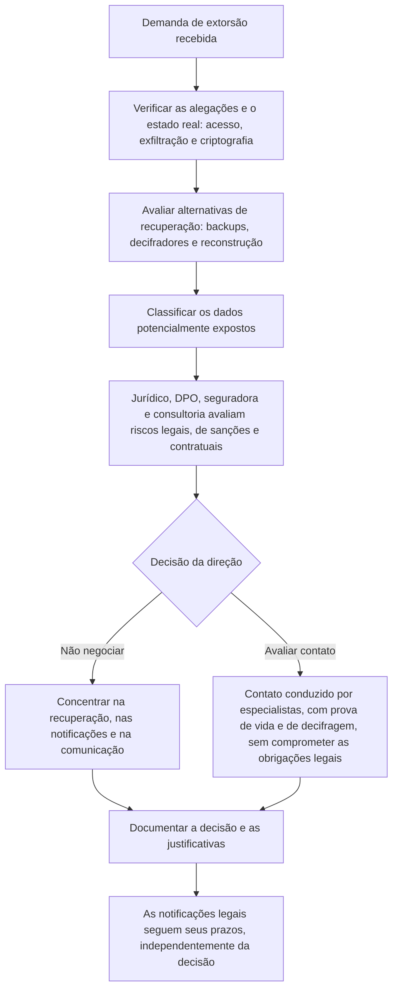

# Extorsão, Pagamento e Notificação

> **Objetivo pedagógico:** estruturar as decisões sobre extorsão e negociação (sem incentivar nem desencorajar o pagamento de forma automática), verificar as alegações do atacante, classificar os dados potencialmente expostos e conduzir as notificações a autoridades, titulares, parceiros e mercado, com base em fatos verificados, em avaliação jurídica e em documentação defensável.

> **Aviso:** este material é técnico-educacional e não substitui parecer jurídico. As decisões sobre pagamento e notificação cabem à direção, ao Jurídico e ao DPO, com apoio especializado.

## 1. Os elementos da extorsão

| Elemento | Descrição |
|---|---|
| Chave de decifragem | Oferecida mediante pagamento |
| Ameaça de publicação | Dados roubados publicados em site de vazamentos ou vendidos |
| Pressão adicional | Prazos, contatos com clientes e imprensa, ataques de negação de serviço |
| Prova de vida e de posse | Amostras de arquivos e listas de diretórios; teste de decifragem de poucos arquivos |
| Canal de negociação | Site Tor ou e-mail, com identificador da vítima |

## 2. Verificação das alegações

| Alegação | Como verificar |
|---|---|
| "Roubamos X GB de dados" | Comparar com os volumes de saída (fluxos, proxy e EDR) e com os arquivos acessados |
| "Temos dados de determinado sistema" | Verificar nas amostras: formato, datas, campos e a correspondência com os sistemas; pode haver dados de fontes diferentes (outros vazamentos) |
| "Temos suas credenciais e o diretório" | Verificar o comprometimento do domínio e das contas |
| "Publicaremos em N dias" | Monitorar o site de vazamentos por meio de serviços especializados |
| "Podemos decifrar tudo" | Validar com o teste de decifragem em ambiente isolado |

Não baixe nem manipule dados vazados por conta própria: isso pode gerar riscos legais e de segurança. Use fornecedores especializados e o Jurídico para tratar esse conteúdo.

## 3. Classificação dos dados potencialmente expostos

| Categoria | Exemplos | Implicação |
|---|---|---|
| Dados pessoais comuns | Nome, CPF, e-mail e endereço | Avaliar o risco e a notificação à ANPD e aos titulares |
| Dados pessoais sensíveis (LGPD, art. 5º, II) | Saúde, biometria, origem racial, religião e dados de crianças e adolescentes | Risco relevante; maior probabilidade de notificação |
| Dados financeiros | Dados bancários e de pagamento | Notificação, regras setoriais e risco de fraude |
| Dados sigilosos e segredos comerciais | Contratos, propriedade intelectual e planos | Risco competitivo e contratual |
| Credenciais | Senhas, chaves e tokens | Redefinição imediata |
| Dados de clientes e de parceiros | Informações de terceiros sob contrato | Notificação contratual |
| Informações privilegiadas e de mercado | Resultados e fusões | Obrigações de companhias abertas |

Use os resultados da investigação (arquivo anterior) para estimar: quais sistemas e repositórios foram acessados, que dados contêm, quantos titulares podem ser afetados e quais períodos.

## 4. Decisão sobre pagamento: estrutura de avaliação

A decisão é da alta direção, com o Jurídico e consultoria especializada. Não existe resposta universal. Considere:

| Fator | Perguntas |
|---|---|
| Legalidade e sanções | O ator ou a carteira estão sujeitos a sanções? (Ex.: alertas do OFAC e de outras autoridades; verificação de listas de sanções antes de qualquer contato financeiro) |
| Alternativas de recuperação | Há backups, decifradores, reconstrução viável e em que prazo? |
| Impacto operacional e humano | Há risco à vida, à saúde ou à segurança? Qual o custo de cada dia de paralisação? |
| Fiabilidade do atacante | A decifragem funciona? Os dados serão realmente apagados? Em geral, **não há garantia** de que os dados sejam destruídos nem de que não serão reutilizados ou vendidos |
| Risco de novos ataques | O pagamento pode sinalizar disposição a pagar e a existência de falhas não corrigidas |
| Obrigações regulatórias e contratuais | O pagamento afeta as notificações, o seguro e os contratos? |
| Seguro | A apólice cobre? Há condições, aprovações e fornecedores exigidos? |
| Aspectos reputacionais e éticos | Política da organização e expectativas de partes interessadas |
| Evidências e orientação das autoridades | Autoridades policiais e CSIRTs desencorajam o pagamento, mas a decisão final é da organização |
| Prazos | Prazos do atacante e prazos legais (notificação não depende do pagamento) |

## 5. Se houver contato com o atacante

| Prática | Observação |
|---|---|
| Contato conduzido por profissionais com experiência (e não por funcionários) | Reduz o risco de erros |
| Comunicação a partir de ambiente isolado | Não usar sistemas da organização |
| Nenhuma informação adicional sobre a organização | Evitar revelar capacidade de pagamento ou detalhes sensíveis |
| Prova de vida e teste de decifragem | Validar a capacidade antes de qualquer decisão |
| Registro integral das comunicações | Parte do dossiê do incidente |
| Triagem de sanções e de conformidade | Antes de qualquer transação |
| Nenhuma promessa | Os atacantes não são fiáveis |
| Autoridades informadas | Conforme a orientação do Jurídico |

Mesmo havendo decifrador, **valide-o em ambiente isolado** antes de usá-lo na produção (um decifrador pode ser lento, defeituoso ou conter código malicioso) e mantenha cópias dos arquivos criptografados originais.

## 6. Notificações: mapa

| Destinatário | Base e momento (verifique a vigência e o caso) |
|---|---|
| ANPD | LGPD, art. 48, e Resolução CD/ANPD nº 15/2024: comunicação em 3 dias úteis a partir do conhecimento de incidente que possa acarretar risco ou dano relevante aos titulares |
| Titulares | Comunicação em prazo adequado, com linguagem clara, sobre natureza dos dados, riscos e medidas |
| Reguladores setoriais | Banco Central (instituições financeiras e de pagamento), SUSEP, ANS, CVM e outros, conforme normas aplicáveis |
| Companhias abertas | Fato relevante, conforme as regras da CVM; nos EUA, o Formulário 8-K item 1.05, em 4 dias úteis após a determinação de materialidade |
| Clientes e parceiros | Obrigações contratuais (prazos e conteúdos) |
| Seguradora | Conforme a apólice (frequentemente imediato) |
| Polícia e CSIRTs | Registro de ocorrência, CERT.br e CTIR Gov (órgãos federais) |
| Autoridades de outras jurisdições | Por exemplo, GDPR, com notificação em 72 horas, quando houver titulares na União Europeia |

### 6.1 Conteúdo mínimo da comunicação à ANPD (referência; confirme a regulamentação)

| Item | Descrição |
|---|---|
| Natureza e categorias de dados | Quais dados e se há dados sensíveis, de crianças ou de idosos |
| Número de titulares afetados | Estimativa e critério |
| Medidas técnicas e de segurança adotadas | Antes e depois do incidente |
| Riscos relacionados | Possíveis consequências para os titulares |
| Motivos da demora (se houver) | Justificativa |
| Medidas de reversão ou mitigação | O que foi ou será feito |
| Controlador e encarregado | Identificação e contato |
| Complementação | Informações adicionais podem ser enviadas depois, quando a apuração avançar |

A comunicação deve ser baseada em fatos **verificados**; quando houver incerteza, declare-a e complemente depois.

## 7. Comunicação com stakeholders

| Público | Princípios |
|---|---|
| Colaboradores | Transparência sobre o que se sabe, instruções e canal de dúvidas |
| Clientes e parceiros | Mensagens factuais, medidas de proteção e contato |
| Imprensa e público | Declaração única e coordenada; sem especulação; porta-voz definido |
| Titulares | Linguagem clara, medidas práticas (troca de senhas e monitoramento) e canais de apoio |
| Conselho e acionistas | Impacto, decisões e prazos |

Evite afirmar que "nenhum dado foi acessado" sem evidências sólidas; use declarações calibradas ("até o momento, a investigação não identificou...").

## 8. Documentação defensável

| Item | Conteúdo |
|---|---|
| Livro de decisões | Cada decisão sobre extorsão, pagamento, notificações e comunicação, com data, decisor e fundamentos |
| Avaliação de riscos | Análise de riscos legais, de sanções e de segurança |
| Evidências do processo | Notificações, protocolos e correspondências |
| Registro das comunicações com o atacante | Integral e preservado |
| Parecer jurídico | Arquivado sob privilégio, quando aplicável |
| Relatório forense | Linha do tempo, escopo e limitações |

## 9. Exemplo prático: decisão e notificações em um caso real simulado

| Elemento | Situação |
|---|---|
| Fatos verificados | 214 hosts criptografados; 380 GB exfiltrados (confirmado por proxy e EDR); dados de clientes e de colaboradores em servidores de arquivos |
| Recuperação | Backups imutáveis do dia anterior para os sistemas críticos; recuperação em 6 dias |
| Classificação | Dados pessoais comuns de 42.000 titulares e dados de saúde ocupacional de 1.800 colaboradores (sensíveis) |
| Decisão da direção | Não negociar o pagamento; foco na recuperação e nas notificações |
| Notificações | ANPD no 3º dia útil; titulares com comunicação individual e por canal de apoio; clientes corporativos conforme os contratos; seguradora e polícia; regulador setorial |
| Monitoramento | Serviço especializado acompanha o site de vazamentos; plano de resposta caso os dados sejam publicados |
| Documentação | Livro de decisões, relatório forense e parecer jurídico preservados |

## 10. Casos de uso corporativos

- Preparação do comitê de crise para decisões de extorsão e de notificação.
- Elaboração de modelos de comunicação à ANPD, a titulares e a clientes.
- Exercícios de simulação com decisões de pagamento e de comunicação.

## 11. Normas e frameworks relevantes

- LGPD, arts. 5º, 6º, 46, 48 e 52; Resolução CD/ANPD nº 15/2024
- Resoluções CMN nº 4.893/2021 e BCB nº 85/2021 (conforme o setor); normas da CVM
- GDPR, arts. 33 e 34; SEC Form 8-K, item 1.05; alertas de sanções do OFAC sobre pagamentos de resgate
- Código Penal, arts. 154-A e 158; ISO/IEC 27035; NIST SP 800-61 Rev. 3
- CISA #StopRansomware Guide

## 12. Referências

- Brasil. Lei nº 13.709/2018 (LGPD); ANPD. Resolução CD/ANPD nº 15/2024 e orientações sobre comunicação de incidentes.
- OFAC (Departamento do Tesouro dos EUA). Updated Advisory on Potential Sanctions Risks for Facilitating Ransomware Payments. 2021.
- CISA; FBI. Orientações sobre pagamento de resgate e notificação.
- U.S. SEC. Cybersecurity Risk Management, Strategy, Governance, and Incident Disclosure. 2023.
- ENISA. Threat Landscape: Ransomware.
- No More Ransom Project. Orientações para vítimas.
